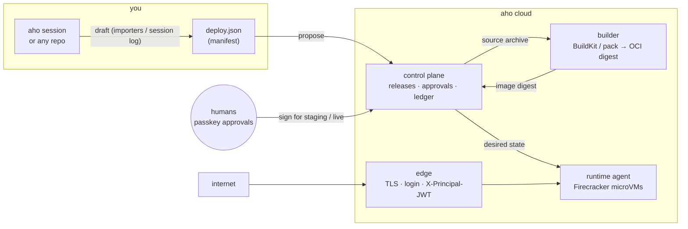
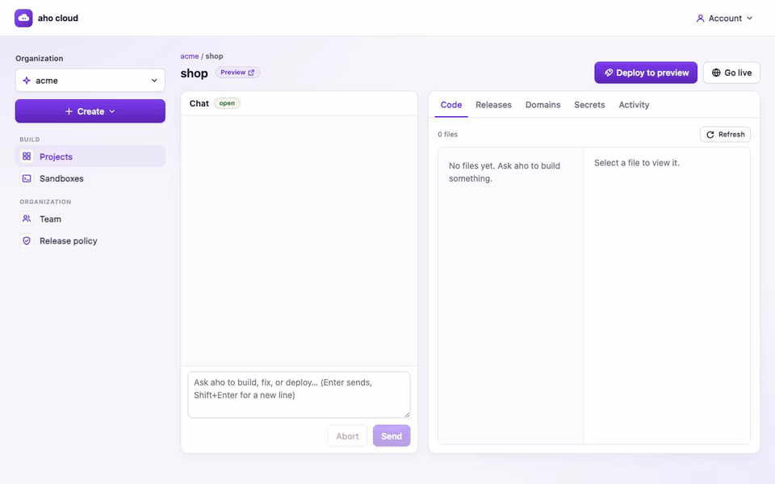
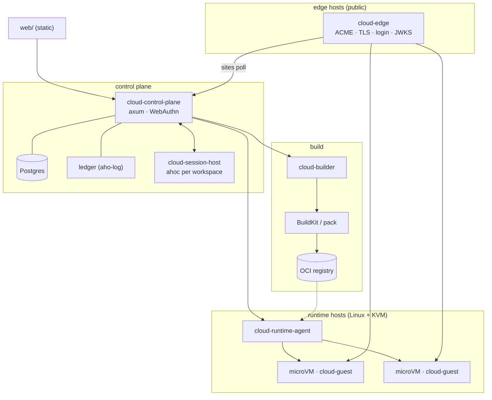

# aho cloud

**Build with [aho](../aho) (or anything else), hand over one document, and it runs under your
domain — built by the cloud, approved by humans, served behind an edge that owns TLS and login.**

The document is the deploy manifest (`deploy.json`, schema `deploy.aho.cloud/v1`). It names the
source, how to build it, the processes and ports, who may open the app, who answers when it breaks
and how much it may cost. Nothing else is needed: no YAML for the proxy, no cert, no dashboard
clicking.

<p align="center">
  
</p>

Above: a directory with a `Dockerfile` becomes a release. `ahocloud deploy` infers the build and
process fields from the repo (every value cites the file and line it came from), asks only what
no file decides (health check, owner, budget), uploads the source archive, and the cloud builds
it. Forty seconds later the preview answers; one signed approval promotes it.

Design and crate map: [docs/architecture.md](docs/architecture.md).

## How it works



A release moves through three stages — **preview → staging → live** — and the rules never bend:

| rule | what it means |
|---|---|
| **The model can propose, never approve.** | Agents and CI append `release_proposed`. Activation at staging and live needs signed human approvals meeting the org's release policy for the *surface diff* against live. Quorums never exceed the org's member count, so a one-person org's owner signs alone. |
| **The cloud rebuilds.** | Local builds are never trusted. The manifest names the source; the builder produces the digest. |
| **Narrowing is free, widening is signed.** | Adding a process, opening a port, loosening auth, raising the budget: each is a *widen* that approvers see on the card. Removing reach needs nobody. Same for rollbacks. |
| **Secrets are names in documents, values only in the store and the runtime.** | A value found in an uploaded session log taints the release until rotated. |
| **Authn at the edge, authz in the app.** | The edge verifies the visitor (password, magic link, OIDC) and forwards `X-Principal-JWT`; apps check it against the project JWKS and decide what that person may do. |

Every proposal, approval, activation and rollback is an entry in the project's hash-chained
ledger (Activity tab, `ahocloud releases`).

## Three ways in

**1. From the console, with aho.** Create a project, chat with aho in its workspace, watch the
Code tab, press **Deploy to preview**. If the workspace has no `deploy.json`, the draft opens in a
confirm screen (fields inferred from the files and the aho session, each with evidence); confirm,
and the release is *attested*: the session log that produced the code is stored with it. **Go
live** adds the domain, shows the DNS records, then asks for one passkey approval per stage.

<p align="center">
  
</p>

**2. From a terminal, with or without aho.** Any directory with a `Dockerfile`, a buildpack-able
repo, or a `deploy.json`:

```sh
ahocloud login                                   # device code + a new Ed25519 key that signs your approvals
ahocloud -p shop deploy                          # draft → confirm → upload → propose; builds, activates at preview
ahocloud -p shop approve <release> --stage staging && ahocloud -p shop promote <release> --stage staging
ahocloud -p shop approve <release> --stage live    && ahocloud -p shop promote <release> --stage live
```

If the directory holds `.aho/sessions/*.jsonl`, `deploy` drafts from the newest session and uploads
it as provenance. `ahocloud manifest init` writes a `deploy.json` from repo files (Dockerfile,
Procfile, compose, `fly.toml`, `render.yaml`, `app.yaml`, `package.json`) without touching the
network; `ahocloud manifest check` runs the gate's rules locally and exits 1 where the cloud would
refuse.

**3. From CI, with no humans in the loop until approval.** Commit `deploy.json`, call
`POST /v1/projects/{p}/releases` with the source archive (crate `api` has the typed client). The
release builds and activates at preview on its own; staging and live wait for the people named
in the release policy. The model, the pipeline and the person who wrote the code all land in the
same queue.

A manifest for the app in the GIF, as `deploy` wrote it:

```json
{
  "api_version": "deploy.aho.cloud/v1",
  "project": "hello",
  "source":  { "kind": "archive", "hash": "blake3:…" },
  "build":   { "kind": "dockerfile", "path": "Dockerfile", "context": "." },
  "processes": [
    { "name": "web", "command": ["node", "server.js"], "port": 3000, "expose": "public",
      "health": { "kind": "http", "path": "/healthz" } }
  ],
  "domains": [], "auth": { "mode": "none" }, "secrets": [], "egress": [],
  "data_class": "none",
  "owner":  { "name": "Demo", "email": "demo@example.com" },
  "budget": { "ceiling_usd_month": 20, "degrade": "sleep" }
}
```

Published JSON Schema: [schema/manifest.v1.json](schema/manifest.v1.json).

## Working with it day to day

- **Domains** — `ahocloud domains add shop.example.com` prints the TXT and CNAME records; the
  edge issues the certificate once they verify, and a removed domain gets a grace period and a
  tombstone page instead of a stranger's app.
- **Secrets** — `printf %s "$KEY" | ahocloud secrets set STRIPE_KEY --stage live`: values come
  from stdin, never from arguments. Manifests list names; the runtime injects values; nothing is
  ever echoed back.
- **Rollback** — `ahocloud rollback <release>` makes an earlier release live again. Free when it
  fits inside the current surface, signed when it widens it.
- **Standing orders** — `ahocloud standing-orders grant --restart --scale 1:3 --maintenance-page
  --rollback-within-ceiling --ttl 7d` pre-approves bounded on-call actions, signed with your
  device key. On-call — human or agent — acts without asking until the grant expires; every use
  is in the ledger.
- **Sandboxes** — a VM with aho and common toolchains and one persistent disk at `/workspace`,
  for coding without deploying. `ahocloud sandbox create dev && ahocloud ssh dev -- aho`, or the
  console's Terminal, Chat and Files tabs. The model key is a sandbox env var; egress is an
  allowlist (model providers, package registries, GitHub by default); the VM auto-stops.
- **Previews and staging** admit only org members (email link); live admits whoever `auth` says.
- **Budget** — `budget.ceiling_usd_month` with `degrade: sleep`: at the ceiling every process
  stops and the edge serves a "paused" page until the owner raises it.

## Deploying aho cloud itself

Everything is one Cargo workspace, five long-running binaries and a React console. Tests run
against in-process fakes; production hosts need the real programs below.



| component | needs |
|---|---|
| `cloud-control-plane` | Postgres (`--ephemeral` keeps everything in memory for development); WebAuthn RP id and origin of the console |
| `cloud-builder` | `git`, `buildctl` (BuildKit), `pack`, an OCI registry |
| `cloud-runtime-agent` | Linux + KVM, `firecracker`, a kernel image, `skopeo`, `umoci`, `mkfs.ext4`, `ip`, `nft`, cgroup v2 — or `--backend docker` for development (containers, no isolation, no egress enforcement) |
| `cloud-edge` | an ACME CA (Let's Encrypt), SMTP for magic links, OIDC client ids |
| `cloud-session-host` | `ahoc` (from `bundle-cloud`) and aho's VM world prerequisites; `--runtime-url` for sandboxes |
| sandbox image | Docker with buildx to build `images/sandbox` (passed to the control plane as `--sandbox-image`) |

Shapes that fit:

- **One box to try it** — all five binaries, Postgres and a registry on a single Linux host with
  KVM; the edge on :443, the console as static files behind it.
- **Split by trust** — the edge alone on public hosts; the control plane, builder and registry on
  a private network; runtime hosts scale horizontally, each running one `cloud-runtime-agent`.
  The internet needs to reach the edge, the control plane's API and the session host's
  WebSocket (the console talks to the last two directly).
- **Builders hold nothing worth backing up** — the manifest's source hash and the image digest
  are the contract; the registry, Postgres and the ledger are the state.
- **Firecracker is the intended isolation boundary**; it compiles for Linux and the shared exec
  server is tested, but only the Docker backend has run end to end so far
  ([docs/architecture.md → Not built](docs/architecture.md#not-built)).

## Run locally

```sh
scripts/dev.sh                 # control plane :8080 · session host :8790 · console http://localhost:5173
scripts/dev.sh --with-deploy   # + BuildKit, registry, builder, runtime (Docker), edge :8443, mail catcher, sandboxes
scripts/dev.sh --down          # remove the deploy containers (registry and BuildKit volumes stay)
```

Env: `CP_PORT`, `SH_PORT`, `WEB_PORT`, `EDGE_PORT`, `REGISTRY_PORT` move the ports;
`SANDBOX_IMAGE=aho.sandbox@sha256:…` reuses a sandbox image already in the local registry
instead of rebuilding it; `AHO_CLOUD_DEV_DIR` moves the state (default `.dev/`).

Both modes run the control plane in memory (accounts vanish on restart), the session host with
`ahoc` per workspace in aho's host world (forced with `--set seams.world=host`, whatever
`~/.aho/config.toml` says: the Code tab and deploys read the workspace directory on this machine;
the host world is policy-only, not a sandbox), and the console. Open the console at `localhost`,
not `127.0.0.1`: it is the WebAuthn origin for passkeys.

Without `--with-deploy`, releases stop at `build failed`; passkey accounts, orgs, projects, domains
and their DNS records, secrets, manifests, the approval card and workspaces all work.

With `--with-deploy` (needs Docker: OrbStack, Docker Desktop or colima; first start pulls
`registry:2`, `moby/buildkit` and `axllent/mailpit` and downloads a checksummed `buildctl` into the
state dir), releases are built by BuildKit into `localhost:5055`, run as containers, and served at
`http://<project>.preview.localhost:8443`. The same mode builds the sandbox image
(`scripts/build-sandbox-image.sh`; the first build compiles aho for Linux in Docker, a few minutes)
and pushes it to the local registry. Buildpack builds need `pack`, which the script does not
install. Prompts in a workspace use your aho provider login (`~/.aho`) and spend its credits.

From the console:

1. Create an organization (sidebar), then **Create → New project**.
2. In the project, chat with aho; the **Code** tab shows the workspace files as a deploy would ship
   them.
3. **Deploy to preview** packs the workspace files. With a `deploy.json` it proposes right away;
   without one it shows a draft from the files and the aho session: confirm the inferred fields and
   answer what nothing in the code decides. Preview activates once built; with the email-link
   login, the link lands in the mail catcher at <http://localhost:8025>.
4. **Go live** adds or picks a domain, re-proposes the preview's source with that domain if its
   manifest lacks it, then asks for passkey approvals for staging and live. Locally the domain
   cannot verify, so live stays "waiting for DNS".

From a terminal, the GIF at the top, verbatim:

```sh
export AHOCLOUD_API_URL=http://127.0.0.1:8080
ahocloud login                                   # approve the code at http://localhost:5173/device
ahocloud -p hello deploy --accept-inferred       # answers: /healthz · auth none · owner · budget
ahocloud -p hello releases
curl http://hello.preview.localhost:8443/
ahocloud -p hello approve <release> --stage staging && ahocloud -p hello promote <release> --stage staging
```

Sandboxes locally: **Create → New sandbox** in the console, or `ahocloud sandbox create <slug>`
then `ahocloud ssh <slug>`. Containers stand in for microVMs; disks are Docker volumes named
`aho-cloud-sandbox.<slug>`, and the in-memory control plane forgets sandboxes on restart, so remove
leftovers with `docker volume rm`.

## Layout

```
crates/contract        manifest, validation, surface diff, policy, edge.toml, principal claims (no aho, no I/O)
crates/api             control-plane routes + bodies, internal service bodies, typed client, exec frames
crates/ledger          per-project release ledger on aho-log
crates/control-plane   the API server                         bin: cloud-control-plane
crates/builder         source → OCI image (BuildKit, pack)    bin: cloud-builder
crates/runtime-agent   Firecracker microVMs, sandboxes, egress proxy  bins: cloud-runtime-agent, cloud-guest
crates/domains         domain bindings, DNS, ACME, certs, RDAP
crates/edge            TLS reverse proxy, edge login, JWT     bin: cloud-edge
crates/session-host    browser ↔ aho rpc, workspace files, sandbox terminals  bin: cloud-session-host
crates/draft           aho session log → manifest draft
crates/importers       Dockerfile/Procfile/compose/fly/render/app.yaml/package.json → draft
crates/workdir         project dir → source archive, file tree, session log, draft (CLI + session host)
crates/cap-deploy      aho capability: cloud_draft, cloud_propose
crates/cap-edge-contract  aho capability: edge contract prompt, edge_routes, edge_verifier
crates/bundle-cloud    aho-lab + the caps                     bin: ahoc
crates/ahocloud        customer CLI                           bin: ahocloud
web/                   React console                          (web/README.md)
packages/ui/           @aho/ui: shared components, transcript, code view, terminal
images/sandbox/        the sandbox VM image (Debian, toolchains, aho, cloud-guest)
schema/manifest.v1.json  published JSON Schema (generated)
mage/                  ahomage: a separate product in this tree (ticket triage → repro → fix → PR); see mage/README.md
```

aho itself is a path dependency (`../aho`) and is never modified: cloud features are capability
crates composed in `bundle-cloud`.

## Commands

```sh
cargo test --workspace                              # all Rust tests
cargo clippy --workspace --all-targets -- -D warnings
cargo fmt --all --check
UPDATE_GENERATED=1 cargo test -p cloud-contract -p cloud-api   # rewrite web/src/gen/*.ts + schema
cd web && npm install && npx tsc --noEmit && npx vitest run && npx vite build
```

`PgStore` tests run only with `DATABASE_URL` set; without it they print a skip reason.
