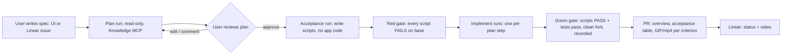

# Mage Build — extension (second system)

Status: proposal. Nothing here changes the base docs ([../../design.md](../../design.md),
[../../internals/](../../internals/README.md)); where Build needs something from the base, it is
listed under [Extension points](#extension-points-the-base-must-expose) as a proposed change.

| Doc | Content |
|---|---|
| README.md (this) | What Build is, how it sits next to Mage, crates, reuse map, extension points, phases |
| [domain.md](domain.md) | Spec, Plan, Build, acceptance criteria, state machines, proof tokens |
| [flow.md](flow.md) | Use cases end to end: spec → plan → approval → acceptance-first → implement → gate → PR |

## What it is

Mage (support) starts from a **bug**: triage → diagnose → fix. Build starts from a **feature
request**:



The approved plan is the contract. Its **acceptance criteria** are what the user signs off on, and
the gates prove them: each criterion's script must fail before the change (it tests something new)
and pass after it, in a clean fork, with the scripts frozen between the two gates.

## Relationship to Mage

Build is a **separate product** on the **same platform**:

| Shared platform (from base Mage) | Support product (base) | Build product (this extension) |
|---|---|---|
| Knowledge (indexer, Knowledge MCP), runners + runner protocol, harness adapters, executor, Playwright, model gateway, auth/tokens, artifacts, jobs, GitHub/Linear/Slack clients, UI shell | Tickets, triage, causes, diagnose, fix brief, fix, PR from `FixGatePassed` | Specs, plans, approvals, acceptance scripts, implement steps, PR from `AcceptanceGatePassed` |

Build never reads or writes support data (tickets, causes), and support never reads Build data.
That is what keeps Build removable or deployable on its own.

## Crates

Following the base rules (every crate ports and adapters, role/product crates never depend on each
other):

```
aho-cloud/mage/crates/
  mage-build-core/   pure: Build domain (Spec, Plan, Build, AcceptanceCriterion, gates, proof
                     tokens), wire DTOs for submit_plan / submit_acceptance / submit_step
                     (ts-rs derives), Build-only shared ports. Depends on mage-core.
  mage-build/        Build product hexagon (server side):
                     src/{domain,ports,app,adapters/{driving,driven},testing,compose.rs}
                     app: spec, plan, approval, acceptance, implement, ship
                     driving: HTTP routes /api/v1/build/*, job handlers build.*
                     driven: pg stores for build tables
                     Depends on mage-core, mage-build-core, mage-infra.
aho-cloud/mage/web-build/
                     React package (spec editor, plan review/diff/approve, build view) on
                     packages/ui; mounted by mage/web-app and the aho-cloud console like
                     mage/web (see ../../internals/deployment.md). Plan approval can reuse the
                     console's ApprovalCard (passkey signing) in aho-cloud mode.
```

`mage-app` composes it: `mage start server --products support,build` (default `support`). The
runner needs no Build crate if the base exposes generic run profiles (E1) and generic verify
specs (E2); otherwise `mage-runner` gains a `build` cargo feature.

## Reuse map

| Need | Reused as-is | New in Build |
|---|---|---|
| Spec intake | Linear webhook verification, inbox, `notify.*` idempotency (intake.md) | `Spec` aggregate; label/team routing to Build instead of support |
| Codebase knowledge | Indexer, all Knowledge MCP tools, evidence gate (citations exist at sha) | — |
| Plan | Read-only harness run shape (like Triage: Knowledge MCP + one submit tool) | `submit_plan` schema, plan versions, review/approval |
| Acceptance scripts | Run MCP `write`/`exec`/`playwright_run`, Playwright recording | Acceptance run kind, script freezing, red gate |
| Implementation | Fix run machinery: workspace RW, `diff_against_base`, `PatchPolicy`, `SecretScanner`, gate feedback loop | Implement run per plan step, step chaining (fork from previous step's patch) |
| Verification | Verify runs on fresh forks, `apply_patch`, `rebuild`, recipe test command | `VerifySpec` for "scripts must fail" / "scripts must pass" (E2) |
| PR | `PullRequests` Git Data API flow, branch naming, media upload (GIF/mp4), Linear `upload_file` | `CommitPlan` from `AcceptanceGatePassed` (E3), overview generator, acceptance table |
| Budgets, cancel, steer, SSE | Run manager as-is | Per-build budget across all its runs |

## Extension points the base must expose

Proposed changes to base Mage, **not applied**. Each is small and keeps support behavior identical.

| # | Base today | Proposed | Why Build needs it |
|---|---|---|---|
| E0 | Run manager hardcodes support outcomes (`runs.apply_outcome` dispatches on `RunKind`, runs.md) | A `Product` registry: each product registers its run kinds, submit handlers, gate evaluators, outcome appliers, job handlers, routes, UI pages (sketch below) | Build adds run kinds without editing support code |
| E1 | `RunKind` is a closed enum in `mage_core::domain`; Run MCP tools via `ToolSet::for_kind(kind)` (executor.md) | `RunAssignment` carries a `RunProfile { tools, workspace, submit: SubmitToolDef { name, json_schema } }`; the runner serves whatever the profile lists | Runner stays product-agnostic; Build ships no runner code |
| E2 | `VerifySpec = Boot \| Repro \| Fix \| TestBaseline` (runs.md, fix.md) | Add a generic `VerifySpec::Scripts { patch: Option<ArtifactId>, scripts: Vec<ScriptRef>, expect: Fail \| Pass, tests: bool, repetitions }` | Red gate (expect Fail on base) and green gate (expect Pass with patch) |
| E3 | `CommitPlan::build(&FixGatePassed, …)` (fix.md) | `CommitPlan::build(&impl Shippable, …)` with a sealed `Shippable` trait in `mage_core::domain`, implemented by `FixGatePassed` and Build's `AcceptanceGatePassed` (via a `mage-core` hook the build-core crate can implement) | Same "no PR without a gate" guarantee for Build |
| E4 | `PullRequests`, `TicketTracker`, `ChatNotifier` ports live in `mage_server::ports` | Move these ports to `mage_core::ports` and their adapters to `mage_infra` | `mage-build` can't depend on `mage-server` |
| E5 | Knowledge query use case lives in `mage_server::app::knowledge_query` | Move it to a `mage-knowledge` library crate (query + MCP adapter), composed by the server | Build plan runs use the same Knowledge MCP |
| E6 | `RunSubject` variants tied to support (`Ticket`, `Cause`) | `RunSubject::Product { product: ProductId, subject: String }` | Build runs reference builds/steps without new base variants |

`Product` sketch (lives in the platform, base E0):

```rust
#[async_trait]
pub trait Product: Send + Sync {
    fn id(&self) -> ProductId;                       // "support", "build"
    fn run_kinds(&self) -> Vec<RunKindDef>;          // name, RunProfile, harness defaults, budget defaults, gate kinds
    async fn on_submit(&self, run: &Run, submission: serde_json::Value) -> Result<SubmitDecision, AppError>;
    async fn on_gate(&self, gate: &Gate, verify: &VerifyResult) -> Result<GateDecision, AppError>;
    async fn apply_outcome(&self, run: &Run) -> Result<(), AppError>;
    fn job_handlers(&self) -> Vec<JobHandlerDef>;    // kinds prefixed by product id: "build.*"
}
```

Routes and UI pages register through the driving adapters (`mage-http` router merge, UI nav
entries), not through this trait, to keep it free of axum/React types.

If the base is **not** changed, Build can still be built by adding variants to the base enums
(`RunKind::Plan | Acceptance | Implement`, `VerifySpec::Scripts`) and a second `CommitPlan`
constructor. That works but couples the two products; prefer E0–E6.

## Deployment options

| Option | What | When |
|---|---|---|
| **Same platform** (recommended) | One `mage` binary, `--products support,build`; shared runners, knowledge, gateway, auth, UI shell | Start here; least to build and operate |
| **Separate deployment** | Build runs its own server instances (`--products build`) against the same Postgres schema family and runner pool, or its own | When Build needs separate scaling, billing, or a separate brand |

Both need E0–E6; the second needs nothing more, because Build never touches support data.

## Phases

| Phase | Deliverable |
|---|---|
| B0 | Base extension points E0–E6 (no behavior change for support) |
| B1 | Spec + Plan + review/approve (read-only; useful alone as "Mage plans the feature") |
| B2 | Acceptance run + red gate (scripts frozen, failing on base) |
| B3 | Implement (single step) + green gate + patch download |
| B4 | PR with overview, acceptance table, GIF/mp4; Linear video |
| B5 | Multi-step implement with step chaining; recipe updates mid-build |

## Open questions

1. Name of the product (Build / Forge / …) and whether it shares the `mage` brand.
2. Spec source: Mage UI only, Linear only (label), or both.
3. Who can approve a plan (role), and whether approval is required per plan version or per build.
4. Backend-only features: acceptance via API scripts is fine, but the "video" is a request timeline,
   not a screen recording — acceptable for the PR?
5. Whether E0–E6 land in the base before Build starts (recommended) or Build starts on enum
   variants and migrates later.
