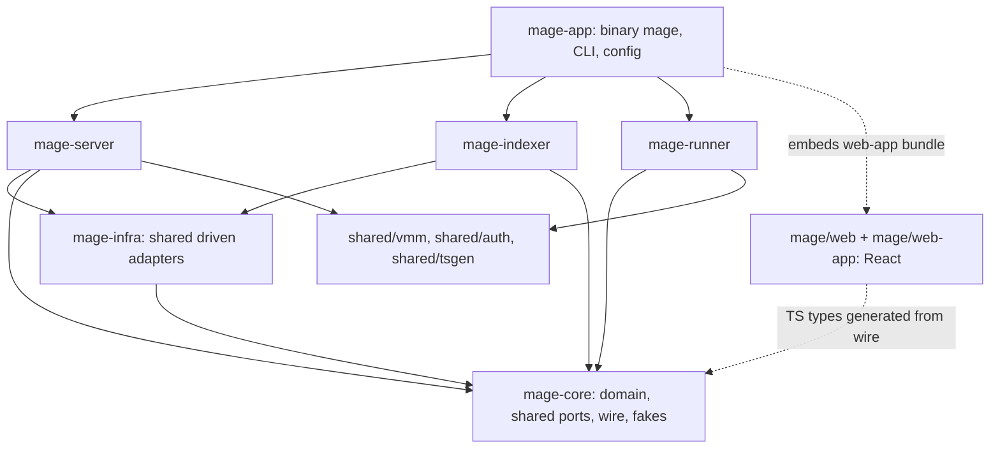

# ahomage internals

How each part of Mage is built, using **ports and adapters** (hexagonal architecture). The product
design and decisions live in [../design.md](../design.md); this folder describes the code.

| Doc | Part |
|---|---|
| [domain.md](domain.md) | Entities, value objects, state machines, invariants |
| [storage.md](storage.md) | Postgres schema, jobs queue, blob layout, tenancy, encryption |
| [intake.md](intake.md) | GitHub / Linear / Slack webhooks, ticket normalization, outbound comments |
| [knowledge.md](knowledge.md) | Indexer pipeline, layers, Knowledge MCP query semantics |
| [triage.md](triage.md) | Triage use case, evidence gate |
| [runs.md](runs.md) | Run manager, gates, runner ↔ server protocol |
| [harness.md](harness.md) | Harness port, omp and Claude Code adapters |
| [executor.md](executor.md) | Executor port, host adapter, recipe, Run MCP, Playwright |
| [fix.md](fix.md) | Fix brief, fix runs, fix gate, pull requests |
| [server.md](server.md) | HTTP surface, auth, UI, model gateway, secrets, tokens |
| [deployment.md](deployment.md) | Code location (`aho-cloud/mage/`), shared crates, self-host vs aho-cloud modes, adapter matrix, frontend packages, distribution |

## Crates

Every crate follows ports and adapters. Shared, pure types live in `mage-core`; shared I/O
adapters live in `mage-infra`; each role is its own hexagon; `mage-app` is the one binary. The
crates live in `aho-cloud/mage/crates/` and may use `aho-cloud/shared/*` (no product logic), never
aho-cloud product crates ([deployment.md](deployment.md)).



| Crate / package | What it is | Depends on |
|---|---|---|
| `mage-core` | **Pure, no I/O.** `domain` (see [domain.md](domain.md); includes recipe parsing/validation/hashing and fix types), `ports` (only ports used by more than one role), `wire` (runner ↔ server, indexer API, UI API DTOs with ts-rs derives, signed-token format), `testing` (fakes for core ports, feature `testing`) | serde, thiserror, time, uuid, sha2, toml, ed25519-dalek, async-trait, ts-rs |
| `mage-infra` | Shared **driven** adapters implementing `mage-core` ports: `pg` (pool, all migrations, `JobQueue`, `RepoStore`, `KnowledgeStore`), `blob` (`ArtifactStore` + signed URLs via `object_store`), `github` (GitHub App client + `SourceHost`), `telemetry`, `config` helpers | `mage-core`, sqlx, object_store, reqwest, tracing |
| `mage-server` | Server role hexagon; serves the web-app bundle it is given | `mage-core`, `mage-infra`, `shared/auth` |
| `mage-indexer` | Indexer role hexagon | `mage-core`, `mage-infra` |
| `mage-runner` | Runner role hexagon | `mage-core`, `shared/vmm` (v2 `exec_vm`) — the runner holds no DB, blob, or vault credentials |
| `mage/web` | React package: Mage pages, API client, generated types (`src/gen/mage.ts`) | `packages/ui` |
| `mage/web-app` | Standalone React shell for self-host (login, org switcher, nav) | `packages/ui`, `mage/web` |
| `mage-app` | Binary `mage`: `mage start server \| indexer \| runner \| all` (`all` = local dev only, every role as tokio tasks in one process), plus operator commands (`mage migrate`, `mage jobs dead …`, `mage knowledge eval`, `mage eval triage …`). Features `selfhost` (default) and `ahocloud`. Loads config, embeds the `mage/web-app` bundle, calls `mage_server::run`, `mage_indexer::run`, `mage_runner::run` | everything above |

Rules:
- **Role crates never depend on each other.** Anything two roles share goes to `mage-core`
  (types, port traits) or `mage-infra` (adapter implementations).
- `mage-infra` never depends on a role crate, so it can only implement `mage-core` ports. A role
  that needs a role-specific port on top of a shared client (e.g. `PullRequests` on the GitHub
  client) implements it in its own `adapters::driven` module.
- Enforce with a layer test reading `cargo metadata` (same idea as aho's
  `scripts/ratchets/layers.json`): a new crate edge fails until the baseline is updated.

## Inside a role crate

```
mage-<role>/src/
  lib.rs              pub struct Config; pub async fn run(Config, Shutdown) -> Result<(), RunError>
  compose.rs          composition root: build adapters, wire Arc<dyn Port>, start driving adapters
  domain/             role-only rules (most rules live in mage_core::domain)
  ports/              role-only driven port traits
  app/                use cases (one module per part)
  adapters/
    driving/          inbound: http, mcp, job worker, lease loop
    driven/           outbound: implementations of ports
  testing/            fakes for role ports (cfg(test) or feature `testing`)
```

Dependency direction inside the crate: `adapters → app → ports/domain`. `app/` and `domain/`
never import `crate::adapters`; a test scans `src/app/**` and `src/domain/**` for `crate::adapters`
and fails on a hit (cargo can't enforce module edges).

| Role crate | Use cases (`app/`) | Driving adapters | Driven adapters |
|---|---|---|---|
| `mage-server` | `intake`, `triage`, `runs`, `fix`, `knowledge_query`, `gateway` | `http` (axum: `/api`, `/hooks`, `/runner`, `/llm`, SSE), `mcp` (Knowledge MCP, rmcp), `worker` (jobs) | `pg` (server-only stores), `linear`, `slack`, `vault`, `llm_upstream`, `github` (`PullRequests`, `DeploymentResolver` on `mage_infra::github`), `identity` (`github_oauth`, `google_oidc`; `edge_jwt` with feature `ahocloud`), `ahocloud` (feature: `ahocloud_orgs`, `ahocloud_ledger`, `ahocloud_edge`) |
| `mage-indexer` | `index` (pipeline per commit) | `worker` (jobs), `search_api` (internal text-search endpoint) | `git` (gix), `treesitter`, `scip`, `search` (ripgrep libs) |
| `mage-runner` | `runner` (lease, execute, verify) | `lease_loop`, `mcp` (Run MCP, rmcp) | `link` (HTTP client to server), `harness_omp`, `harness_claude`, `exec_host` (v1), `exec_vm` (v2, `shared/vmm` Firecracker / Docker backend), `exec_ahocloud` (feature `ahocloud`), `playwright`, `runner_state` (SQLite) |

## Port conventions

- Shared ports: `mage_core::ports::<area>`. Role ports: `mage_<role>::ports::<area>`. One trait
  per responsibility.
- Async ports use `#[async_trait]`, are `Send + Sync`, and are held as `Arc<dyn Port>`.
- Every store method takes `OrgId` explicitly. No ambient tenant.
- Each port has its own error enum (`thiserror`) with at least `NotFound`, `Conflict`,
  `Invalid(String)`, `Unavailable(String)`. Use cases map to the role's `AppError`; driving
  adapters map `AppError` to HTTP/MCP errors. `anyhow` only in `mage-app`.
- Time comes from a `Clock` port; IDs from an `IdGen` port. Both have deterministic fakes.
- Every port has an in-memory fake (`mage_core::testing` or `mage_<role>::testing`).

## Port catalog

| Port | Defined in | Methods (summary) | Used by | Adapter |
|---|---|---|---|---|
| `Clock`, `IdGen` | `mage-core` | now, new ids | all | `mage_core` system impls |
| `JobQueue` | `mage-core` | enqueue (dedupe key), lease, complete, fail/retry | server, indexer | `mage_infra::pg` |
| `RepoStore` | `mage-core` | repos, repo versions, layer status, recipes, deployments | server, indexer | `mage_infra::pg` |
| `KnowledgeStore` | `mage-core` | write/read layer facts (manifests, symbols, refs, error sites, app graph, history, chunks, summaries) | indexer (write), server (read) | `mage_infra::pg` |
| `ArtifactStore` | `mage-core` | put/get bytes by key, signed upload/download URLs | server, indexer | `mage_infra::blob` |
| `SourceHost` | `mage-core` | installations, repo metadata, installation tokens, fetch URL | server, indexer | `mage_infra::github` |
| `OrgStore` | `mage-server` | orgs, members, integrations | server | `adapters::driven::pg` |
| `OrgDirectory` | `mage-server` | org/member/role view used for authz | server | `pg` (self-host), `ahocloud_orgs` (aho-cloud) — [deployment.md](deployment.md) |
| `PreviewHost` | `mage-server` | open/extend/close a live repro link | server | `runner_proxy` (self-host), `ahocloud_edge` — [deployment.md](deployment.md) |
| `TicketStore` | `mage-server` | tickets, causes, fix briefs, resolutions | server | `adapters::driven::pg` |
| `RunStore` | `mage-server` | runs, run events, gates, leases, artifact metadata | server | `adapters::driven::pg` |
| `WebhookInbox`, `OutboundLog`, `TokenStore`, `SecretStore`, `RunSignals` | `mage-server` | see storage.md, intake.md, runs.md, server.md | server | `adapters::driven::pg` |
| `SecretVault` | `mage-server` | encrypt/decrypt tenant secrets (model keys, integration tokens) | server | `adapters::driven::vault` |
| `DeploymentResolver` | `mage-server` | deployed sha for (repo, environment/customer) | server | `adapters::driven::github`, `adapters::driven::pg` (manual mapping), `ahocloud_ledger` (feature `ahocloud`) |
| `PullRequests` | `mage-server` | create branch + commit from patch, open PR | server | `adapters::driven::github` |
| `TicketTracker` | `mage-server` | get issue, comment, attach link, set state | server | `adapters::driven::linear` |
| `ChatNotifier` | `mage-server` | read thread, post reply | server | `adapters::driven::slack` |
| `ModelUpstream` | `mage-server` | forward Anthropic Messages request with tenant credential | server (gateway) | `adapters::driven::llm_upstream` |
| `GitRepoReader` | `mage-indexer` | mirror fetch, resolve ref, list tree, read blob, diff, log, blame, archive | indexer | `adapters::driven::git` |
| `Parser` | `mage-indexer` | symbols + string-literal sites for one blob | indexer | `adapters::driven::treesitter` |
| `ScipReader` | `mage-indexer` | decode `index.scip` into defs/refs | indexer | `adapters::driven::scip` |
| `TextSearch` | `mage-indexer` | literal/regex search over a checkout | indexer | `adapters::driven::search` |
| `Embedder` | `mage-indexer` (later; moves to `mage-core` when the server embeds queries) | embed chunks | indexer | via the model gateway |
| `ServerLink` | `mage-runner` | lease run, push events, pull commands, upload URLs, finish | runner | `adapters::driven::link` |
| `Harness` / `HarnessSession` | `mage-runner` | start, events, steer, abort, wait | runner | `adapters::driven::{harness_omp, harness_claude}` |
| `Executor` / `Env` | `mage-runner` | prepare, fork, exec, read, write, services, patch, destroy | runner | `exec_host` (v1), `exec_vm` (v2), `exec_ahocloud` (feature `ahocloud`) |
| `BrowserRunner` | `mage-runner` | run a Playwright script against an `Env` with recording | runner | `adapters::driven::playwright` |
| `RunnerState` | `mage-runner` | local forks, port leases, prepared bases, run tracking; crash recovery | runner | `adapters::driven::runner_state` |

Ports added by the part docs (each doc's "Additions to the contract" has full signatures):

| Port | Defined in | Doc |
|---|---|---|
| `WebhookDecoder`, `SourceHostAdmin`, `OutboundLog` | `mage-server` | [intake.md](intake.md) |
| `IndexerLink` | `mage-server` | [knowledge.md](knowledge.md) |
| `TriageEvalStore` | `mage-server` | [triage.md](triage.md) |
| `RunSignals` | `mage-server` | [runs.md](runs.md) |
| `SecretScanner` | `mage-server` | [fix.md](fix.md) |
| `TokenSigner`, `IdentityProvider` (adapters `github_oauth`, `google_oidc`, `edge_jwt`), `ChangeFeed`, `AuditLog` | `mage-server` | [server.md](server.md), [deployment.md](deployment.md) |
| `TokenStore`, `SecretStore` | `mage-server` | [storage.md](storage.md) |
| `OrgDirectory`, `PreviewHost` | `mage-server` | [deployment.md](deployment.md) |
| `RunMcpHost` | `mage-runner` | [executor.md](executor.md) |

Launch spec naming: the server persists `RunSpec` (runs.md); the runner builds a `HarnessSpec`
from the `RunAssignment` to start a harness (harness.md). They are different types.

The part docs define each port's full method list. Names in this table are the contract; docs
elaborate, never rename.

## Config

One TOML file plus `MAGE_*` environment overrides, deserialized into a per-role struct
(`mage_server::Config`, `mage_indexer::Config`, `mage_runner::Config`); `mage-app` only routes
sections. A role refuses to start if its section is missing or if a secret field for another
role is present. `mage start all` loads all three sections (local dev only). See
[server.md](server.md) for which secrets each role may hold.

## Testing

- **Use cases**: unit tests against fakes (`mage_core::testing`, `mage_<role>::testing`);
  deterministic `Clock`/`IdGen`.
- **Port contract tests**: one generic test suite per port (`fn contract<P: Port>(make: impl Fn() -> P)`),
  run against the fake and every real adapter. A fake that drifts from the adapter fails here.
- **Adapters**: integration tests against real dependencies (Postgres in Docker, fixture git repos,
  recorded Linear/Slack/GitHub payloads for parsing, real `omp`/`claude` binaries behind an
  opt-in flag).
- **Domain**: state-machine transition tables tested exhaustively (every `(state, event)` pair).
