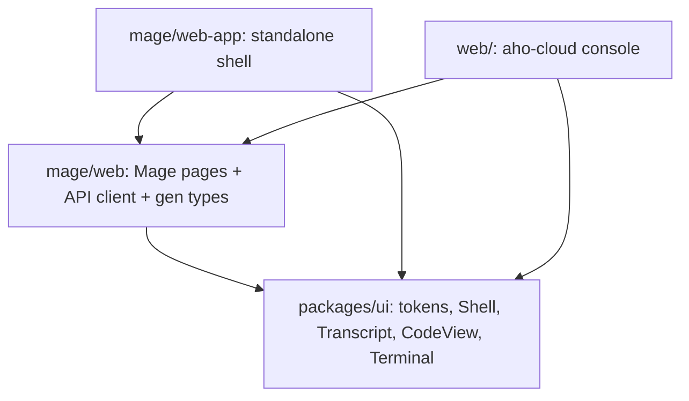

# Deployment, distribution, and aho-cloud integration

Where the code lives, how Mage ships, and how the same binary runs **self-hosted** (no aho-cloud)
or **on aho-cloud**. Ports and adapters named here are defined in the other internals docs; this
doc decides which adapter each mode uses.

These docs live in `aho-cloud/mage/docs`.

## Decisions

| Topic | Decision |
|---|---|
| Code location | Inside the aho-cloud repo, folder `mage/` (all Mage crates and web packages) |
| aho | Git dependency pinned to a revision; used only by the aho harness adapter (later) |
| Independence | **Mage never depends on aho-cloud.** A Mage build compiles no aho-cloud crate unless the `ahocloud` feature is on |
| Self-host distribution | The `mage` binary and a container image that runs it. Later: deploy templates for several providers (built by us) |
| Licensing | Decided later. Self-hosters get binaries/images only, so no source split is needed now |
| Login | GitHub OAuth and Google (OIDC) in Mage. aho-cloud adds the same providers next to passkeys |
| Frontend | React + TypeScript, sharing aho-cloud's design system. Same Mage pages in the aho-cloud console and in a standalone Mage shell |
| VM execution (v2) | `shared/vmm`: Firecracker (Docker backend in dev), exec protocol, egress proxy — extracted from aho-cloud's `runtime-agent` when we build it; `runtime-agent` keeps its behavior |

## Repo layout (aho-cloud)

```
aho-cloud/
  crates/               aho-cloud product crates (control-plane, edge, builder, runtime-agent, …)
  shared/               no product logic; used by aho-cloud and Mage
    vmm/                Firecracker + Docker backends, image → rootfs, cgroups, egress proxy,
                        exec frame protocol, guest init (moved out of runtime-agent later)
    auth/               GitHub OAuth, Google OIDC, (passkeys stay in aho-cloud), PKCE/state helpers
    tsgen/              ts-rs config + "generated files are current" test helper
  mage/
    crates/
      mage-core/        pure domain, shared ports, wire DTOs, fakes
      mage-infra/       shared driven adapters (pg, blob, github, telemetry, config)
      mage-server/      server role hexagon
      mage-indexer/     indexer role hexagon
      mage-runner/      runner role hexagon
      mage-app/         binary `mage`
    web/                Mage React package: pages, API client, generated types (src/gen/mage.ts)
    web-app/            standalone Mage shell for self-host (login pages, org switcher, nav)
    docs/               (later) these docs
  packages/ui/          design system: CSS variables/tokens, ui/common, icons, overlay, Shell,
                        Transcript, CodeView, Terminal (data sources pluggable)
  web/                  aho-cloud console; mounts mage/web under a Support section
```

## Dependency rules (CI-enforced)

| From | May depend on | Never |
|---|---|---|
| `mage/crates/*` | `shared/*`, `aho` (git, feature `aho-harness`), third-party | `crates/*` (aho-cloud) |
| `crates/*` (aho-cloud) | `shared/*`, `aho`, `mage-core` (only if the console needs Mage wire types) | other `mage/*` crates |
| `shared/*` | third-party only | `mage/*`, `crates/*` |
| `packages/ui` | React | product code |
| `mage/web` | `packages/ui` | `web/` |
| `mage/web-app` | `packages/ui`, `mage/web` | `web/` |
| `web/` (console) | `packages/ui`, `mage/web` | — |

CI checks:
- `cargo tree -p mage-app --no-default-features --features selfhost` lists no aho-cloud crate.
- `cargo build -p mage-app --features ahocloud` builds (integration adapters compile).
- `mage/web-app` builds and its tests pass without `web/`.
- ESLint import rule mirrors the table for the TypeScript packages.
- The crate layer test from [README.md](README.md) covers `shared/*` and both feature sets.

`mage/` may be its own Cargo workspace so a self-host build is `cargo build --release -p mage-app`
inside `mage/`; `shared/*` are path dependencies.

## Two modes, one binary

Features: `selfhost` (default) and `ahocloud` (adds the integration adapters). Both can be on;
config picks the adapter per port at startup.

| Concern | Self-hosted | On aho-cloud |
|---|---|---|
| User login | Mage: GitHub OAuth, Google OIDC (`shared/auth`) | aho-cloud edge (passkeys, GitHub, Google); Mage verifies `X-Principal-JWT` |
| Orgs and members | Mage owns them | aho-cloud orgs; Mage keeps a local projection keyed by aho-cloud org id |
| Running customer code | `exec_host` (v1, trusted repos) or `exec_vm` (v2, `shared/vmm` on the runner host) | `exec_ahocloud` (runtime-agent API) or `exec_vm` |
| Customer's deployed commit | GitHub Deployments, manual mapping | aho-cloud ledger: exact source hash and image digest per stage |
| Live repro link | Runner VM + Mage reverse proxy, or off | aho-cloud edge site behind org login |
| UI | `mage/web-app` served by `mage-server` | Mage pages inside the aho-cloud console |
| Blob store | `object_store`: S3, GCS, Azure, or local disk | GCS |
| Secrets | `SecretVault`: local key file, GCP KMS (AWS KMS later) | GCP KMS |
| Model keys | Company's own key via Mage's model gateway | BYOK or aho-cloud billing, via the gateway |

## Adapter matrix

| Port | Self-host adapter(s) | aho-cloud adapter (feature `ahocloud`) | Defined in |
|---|---|---|---|
| `IdentityProvider` | `github_oauth`, `google_oidc` | `edge_jwt` (verifies the edge JWT against the project JWKS) | server.md |
| `OrgDirectory` (new) | `pg` (Mage owns orgs/members) | `ahocloud_orgs` (reads orgs/members, caches locally) | this doc |
| `Executor` | `exec_host`, `exec_vm` | `exec_ahocloud` | executor.md |
| `DeploymentResolver` | `github`, `pg` (manual) | `ahocloud_ledger` | intake.md |
| `PreviewHost` (new) | `runner_proxy` (or disabled) | `ahocloud_edge` | this doc |
| `ArtifactStore` | `object_store` (S3/GCS/Azure/local) | `object_store` (GCS) | storage.md |
| `SecretVault` | `local_key`, `gcp_kms` | `gcp_kms` | server.md |

New ports introduced here (full signatures to be added when built):

```rust
// mage_server::ports::org_directory
#[async_trait]
pub trait OrgDirectory: Send + Sync {
    async fn org(&self, id: OrgId) -> Result<OrgView, DirectoryError>;
    async fn members(&self, id: OrgId) -> Result<Vec<MemberView>, DirectoryError>;
    async fn orgs_for_user(&self, user: UserId) -> Result<Vec<OrgView>, DirectoryError>;
    async fn role(&self, org: OrgId, user: UserId) -> Result<Option<Role>, DirectoryError>;
}

// mage_server::ports::preview
#[async_trait]
pub trait PreviewHost: Send + Sync {
    /// Keep a run's environment alive and reachable by org members; returns its URL.
    async fn open(&self, org: OrgId, run: RunId, port: PortName, ttl: Duration) -> Result<PreviewLink, PreviewError>;
    async fn extend(&self, org: OrgId, link: &PreviewLink, ttl: Duration) -> Result<(), PreviewError>;
    async fn close(&self, org: OrgId, link: &PreviewLink) -> Result<(), PreviewError>;
}
```

In `edge_jwt` mode the role check stays in Mage (authz in the app); `OrgDirectory` gives the role.

## Login

- **Self-hosted**: GitHub OAuth (PKCE + state) and Google OIDC (authorization code + PKCE,
  `id_token` verified against Google's JWKS, `email_verified` required). A user is keyed by
  `(provider, subject)`. Linking a second provider happens only while logged in (explicit "connect
  Google"); never auto-link by matching email.
- **On aho-cloud**: aho-cloud adds GitHub and Google next to passkeys, using `shared/auth`. Mage
  sees only the edge JWT. GitHub stays a separate *integration* (GitHub App for repo access) in
  both modes; logging in with GitHub never grants repo access.

## Frontend



- `packages/ui` is extracted from the console's `src/styles.css`, `src/ui/*` and `Shell`; both
  products import it, so look and behavior stay identical.
- Shared components split **display** from **protocol**: `Transcript` renders a common message
  model with one adapter per source (aho rpc in the console, Mage SSE run events); `CodeView` takes
  a file-source interface; `Terminal` takes an exec-socket factory.
- `mage/web` exports routes and nav entries; the host passes `apiBase`, the current user and org,
  and a fetch function (cookies in self-host, same-origin edge in aho-cloud).
- Types: ts-rs derives on `mage_core::wire::api`, generated into `mage/web/src/gen/mage.ts`, checked
  by a test (`shared/tsgen`), same pattern as aho-cloud's `UPDATE_GENERATED=1`.
- Mage pages: Tickets, Ticket (causes, Run diagnostic), Run (live transcript, video, trace, live
  repro link), Repos (index and recipe status, onboarding), Settings (integrations, model keys).
  Build pages later (see `../extensions/build/`).
- Reused aho-cloud pieces: `SandboxTerminal` + `lib/exec.ts` (live repro terminal), `CodePanel` +
  `lib/filetree.ts` (citations, scripts, patches), `Chat`/`Transcript` (run view), `ApprovalCard` +
  `lib/webauthn.ts` (Build plan approval), `LedgerTimeline` (ticket/run timeline).

## Distribution (self-host)

| Artifact | Contents |
|---|---|
| `mage` binary | Linux x86_64 and arm64; `--features selfhost`; `mage/web-app` bundle embedded |
| Container image | The binary on a minimal base; one image for every role (`mage start server \| indexer \| runner`). The runner image adds Node + Playwright + browsers, `git`, `ffmpeg`, harness CLIs; v2 runner hosts also need KVM and `shared/vmm` prerequisites (`firecracker`, kernel image, `skopeo`, `umoci`, `mkfs.ext4`, `ip`, `nft`, cgroup v2) |
| Deploy templates (later) | Per provider (e.g. GCP, AWS, Kubernetes/Helm): Postgres, object store, server, indexer, runner hosts with KVM |

Self-hosted runners execute customer code inside the company's own infra, so the trusted-repo
limit of v1 `exec_host` is the company's call; `exec_vm` is the default once v2 lands.

## aho-cloud integration points (feature `ahocloud`)

| Integration | What it gives Mage |
|---|---|
| Edge + `X-Principal-JWT` | One login and one org list with the console; Mage runs as an aho-cloud project behind the edge |
| Ledger → `DeploymentResolver` | Exact commit and image digest per stage; repro on the image that runs live |
| Runtime-agent → `Executor` | Firecracker sandboxes, egress allowlist, exec protocol, without running Mage's own VM hosts |
| Builder | Base images for `prepare` (source → OCI) |
| Importers | First draft of `.mage/env.toml` from Dockerfile/compose/Procfile/… |
| Edge sites → `PreviewHost` | "Open live repro" links behind org login |
| Model gateway (Mage → aho-cloud) | Fixes aho-cloud's open gap "sandbox model keys stay in the VM": VMs get run-scoped gateway tokens instead of provider keys |
| Build extension | PR branch deployed to aho-cloud preview; acceptance scripts run against it |

`exec_ahocloud` keeps Mage's "runner holds no secrets" rule: `mage-server` asks the aho-cloud
control plane for a sandbox and a single-use exec token (the session-host terminal pattern); the
runner receives only that token.

## What aho-cloud must add for Mage

| Gap (today) | Needed |
|---|---|
| Sandboxes are long-lived, one per slug, share the project namespace | Ephemeral sandboxes: generated ids, TTL, no persistent disk, high creation rate |
| No snapshot / fork | Firecracker snapshot/restore → Mage fork L2; until then L1 = new sandbox from the base image |
| Files API is read-only | Writes through `exec` (fine) |
| Firecracker untested on hardware (Docker backend only) | Hardware validation on KVM hosts (GCP Intel with nested virtualization) |
| No display device | Playwright records video inside the VM; the repro gate's clean re-run remains the anti-tamper control |
| Login is passkeys only | GitHub + Google via `shared/auth` |

## Migration steps (when we build it)

1. Docs: done (`aho-cloud/mage/docs`).
2. Extract `packages/ui` from `web/src/{styles.css,ui/*}` and `Shell`; console imports it unchanged.
3. Extract `shared/vmm` from `crates/runtime-agent` (Firecracker, Docker backend, image store,
   cgroups, egress proxy, exec protocol, guest init); `runtime-agent` depends on it with no behavior
   change (its tests must pass unchanged).
4. Add `shared/auth` (GitHub OAuth, Google OIDC); wire it into aho-cloud next to passkeys and into
   `mage-server`.
5. Mage crates and web packages as described in the other internals docs.
