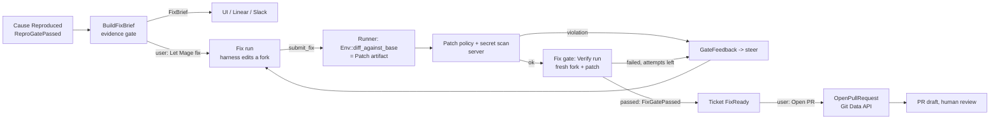
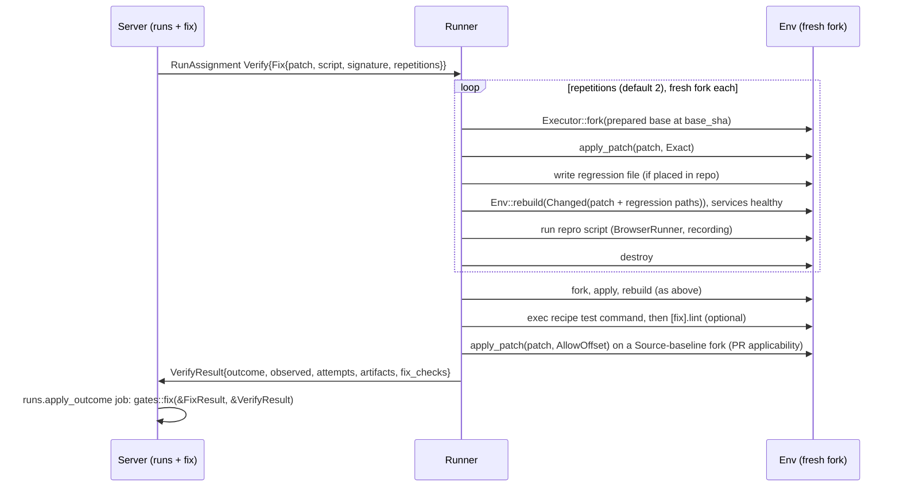
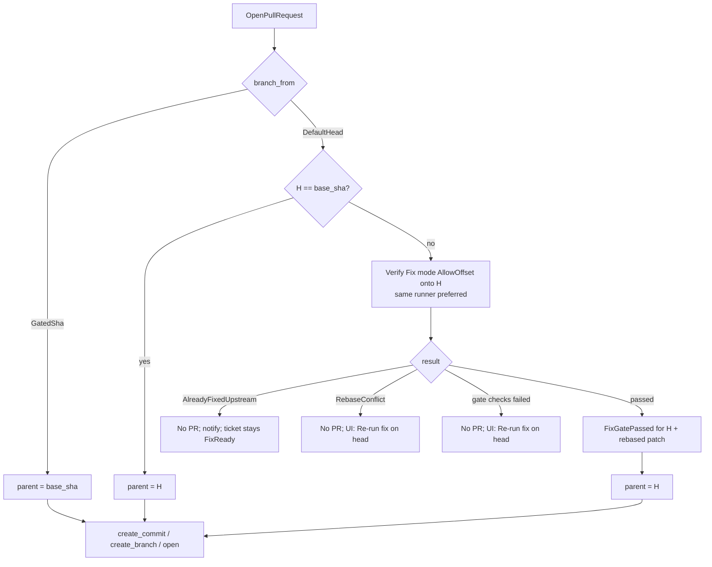

# Fix path (`mage_server::app::fix`)

Code locations (crate layout per [README.md](README.md)):

| Piece | Location |
|---|---|
| Fix domain types (`Patch`, `PatchPolicy`, `ChangeSet`, `ChangeSetDigest`, `CommitPlan`, `BranchName`, `FixPullRequest`) | `mage_core::domain::fix` (same crate as `FixGatePassed`, so `CommitPlan` can require it; the runner also needs `Patch`/`PatchPolicy`) |
| `FixSpec`, `VerifySpec::Fix`, `FixResult` DTOs | `mage_core::wire` |
| Use cases `BuildFixBrief`, `StartFixRun`, `AcceptFixResult`, `ApplyFixOutcome`, `OpenPullRequest`, brief renderer | `mage_server::app::fix` |
| `PullRequests`, `SecretScanner` ports | `mage_server::ports` (server-only) |
| `PullRequests` adapter | `mage_server::adapters::driven::github`, built on the shared GitHub App client in `mage_infra::github` |
| `SecretScanner` adapter | `mage_server::adapters::driven::secretscan` |
| Fakes | `mage_server::testing` |
| `submit_fix` handler | `mage_runner::adapters::driving::mcp` (Run MCP) → `mage_runner::app::fix::collect_patch` |
| Fix gate execution | `mage_runner::app::verify::fix` |

## Purpose

Turn a **reproduced** cause into a change a human can merge, in three stages that ship and run
independently, each behind its own gate and org setting:

| Stage | Use case | Output | Gate | Org setting | Phase |
|---|---|---|---|---|---|
| F1 Fix brief | `BuildFixBrief` | Markdown brief for the user's own LLM (`FixBrief` + artifact) | Evidence gate (`EvidenceChecked`) over every citation in the brief | `fix.brief` (default on) | P3 |
| F2 Mage fixes | `StartFixRun`, `AcceptFixResult`, `ApplyFixOutcome` | Patch artifact + passing fix gate | **Fix gate** via a `Verify` run (`FixGatePassed`) | `fix.run` (default off) | P5 |
| F3 Open PR | `OpenPullRequest` | Branch + commit + PR on GitHub | Requires `FixGatePassed` for the exact change set pushed | `fix.pull_requests` (default off) | P6 |

Each stage depends only on the previous stage's **persisted** output, never on in-memory state:
F1 needs a `Reproduced` cause; F2 needs a `FixBrief`; F3 needs a stored Fix run whose fix gate
re-evaluates to `FixGatePassed`. A stage can be disabled without breaking the ones before it.



Invariant (the acceptance criterion of this doc): **no code path reaches
`PullRequests::create_commit` without a `FixGatePassed` whose change-set digest equals the digest of
the tree delta being committed.** Enforced by types (see `CommitPlan` below), not by review.

## Ports used / defined

### Owned by this doc

`PullRequests` (catalog: "create branch + commit from patch, open PR"; port in
`mage_server::ports`, adapter `mage_server::adapters::driven::github`). Full signature below. Plus
`SecretScanner` (new, see Additions).

### Used

| Port | Role | Used for |
|---|---|---|
| `TicketStore` | server | causes, `FixBrief` rows, ticket status transitions, fix PR records |
| `RunStore` | server | create Fix / Verify runs, gates, load `FixResult` / `VerifyResult`, artifacts metadata |
| `RepoStore` | server | repo, validated recipe (test command, `[fix]` section), prepared-base hints |
| `OrgStore` | server | `FixSettings`, GitHub fix integration, member role of the requester |
| `KnowledgeStore` | server | manifest view for `evidence::check` on brief citations |
| `ArtifactStore` | server | read repro script / patch / logs; write brief artifact; signed URLs for the runner |
| `JobQueue` | server | `fix.brief`, `fix.open_pr`, `fix.pr_event`, `notify.ticket` |
| `SourceHost` | server | installation permissions (read app), default branch, SourceBundle requests |
| `PullRequests` | server | F3 only |
| `SecretScanner` | server | patch, regression script, PR body |
| `Clock`, `IdGen` | all | timestamps, ids |
| `Executor` / `Env` | runner | `fork`, `diff_against_base`, `apply_patch`, `exec`, services |
| `BrowserRunner` | runner | repro script inside the fix gate (with recording) |
| `HarnessSession` | runner | steer on `GateFeedback` |
| `ServerLink` | runner | upload patch, post `FixResult`, post `VerifyResult` |

Notifications: fix code **never** calls `TicketTracker` or `ChatNotifier`. It enqueues
`notify.ticket` `{org_id, ticket_id, notice}` (dedupe `notify:{ticket_id}:{notice_key}`), handled by
`intake::notify::Notify` ([intake.md](intake.md)); keys come from `Notice::key()`. Notices emitted
here: `FixBriefReady{cause_id, version}` (key `brief:{cause_id}:v{version}`),
`FixReady{cause_id, run_id}` (key `fix:{run_id}`), `PrOpened{cause_id, url}` (key `pr:{url}`), and
`FixFailed{cause_id, run_id}` (key `fixfail:{run_id}`).

Jobs are enqueued with `JobQueue::enqueue(NewJob{kind, payload, dedupe_key, run_after, max_attempts})`;
when a store mutation and a job must be atomic (status change + notify), use the outbox form of the
server pg stores (`mage_server::adapters::driven::pg`; `jobs: &[NewJob]` on the mutating store method).

### `PullRequests` port

`mage_server::ports::pull_requests`. Pure GitHub I/O; no patch logic, no policy. Every method
takes `OrgId` and the `Repo` (which carries `owner`, `name`, `installation_id`); the adapter
resolves the **fix** installation token through the shared GitHub App client in
`mage_infra::github` (one JWT/installation-token cache, keyed by app + installation, also used by
the `SourceHost` impl).

```rust
#[async_trait]
pub trait PullRequests: Send + Sync {
    /// Permissions granted to the fix installation for this repo.
    async fn write_access(&self, org: OrgId, repo: &Repo)
        -> Result<WriteAccess, PullRequestsError>;

    /// Current head of a branch; None if the branch does not exist.
    async fn branch_head(&self, org: OrgId, repo: &Repo, branch: &str)
        -> Result<Option<CommitSha>, PullRequestsError>;

    /// Paths changed between two commits and how far `head` is ahead of `base`.
    async fn compare(&self, org: OrgId, repo: &Repo, base: CommitSha, head: CommitSha)
        -> Result<Comparison, PullRequestsError>;

    /// Content and mode of `paths` at `at`. Missing paths are returned as `BaseFile::Absent`.
    async fn read_files(&self, org: OrgId, repo: &Repo, at: CommitSha, paths: &[RepoPath])
        -> Result<Vec<BaseFile>, PullRequestsError>;

    /// Create blobs, a tree on top of `plan.parent()`'s tree, and a commit. Moves no ref.
    /// Idempotent: same plan -> same tree sha; commit sha may differ only by timestamp.
    async fn create_commit(&self, org: OrgId, repo: &Repo, plan: &CommitPlan)
        -> Result<CommitSha, PullRequestsError>;

    /// Create `refs/heads/<branch>` at `commit`. Never force-updates.
    /// Adapter refuses any branch not starting with `mage/` (Invalid).
    async fn create_branch(&self, org: OrgId, repo: &Repo, branch: &BranchName, commit: CommitSha)
        -> Result<BranchOutcome, PullRequestsError>;

    /// Read a commit's message trailers (used to recognise Mage's own commits on retry).
    async fn commit_trailers(&self, org: OrgId, repo: &Repo, commit: CommitSha)
        -> Result<Vec<(String, String)>, PullRequestsError>;

    /// Open PR whose head is `branch`, if any.
    async fn find_open(&self, org: OrgId, repo: &Repo, branch: &BranchName)
        -> Result<Option<PullRequestRef>, PullRequestsError>;

    async fn open(&self, org: OrgId, repo: &Repo, req: &OpenPullRequest)
        -> Result<PullRequestRef, PullRequestsError>;

    async fn add_labels(&self, org: OrgId, repo: &Repo, number: u64, labels: &[String])
        -> Result<(), PullRequestsError>;

    /// Upload a video (mp4) or image (gif/png) through GitHub's user-attachments flow and return
    /// the `https://github.com/user-attachments/assets/<id>` URL — the only URL kind GitHub renders
    /// as an inline video player. Limits: 10 MB images/GIFs; video 10 MB (Free) / 100 MB (paid).
    /// Endpoint is undocumented (`uploads.github.com/user-attachments/assets`); `gh --attach`
    /// (gh ≥ 2.99.0) uses it. Whether a GitHub App installation token is accepted is [unverified].
    async fn upload_media(&self, org: OrgId, repo: &Repo, media: &MediaUpload)
        -> Result<MediaUrl, PullRequestsError>;

    async fn request_reviewers(&self, org: OrgId, repo: &Repo, number: u64, who: &Reviewers)
        -> Result<(), PullRequestsError>;

    /// State incl. GitHub's computed mergeability (may be Unknown right after open).
    async fn state(&self, org: OrgId, repo: &Repo, number: u64)
        -> Result<PullRequestState, PullRequestsError>;
}

pub struct WriteAccess { pub contents: bool, pub pull_requests: bool, pub workflows: bool, pub issues: bool }
pub struct Comparison { pub ahead_by: u32, pub behind_by: u32, pub changed_paths: BTreeSet<RepoPath> }
pub enum BaseFile { Present { path: RepoPath, mode: FileMode, bytes: Vec<u8> }, Absent { path: RepoPath } }
pub enum FileMode { Regular, Executable }            // symlink/gitlink never produced
// `BranchName` lives in mage_core::domain::fix (used by `FixPullRequest`); validated `mage/[a-z0-9._-]+`, ≤ 100 chars
pub enum BranchOutcome { Created, AlreadyAt, ExistsAt(CommitSha) }
pub struct OpenPullRequest { pub title: String, pub body: String, pub head: BranchName,
                             pub base_branch: String, pub draft: bool }
pub struct PullRequestRef { pub number: u64, pub url: Url, pub head_commit: CommitSha }
pub struct Reviewers { pub users: Vec<String>, pub teams: Vec<String> }
pub struct PullRequestState { pub open: bool, pub merged: bool, pub draft: bool,
                              pub mergeable: Mergeable, pub head_commit: CommitSha }
pub enum Mergeable { Clean, Conflicting, Unknown }

#[derive(thiserror::Error, Debug)]
pub enum PullRequestsError {
    NotFound, Conflict, Invalid(String), Unavailable(String),
    PermissionDenied { missing: Vec<&'static str> },
    RateLimited { retry_after: Duration },
}
```

`CommitPlan` is a domain type (see Additions) whose only constructor takes `&FixGatePassed`, so the
port cannot be called with an ungated change set, and its fake cannot either.

## Domain pieces used here

From [domain.md](domain.md), unchanged: `Cause`, `CauseStatus::Reproduced { run, gate }`,
`DiagnoseResult { verdict, script, signature, summary }`, `FixResult { patch, summary }`,
`VerifyResult`, `Gate { kind: Fix }`, `FixGatePassed` (created by `gates::fix(&FixResult, &VerifyResult)`,
consumed by `Ticket` → `FixReady` and the PR use case), `FixBrief`, `ArtifactKind::{FixBrief, Patch, Script, Video, Trace, Log}`,
`TicketStatus::{Diagnosed, Fixing, FixReady, PrOpen}`.

Proof tokens are **never persisted or deserialized**. Every use case that needs `FixGatePassed`
re-derives it by loading the stored `FixResult` and the gate's `VerifyResult` from `RunStore` and
calling `gates::fix` again. The function is pure and cheap; a stored "passed" flag is display data
only.

---

## F1 — Fix brief

### Trigger

- Automatic: when `Cause::mark_reproduced(ReproGatePassed)` commits, the runs module enqueues
  `fix.brief` `{org_id, cause_id, diagnose_run_id}` in the same transaction (outbox), dedupe
  `fix.brief:{cause_id}:{diagnose_run_id}`. Skipped if `fix.brief` is off.
- Manual: "Regenerate brief" in the UI (same job, new version) — e.g. after a recipe change.

### Inputs

| Input | Source | Used for |
|---|---|---|
| `Cause` (must be `Reproduced`) | `TicketStore` | title, explanation, `evidence: Vec<Citation>`, `method` |
| `DiagnoseResult` of the reproducing run | `RunStore` | `summary`, `signature`, `script`, `suggested_fix`, `fix_sites` (Additions) |
| Repro gate `VerifyResult` | `RunStore` | observed signature, video/trace artifact ids |
| Repro script artifact | `ArtifactStore` | inlined into the brief |
| `Ticket` | `TicketStore` | title, Linear identifier + URL, `target.sha`, `target.assumed` |
| `Repo` + validated `Recipe` | `RepoStore` | owner/name for permalinks, run instructions, test command |
| `FixSettings` | `OrgStore` | constraint toggles (workflow edits, lockfiles) |

### Use case `BuildFixBrief`

1. Load cause; require `CauseStatus::Reproduced { run, gate }` else `AppError::Invalid` (job completes, no retry).
2. Load `DiagnoseResult` for `run` and the repro gate's `VerifyResult`; re-derive
   `ReproGatePassed` via `gates::repro` (guards against a hand-edited row).
3. Collect citations: `cause.evidence` ∪ `DiagnoseResult.fix_sites`. Run
   `evidence::check(citations, &ManifestView)` at `ticket.target.sha`. Citations that fail are
   **dropped from the brief** and listed in a `Notice` run event; if every `cause.evidence` citation
   fails, abort with `MissingEvidence` (cannot happen for a cause created through the evidence gate
   unless the index was rebuilt; then job retries after `index.version` completes).
4. Read the repro script (≤ 64 KiB inlined; larger → link only).
5. Render markdown with `fix::brief::render(&BriefInput) -> String` (pure, deterministic, golden-tested).
6. `SecretScanner::scan` the rendered markdown. Findings → redact the matched span
   (`[redacted: <rule>]`) and record a `Notice`; never block F1 on a scanner hit.
7. Put artifact `ArtifactKind::FixBrief` at `org/{org}/runs/{diagnose_run}/fix_brief/brief-v{n}.md`.
8. `TicketStore::put_fix_brief(org, FixBrief, jobs)` (version `n` = max + 1 per cause,
   assigned in the transaction) with `jobs = [notify.ticket{FixBriefReady{cause_id, version: n}}]` (outbox).

### Template

Rendered with plain string building (no template engine). Untrusted text (agent `summary`,
`suggested_fix`, ticket body) is placed inside blockquotes or fenced blocks and has `@` mentions
neutralised (`@\u{200B}name`) so pasting into Linear/GitHub never pings anyone.

````markdown
# Fix brief: {ticket.identifier} — {cause.title}

> Generated by Mage from a **reproduced** diagnosis. Repo `{owner}/{name}` at
> `{sha_short}`{ " (assumed: default branch head)" if target.assumed}.
> Mage run: {ui_url}/runs/{diagnose_run_id} · Linear: {ticket.url}

## Problem
{ticket.title}
> {first 600 chars of ticket body, quoted}

## Root cause
{cause.explanation}

Diagnosis summary (from the diagnosing agent):
> {diagnose.summary}

## Evidence
| # | Location | Why |
|---|---|---|
| 1 | [`{path}:{start}-{end}`](https://github.com/{owner}/{name}/blob/{sha}/{path}#L{start}-L{end}) | {citation note} |
…
Repro evidence: video {ui_url}/artifacts/{video_id} · trace {ui_url}/artifacts/{trace_id}
Observed failure: `{signature.kind}` {matcher} `{signature.value}`

## Repro script
`{script_name}` (`ScriptKind::Playwright` or `ScriptKind::Shell`, method {method})
```{lang}
{script body}
```

## How to run it
1. Check out `{sha}` (or your branch based on it).
2. Bring the app up with the recipe `.mage/env.toml`:
   - build: `{recipe.build[*]}` …
   - services: `{name}` on port `{port}` (health: `{check}`) …
   - database: `{migrate}` then `{seed}`
3. Export the repro env contract ([executor.md](executor.md)): `MAGE_BASE_URL={browser.base_url}`, `MAGE_PORT_<NAME>`, `MAGE_DB_URL`, `MAGE_LOGIN_URL` / `MAGE_LOGIN_USER` / `MAGE_LOGIN_PASSWORD` (fake test login from the recipe), plus any recipe `[env]` mappings (e.g. `DATABASE_URL = "${db.url}"`)
4. Run: `{script_command}`  → today it **fails** with the signature above.
5. Project tests: `{recipe.test}`

## Suggested approach
> {diagnose.suggested_fix, or "No suggestion recorded; start at evidence #1."}
Likely edit sites: {fix_sites as permalinks}

## Acceptance criteria
- [ ] The repro script above **passes** (exit 0) and the failure `{signature.value}` no longer appears.
- [ ] `{recipe.test}` exits 0.
- [ ] {if recipe.fix.lint} `{recipe.fix.lint}` exits 0.

## Constraints
- Keep the change minimal and local to the root cause; no unrelated refactors.
- Do not modify the repro script or weaken its assertions; do not edit `.mage/`.
- Do not change lockfiles unless you change the matching dependency manifest.
- Do not edit generated files ({generated globs}); change their source instead.
- {unless allowed} Do not edit `.github/workflows/` or `.github/actions/`.
- Never add credentials, tokens or real keys; the recipe uses fake keys only.
````

`script_command` comes from the `ScriptKind` recorded with the `Script` artifact: Playwright →
`npx playwright test <path>`, Shell → `bash <path>` ([executor.md](executor.md) defines script kinds
and the `MAGE_*` env contract for repro scripts).

### Storage and exposure

| Where | What |
|---|---|
| `fix_briefs` row (TicketStore) | `FixBrief` + `version`, `diagnose_run_id`, `artifact_id`; latest version is current |
| Artifact | `brief-v{n}.md`, immutable; served via signed URL |
| UI | Cause panel → "Fix brief" tab: rendered markdown, **Copy** (raw markdown), **Download .md**, version picker, "Let Mage fix" button (F2, shown only if enabled and preconditions hold) |
| API | `GET /api/tickets/{ticket}/causes/{cause}/fix-brief?version=` → `{markdown, version, created_at, artifact_url}` ([server.md](server.md)) |
| Linear | `notify.ticket{FixBriefReady}` → comment with root cause, acceptance criteria and a link to the UI. Full brief inline only if `fix.brief_in_linear = full` and it fits the comment limit; default `summary` (the brief contains code and test credentials) |
| Slack | Same notice → one-line reply in the linked thread with the UI link |

### Gate

F1's gate is the evidence gate: every citation printed in the brief passed `evidence::check` at the
ticket sha in step 3. A `FixBrief` can only be constructed for a `Reproduced` cause (domain rule) and
with an `EvidenceChecked` token (Additions).

---

## F2 — Fix run

### Preconditions (`StartFixRun`)

| Check | Failure |
|---|---|
| `fix.run` enabled for org | `Invalid("fix runs disabled")` |
| Requester role ≥ `Member` | `Forbidden` |
| Cause `Reproduced`, current `FixBrief` exists | `Invalid` |
| Ticket in `Diagnosed` (or `FixReady`, see Additions) | `Conflict` (one fix run per ticket at a time) |
| Recipe `Validated` and has a test command | `Invalid("recipe has no test command")` |
| Test baseline green for `(repo, sha, recipe_hash)` or unknown | red → `Invalid("project tests fail at base")` |
| Per-repo run concurrency slot (shared with Diagnose) | stays `Queued` |

Test baseline: the first Fix run for a `(repo, sha, recipe_hash)` also enqueues a `Verify` run with
`VerifySpec::TestBaseline` (Additions; parent = the Fix run) that runs the recipe test command in an
unpatched fork, in parallel with the agent's work. Result cached by that key. If it comes back red,
the Fix run is cancelled with reason `BaselineRed` and the UI explains that F2 needs a green
baseline. Mage does not try to diff test-by-test in v1.

### RunSpec for `RunKind::Fix`

Fields per [runs.md](runs.md); Fix-specific values:

| Field | Value |
|---|---|
| `kind` / `subject` | `Fix` / `Cause(cause_id)` |
| `harness` | user choice, default org setting (`Omp` or `ClaudeCode`) |
| base | prepared base for `(repo, ticket.target.sha, recipe_hash)`; `SourceBundle` signed URL |
| prompt | fix brief markdown + Fix-run preamble (below) |
| MCP | Knowledge MCP (`knowledge_token` scoped to org/repo/sha) + Run MCP with the **Fix** tool set: `exec`, `read`, `write`, `list`, `playwright_run`, `http_request`, `logs`, `db_query`, `submit_fix` |
| built-in tools | v1: `HarnessSpec { builtin_tools: WorkspaceRw, cwd: Some("") }` ([harness.md](harness.md)): edit/read/grep/bash on the fork workspace (granted via `--add-dir`; the harness process cwd is an empty scratch dir), OS user `mage-agent`, cleared env. v2: `BuiltinToolPolicy::None`, all edits via Run MCP `write` |
| repro script | placed by the runner at `.mage/repro/{cause_id}/{name}` in the fork; `playwright_run` can target it |
| budget | default `max_wall 45m`, `max_turns 200`, `max_cost` per org, `max_gate_attempts 3` |
| fix spec | `RunSpec.fix` / `RunAssignment.fix: Option<FixSpec>` (runs.md; fields in Additions): brief artifact, script artifact + sha256, `FailureSignature`, `PatchPolicy`, `RegressionPlacement` |

Preamble (appended to the brief): you are in a disposable fork at `{sha}`; edit code to make the
repro pass; run the repro with `playwright_run` and the tests with `exec`; when done call
`submit_fix` with a summary; Mage computes the patch from your working tree and re-checks it in a
fresh environment; edits under `.mage/`, lockfiles without manifest changes, and generated files
are discarded; workflow edits are rejected.

### `submit_fix`

Arguments (JSON schema in [executor.md](executor.md) Run MCP section):

```rust
pub struct SubmitFix { pub summary: String }   // markdown, 1..=8 KiB
```

The agent submits **only a summary**. Anything the agent says about which files it changed is
ignored; the patch is whatever differs in the fork.

Runner handler (Run MCP, Fix tool set):

1. Reject if a previous `submit_fix` is still being gated (`AwaitingGate`): tool error "fix under
   verification".
2. `Env::diff_against_base(&DiffOptions { against: Prepared, exclude })` where `exclude` =
   always-excluded globs ∪ policy-excluded globs from `FixSpec.policy` (table below). Returns
   `PatchOutput { patch, files, excluded, binary }` (git CLI, `--no-renames --full-index -U3`,
   untracked non-ignored files included, deterministic; see [executor.md](executor.md)).
3. Local fast checks (duplicated authoritatively on the server by `PatchPolicy`): empty diff → tool
   error "no changes" (no attempt consumed); deny paths (`.github/workflows/**`,
   `.github/actions/**` unless allowed, `.git/**`, symlinks, gitlinks), binary files and size
   limits → tool error naming the paths, so the agent can undo them before a gate attempt is spent.
4. Upload as `ArtifactKind::Patch` (`org/{org}/runs/{run}/patch/attempt-{n}.diff`) via
   `POST /runs/{id}/artifacts` signed URL; sha256 recorded.
5. `POST /runs/{id}/result` with `FixResult { patch, summary, excluded, stats }` (carries the run
   `attempt` for fencing; 409 `lease_lost` → runner aborts the session).
6. Tool returns immediately: "submitted, gate running, end your turn". The session idles while the
   run is `AwaitingGate`.

### Path policy

Applied in two places: `exclude` (silently dropped from the diff, listed to the reviewer) and
`deny` (patch rejected with feedback; the agent must undo it).

| Paths | Policy | Why |
|---|---|---|
| `.mage/**` | exclude | recipe changes go through Learn + boot gate; repro script lives here |
| Lockfiles (`package-lock.json`, `yarn.lock`, `pnpm-lock.yaml`, `Cargo.lock`, `go.sum`, `Gemfile.lock`, `poetry.lock`, `uv.lock`, `composer.lock`, `mix.lock`, …) | `LockfilePolicy::WithManifest` (default): kept only if the sibling manifest (`package.json`, `Cargo.toml`, `go.mod`, …) also changed; otherwise excluded. Org may choose `Exclude` or `Include` | installs during the run rewrite lockfiles incidentally |
| Generated: recipe `[fix].generated` globs, `.gitattributes` `linguist-generated`, built-ins (`dist/`, `build/`, `target/`, `.next/`, `node_modules/`, `*.min.js`, `__generated__/`) | exclude | rebuilt by the build; change the source instead |
| Paths ignored by `.gitignore` | never in the diff | `diff_against_base` honours `.gitignore` |
| `.github/workflows/**`, `.github/actions/**` | deny unless `fix.allow_workflow_edits` (and the fix app has `workflows` permission) | CI is a privilege boundary |
| `.git/**`, absolute paths, `..`, symlinks, submodule (gitlink) changes, mode changes other than ±x | deny | tree integrity |
| Binary files | deny (v1) | gate and PR apply text diffs only |

Because exclusion happens **before** the gate, the gate verifies exactly the patch that would be
committed: if dropping a generated file breaks the build, the gate fails and the agent learns why.

### Server: `AcceptFixResult`

On `POST /runs/{id}/result` for a Fix run in `Running`:

1. Load patch artifact; check sha256 matches the artifact row.
2. `Patch::parse` (domain, strict git-diff subset). Parse error → policy violation.
3. `PatchPolicy::check(&Patch, &FixSettings)` (domain, pure): deny paths, size limits
   (defaults: ≤ 1 MiB diff, ≤ 50 files, ≤ 5 000 changed lines, ≤ 256 KiB per post-image file),
   no binary.
4. `SecretScanner::scan(added lines)` (+ exact match against the run's own tokens).
5. Compute `RegressionPlacement` → optional `RegressionFile { path, script }` (F3 section) and the
   `ChangeSet { base_sha, patch_sha256, regression }` with its `ChangeSetDigest`.
6. Violation in 2–4: record `Gate { kind: Fix, attempt, status: Failed { reason }, verify_run: None }`
   and take the normal failed-gate path (`GateFeedback` `Failed`; counts as an attempt).
7. Otherwise: create `Gate { kind: Fix, attempt: n, Pending }`, create a `Verify` run
   (`parent` = Fix run, spec `VerifySpec::Fix { patch, script, signature, repetitions, regression,
   mode: Exact, upstream_check: false }`, see Additions), prefer the same runner (base already
   prepared), set Fix run `AwaitingGate`, emit `GateStarted(Fix)`.

### Fix gate (Verify run on the runner)



Checks, in order (stop at the first hard failure, still collect logs):

| # | Check | Pass condition | Failure reason |
|---|---|---|---|
| 1 | Fork | fresh fork of the prepared base at `base_sha`, one per repetition plus one for tests | infra → Verify `Errored` (no attempt consumed) |
| 2 | Apply | `apply_patch(Exact)` returns `Applied`; runner reports sha256 of the bytes applied = `patch_sha256` | `PatchDoesNotApply` / `DigestMismatch` |
| 3 | Rebuild | `Env::rebuild(RebuildScope::Changed(patch paths ∪ regression path))` succeeds — re-runs `[[build]]` steps whose `inputs` match a changed path (steps without `inputs` always), then the idempotent `database.migrate` (the patch may add migrations); `seed` is not re-run (data is already in the template DB) — and services are healthy | `BootFailed { step, log_tail }` |
| 4 | Repro | script (artifact pinned by sha256, not the agent's copy) exits 0 on **every** repetition; the runner extracts the observation using the expected signature's `kind`, and the server's `FailureSignature::matches` is false for every observation | `ReproStillFails { observed }` |
| 5 | Tests | recipe test command exits 0 within its timeout | `TestsFailed { exit, log_tail }` |
| 6 | Lint | if `[fix].lint` set and `lint_mode = required`: exit 0; `advisory`: recorded only | `LintFailed` |
| 7 | Source applicability | `apply_patch(AllowOffset)` on a fork at the **Source** baseline (tree at sha, no build output) returns `Applied` | `NotApplicableToSource` (the patch depends on prepare-time changes and could not be committed to GitHub) |

Artifacts: post-fix repro video + trace (shown next to the diagnose video as before/after), test
log, lint log. `gates::fix` is the only judge; the runner reports facts, not a verdict.

### Attempt policy and session

- The server answers every gate on `/runs/{id}/commands` with
  `GateFeedback { gate_id, kind: Fix, attempt, outcome: Passed | Failed { reason, details, attempts_left } }`
  ([runs.md](runs.md)).
- `Failed` with `attempts_left > 0` → Fix run `AwaitingGate → Running`; the runner calls
  `HarnessSession::steer` with a rendered message (failed check, observed signature, ≤ 8 KiB log
  tail, violating paths, secrets redacted), starting a new turn. The agent edits and calls
  `submit_fix` again; the new patch is diffed from the **current** fork state (cumulative, still
  against base).
- `Failed` with `attempts_left = 0` → Fix run `Failed`; ticket `Fixing → Diagnosed`;
  `notify.ticket{FixFailed}` (Additions).
- Verify run `Errored` (infra) → retried once on any runner; second error → Fix run `Errored`, no
  attempt consumed.
- Budget exceeded → `TimedOut`; user cancel → `Cancelled`; both → ticket `Fixing → Diagnosed`.
- While `AwaitingGate`, user steers from the UI are queued and delivered after the gate result.

### Gate passed

Gate `Passed` and Fix run `Succeeded` are written by the runs module, which enqueues
`runs.apply_outcome { run_id }` in the same transaction. For a Fix run that job calls
`fix::ApplyFixOutcome`:

1. Load `FixResult` + gate `VerifyResult`; `gates::fix(&fix_result, &verify_result)` →
   `FixGatePassed` (binds fix run, cause, base sha, change-set digest).
2. `Ticket::fix_ready(&FixGatePassed)` → `FixReady`; enqueue `notify.ticket{FixReady{cause_id, run_id}}`
   (and `fix.open_pr` when `fix.open_pr = auto`) — one transaction (outbox). Idempotent: ticket
   already `FixReady` for this run → no-op.
3. Runner receives `GateFeedback` `Passed` and closes the harness session gracefully.
4. UI shows: diff viewer, excluded paths, agent summary (quoted, untrusted), before/after videos,
   test log, **Download .patch**, `git apply` instructions, and **Open PR** (F3, if enabled).

F2 is useful without F3: the gated patch can be downloaded and applied by a human.

### Ticket transitions used

| From | Event | To | Where |
|---|---|---|---|
| `Diagnosed` | fix run started | `Fixing` | `StartFixRun` |
| `Fixing` | fix gate passed (`FixGatePassed`) | `FixReady` | gate passed |
| `Fixing` | fix failed / timed out / cancelled / errored | `Diagnosed` | run terminal |
| `FixReady` | PR opened | `PrOpen` | `OpenPullRequest` |
| `FixReady` | fix run started | `Fixing` | **Additions** (re-fix after rejection or rebase conflict) |

---

## F3 — Open pull request

### Preconditions

| Check | Failure |
|---|---|
| `fix.pull_requests` enabled | `Invalid` |
| Org has an active GitHub fix integration (Additions); `PullRequests::write_access` has `contents` and `pull_requests` (and `workflows` if the patch touches workflow paths) | `PermissionDenied { missing }` → UI prompts an admin to install/approve |
| Ticket `FixReady`; latest succeeded Fix run for the cause | `Conflict` |
| `FixGatePassed` re-derived from stored `FixResult` + gate `VerifyResult` | `Invalid("fix gate not passed")` |
| Requester role ≥ `Member` (manual mode) | `Forbidden` |

Trigger: UI **Open PR** (default, `fix.open_pr = manual`), or automatically on `FixReady` when
`fix.open_pr = auto`. Both enqueue `fix.open_pr` `{org_id, ticket_id, fix_run_id}`, dedupe
`fix.open_pr:{ticket_id}:{changeset_digest_hex}`.

### Branch, base and rebase policy

Branch name: `mage/{ticket.identifier lowercased}-{digest_hex[..7]}` (e.g.
`mage/eng-412-3f9a2c1`). Deterministic per change set, so retries hit the same branch.

`fix.pr.branch_from` (org setting):

- `GatedSha` — commit parent = the gated `base_sha`; PR targets the default branch. No re-gate
  needed: the pushed tree is exactly what passed. If GitHub later reports `Mergeable::Conflicting`,
  the UI offers **Rebase** (below).
- `DefaultHead` (**decided default**) — commit parent = current default branch head `H`. Chosen
  over `GatedSha` because PRs stay clean against current code; the cost is a re-gate when `H` moved.
  - `H == base_sha` → commit directly.
  - `H != base_sha` → **rebase flow**; a new `FixGatePassed` for `(H, rebased digest)` is required.



Rebase flow = `Verify` run with `VerifySpec::Fix { patch, script, signature, repetitions,
regression, mode: AllowOffset, upstream_check: true }`, parent = the Fix run, assigned on a prepared
base at `H` (runner prepares it from `H`'s SourceBundle if missing; until the bundle exists the run
stays `Queued` and unleasable, and the server enqueues `index.version` for `H`; the indexer's
`runs.source_ready` releases it). It is created through `CreateRun` **without a gate row** (runs.md
accepts fix-module Verify runs with no gate: rebase verify on a finished Fix run, `TestBaseline`)
and does not change the `Succeeded` Fix run's status; `runs.apply_outcome` dispatches its result to
`fix::ApplyFixOutcome`.

1. `upstream_check`: fork at `H`; run the original repro script **unpatched**. If it exits 0 and the
   server finds no signature match → `AlreadyFixedUpstream` (bug fixed on head; no PR).
2. `apply_patch(patch, AllowOffset)` (git apply semantics, zero fuzz). `Rejected` →
   `RebaseConflict { paths }`.
3. `diff_against_base(against: Prepared)` with the same exclusions → rebased patch, uploaded as a
   new `Patch` artifact; every later check uses the rebased bytes (`Exact`).
4. Fix gate checks 3–7 as above, plus regression file placement.
5. `VerifyResult.rebased_patch = Some(..)`; `gates::fix` binds the token to `(H, rebased digest)`.
   `runs.apply_outcome` for this Verify run calls `fix::ApplyFixOutcome`, which sees the ticket is
   already `FixReady` and only re-schedules the waiting `fix.open_pr` job (`run_after = now`).

Rebase does not consume Fix-run attempts and never involves the harness. On conflict or failure the
ticket stays `FixReady`; the user may start a new Fix run whose base is `H` (`FixReady → Fixing`).
`OpenPullRequest` always re-derives the token from the **latest** source of proof for the Fix run:
the most recent `Succeeded` rebase Verify run (if any), else the passed Fix gate's Verify run.

### Regression test placement

The PR adds the repro script as a regression test. Placement is decided **when the change set is
built** (F2 step 5), so the gate already ran with the file in place:

| `RegressionPlacement` | Path | Gate behaviour |
|---|---|---|
| `Off` | — | — |
| `MageDir` (default) | `.mage/regressions/{identifier}-{slug}.{ext}` | script run directly (check 4) |
| `RepoTests { dir }` from recipe `[fix].regression_dir` | `{dir}/mage-{identifier}-{slug}.{ext}` | file written into the fork before check 5, so the project's test command runs it |

The regression file is scanned by `SecretScanner` and counts toward size limits. Its header comment
carries the Linear identifier and the Mage run URL.

### Use case `OpenPullRequest`

Runs as the `fix.open_pr` job; every step is idempotent and its progress is persisted in the
`fix_pull_requests` row via `TicketStore::upsert_pull_request` (keyed by
`(org_id, ticket_id, changeset_digest)`) and `TicketStore::set_pull_request_state(org, id, expect,
next, jobs)` (`FixPullRequest.state: FixPrState`, see Additions), so a
crash resumes from the last step.

1. Preconditions above; re-derive `FixGatePassed` (`token`).
2. Decide parent per policy; run the rebase flow if required (job reschedules itself with
   `run_after` and resumes when the rebase Verify run is terminal) and re-derive `token`.
3. `PullRequests::read_files(parent, touched paths)`; `CommitPlan::build(&token, base_files, &patch,
   regression, message)` — applies the patch with domain `Patch::apply` (same semantics as
   `ApplyMode::AllowOffset`: offsets allowed, zero fuzz; gate check 7 proved this succeeds on the
   Source tree at `parent`), producing post-images. Failure → `Invalid` (should be impossible).
4. Final `SecretScanner` pass over post-image added lines and the PR body. Hit → abort, notify
   admins, no retry.
5. `create_commit(plan)` → commit `C`. Message:
   ```
   fix: {cause.title} ({ticket.identifier})

   {agent summary, first paragraph, mentions neutralised}

   Linear: {ticket.url}
   Mage-Run: {fix_run_id}
   Mage-Gate: {gate_id}
   Mage-Change-Set: {digest_hex}
   ```
   Author/committer omitted → the GitHub App identity [unverified: signed/"Verified" badge for
   app-created commits].
6. `create_branch(branch, C)`:
   - `Created` / `AlreadyAt` → continue.
   - `ExistsAt(X)`: if `commit_trailers(X)` has the same `Mage-Change-Set` → treat as ours, use `X`.
     Otherwise (someone pushed to it) → append `-2`, `-3`… (max 5) and retry; never force-push.
7. `find_open(branch)` → reuse, else `open(OpenPullRequest { title, body, head, base_branch:
   repo.default_branch, draft: fix.pr.draft })`. Title: `fix: {cause.title} ({identifier})`.
8. `add_labels(["mage", "mage:fix"] ∪ fix.pr.labels)`; `request_reviewers(fix.pr.reviewers)` if
   set (CODEOWNERS review requests are GitHub's own behaviour).
9. Transaction: `fix_pull_requests` → `Opened{number}`; `Ticket` `FixReady → PrOpen`;
   enqueue `notify.ticket{PrOpened{cause_id, url}}`. `Notify` comments on Linear, attaches the PR
   link to the issue, and replies in the Slack thread.

Mage never merges, approves, enables auto-merge, pushes to the default branch, or force-pushes.
Human review is always required; branch protection on the repo is the enforcement point.

### PR body template

````markdown
Fixes [{ticket.identifier}]({ticket.url}) — {ticket.title}

> Opened by **Mage** at the request of {requester or "auto (org setting)"}.
> Human review required. Mage does not merge.

## Root cause
{cause.explanation}

Evidence (at `{base_sha_short}`):
- [`{path}:{a}-{b}`](https://github.com/{owner}/{repo}/blob/{base_sha}/{path}#L{a}-L{b})
…

## Change
> {agent summary, quoted; mentions neutralised}

{n} files changed, +{added} −{removed}.{ if excluded } Discarded by policy: `{paths}`.{ if rebased }
Rebased from `{gated_sha_short}` onto `{H_short}` and re-verified.

## Regression test
`{regression.path}` — the script that reproduced the bug; it failed before this change and passes
after. Run: `{script_command}` (see `.mage/env.toml` for setup).

## Verification (fix gate, clean environment)
| Check | Result |
|---|---|
| Patch applies at `{parent_short}` | pass |
| Repro script ({repetitions} fresh forks) | pass — signature `{signature.value}` absent |
| `{recipe.test}` | exit 0 ({duration}) |
| `{lint}` | {pass / advisory / n/a} |

## Before / after

| Before (repro) | After (fix) |
|---|---|
|  |  |

{fix_video_url}

[trace]({trace_url}) · [test log]({test_log_url}) · [Mage run]({ui_url}/runs/{fix_run_id})

<!-- mage:change-set={digest_hex} run={fix_run_id} gate={gate_id} -->
````

Evidence links point at the Mage UI (auth required). Body truncated to fit GitHub's body limit
[unverified: 65 536 chars] by shortening evidence and change lists first.

### Media in the PR and in Linear

The runner turns each verify-run recording (Playwright `webm`) into two artifacts with `ffmpeg`:

| Artifact | Format | Target | Used in |
|---|---|---|---|
| `ArtifactKind::Video` | mp4 (H.264, no audio) | ≤ 10 MB (fits GitHub Free); trim to the failing / acceptance segment, then lower bitrate | PR body (inline player), Linear comment |
| `ArtifactKind::Gif` | gif, ≤ 15 s, ≤ 960 px wide, ~10 fps, palette-optimized | ≤ 10 MB | PR body before/after table (renders everywhere, incl. email) |

Upload happens on the server (it holds the tokens), from `ArtifactStore`:

- **GitHub PR**: `PullRequests::upload_media` for the GIFs and the mp4, then the URLs go into the
  body. User-attachments on private repos are readable only by people with repo access.
- **Linear card**: `TicketTracker::upload_file` (official `fileUpload` mutation → server-side PUT to
  the pre-signed URL) for the mp4, then the asset URL goes into the `notify.ticket` comment
  markdown. Linear uploads are private to the workspace.
- **Fallback** (upload refused, too large, or the installation token is not accepted by the
  user-attachments endpoint): the PR body links to the Mage artifact page instead; Linear still gets
  the video. Never block a PR on media.
- Upload results are cached per `(artifact_id, destination)` so retries of `fix.open_pr` and
  `notify.ticket` never upload twice.

Videos only ever show the sandbox with fake data; no customer data is recorded.

### GitHub Git Data API flow (`mage_server::adapters::driven::github`)

No clone; all over REST with the fix installation token.

| Port method | REST calls |
|---|---|
| `write_access` | `GET /app/installations/{id}` → `permissions` |
| `branch_head` | `GET /repos/{o}/{r}/git/ref/heads/{branch}` (404 → `None`) |
| `compare` | `GET /repos/{o}/{r}/compare/{base}...{head}` (paginated file list) |
| `read_files` | `GET /repos/{o}/{r}/git/commits/{sha}` → tree; `GET …/git/trees/{tree}?recursive=1` (mode + blob sha per path); `GET …/git/blobs/{sha}` (base64) |
| `create_commit` | per changed file `POST …/git/blobs` `{content, encoding: base64}`; `POST …/git/trees` `{base_tree, tree: [{path, mode, type: "blob", sha}]}` with `sha: null` for deletions [unverified: null-sha deletion semantics]; `POST …/git/commits` `{message, tree, parents: [parent]}` |
| `create_branch` | `POST …/git/refs` `{ref: "refs/heads/mage/…", sha}`; 422 "Reference already exists" → `branch_head` → `AlreadyAt` / `ExistsAt` |
| `commit_trailers` | `GET …/git/commits/{sha}` → parse message |
| `find_open` | `GET …/pulls?head={o}:{branch}&state=open` |
| `open` | `POST …/pulls` `{title, body, head, base, draft}`; 422 "already exists" → `find_open` |
| `add_labels` | `POST …/issues/{n}/labels` [unverified: auto-creates missing labels; permission needed is `issues: write` or `pull_requests: write`] |
| `request_reviewers` | `POST …/pulls/{n}/requested_reviewers` |
| `state` | `GET …/pulls/{n}` (`mergeable` may be `null` → `Unknown`) |

Adapter rules: refuse refs outside `refs/heads/mage/`; map 401/403 with missing permission to
`PermissionDenied`, primary/secondary rate limits to `RateLimited { retry_after }` (from
`Retry-After` / `x-ratelimit-reset`); content-creation calls are serialised per installation
[unverified: GitHub secondary-rate-limit guidance for content creation]. Modes: base mode
preserved; new files `100644`, or `100755` when the patch says so.

### Permissions

The read-only GitHub App (`SourceHost`) never gets write scopes. F3 uses a **separate GitHub App**
("Mage Fix") with `contents: write`, `pull_requests: write`, `metadata: read`, and optionally
`workflows: write`, installed by an org only when it enables F3. GitHub App permissions are
app-wide, so "requested only when F3 is enabled" requires a second app rather than per-installation
scopes [unverified: no per-installation permission subsets]. Internal v1 (one org) may use a single
app upgraded at P6; the port and integration kind stay the same.

### After the PR is open

Intake ([intake.md](intake.md)) receives fix-app webhooks on `POST /hooks/github-fix` (internal v1
single app: on `/hooks/github`), handles fix-app `installation*` events (`Integration` kind
`GitHubFix` Active/Revoked), and forwards `pull_request` events whose head ref matches `mage/*` as
`fix.pr_event` `{org_id, repo_id, number, action, merged}`, dedupe
`fix.pr_event:{repo_id}:{number}:{delivery_id}`. `fix::OnPullRequestEvent` handles them:

- `closed` + merged → record `fix_pr_url` on the ticket's pending `Resolution` suggestion; the user
  still resolves the ticket (domain: "resolved by user").
- `closed` unmerged → row found via `TicketStore::pull_request_by_number(org, repo, number)`;
  `FixPullRequest.state = Closed { merged: false }`; ticket `PrOpen → FixReady` (Additions).
- `synchronize` by a human → recorded; Mage never touches the branch again.

---

## Adapter internals

| Component | Location | Notes |
|---|---|---|
| `fix::brief::render` | `mage_server::app::fix` | pure string builder; markdown escaping helpers shared with PR body |
| `Patch`, `Patch::parse`, `FilePatch::apply`, `PatchPolicy`, `ChangeSet`, `CommitPlan` | `mage_core::domain::fix` | pure, no I/O; strict git-diff subset matching `diff_against_base` output: `diff --git`, `index` (full), `---`/`+++`, `@@` hunks, `new file mode`, `deleted file mode`, `old mode`/`new mode`, `\ No newline at end of file`; no renames (delete + add), no binary. `apply` = git-apply semantics with offsets, zero fuzz. CRLF preserved byte-for-byte |
| `ChangeSetDigest` | `mage_core::domain::fix` | SHA-256 over `base_sha ‖ patch_sha256 ‖ regression path ‖ regression script sha256`, computed in the domain with `sha2` (decided: `mage_core` may depend on `sha2`, pure, wasm-compatible); component hashes come from artifact rows |
| Glob matching for policy | `mage_core::domain::fix` | minimal `**`/`*`/`?` matcher; no gitignore semantics needed (that lives in `diff_against_base`) |
| `SecretScanner` | `mage_server::adapters::driven::secretscan` (new module) | `regex` rule set + entropy check; see Security |
| `PullRequests` | `mage_server::adapters::driven::github` | REST calls through the shared `mage_infra::github` App client (JWT + installation-token cache keyed by app + installation, also behind `SourceHost`) |
| Fix gate executor | `mage_runner::app::verify::fix` | sequence above over `Env` + `BrowserRunner`; emits `RunEvent`s per check |
| `submit_fix` handler | `mage_runner::adapters::driving::mcp` (Run MCP) → `mage_runner::app::fix::collect_patch` | diff, local limits, upload, result |

## Failure modes & recovery

| Failure | Detection | Recovery |
|---|---|---|
| Brief job: cause no longer `Reproduced` (re-diagnosed) | step 1 | job completes, no brief |
| Brief citations stale after reindex | evidence check | drop failing citations; all failed → retry after `index.version` |
| Agent submits no changes | runner diff empty | tool error, agent continues; no attempt consumed |
| Patch violates policy / contains secret | server `AcceptFixResult` | gate `Failed`, feedback steer, attempt consumed; secret values never echoed |
| Patch does not apply in fresh fork | gate check 2 (`Rejected { BaseMismatch }` or hunk failure) | indicates executor bug (diff vs base mismatch) → gate fail + `Error` event; alert |
| Patch applies to Prepared but not Source | gate check 7 | gate fail with feedback "change depends on build output; edit sources"; attempt consumed |
| Flaky repro (passes once, fails once) | `repetitions` ≥ 2 | gate fails; feedback says "intermittent"; attempt consumed |
| Base tests red | `TestBaseline` verify | Fix run cancelled `BaselineRed`; F2 disabled for that `(repo, sha, recipe)` until recipe changes |
| Runner lost during gate | lease expiry | Verify run requeued per runs.md; Fix run follows runs.md lease rules (`Queued` with attempt + 1, or `Errored` at max lease attempts); ticket → `Diagnosed` if terminal |
| Harness session died while `AwaitingGate` | runner sends `finish(Abandoned)`; server marks the run `session_lost` (lease cleared), the gate keeps running | gate passed → `Succeeded` (session not needed). Gate failed with `attempts_left > 0` → `Running`, then lease lost in the same commit → `Queued` (attempt + 1; the feedback travels in `RunAssignment.prior_feedback` so the new session starts from it) or `Errored` at max lease attempts. Gate failed with 0 left → `Failed` |
| Default branch moved (`DefaultHead`) | `branch_head != base_sha` | rebase verify run (fix-gate checks, no gate row) → new `FixGatePassed` for `H`; conflict → no PR, offer re-fix on head |
| Bug already fixed on head | rebase step 1 | no PR; notice; user resolves ticket |
| Branch name taken by human commits | `ExistsAt` + foreign trailers | suffix `-2`…; never force-push |
| PR already exists | 422 / `find_open` | reuse; idempotent |
| Missing GitHub permissions | `PermissionDenied` | job fails without retry; UI banner for org admins |
| Rate limited | `RateLimited` | job retry with `run_after = retry_after` |
| Crash mid-F3 | `fix_pull_requests.state` | job resumes from last completed step |
| Ticket changed state during F3 (resolved/closed) | transition `InvalidTransition` at step 9 | PR stays open (already created); record it; notify; no ticket change |

## Security notes

- **Gate binding.** `FixGatePassed` carries the change-set digest; `CommitPlan::build` requires it
  and checks the digest of `(parent, patch, regression)`; the gate verified the patch by sha256, the
  runner echoed the digest it applied, and the server re-applies the same bytes to GitHub blobs. A
  patch cannot be swapped between gate and PR.
- **Patch provenance.** The agent's claims are never trusted: the patch is `diff_against_base` of
  the fork; the server re-parses and re-checks it. v1 trusts the host runner's `VerifyResult`
  (trusted repos); v2 moves the same checks behind the aho executor.
- **No secrets in patches.** `SecretScanner` runs on added lines of the patch, the regression
  script, the brief, and the PR body. Rules: provider key formats (AWS `AKIA…`, GitHub `ghp_`/
  `ghs_`/`github_pat_`, Slack `xox[abpr]-`, Anthropic `sk-ant-`, OpenAI `sk-`, Google API keys,
  GCP service-account JSON `"private_key"`), PEM private-key blocks, JWTs, high-entropy values
  assigned to `*_KEY|*_SECRET|*_TOKEN|PASSWORD`, and exact matches of the run's own Mage-issued
  tokens (`gateway_token`, `knowledge_token`, Run MCP bearer). Findings are reported by rule and
  location only, never by value. Recipe fake keys are allow-listed by exact value.
- **Size limits** (per org, defaults above) bound reviewer load and API cost and stop the agent from
  vendoring code.
- **Workflow files.** `.github/workflows/**` and `.github/actions/**` are denied unless
  `fix.allow_workflow_edits`; even then GitHub requires the `workflows` permission on the fix app
  [unverified: applies to Git Data API ref creation as well as git pushes].
- **Untrusted text.** Agent summaries, ticket bodies and repo content are untrusted. They are quoted,
  mentions neutralised, HTML stripped, length-capped before going into the brief, Linear, Slack or
  GitHub. The brief is also untrusted input to the Fix agent (prompt injection); the agent holds no
  secrets and its output is gated and human-reviewed.
- **Least privilege.** Read app vs fix app; fix app token only in the server role; runner never sees
  GitHub credentials. Adapter refuses refs outside `refs/heads/mage/`.
- **Linear exposure.** Briefs contain code and fake test logins; default Linear comment is a summary
  plus a link.

## Testing

| Level | What |
|---|---|
| Domain | `Patch::parse`/`apply` fixtures: add/modify/delete, CRLF, no trailing newline, `+x` mode, multi-hunk, shifted hunk (offset accepted), changed context (rejected, no fuzz), byte-for-byte parity with `git apply` on the same fixtures; malformed inputs. `PatchPolicy` table per path class and limit. `gates::fix` table: each check failing alone, digest mismatch, signature present on 1 of N repetitions. `CommitPlan::build` rejects digest mismatch. Ticket transitions incl. the Additions rows |
| `fix::brief::render` | golden files for each `ReproMethod`, missing suggestion, assumed sha, large script (link only), mention/HTML neutralisation |
| Use cases (fakes) | `BuildFixBrief` refuses non-reproduced cause; drops stale citations. `AcceptFixResult` policy violation → feedback, attempt count. `ApplyFixOutcome` pass → `FixReady` + `notify.ticket`, idempotent on replay; exhausted attempts → `Diagnosed`. `OpenPullRequest`: crash after each persisted step then resume (no duplicate commit/branch/PR); `ExistsAt` foreign → suffix; moved head → rebase Verify enqueued; `AlreadyFixedUpstream` → no PR |
| `PullRequests` contract | generic suite run against the fake (`mage_server::testing`) and `mage_server::adapters::driven::github` with recorded HTTP fixtures: idempotent `create_branch`, `open` on existing PR, deletion entries, `PermissionDenied`/`RateLimited` mapping, refusal of non-`mage/` refs. Opt-in live test against a throwaway repo |
| `SecretScanner` contract | positive fixture per rule; false-positive corpus (hashes, UUIDs, base64 test data, lockfile integrity hashes); redaction never returns the value |
| Runner integration | fixture repo (small Node app with a known off-by-one bug + Playwright repro + `npm test`): fake harness writes a correct fix via Run MCP `write` and calls `submit_fix` → gate passes; wrong fix → `ReproStillFails` feedback → second attempt passes; agent edits `package-lock.json` only → excluded; edits `.github/workflows/ci.yml` → denied |
| End to end (opt-in) | real `omp`/`claude` on the fixture repo through F1 → F2 → F3 against a sandbox GitHub repo |

## Additions to the contract

| Addition | Kind | Justification |
|---|---|---|
| `SecretScanner` port in `mage_server::ports`: `fn scan(&self, input: &ScanInput) -> Vec<SecretFinding>` (sync; `ScanInput { path: Option<RepoPath>, text: &str, known: &[KnownSecret] }`, `SecretFinding { rule, path, line, column }`). Adapter module `mage_server::adapters::driven::secretscan` (`regex`); fake in `mage_server::testing` | port + adapter module | server-only concern; rule set is swappable and tested by a contract suite, keeping `regex` out of `mage_core` |
| `FixBrief` gains `id: FixBriefId`, `org_id`, `version: u32`, `diagnose_run: RunId`, `artifact: ArtifactId`; `FixBrief::new(&Cause, EvidenceChecked, …)` requires `Reproduced`. Stored as-is by `TicketStore::put_fix_brief` (no separate record type) | domain | tenancy rule (every aggregate has `org_id`); versioned regeneration; link to artifact |
| `FixPullRequest { id: FixPullRequestId, org_id, ticket_id, fix_run: RunId, gate: GateId, change_set: ChangeSetDigest, branch: BranchName, base_sha: CommitSha, head_commit: Option<CommitSha>, number: Option<u64>, url: Option<Url>, state: FixPrState, created_at, updated_at }`; `FixPrState = Planned \| CommitCreated { commit } \| BranchCreated \| Opened { number } \| Closed { merged: bool }`; new id types `FixBriefId`, `FixPullRequestId` (Uuid v7 newtypes like the other ids) | domain | resumable, idempotent F3 progress; table `fix_pull_requests` (storage.md) |
| `DiagnoseResult` gains `suggested_fix: Option<String>` and `fix_sites: Vec<Citation>` (from `submit_diagnosis`) | domain + Run MCP schema | F1 renders a suggestion without a model call |
| `FixResult` gains `excluded: Vec<RepoPath>` and `stats { files, added, removed }` | domain | reviewer sees discarded paths; limits |
| `VerifyResult` gains `fix_checks: Option<FixChecks { applied_patch_sha256, boot, test_exit, lint_exit, source_applies, upstream_already_fixed }>` and `rebased_patch: Option<ArtifactId>` | domain | `gates::fix` needs test exit, digest echo, Source applicability |
| `VerifySpec::Fix { patch, script, signature }` (runs.md) extended with `repetitions: u8`, `regression: Option<RegressionFile>`, `mode: ApplyMode`, `upstream_check: bool`; new variant `VerifySpec::TestBaseline` | runs.md / `mage_core::wire` | rebase flow = `Fix` with `mode: AllowOffset`, `upstream_check: true` on a base at `H`; baseline check |
| `FixGatePassed` exposes read-only `fix_run()`, `cause()`, `base_sha()`, `change_set()`; not `Serialize`/`Deserialize`; `gates::fix` also accepts the rebased patch case | domain | F3 must commit exactly what was gated |
| `ChangeSet { base_sha, patch: ArtifactId, patch_sha256, regression: Option<RegressionFile { path, script, script_sha256 }> }`, `ChangeSetDigest([u8; 32])` | domain | gate ↔ PR binding |
| `CommitPlan` (private fields; `CommitPlan::build(&FixGatePassed, base_files, &Patch, regression, message) -> Result<CommitPlan, DomainError>`; accessors `parent()`, `files()`, `message()`) and `Patch`, `PatchPolicy`, `RepoPath` | domain | type-level guarantee that `PullRequests::create_commit` only receives gated changes |
| `FixSpec { brief, script, script_sha256, signature, policy: PatchPolicy, regression: RegressionPlacement }`, carried as `RunSpec.fix` / `RunAssignment.fix: Option<FixSpec>` (adopted in runs.md) | `mage_core::wire` | runner needs exclusions and script pin |
| `Env::diff_against_base(&DiffOptions { against, exclude }) -> Result<PatchOutput, ExecError>`, `Env::apply_patch(&[u8], ApplyMode) -> Result<ApplyOutcome, ExecError>`, `Env::rebuild(RebuildScope::Changed(paths))` — owned by executor.md; fix.md owns the `exclude` policy | executor.md | patch computed by runner; gate/rebase apply; incremental rebuild after apply |
| Recipe `[fix]` section: `lint`, `lint_mode = "required" \| "advisory"`, `generated = [globs]`, `regression_dir` | recipe (executor.md) | per-repo fix policy |
| `FixSettings` on org (`OrgStore`): `brief`, `brief_in_linear = off\|summary\|full`, `run`, `pull_requests`, `open_pr = manual\|auto`, `pr.branch_from = gated_sha\|default_head` (default `default_head`), `pr.draft` (default true), `pr.labels`, `pr.reviewers`, `lockfiles = exclude\|with_manifest\|include`, `allow_workflow_edits`, limits, `repetitions` (default 2), `regression = off\|mage_dir\|repo_tests` | domain + OrgStore | per-org policy |
| `mage_core` may depend on `sha2` (decided; README dependency rule updated by Main) | dependency rule | `ChangeSetDigest` is computed in the domain next to `CommitPlan::build` |
| `Integration.kind` gains `GitHubFix` | domain | separate write app, requested only with F3 |
| Ticket transitions `FixReady --fix run started--> Fixing` and `PrOpen --PR closed unmerged--> FixReady` | domain | re-fix after rejection/rebase conflict; closed PR returns to a fixable state |
| `Notice::FixFailed { cause_id, run_id }` (key `fixfail:{run_id}`) | intake `Notice` | support needs to know when F2 gave up |
| Job kinds `fix.brief`, `fix.open_pr`, `fix.pr_event` | jobs | area prefix `fix.*` alongside `intake.*`, `index.*`, `triage.*`, `notify.*`, `runs.*` |
| Tables `fix_briefs`, `fix_pull_requests` (storage.md) | storage | brief versions; idempotent PR progress, unique `(org_id, ticket_id, changeset_digest)` |

## Open questions

1. Test baseline: strict exit 0 blocks F2 on repos with known-flaky suites. Per-test baseline needs a
   test-report format (JUnit XML) in the recipe — later.
2. Should `Notify` post the full brief to Linear for internal orgs by default?
3. Regression test default: `.mage/regressions/` is runnable only with Mage's Playwright config;
   repos may prefer `RepoTests`. Decide per org at onboarding.
4. Claude Code / omp edit tools may follow symlinks out of the workspace in v1 [unverified]; the
   `mage-agent` user's filesystem permissions are the boundary until v2.
5. Whether app-created commits are signed by GitHub and satisfy "require signed commits" branch
   protection [unverified].
