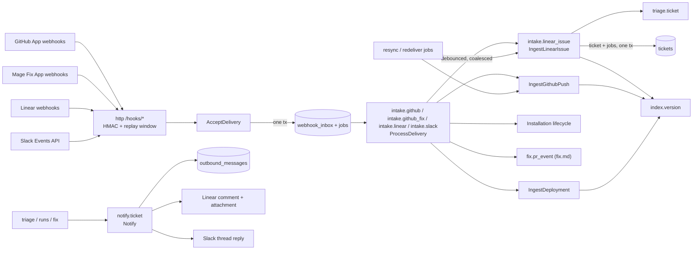
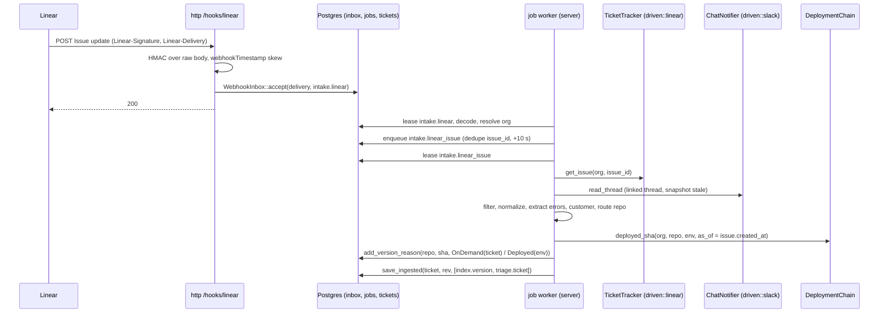

# Intake (`mage_server::app::intake`, `mage_infra::github`, `mage_server::adapters::{driving::http::hooks, driven::{github, linear, slack, pg}}`)

## Purpose

Intake is how the outside world reaches Mage and how Mage talks back:

- **Inbound**: GitHub, Linear and Slack webhooks are verified, deduplicated, acknowledged fast, and
  turned into jobs. Jobs normalize Linear issues into `Ticket`s with a defined target sha, record
  repo versions and deployments from GitHub, and track installation lifecycle.
- **Outbound**: every Linear comment and Slack thread reply Mage posts goes through one idempotent
  job (`notify.ticket`), so a retry never posts twice.

Out of scope: HTTP routing, body limits, sessions, connect/callback routes and OAuth `state`
([server.md](server.md)); table DDL, JobQueue, retention mechanics ([storage.md](storage.md));
indexing a `RepoVersion` ([knowledge.md](knowledge.md)); triage itself ([triage.md](triage.md));
pull requests and the Fix App's PR lifecycle ([fix.md](fix.md)).

## Overview



Two rules shape everything below:

1. **Webhook = trigger, source = truth.** A delivery only says "something changed about X".
   Jobs re-read X from the provider (issue, ref head, installation) with the org's own credentials.
   Out-of-order deliveries, coalesced bursts, retries and replays then converge on the same state.
2. **At-least-once in, effectively-once out.** Inbound processing may repeat; every write it makes
   is idempotent (upserts, dedupe keys). Outbound messages carry a pre-allocated identity recorded
   in `OutboundLog` before the call, so an uncertain attempt is reconciled, not repeated.

All intake jobs run in the server role's job worker (`mage start server`, or `mage start all` in
local dev). Intake code never runs on the runner or the indexer.

## Endpoints

Routes are declared in [server.md](server.md); this doc owns what the handlers do.

| Route | Provider | Events handled | Body limit | Must answer within |
|---|---|---|---|---|
| `POST /hooks/github` | GitHub App, read-only (one URL for all installations) | `push`, `installation`, `installation_repositories`, `repository`, `deployment_status`; `pull_request` only in internal v1 single-app mode; `ping` → 200, not recorded | 25 MiB | 10 s (GitHub records a failure otherwise) |
| `POST /hooks/github-fix` | Mage Fix App (F3 write app, [fix.md](fix.md)) | `installation` (lifecycle of the `GitHubFix` integration), `pull_request` with head ref `mage/*`; `ping` → 200 | 25 MiB | 10 s |
| `POST /hooks/linear` | Linear (workspace webhook in API-key mode, app webhook in OAuth mode) | `Issue`, `Comment`, attachment events, `OAuthApp` revoked | 1 MiB | 5 s, and only HTTP 200 counts as success |
| `POST /hooks/slack` | Slack Events API | `url_verification` (inline), `app_uninstalled`, `tokens_revoked`; thread `message` events optional, off in v1 | 1 MiB | 3 s |

GitHub caps webhook payloads at 25 MB and drops larger events [unverified]; a missed push is
recovered by `intake.github_resync`.

Slack events decision: v1 does not subscribe to channel messages. A linked thread is pulled with
`conversations.replies` when its Linear issue is ingested (and on periodic Linear resync). Thread
`message` events (scopes `channels:history`/`groups:history` events, every message in every channel
the bot is in) are an optional extension: `HookEvent::SlackThreadMessage { team, channel,
thread_ts }` → find the ticket by thread → enqueue `intake.linear_issue`. Enable only if stale
thread content proves to hurt triage.

### Signature verification

Verification happens in `mage_server::adapters::driving::http::hooks::verify` (uses `hmac` +
`sha2`) on the **exact raw bytes** (`axum::body::Bytes`), before any JSON parsing, with a
constant-time compare (`Mac::verify_slice`). Header hex is decoded first; invalid hex or a missing
header is a failure.

| Provider | Signature header | Signed bytes | Secret (SecretVault, Platform scope) | Freshness check | Delivery id |
|---|---|---|---|---|---|
| GitHub | `X-Hub-Signature-256: sha256=<hex>` | raw body | `github/webhook_secret` (read app); `github_fix/webhook_secret` on `/hooks/github-fix` | none available (no signed timestamp) | `X-GitHub-Delivery` (GUID; redeliveries reuse it) |
| Linear | `Linear-Signature: <hex>` (no prefix) | raw body | `linear/webhook_secret` | body `webhookTimestamp` (ms, signed) within `max_skew` (default 60 s); `Linear-Timestamp` header is unsigned and ignored | `Linear-Delivery` (UUID v4) |
| Slack | `X-Slack-Signature: v0=<hex>` | `v0:{X-Slack-Request-Timestamp}:{raw body}` | `slack/signing_secret` | `X-Slack-Request-Timestamp` within 300 s | body `event_id` |

- **Secret rotation**: the handler holds `[active, previous]` versions (SecretVault versions) and
  accepts either; previous is dropped after the provider-side rotation is confirmed.
- **Linear secret**: API-key mode is internal-only and single-workspace, so its one workspace
  webhook secret is the platform `linear/webhook_secret`. OAuth mode uses the app's webhook signing
  secret under the same name [unverified: one signing secret per OAuth app across workspaces].
- **Linear retries vs `max_skew`**: Linear retries after 1 min, 1 h, 6 h. Whether a retry carries a
  fresh `webhookTimestamp` is [unverified]. If it does not, a 60 s window rejects every retry
  (resync still recovers the change). The contract test with a recorded retry decides; if retries
  keep the original timestamp, raise `max_skew` to 8 h, which stays below inbox row retention
  (30 days), so replay protection is preserved (see below).
- **Slack `url_verification`**: answered inline with the `challenge` value **after** signature
  verification; not recorded.
- **Slack retries**: `X-Slack-Retry-Num` / `X-Slack-Retry-Reason` are logged; the retry is handled
  like any delivery and deduplicated by `event_id` and body hash.

### Replay and dedupe

Delivery-id headers are **not** covered by any signature, and GitHub signs no timestamp. So the
inbox rejects a delivery when either key was seen before:

| Key | Catches |
|---|---|
| `UNIQUE (source, delivery_id)` | provider retries and redeliveries (same id) |
| `UNIQUE (source, body_sha256)` | a captured body replayed with a forged delivery id |

| Provider | Replay window | Inbox row retention | Why it is safe |
|---|---|---|---|
| Linear | `max_skew` on signed `webhookTimestamp` | 30 d | window < retention: any replay is stale or a duplicate |
| Slack | 300 s on signed request timestamp | 30 d | same |
| GitHub | none | 30 d (> 3-day redelivery limit [unverified]) | a replay older than 30 d is accepted by design; jobs re-read source state, so it costs one API call and changes nothing |

Optional defense in depth for GitHub: check the source IP against the `hooks` ranges from
`GET /meta` [unverified that Cloud Run exposes the client IP reliably via `X-Forwarded-For`].

### Handler algorithm

```
1. Read raw Bytes (route body limit, 413 above it).
2. Required headers present, else 400.
3. Verify signature against [active, previous] secrets, else 401.
4. Freshness check (Linear, Slack), else 401.
5. Slack url_verification → 200 {challenge}. GitHub ping → 200.
6. delivery_id + event name from headers (Slack: event_id + event.type from body).
7. AcceptDelivery use case (deadline 2 s):
     Accepted::New | Accepted::Duplicate → 200 (empty body)
     AppError::Unavailable / deadline   → 503
```

| Situation | Status | Provider reaction |
|---|---|---|
| New or duplicate delivery | 200 | done |
| Bad or missing signature, stale timestamp | 401 | Linear/Slack retry, then give up; logged with source IP |
| Malformed headers | 400 | same |
| Body too large | 413 | GitHub: lost → resync |
| Database unavailable or slow | 503 | Linear 3 retries, Slack 3 retries, GitHub none → `intake.github_redeliver` |

Unknown event types, unbound installations and revoked integrations are still answered 200; the
job marks them `Ignored`. Bodies are never logged; logs carry source, delivery id, event, outcome,
latency.

Cloud Run cold starts can exceed Slack's 3 s budget; the server role keeps at least one warm
instance (see [server.md](server.md)).

## Job kinds

Payloads are variants of `mage_core::domain::JobPayload` (serde-tagged; `kind()` gives the
string); `NewJob { kind, payload, dedupe_key, run_after, max_attempts }` and `JobQueue` live in
`mage_core::ports` (impl `mage_infra::pg`, see [storage.md](storage.md)).
Dedupe is active while a job is queued or running and is scoped per org by the index.

| Kind | Payload | Dedupe key | `run_after` | Max attempts |
|---|---|---|---|---|
| `intake.github` / `intake.github_fix` / `intake.linear` / `intake.slack` | `IntakeDelivery { source, delivery_id }` (org: None) | none (inbox already deduped) | now | 5 |
| `intake.linear_issue` | `IntakeLinearIssue { org_id, issue_id }` | `intake.linear_issue:{issue_id}` | now + `debounce.issue` (10 s) | 6 |
| `intake.github_resync` | `IntakeGithubResync { org_id }` | `intake.github_resync` | periodic, 60 min | 3 |
| `intake.linear_resync` | `IntakeLinearResync { org_id, since }` | `intake.linear_resync` | periodic, 15 min (poll mode: 1 min) | 3 |
| `intake.github_redeliver` | `IntakeGithubRedeliver { since }` (platform; both GitHub apps) | `intake.github_redeliver` | periodic, 10 min | 3 |
| `intake.inbox_purge` | `IntakeInboxPurge` (platform) | `intake.inbox_purge` | periodic, 24 h | 3 |
| `notify.ticket` | `NotifyTicket { org_id, ticket_id, notice }` | `notify:{ticket_id}:{notice.key()}` | now | 8 |

Emitted by intake, owned elsewhere:

| Kind | Payload | Dedupe key | Owner |
|---|---|---|---|
| `index.version` | `IndexVersion { org_id, repo_id, sha, reason }` | `index.version:{repo_id}:{sha}` | [knowledge.md](knowledge.md) |
| `triage.ticket` | `TriageTicket { org_id, ticket_id, content_hash }` | `triage.ticket:{ticket_id}:{content_hash_hex}` | [triage.md](triage.md) |
| `fix.pr_event` | `FixPrEvent { org_id, repo_id, number, action, merged }` | `fix.pr_event:{repo_id}:{number}:{delivery_id}` | [fix.md](fix.md) (`fix::OnPullRequestEvent`) |

Periodic jobs ("periodic chain" in storage.md) keep one live instance per `(kind, org)`: the job
finishes with `JobQueue::complete(&lease, follow_ups: &[successor])`, which marks it succeeded and
inserts the successor in one transaction, and the server worker re-runs the bootstrap enqueue of
the same dedupe key at start and hourly (Duplicate while the chain is alive; revives a dead
chain). `IntakeLinearResync.since` carries the checkpoint forward, so no cursor table is needed; a
revived chain starts with `since = now - 24 h`.

Backoff for all intake and notify jobs: exponential with full jitter, base 30 s, factor 2, cap
1 h; a port `RateLimited { retry_at }` overrides it with `run_after = retry_at`. Exhausted jobs stay
visible as dead in the admin UI ([storage.md](storage.md)).

## Ports

### Owned here

Errors follow the README convention plus two variants every provider port needs:
`Unauthorized` (credential revoked or expired after one refresh) and
`RateLimited { retry_at: OffsetDateTime }`.

#### `WebhookInbox` (`mage_server::ports::inbox`, impl `mage_server::adapters::driven::pg`, table `webhook_inbox`)

```rust
pub enum WebhookSource { GitHub, GitHubFix, Linear, Slack }

pub struct NewDelivery {
    pub source: WebhookSource,
    pub delivery_id: String,          // X-GitHub-Delivery | Linear-Delivery | Slack event_id
    pub event: String,                // X-GitHub-Event | Linear-Event | Slack event.type
    pub org_id: Option<OrgId>,        // None until the job resolves the tenant
    pub body: Vec<u8>,                // raw bytes as verified; the pg adapter computes body_sha256 and received_at
}

pub enum Accepted { New { job_id: JobId }, Duplicate { first_seen_at: OffsetDateTime } }

pub struct Delivery {
    pub source: WebhookSource, pub delivery_id: String, pub event: String,
    pub org_id: Option<OrgId>, pub received_at: OffsetDateTime,
    pub body: Option<Vec<u8>>,        // None after body purge
    pub body_sha256: [u8; 32],
    pub outcome: Option<InboxOutcome>, pub processed_at: Option<OffsetDateTime>,
}

pub enum InboxOutcome { Processed, Ignored(String), Rejected(String) }

pub enum InboxError { NotFound, Conflict, Invalid(String), Unavailable(String) }

#[async_trait]
pub trait WebhookInbox: Send + Sync {
    /// One transaction: insert the delivery (ON CONFLICT on (source, delivery_id) or
    /// (source, body_sha256) DO NOTHING); if inserted, enqueue `job`.
    async fn accept(&self, d: NewDelivery, job: NewJob) -> Result<Accepted, InboxError>;
    async fn get(&self, source: WebhookSource, delivery_id: &str) -> Result<Delivery, InboxError>;
    async fn resolve_org(&self, source: WebhookSource, delivery_id: &str, org: OrgId) -> Result<(), InboxError>;
    async fn mark_processed(&self, source: WebhookSource, delivery_id: &str, outcome: InboxOutcome) -> Result<(), InboxError>;
    /// Null bodies of processed rows received before `bodies_before`; delete rows before `rows_before`.
    async fn purge(&self, bodies_before: OffsetDateTime, rows_before: OffsetDateTime) -> Result<u64, InboxError>;
}
```

Exception to "every store method takes `OrgId`": a delivery exists before its tenant is known
(GitHub `installation.created` for an installation not bound yet). Rows get `org_id` via
`resolve_org`; every read after that is org-scoped.

#### `SourceHost` (`mage_core::ports::source_host`, impl `mage_infra::github`)

Shared port: intake (server) and knowledge (indexer) use the same trait, so it lives in
`mage_core`. It authenticates with the read-only GitHub App's private key, a shared infra
credential loaded through `mage_infra::config::SecretSource`. Server-only GitHub calls that need
server-only secrets are on `SourceHostAdmin` (below).

```rust
pub struct RepoCoords { pub owner: String, pub name: String }
pub enum Access { Read, Write }
pub struct AccessToken(String);       // Debug/Display print "***"; fn expose(&self) -> &str

pub struct TokenScope {
    pub repositories: Option<Vec<String>>,          // None = all repos granted to the installation
    pub permissions: BTreeMap<String, Access>,      // empty = the installation's full set
}
pub struct InstallationToken {
    pub token: AccessToken, pub expires_at: OffsetDateTime,
    pub permissions: BTreeMap<String, Access>, pub repositories: Option<Vec<String>>,
}
pub struct FetchSpec { pub url: Url, pub username: String /* "x-access-token" */, pub token: InstallationToken }

pub enum AccountKind { User, Organization }
pub enum RepoSelection { All, Selected }
pub struct InstallationInfo {
    pub id: InstallationId, pub account_login: String, pub account_kind: AccountKind,
    pub permissions: BTreeMap<String, Access>, pub repository_selection: RepoSelection,
    pub suspended: bool,
}
pub struct RemoteRepo {
    pub external_id: u64,             // GitHub repository id, stable across renames
    pub coords: RepoCoords, pub default_branch: String, pub private: bool, pub archived: bool,
}

// Owned by knowledge.md's needs, defined here (single definition):
pub enum PrState { Open, Closed, All }
pub enum PrSort { Created, Updated }
pub enum SortDirection { Asc, Desc }
pub struct PrListQuery {
    pub state: PrState, pub sort: PrSort, pub direction: SortDirection,
    pub updated_since: Option<OffsetDateTime>, pub page_token: Option<String>,
    pub per_page: u8,                 // <= 100
}
pub struct PullRequestInfo {
    pub number: u32, pub title: String, pub body_head: String /* first 2 KiB */,
    pub head_ref: String, pub base_ref: String, pub merge_commit_sha: Option<CommitSha>,
    pub merged_at: Option<OffsetDateTime>, pub updated_at: OffsetDateTime,
    pub url: String, pub author_login: String,
}
pub struct PrPage { pub items: Vec<PullRequestInfo>, pub next: Option<String> }

pub enum SourceHostError {
    NotFound, Conflict, Invalid(String), Unavailable(String),
    Unauthorized, RateLimited { retry_at: OffsetDateTime },
}

#[async_trait]
pub trait SourceHost: Send + Sync {
    // Installations (app JWT)
    async fn installation(&self, inst: InstallationId) -> Result<InstallationInfo, SourceHostError>;
    async fn installation_repos(&self, inst: InstallationId) -> Result<Vec<RemoteRepo>, SourceHostError>;

    // Repo metadata (installation token)
    async fn repo(&self, inst: InstallationId, repo: &RepoCoords) -> Result<RemoteRepo, SourceHostError>;
    /// Branch, tag (annotated tags peeled to the commit), full sha or unique sha prefix.
    async fn resolve_ref(&self, inst: InstallationId, repo: &RepoCoords, git_ref: &str) -> Result<CommitSha, SourceHostError>;

    // Tokens and fetch (indexer)
    async fn installation_token(&self, inst: InstallationId, scope: &TokenScope) -> Result<InstallationToken, SourceHostError>;
    async fn fetch_spec(&self, inst: InstallationId, repo: &RepoCoords) -> Result<FetchSpec, SourceHostError>;
    async fn list_pull_requests(&self, inst: InstallationId, repo: &RepoCoords, query: &PrListQuery) -> Result<PrPage, SourceHostError>;
}
```

Token contract: the adapter returns a cached token only with at least 5 minutes left; callers must
not keep a token past `expires_at`. The indexer asks for
`TokenScope { repositories: Some(vec![name]), permissions: {contents: Read, pull_requests: Read} }`.
`PullRequests` ([fix.md](fix.md)) uses the same `mage_infra::github` client and token cache (keyed
by app + installation) with the Fix App's credentials, not this port.

#### `SourceHostAdmin` (new, `mage_server::ports::source_host_admin`, impl `mage_server::adapters::driven::github`)

Server-only GitHub App operations. `complete_install` needs `github/oauth_client_secret` (server
SecretVault); delivery reconciliation is a server job. Keeping them off `SourceHost` keeps the
indexer from holding or needing either.

```rust
pub enum GithubApp { Read, Fix }

pub struct HookDelivery {
    pub id: u64, pub guid: String, pub delivered_at: OffsetDateTime,
    pub redelivery: bool, pub status_code: u16, pub event: String, pub action: Option<String>,
}
pub struct HookDeliveryPage { pub items: Vec<HookDelivery>, pub next: Option<String> }

#[async_trait]
pub trait SourceHostAdmin: Send + Sync {
    /// Exchange the install-time OAuth `code` for a user token and confirm that user can see
    /// `inst` (GET /user/installations). Rejects a spoofed `installation_id` with `Invalid`.
    async fn complete_install(&self, app: GithubApp, inst: InstallationId, code: &str) -> Result<InstallationInfo, SourceHostError>;
    /// App-level webhook deliveries, newest first (app JWT).
    async fn hook_deliveries(&self, app: GithubApp, cursor: Option<String>, per_page: u8) -> Result<HookDeliveryPage, SourceHostError>;
    async fn redeliver(&self, app: GithubApp, delivery_id: u64) -> Result<(), SourceHostError>;
}
```

#### `DeploymentResolver` (`mage_server::ports::deployments`; impls `mage_server::adapters::driven::{pg, github}`)

```rust
pub enum DeploymentError { NotFound, Conflict, Invalid(String), Unavailable(String), Unauthorized, RateLimited { retry_at: OffsetDateTime } }

#[async_trait]
pub trait DeploymentResolver: Send + Sync {
    /// Newest *successful* deployment of `environment` for `repo` with `observed_at <= as_of`.
    /// Ok(None) = this source has no answer, try the next one.
    /// Err = answer unknown; the caller retries and never falls through to a weaker source.
    async fn deployed_sha(&self, org: OrgId, repo: &Repo, environment: &str, as_of: OffsetDateTime)
        -> Result<Option<Deployment>, DeploymentError>;
}
```

- `driven::pg`: `RepoStore::latest_deployment(org, repo, env, as_of)` over the append-only
  `deployments` history (sources `Manual`, `Tag`, and `GitHubDeployments` recorded by
  IngestDeployment). Manual and tag mappings are entered in the UI ([server.md](server.md)); a tag
  mapping is resolved to a sha once via `SourceHost::resolve_ref` and stored with `source: Tag`.
- `driven::github`: live Deployments API lookup through the `mage_infra::github` client, for repos
  whose history has gaps (installed recently, missed webhooks).
- `mage_server::app::intake::DeploymentChain` (not an adapter) holds
  `Vec<Arc<dyn DeploymentResolver>>` in order `[pg, github]` and returns the first `Some`;
  `mage_server::compose` builds it.
- `as_of` is the issue's `created_at`: the customer reported the bug against what was deployed
  then, not what is deployed when Mage looks.

#### `TicketTracker` (`mage_server::ports::tracker`, impl `mage_server::adapters::driven::linear`)

```rust
pub enum TrackerStateKind { Triage, Backlog, Unstarted, Started, Completed, Canceled }
pub enum Author { Human { id: String }, Bot { id: String } }

pub struct TrackerComment { pub id: String, pub author: Author, pub body: String, pub created_at: OffsetDateTime }
pub struct TrackerAttachment {
    pub url: Url, pub title: String,
    pub source_kind: Option<String>,             // Linear `sourceType`, e.g. "slack"
    pub metadata: BTreeMap<String, String>,
}
pub struct TrackerIssue {
    pub issue_id: String, pub identifier: String, pub url: Url,
    pub workspace_id: String, pub team_key: String, pub project: Option<String>,
    pub labels: Vec<String>, pub state_name: String, pub state_kind: TrackerStateKind,
    pub title: String, pub description: String,
    pub created_at: OffsetDateTime, pub updated_at: OffsetDateTime, pub archived: bool,
    pub comments: Vec<TrackerComment>,           // oldest first, up to 100
    pub attachments: Vec<TrackerAttachment>,
    pub customer_ids: Vec<String>,               // Linear customers linked via customer requests
}

pub struct CommentDraft { pub client_id: Uuid, pub body_markdown: String }
pub struct PostedComment { pub id: String, pub url: Option<Url>, pub created: bool /* false = already existed */ }
pub struct LinkAttachment { pub url: Url, pub title: String, pub subtitle: String, pub metadata: BTreeMap<String, String> }

pub struct IssueQuery { pub team_keys: Vec<String>, pub updated_since: OffsetDateTime, pub cursor: Option<String>, pub page_size: u8 }
pub struct IssueStub { pub issue_id: String, pub updated_at: OffsetDateTime }
pub struct IssuePage { pub items: Vec<IssueStub>, pub next: Option<String> }

pub struct TrackerIdentity { pub user_id: String, pub app_id: Option<String> }
pub struct TrackerGrant {
    pub workspace_id: String, pub workspace_name: String,
    pub access_token: AccessToken, pub refresh_token: Option<AccessToken>,
    pub expires_at: Option<OffsetDateTime>, pub scopes: Vec<String>,
}

pub enum TrackerError { NotFound, Conflict, Invalid(String), Unavailable(String), Unauthorized, RateLimited { retry_at: OffsetDateTime } }

#[async_trait]
pub trait TicketTracker: Send + Sync {
    async fn get_issue(&self, org: OrgId, issue_id: &str) -> Result<TrackerIssue, TrackerError>;
    async fn updated_issues(&self, org: OrgId, q: &IssueQuery) -> Result<IssuePage, TrackerError>;
    /// Create the comment with id `client_id`; if that id already exists on the issue, return it
    /// (`created: false`) without changing it. Safe to call again after an uncertain attempt.
    async fn comment(&self, org: OrgId, issue_id: &str, c: &CommentDraft) -> Result<PostedComment, TrackerError>;
    /// Idempotent by (issue, url): an existing attachment with the same url is updated.
    async fn attach_link(&self, org: OrgId, issue_id: &str, link: &LinkAttachment) -> Result<(), TrackerError>;
    /// Move the issue to the team workflow state named `state_name`; no-op if already there.
    async fn set_state(&self, org: OrgId, issue_id: &str, state_name: &str) -> Result<(), TrackerError>;
    /// Upload a file (e.g. the repro/fix mp4) to Linear's private storage via the `fileUpload`
    /// mutation and a server-side PUT to the pre-signed URL (copying the returned headers).
    /// Returns the asset URL to embed in comment markdown. Private to the workspace.
    async fn upload_file(&self, org: OrgId, file: &TrackerUpload) -> Result<Url, TrackerError>;
    /// Who Mage acts as in this workspace (to recognize its own comments).
    async fn identity(&self, org: OrgId) -> Result<TrackerIdentity, TrackerError>;
    /// Provider half of the OAuth connect flow (routes and `state` in server.md).
    async fn complete_install(&self, code: &str, redirect_uri: &Url, pkce_verifier: &str) -> Result<TrackerGrant, TrackerError>;
}
```

#### `ChatNotifier` (`mage_server::ports::chat`, impl `mage_server::adapters::driven::slack`)

```rust
pub enum ChatAuthor { Human { user_id: String }, Bot { id: String, ours: bool } }
pub struct ChatMessageView {
    pub ts: String, pub author: ChatAuthor, pub text: String, pub at: OffsetDateTime,
    pub file_names: Vec<String>,
    pub mage_key: Option<String>,     // our message metadata key, if any
}
pub struct ChatThread { pub thread: SlackThreadRef, pub messages: Vec<ChatMessageView>, pub truncated: bool }

pub struct ChatPost {
    pub key: String,                  // OutboundKey string; stored as Slack message metadata
    pub text: String,                 // plain text; the adapter escapes it
    pub link: Option<(Url, String)>,  // Mage-built link and label
}
pub struct PostedChat { pub ts: String }
pub struct ChatGrant { pub team_id: String, pub team_domain: String, pub bot_user_id: String, pub bot_token: AccessToken, pub scopes: Vec<String> }

pub enum ChatError {
    NotFound, NoAccess(String) /* not_in_channel, missing_scope */, Conflict, Invalid(String),
    Unavailable(String), Unauthorized, RateLimited { retry_at: OffsetDateTime },
}

#[async_trait]
pub trait ChatNotifier: Send + Sync {
    async fn read_thread(&self, org: OrgId, thread: &SlackThreadRef, max_messages: u16) -> Result<ChatThread, ChatError>;
    async fn post_reply(&self, org: OrgId, thread: &SlackThreadRef, post: &ChatPost) -> Result<PostedChat, ChatError>;
    /// Our reply in `thread` whose metadata key equals `key`, posted at or after `since`.
    async fn find_reply(&self, org: OrgId, thread: &SlackThreadRef, key: &str, since: OffsetDateTime) -> Result<Option<PostedChat>, ChatError>;
    async fn complete_install(&self, code: &str, redirect_uri: &Url) -> Result<ChatGrant, ChatError>;
}
```

#### `OutboundLog` (new, `mage_server::ports::outbound`, impl `mage_server::adapters::driven::pg`, table `outbound_messages`)

See [Additions to the contract](#additions-to-the-contract) for the justification.

```rust
pub enum OutboundTarget { LinearComment, SlackReply }
pub struct OutboundKey { pub ticket_id: TicketId, pub target: OutboundTarget, pub notice_key: String }
pub enum OutboundState { Pending { uncertain: bool }, Sent, Skipped { reason: String }, Failed { reason: String } }
pub struct OutboundRecord {
    pub key: OutboundKey, pub client_id: Uuid, pub state: OutboundState, pub attempts: u16,
    pub body_sha256: [u8; 32], pub external_id: Option<String>, pub last_error: Option<String>,
    pub created_at: OffsetDateTime, pub sent_at: Option<OffsetDateTime>,
}
pub enum OutboundError { NotFound, Conflict, Invalid(String), Unavailable(String) }

#[async_trait]
pub trait OutboundLog: Send + Sync {
    /// Insert if absent and return the row; an existing row keeps its original client_id.
    async fn begin(&self, org: OrgId, key: &OutboundKey, client_id: Uuid, body_sha256: [u8; 32]) -> Result<OutboundRecord, OutboundError>;
    async fn mark_attempt(&self, org: OrgId, key: &OutboundKey, uncertain: bool, error: Option<&str>) -> Result<(), OutboundError>;
    async fn mark_sent(&self, org: OrgId, key: &OutboundKey, external_id: &str, at: OffsetDateTime) -> Result<(), OutboundError>;
    async fn mark_skipped(&self, org: OrgId, key: &OutboundKey, reason: &str) -> Result<(), OutboundError>;
    async fn mark_failed(&self, org: OrgId, key: &OutboundKey, reason: &str) -> Result<(), OutboundError>;
    async fn list_for_ticket(&self, org: OrgId, ticket: TicketId) -> Result<Vec<OutboundRecord>, OutboundError>;
    /// Loop prevention: is this Linear comment id / Slack ts one of ours?
    async fn find_by_external(&self, org: OrgId, target: OutboundTarget, external_id: &str) -> Result<Option<OutboundRecord>, OutboundError>;
}
```

#### `WebhookDecoder` (new, `mage_server::ports::hooks`; impls in `mage_server::adapters::driven::{github, linear, slack}`)

Provider JSON shapes stay in the provider adapter modules next to their API types; the
`app::intake` layer sees only provider-neutral `HookEvent`s. Synchronous and pure.

```rust
pub enum LinearAction { Create, Update, Remove }
pub enum InstallationAction { Created, Deleted, Suspend, Unsuspend, NewPermissionsAccepted, Other(String) }
pub enum RepoAction { Renamed, Edited, Archived, Unarchived, Deleted, Transferred, Other(String) }
pub enum DeploymentState { Success, Failure, Error, Inactive, InProgress, Queued, Pending }

pub enum HookEvent {
    GithubPush { installation: InstallationId, repo_external_id: u64, repo: RepoCoords, git_ref: String, deleted: bool },
    GithubInstallation { installation: InstallationId, action: InstallationAction, account_login: String },
    GithubInstallationRepos { installation: InstallationId, added: Vec<(u64, RepoCoords)>, removed: Vec<u64> },
    GithubRepository { installation: InstallationId, repo_external_id: u64, action: RepoAction, repo: RepoCoords, default_branch: String },
    GithubDeploymentStatus {
        installation: InstallationId, repo_external_id: u64, deployment_id: u64, status_id: u64,
        environment: String, sha: CommitSha, state: DeploymentState, created_at: OffsetDateTime,
    },
    GithubPullRequest {                       // Fix App (or the single app in internal v1)
        installation: InstallationId, repo_external_id: u64, number: u32,
        action: String, merged: bool, head_ref: String,
    },
    LinearIssue { workspace_id: String, issue_id: String, action: LinearAction, actor_id: Option<String> },
    LinearComment { workspace_id: String, comment_id: String, issue_id: String, action: LinearAction, actor_id: Option<String> },
    LinearAttachment { workspace_id: String, issue_id: String, action: LinearAction, actor_id: Option<String> },
    LinearAppRevoked { workspace_id: String },
    SlackAppUninstalled { team_id: String },
    SlackTokensRevoked { team_id: String },
    SlackThreadMessage { team_id: String, channel: String, thread_ts: String, bot: bool },  // optional, off in v1
    Ignored { reason: String },
}

pub struct DecodeError(pub String);

pub trait WebhookDecoder: Send + Sync {
    fn source(&self) -> WebhookSource;
    fn decode(&self, event: &str, body: &[u8]) -> Result<HookEvent, DecodeError>;
}
```

### Used (owned elsewhere)

| Port | Location (impl) | Methods intake calls | Owner doc |
|---|---|---|---|
| `OrgStore` | `mage_server::ports` (`driven::pg`) | `integration_by_external(kind, external_id)` (cross-tenant, webhook tenant resolution only), `upsert_integration`, `set_integration_status`, `intake_config(org)`, `put_intake_config`, `find_customers_by_refs(org, &[ExternalRef])` | storage.md |
| `RepoStore` | `mage_core::ports` (`mage_infra::pg`) | `get_by_external_id(org, u64)`, `upsert_repo`, `set_access(org, repo, RepoAccess)`, `default_head(org, repo)`, `set_default_head(org, repo, sha)` (moves `DefaultHead` atomically), `add_version_reason(org, repo, sha, reason) -> created: bool`, `record_deployment(org, &Deployment)`, `latest_deployment(org, repo, env, as_of)`, `list_repos(org)` | storage.md |
| `TicketStore` | `mage_server::ports` (`driven::pg`) | `get_by_linear_issue(org, issue_id) -> Option<Versioned<Ticket>>`, `save_ingested(org, &Ticket, expected_rev: Option<u64>, jobs: &[NewJob]) -> u64`, `transition(org, id, expect, next, jobs)`, `get_thread_snapshot` / `put_thread_snapshot`, `list_open_assumed(org, repo)`, causes/runs/briefs reads for templates | storage.md |
| `RunStore` | `mage_server::ports` (`driven::pg`) | read run, gate, artifacts for notice templates | runs.md |
| `JobQueue` | `mage_core::ports` (`mage_infra::pg`) | `enqueue`, `complete(&lease, follow_ups)`, `fail(&lease, retry_at)` | storage.md |
| `SecretVault` | `mage_server::ports` (`driven::vault`) | `load` / `put` (adapter modules load their own credentials) | server.md |
| `Clock`, `IdGen` | `mage_core::ports` | now, `uuid_v4`, new ids | README |

Credentials (names from [server.md](server.md)):

| Secret | Scope | Loaded by |
|---|---|---|
| GitHub read-app private key | shared infra credential via `mage_infra::config::SecretSource` (prod: GCP Secret Manager readable by server and indexer service accounts; dev: file), not SecretVault | `mage_infra::github` |
| `github/webhook_secret`, `github_fix/webhook_secret`, `linear/webhook_secret`, `slack/signing_secret` | SecretVault, Platform | `driving::http::hooks` |
| `github/oauth_client_secret`, `linear/oauth_client_secret`, `slack/oauth_client_secret` | SecretVault, Platform | `driven::{github, linear, slack}` (`complete_install`) |
| `integration/linear/{workspace_id}/oauth` (JSON access, refresh, expires_at) | SecretVault, Org | `driven::linear` (OAuth mode) |
| `integration/linear/{workspace_id}/api_key` | SecretVault, Org | `driven::linear` (internal v1, API-key mode) |
| `integration/slack/{team_id}/bot_token` | SecretVault, Org | `driven::slack` |

The Linear and Slack adapter modules receive `Arc<dyn SecretVault>` (a `mage_server` port) from
`mage_server::compose` and cache decrypted credentials in memory for 5 minutes.

## Configuration

`IntakeConfig` is per org, a serde type in `mage_server::domain`, stored by `OrgStore` (table
`org_intake_config`), edited in the UI. Internal v1 seeds it at server start from TOML
(idempotent `put_intake_config`).

```toml
[server.intake]
mode = "webhook"                       # "poll": no public URL (local dev); resync jobs every minute

[server.intake.orgs.hoop.linear]
teams = ["ENG", "SUP"]                 # Linear team keys; empty = no team accepted
require_labels = []                    # any-of; empty = no requirement
exclude_labels = ["mage:ignore"]
triage_states = ["triage", "backlog", "unstarted", "started"]
customer_label_prefix = "customer:"
directives = true                      # honor `mage-sha:` / `mage-ref:` lines in descriptions
max_skew_secs = 60

[[server.intake.orgs.hoop.routes]]     # first match wins
when = { team = "ENG", label = "frontend" }
repo = "hoophq/webapp"
[[server.intake.orgs.hoop.routes]]
when = { team = "ENG" }
repo = "hoophq/hoop"

[server.intake.orgs.hoop.environments]
allow = ["production", "staging"]     # GitHub environment globs recorded as deployments
aliases = { "prod" = "production" }
default = "production"                 # used when the customer has no environment

[server.intake.orgs.hoop.github]
release_tag_glob = "v*"

[server.intake.orgs.hoop.notify]
linear = ["triage_ready", "diagnosis_verdict", "fix_brief_ready", "fix_ready", "fix_failed", "pr_opened"]
slack = ["triage_ready", "diagnosis_verdict", "pr_opened"]
slack_detail = "minimal"               # "minimal" | "full"
linear_state_on_pr = ""                # e.g. "In Review"; empty = never change state

[server.intake.orgs.hoop.debounce]
issue_secs = 10
push_index_secs = 60
thread_refresh_secs = 600              # public non-Marketplace Slack apps: >= 3600
```

## Use cases

Modules: `mage-server/src/app/intake/{accept, deliver, linear_issue, normalize, extract, target,
github, lifecycle, reconcile, notify, templates}.rs`. Error-string extraction and the content hash
use `regex` and `sha2` (pure computation, allowed in the app layer).

### 1. AcceptDelivery (driving: `mage_server::adapters::driving::http::hooks`)

```rust
pub struct InboundDelivery { pub source: WebhookSource, pub delivery_id: String, pub event: String, pub body: Vec<u8> }
pub enum AcceptOutcome { Accepted, Duplicate }
```

1. Build `NewDelivery { org_id: None, .. }`. Tenant resolution waits for the job so the handler does
   one round trip.
2. `inbox.accept(delivery, NewJob::new(IntakeDelivery { source, delivery_id }))`.
3. Return `Accepted` / `Duplicate`. Any `InboxError::Unavailable` → `AppError::Unavailable` → 503.

### 2. ProcessDelivery (jobs `intake.github`, `intake.github_fix`, `intake.linear`, `intake.slack`)

1. `inbox.get(source, delivery_id)`; body already purged → `Ignored("purged")`.
2. `decoders[source].decode(event, body)`; `DecodeError` → `mark_processed(Rejected(reason))`,
   complete without retry (provider bug or new payload shape; the stored body is the fixture).
3. Resolve the tenant: `orgs.integration_by_external(kind, external_id)` with installation id
   (kind `GitHub` for `/hooks/github`, `GitHubFix` for `/hooks/github-fix`) / Linear
   `organizationId` / Slack `team_id`. Missing or `Revoked` → `Ignored("unbound")` or
   `Ignored("revoked")`, except GitHub installation events, which run without an org (use case 6).
4. `inbox.resolve_org(..)`, then dispatch:

| Event | Action |
|---|---|
| `LinearIssue`, `LinearComment`, `LinearAttachment` | Skip if `actor_id` is Mage's own Linear identity (`TicketTracker::identity`, cached). Otherwise enqueue `intake.linear_issue { org_id, issue_id }` with `run_after = now + debounce.issue`. A burst of edits collapses into one queued job. |
| `GithubPush` | IngestGithubPush (inline) |
| `GithubDeploymentStatus` | IngestDeployment (inline) |
| `GithubPullRequest` | Only if `head_ref` starts with `mage/` and the repo is known: enqueue `fix.pr_event { org_id, repo_id, number, action, merged }`, dedupe `fix.pr_event:{repo_id}:{number}:{delivery_id}`. Everything else `Ignored`. Handled by `fix::OnPullRequestEvent` ([fix.md](fix.md)). |
| `GithubInstallation*`, `GithubRepository`, `LinearAppRevoked`, `Slack*` lifecycle | use case 6 (inline) |
| `Ignored` | nothing |

5. `mark_processed(Processed | Ignored(..))` and complete. A transient port error fails the job for
   retry; every inline action is idempotent, so a retry after a partial run is safe.

### 3. IngestLinearIssue (job `intake.linear_issue`)



Steps:

1. **Load**: `cfg = orgs.intake_config(org)`; Linear integration must be `Active`.
   `issue = tracker.get_issue(org, issue_id)`; `existing = tickets.get_by_linear_issue(org, issue_id)`.
   `NotFound` (deleted, or no longer visible to Mage): if `existing` is non-terminal, apply
   `closed upstream` → `Closed` via `transition`; done.
2. **Upstream close**: `issue.archived` or `state_kind ∈ {Completed, Canceled}` → close `existing`
   the same way; never create a ticket for a closed issue; done.
3. **Filter**: `team_key ∈ cfg.linear.teams`, any of `require_labels` (if set), none of
   `exclude_labels`. Failing issue with no `existing` → done. Failing issue with `existing` →
   keep the ticket as is, no update, no triage.
4. **Own content**: `me = tracker.identity(org)` (cached 1 h). Comments authored by `me.user_id`
   or `me.app_id`, or whose id `outbound.find_by_external(org, LinearComment, id)` knows, are
   dropped. Without this, Mage's own triage comment would change the hash and retrigger triage.
5. **Slack thread** (see 3.4): find `SlackThreadRef`; refresh the stored `ThreadSnapshot` when
   older than `debounce.thread_refresh`.
6. **Normalize** (3.1), **extract error strings** (3.2), **resolve customer** (3.3),
   **route repo** (3.5), **resolve target** (3.6).
7. **Version pin**: `repos.add_version_reason(org, repo, sha, OnDemand(ticket_id))`, plus
   `Deployed(env)` when the target came from a deployment. The pin keeps the version alive while
   the ticket is open, after `DefaultHead` has moved on.
8. **Hash and decide** (3.7).
9. **Persist**: `tickets.save_ingested(org, &ticket, existing.map(|v| v.rev), &jobs)`: ticket and
   jobs in one transaction. `Conflict` (a UI edit or triage write bumped `rev`) → fail the job,
   retried after 30 s with fresh reads.

Intake changes `TicketStatus` only for `closed upstream`. `New → Triaging` and
`Triaged/TriageFailed → Triaging` are applied by the triage job when it starts.

#### 3.1 Normalization

`Ticket` fields from `TrackerIssue`:

| Ticket field | Source |
|---|---|
| `source` | `TicketSource::Linear { issue_id, identifier, url }` |
| `title` | issue title, trimmed |
| `body` | normalized markdown document, below |
| `slack_thread` | 3.4 |
| `customer` | 3.3 |
| `target` | 3.6 |
| `error_strings` | 3.2 |
| `content_hash` | 3.7 |

`body` layout (fixed, triage reads it and never calls Slack itself):

```markdown
## Description
<issue description>

## Comments
**<author id> · 2026-10-01T12:00Z**
<comment body>

## Slack thread
**<slack user id> · 2026-10-01T11:58Z**
<message text> [files: trace.har]
```

- CRLF → LF; trailing whitespace stripped; runs of more than 2 blank lines collapsed.
- Human comments only (step 4), oldest first. Non-bot Slack messages only, oldest first.
- Cap 64 KiB. Over the cap, drop the oldest comments and thread messages first and insert
  `[truncated N messages]`; the description is truncated last.
- Author ids, not names or emails: less PII in the hash and in prompts.

#### 3.2 Error string extraction (`intake::extract`, pure)

Input: description, kept comments, thread messages. Output: `Vec<String>`, at most 20 entries, each
at most 500 chars, deduplicated, ranked:

| Rank | Heuristic |
|---|---|
| 1 | Exception/panic headers: lines matching `\b[\w.$]*(Error\|Exception)\b[:(]`, `panicked at`, `Traceback (most recent call last)` → the following non-frame line, `FATAL`, `Unhandled`. |
| 2 | Log lines at error level: `level=error msg="…"` → `msg`; JSON lines with `"level":"error"` → `message`/`msg`/`error`; `ERROR `/`[error]` prefixed lines → rest of the line after timestamp and logger. |
| 3 | HTTP failures: `\b(4\d\d\|5\d\d)\b` within the same line as a method + path (`POST /api/…`) or a status phrase (`Internal Server Error`) → `"{status} {method} {path}"`. |
| 4 | Quoted UI text: strings of 12–200 chars inside backticks or straight/typographic quotes that contain a letter and are not a path or URL. |

- Fenced and indented code blocks are scanned line by line; stack frames (`at …`, `File "…", line`)
  are skipped (they point at code, not messages).
- Each string is kept verbatim apart from whitespace collapsing. Templating (ids, numbers, uuids →
  placeholders) is `lookup_error`'s job ([knowledge.md](knowledge.md)), so intake never destroys
  information the matcher could use.
- Golden-tested against an anonymized corpus of real tickets.

#### 3.3 Customer resolution

Steps in order; each looks up `orgs.find_customers_by_refs(org, refs)`. Exactly one customer →
done. More than one → ambiguous: `customer = None`, stop, log. None → next step.

1. Linear customers linked to the issue (`customer_ids`) → `ExternalRef::LinearCustomer(id)`
   [unverified GraphQL shape: issue → customer needs → customer].
2. Labels starting with `cfg.linear.customer_label_prefix` → `ExternalRef::LinearLabel(name)`.
3. Channel of the linked Slack thread → `ExternalRef::SlackChannel { team, channel }` (shared
   per-customer channels).

The customer comes only from Linear and Slack data in v1, so Linear stays the single source of
truth; support fixes a wrong customer by fixing the label.

#### 3.4 Slack thread linking

1. Candidates, first match wins: attachments with `source_kind == "slack"`, then any attachment URL,
   then URLs in the description, matching
   `https://{team_domain}.slack.com/archives/{channel}/p{digits}[?thread_ts={ts}]`.
2. `ts` = `digits` with a dot inserted before the last 6 digits; thread root = `thread_ts` if
   present, else `ts`. If attachment `metadata` carries channel and ts, prefer them
   [unverified metadata keys].
3. `team` = the Slack integration whose `team_domain` matches the URL; with exactly one Slack
   integration in the org, that one.
4. Refresh when there is no snapshot or `fetched_at` is older than `debounce.thread_refresh`:
   `chat.read_thread(org, thread, 100)` → `put_thread_snapshot(org, ticket, ThreadSnapshot { .. })`.
   - `NoAccess` / `NotFound` → store a snapshot with `error` set (the UI shows "invite @Mage to
     #channel"); ingest continues without thread text.
   - `RateLimited { retry_at }` → keep the stale snapshot, continue, and enqueue another
     `intake.linear_issue` with `run_after = retry_at`.
   - `Unavailable` → same as rate limited, with backoff.

#### 3.5 Repo routing

`cfg.routes` in order; `when` matches on team key, label and project (all given fields must
match). No match → `cfg.default_repo` → the org's only repo with `access = Granted` → `None`.
`None` means the ticket is saved with `target: None`, no index or triage job, and the UI asks a
user to choose; that choice is stored as an `Override` target (3.6).

#### 3.6 Target sha resolution

The order is domain.md's: **ticket override → customer environment deployment → default branch
head (assumed)**. Intake adds `TicketTarget.origin` so a re-ingest knows which step produced the
current target.

| Step | Source | Result `origin` | `assumed` |
|---|---|---|---|
| 1a | Existing target with `origin = Override` (set in the UI). Sticky: only the UI changes it. | `Override` | false |
| 1b | Description directive on its own line: `mage-sha: <7–40 hex>` or `mage-ref: <tag or branch>` (if `cfg.linear.directives`), resolved with `SourceHost::resolve_ref` in the routed repo. Unresolvable → ignored, logged, next step. | `Directive` | false |
| 2 | `env = customer.environment` else `cfg.environments.default`, aliases applied; `DeploymentChain::deployed_sha(org, repo, env, as_of = issue.created_at)` | `Deployment { environment }` | false |
| 3 | Existing target with `origin = DefaultHead` → keep (sticky, so each push does not retarget and retriage). Else `repos.default_head(org, repo)`, else `SourceHost::resolve_ref(default_branch)`. | `DefaultHead` | true |

Rules:

- Only upgrade, never downgrade: an assumed target moves to a directive or deployment when one
  appears; a deployment target is replaced only by a directive or override. A deployment lookup
  that now returns `None` keeps the existing deployment target.
- `DeploymentError::Unavailable | RateLimited` → fail the job and retry. Never fall through to the
  default head on an unknown answer: a silently wrong sha is design risk 3.
- `sha` is pure data from Linear or GitHub, always resolved inside the routed repo; a directive
  cannot point at another repo.
- With a routed repo, step 3 always yields a sha unless GitHub is unreachable (retry). So a ticket
  with a repo always gets a defined target before triage is enqueued.

Backfill: when IngestDeployment or resync records a deployment whose `observed_at` is older than
`now - 10 min` (history arriving late), it enqueues `intake.linear_issue` for open tickets on that
repo whose target is `DefaultHead` (`list_open_assumed`), so they upgrade.

#### 3.7 Content hash and triage decision

`content_hash = SHA-256` over a length-prefixed canonical encoding (`u32` big-endian length, then
bytes) of: `"mage.ticket.v1"`, title, body, error strings (sorted), `repo_id` bytes, `sha` bytes,
customer id bytes (or empty). Excluded on purpose: status, labels, assignee, priority, timestamps.

Jobs passed to `save_ingested`:

| Condition | Job |
|---|---|
| target set and (ticket new or target changed) | `index.version { org_id, repo_id, sha, reason }`, dedupe `index.version:{repo_id}:{sha}`; `reason` = `Deployed(env)` / `OnDemand(ticket_id)` |
| `should_triage` | `triage.ticket { org_id, ticket_id, content_hash }`, dedupe `triage.ticket:{ticket_id}:{hash_hex}` |

```
should_triage =
     issue.state_kind ∈ cfg.linear.triage_states
  && ticket.target.is_some()
  && repo.access == Granted
  && ticket.status ∈ {New, Triaging, Triaged, TriageFailed}
  && ticket.triaged_hash != Some(ticket.content_hash)
```

- `triaged_hash` is written by triage when the ticket enters `Triaging` ([triage.md](triage.md)).
  Comparing against it, not against the previous `content_hash`, covers an issue moving from a
  non-triage state into a triage state with unchanged content.
- `Triaging` with a new hash: triage cancels the stale in-flight run and starts over (triage.md).
- `Diagnosing`, `Fixing`, `Diagnosed`, `FixReady`, `PrOpen`: content and hash are stored, no
  triage; the UI shows "changed since triage" (`content_hash != triaged_hash`).
- Repeated deliveries with unchanged content produce the same hash; the dedupe key makes a second
  enqueue a `Duplicate`, and after triage started `triaged_hash` matches, so nothing is enqueued.
- Intake guarantees a `RepoVersion` row and an `index.version` job exist before `triage.ticket`
  runs; waiting for layers is triage's concern.

### 4. IngestGithubPush (inside `intake.github`)

1. `repo = repos.get_by_external_id(org, repo_external_id)`; unknown or `access = Lost` →
   `Ignored`.
2. `git_ref == refs/heads/{repo.default_branch}` and not deleted:
   `sha = source.resolve_ref(inst, coords, "heads/{branch}")` (current head, not payload `after`:
   coalesced or out-of-order pushes converge). `repos.set_default_head(org, repo, sha)`; if the
   head changed, enqueue `index.version { reason: DefaultHead }` with
   `run_after = now + debounce.push_index`.
3. `git_ref == refs/tags/{tag}`, not deleted, `tag` matches `cfg.github.release_tag_glob`:
   `sha = source.resolve_ref(inst, coords, "tags/{tag}")` (peels annotated tags; payload `after` is
   the tag object for annotated tags [unverified]) → `add_version_reason(Release(tag))` → enqueue
   `index.version` without debounce.
4. Other refs, deleted refs → `Ignored`. A deleted tag keeps its `RepoVersion` (tickets may cite it).

The indexer may skip a `DefaultHead` version that is no longer head and has no other reasons when
its job starts ([knowledge.md](knowledge.md) decides).

### 5. IngestDeployment (inside `intake.github`)

1. Only `deployment_status` with `state = Success` counts. `deployment` (created), `pending`,
   `in_progress`, `inactive`, `failure`, `error` → `Ignored`. The status payload carries the
   deployment, so `sha` comes from it.
2. `environment` through `cfg.environments.aliases`, then the `allow` globs; preview environments
   stay out.
3. `repos.record_deployment(org, Deployment { repo_id, environment, sha, observed_at:
   status.created_at, source: GitHubDeployments })`: append-only, idempotent on
   `(repo, environment, sha, observed_at)`. History matters: `as_of` lookups need it.
4. `add_version_reason(Deployed(env))`, enqueue `index.version` (no debounce: deployed shas are
   the most valuable versions).
5. Backfill rule from 3.6. Existing tickets are not retargeted otherwise; `as_of` already pins
   them.

### 6. Integration lifecycle

Connect routes, `state` handling and session checks belong to [server.md](server.md). Intake
provides the provider exchange (`complete_install`) and the use case `intake::BindIntegration`,
which stores secrets (`SecretVault::put`), upserts `Integration { status: Active }` and enqueues
the first sync.

**GitHub App (read-only, integration kind `GitHub`)**

| Trigger | Action |
|---|---|
| Server callback with `installation_id` + `code` | `SourceHostAdmin::complete_install(GithubApp::Read, inst, code)`: rejects an installation id the user cannot see (the setup URL is user-controlled, so the id alone proves nothing). Bind → `intake.github_resync { org }` now. |
| Internal v1 | `[server.github] installations = [{ id, org }]` seeded at start; no callback. |
| `installation.created` | Bound → resync. Unbound → `Ignored("unbound")`; the callback binds and syncs. Either order converges. |
| `installation.deleted`, `installation.suspend` | `Integration → Revoked`; all its repos `access = Lost`; evict cached tokens. Queued jobs for these repos fail with `Unauthorized` and are dropped. |
| `installation.unsuspend` | `Active`; resync. |
| `installation.new_permissions_accepted` | Refresh `InstallationInfo`; evict cached tokens. |
| `installation_repositories.added` | `SourceHost::repo` per repo → `upsert_repo` (`Granted`, `external_id`) → IngestGithubPush flow for the default branch. |
| `installation_repositories.removed` | `access = Lost`. Rows stay (tickets and citations refer to them). |
| `repository` renamed / transferred / edited | Update `owner`, `name`, `default_branch` by `external_id`; a default-branch change runs step 2 of use case 4. |
| `repository` archived / deleted | Archived: keep; deleted: `access = Lost`. |

**Mage Fix App (integration kind `GitHubFix`, [fix.md](fix.md))**

| Trigger | Action |
|---|---|
| Server callback (F3 enablement) | `SourceHostAdmin::complete_install(GithubApp::Fix, inst, code)` → bind `Integration { kind: GitHubFix }`. No repo sync: repos come from the read app; the fix app only needs write access to them. |
| `installation.deleted`, `installation.suspend` / `unsuspend` | `GitHubFix` integration `Revoked` / `Active`; `PullRequests::write_access` then fails and fix.md prompts an admin. Evict the fix app's cached tokens. |
| `installation.new_permissions_accepted` | Evict the fix app's cached tokens (new write scopes take effect). |
| `pull_request` | ProcessDelivery row above → `fix.pr_event`. |

**Linear**

| Mode | Connect | Revocation |
|---|---|---|
| Internal v1: API key | Dedicated "Mage" Linear user; key stored as `integration/linear/{workspace_id}/api_key`; workspace webhook created by an admin in Linear settings → `/hooks/linear`, resource types Issues, Comments, Issue attachments [unverified exact resource-type names]. | Key rejected twice in a row (`Unauthorized`, confirmed by `identity`) → `Revoked`; UI banner. |
| Public: OAuth app | `complete_install` exchanges the code (PKCE) and returns `TrackerGrant`; stored as `integration/linear/{workspace_id}/oauth`. Linear creates the app webhook per authorizing workspace. | `OAuthApp` revoked webhook → `Revoked`, secrets disabled. |

**Slack**

| Mode | Connect | Revocation |
|---|---|---|
| Internal v1 | Single-workspace app; bot token stored as `integration/slack/{team_id}/bot_token`. | `app_uninstalled`, `tokens_revoked` → `Revoked`, token disabled. |
| Public | `complete_install` → `oauth.v2.access` → `ChatGrant` (bot token, team id, team domain, bot user id). Scopes: `channels:history`, `groups:history`, `chat:write`. | same |

### 7. Reconciliation (periodic)

| Job | What it does |
|---|---|
| `intake.github_redeliver` (platform, 10 min) | For each configured app (`Read`, and `Fix` when F3 is set up): page `SourceHostAdmin::hook_deliveries(app, ..)` newest-first back to `since` (at most 3 days). Group by `guid`. For each guid with no 2xx attempt and no inbox row → `redeliver(app, latest attempt id)`. Cap 50 per run. Successor `since` = newest `delivered_at` seen minus 15 min. GitHub never retries on its own, so this job is the GitHub retry path. |
| `intake.github_resync { org }` (60 min, and right after binding) | `installation_repos` → upsert repos, mark missing ones `Lost`. Per granted repo: resolve default head → use case 4 step 2. Per allowed environment: the `driven::github` resolver with `as_of = now` → `record_deployment` if new (and the backfill rule). |
| `intake.linear_resync { org, since }` (15 min; 1 min in poll mode) | `updated_issues(team_keys, since - 5 min overlap)` → enqueue `intake.linear_issue` per issue (coalesced with webhook-triggered jobs). Successor `since` = max `updated_at` seen. Covers missed and rejected deliveries, and a webhook that Linear disabled after repeated failures. Linear discourages polling, so this stays narrow (team filter + `updatedAt`). |
| `intake.inbox_purge` (platform, 24 h) | `inbox.purge(bodies_before = now - 72 h, rows_before = now - 30 d)`. |

Lag alarm: if resync enqueues issues whose `updated_at` is more than 30 min older than any
delivery for them, the Linear webhook is likely broken; the UI shows a banner per integration.

### 8. Notify (job `notify.ticket`)

`Notice` (in `mage_core::domain`, part of `JobPayload`):

| Notice | `key()` | Enqueued by |
|---|---|---|
| `TriageReady { run_id }` | `triage:{run_id}` | triage, on triage success ([triage.md](triage.md)) |
| `DiagnosisVerdict { cause_id, run_id }` | `diag:{run_id}` | `runs.apply_outcome` on a verdict: gate passed, gate failed with no attempts left, not reproduced, inconclusive, timed out ([runs.md](runs.md)). Errored and cancelled runs post nothing. |
| `FixBriefReady { cause_id, version }` | `brief:{cause_id}:v{version}` | `fix.brief`, per brief version ([fix.md](fix.md)) |
| `FixReady { cause_id, run_id }` | `fix:{run_id}` | fix gate pass ([fix.md](fix.md)) |
| `FixFailed { cause_id, run_id }` | `fixfail:{run_id}` | fix run failed ([fix.md](fix.md)) |
| `PrOpened { cause_id, url }` | `pr:{url}` (a new PR after a closed one is a new notice) | `fix.open_pr` ([fix.md](fix.md)) |

Callers enqueue `notify.ticket` in the same transaction as the state change that causes it and
never call `TicketTracker` or `ChatNotifier` directly. Job dedupe `notify:{ticket_id}:{key}`.

Steps:

1. Load ticket and notice context (causes, run, gate, verify run, artifacts, brief, repo coords).
   Ticket gone → complete.
2. `rendered = templates::render(&notice, &ctx, &cfg.notify)` (pure):
   `{ linear_markdown, chat_text, chat_link, attachment_subtitle }`.
3. Targets: `LinearComment` if the notice kind is in `cfg.notify.linear` and Linear is `Active`;
   `SlackReply` if `ticket.slack_thread` is set, the kind is in `cfg.notify.slack` and Slack is
   `Active`.
4. `deliver_once` per target (below).
5. `tracker.attach_link(org, issue, LinkAttachment { url: {public_url}/tickets/{ticket_id},
   title: "Mage", subtitle: rendered.attachment_subtitle, .. })`, idempotent by URL, on every
   notice: the Linear sidebar always shows the current state.
6. `PrOpened` and `cfg.notify.linear_state_on_pr` set → `tracker.set_state` (idempotent).
7. Complete when every target is `Sent`, `Skipped` or `Failed`. A `RateLimited` / `Unavailable`
   target fails the job (`retry_at` or backoff); targets already `Sent` are skipped next time.

`deliver_once`:

```
rec = outbound.begin(org, key, idgen.uuid_v4(), sha256(body))
match rec.state:
  Sent | Skipped | Failed                → return
  Pending { uncertain: true } and SlackReply:
      if chat.find_reply(org, thread, key, rec.created_at - 60 s)? is Some(p):
          outbound.mark_sent(org, key, p.ts, now); return
  _ → continue
outbound.mark_attempt(org, key, uncertain = true, None)     // durable before the call
result = match target:
  LinearComment → tracker.comment(org, issue, CommentDraft { client_id: rec.client_id, body })
  SlackReply    → chat.post_reply(org, thread, ChatPost { key, text, link })
match result:
  Ok(ext)                         → mark_sent(org, key, ext.id, now)
  RateLimited { retry_at }        → mark_attempt(uncertain = false, "rate limited"); retry at retry_at
  NoAccess | NotFound             → mark_skipped(reason)            // e.g. bot not in channel
  Invalid(e)                      → mark_failed(e)                  // template bug; no retry
  Unauthorized                    → mark_attempt(uncertain = false); retry; integration check
  Unavailable | timeout           → stays uncertain; retry with backoff
```

Why each message appears at most once:

- **Linear**: the comment id is chosen by Mage (`client_id`, UUID v4 from `IdGen`, persisted by
  `begin` before the first call). A retry sends the same id; the adapter maps "already exists" to
  `created: false`. Exactly one comment per `(ticket, notice)`.
- **Slack**: no idempotency key exists, so every reply carries message metadata
  `{ event_type: "mage_notice", event_payload: { key } }`. Only an attempt whose outcome is
  unknown (`uncertain`) triggers a lookup by key before resending. The remaining window is Slack
  read-after-write lag between a timed-out post and the lookup [unverified]; worst case one
  duplicate reply.
- **Attachment**: Linear treats `(issue, url)` as the identity.
- **Job level**: dedupe key per notice; `OutboundLog` makes re-runs after partial success skip done
  targets.

#### Templates

Rendering rules (security-relevant, see Security notes):

- Model-produced text (cause titles, explanations, run summaries) is untrusted. Linear: markdown
  metacharacters escaped (`\ * _ [ ] ( ) ! # < > |` and backticks), newlines folded, 200 chars
  max per field. Slack: `&`, `<`, `>` escaped.
- Only Mage-built links: GitHub blob permalinks from `Citation`
  (`https://github.com/{owner}/{name}/blob/{sha}/{path}#L{start}-L{end}`, path segments
  percent-encoded), Mage UI links (`{public_url}/tickets/{id}`, `/runs/{id}`,
  `/causes/{id}/brief`), and the PR URL that `PullRequests` returned. Never signed blob URLs.
- `slack_detail = minimal` (default): Slack replies carry the verdict and a Mage link only; no
  paths, code or summaries, because Slack Connect threads can include the customer.

| Notice | Linear comment | Slack reply (minimal) | Attachment subtitle |
|---|---|---|---|
| `TriageReady` | Heading, target line, top 3 causes with confidence and up to 2 citations each, "Run a diagnostic in Mage" link | `Mage found {n} likely causes for {identifier}: <link\|Open in Mage>` | `Triaged · {n} causes` |
| `DiagnosisVerdict` | Verdict, cause, gate result and attempt, links to run, script, video, trace (Mage UI) | `Diagnostic for cause #{rank}: {verdict}. <link\|Details>` | `Reproduced · cause #{rank}` / `Not reproduced` / `Inconclusive` |
| `FixBriefReady` | Link to the brief plus its acceptance line ("repro script passes + project tests pass") | off by default | `Fix brief ready` |
| `FixReady` | Patch summary (files changed), fix gate passed, link | off by default | `Patch ready for review` |
| `FixFailed` | Failure reason (gate result), link | off by default | `Fix attempt failed` |
| `PrOpened` | PR link, "human review required", fix gate summary | `Mage opened a PR for {identifier}: <url\|PR #{n}>` | `PR open` |

Example `TriageReady` comment:

```markdown
**Mage triage** · target `3f2a91c` (deployed to `production` as of 2026-10-01 09:12 UTC)

1. **Session token not refreshed after SSO re-login** · confidence 0.72
   [`gateway/session.go:118-141@3f2a91c`](https://github.com/hoophq/hoop/blob/3f2a91c.../gateway/session.go#L118-L141)
2. **Race in connection pool teardown** · confidence 0.41
   [`agent/pool.go:52-77@3f2a91c`](https://github.com/hoophq/hoop/blob/3f2a91c.../agent/pool.go#L52-L77)
3. ...

[Open in Mage](https://mage.example/tickets/tkt_01j...) to run a diagnostic.
```

With an assumed target, the target line reads ``target `3f2a91c` (assumed: default branch head;
set the customer or a deployment for a precise sha)``.

## Adapter internals

### `mage_server::adapters::driving::http::hooks`

- Router mounted at `/hooks`; no session, CSRF or UI auth middleware; per-route
  `DefaultBodyLimit` (25 MiB GitHub and GitHub Fix, 1 MiB Linear and Slack); `tower` timeout
  2.5 s on the whole route (inside Slack's 3 s).
- Per-source-IP rate limit (e.g. 50 req/s) to bound signature-check CPU under abuse.
- Secrets: `[active, previous]` loaded from SecretVault at start, refreshed every 5 min.
- Minimal serde structs for the few body fields the handler reads (Linear `webhookTimestamp`,
  Slack `type`, `challenge`, `event_id`, `event.type`). Full decoding is the job's.

### `mage_server::adapters::driven::pg`

`WebhookInbox::accept` (sketch; DDL in storage.md):

```sql
WITH ins AS (
  INSERT INTO webhook_inbox (source, delivery_id, event, org_id, body, body_sha256, received_at)
  VALUES ($1, $2, $3, $4, $5, $6, $7)
  ON CONFLICT DO NOTHING                    -- (source, delivery_id) or (source, body_sha256)
  RETURNING source)
INSERT INTO jobs (kind, payload, dedupe_key, run_after, max_attempts, org_id)
SELECT $8, $9, NULL, $10, $11, NULL FROM ins
RETURNING id;
-- no row returned → SELECT received_at FROM webhook_inbox WHERE ... → Accepted::Duplicate
```

`OutboundLog::begin` is `INSERT ... ON CONFLICT (org_id, ticket_id, target, notice_key) DO NOTHING`
followed by a select, so concurrent workers agree on one `client_id`. The pg `DeploymentResolver`
delegates to `RepoStore::latest_deployment` (`mage_infra::pg`):
`ORDER BY observed_at DESC LIMIT 1 WHERE org_id, repo_id, environment, observed_at <= as_of`.

### `mage_infra::github` (shared client, `SourceHost`) and `mage_server::adapters::driven::github`

`mage_infra::github` owns the HTTP client, app JWTs and the installation-token cache for both apps
(keyed by app + installation) and implements `SourceHost`. The server module
`driven::github` builds `SourceHostAdmin`, `DeploymentResolver`, `PullRequests` ([fix.md](fix.md))
and the GitHub `WebhookDecoder` on top of that client.

- **HTTP**: `reqwest`; headers `Accept: application/vnd.github+json`,
  `X-GitHub-Api-Version: 2022-11-28`, `User-Agent: ahomage`; connect timeout 5 s, request 20 s;
  pagination via `Link`. ETag conditional requests for repo, ref and deployment reads (a 304 does
  not count against the primary limit [unverified]).
- **App JWT**: RS256 (`jsonwebtoken`), claims `iat = now - 60 s`, `exp = now + 9 min` (GitHub max
  10 min), `iss = client id`. Cached for 8 min. Read-app private key from
  `mage_infra::config::SecretSource`; Fix App key from SecretVault (`github_fix/app_private_key`,
  server only), passed to the client by `mage_server::compose`.
- **Installation tokens**: `POST /app/installations/{id}/access_tokens` with
  `{ repositories, permissions }` from `TokenScope`; tokens live 1 h. Cache key
  `(InstallationId, TokenScope)`; one `tokio::sync::Mutex` per key (single-flight, so a burst does
  not mint N tokens; GitHub allows 2,000 token requests per hour per app); refresh when less than
  5 min remain (from `Clock`). On a 401 with a cached token: evict, mint, retry once; a second 401
  → `Unauthorized`. Installation lifecycle events evict the installation's entries. Tokens live in
  memory only and print as `***`.
- **Endpoints**:

| Method | Endpoint | Auth | Module |
|---|---|---|---|
| `installation` | `GET /app/installations/{id}` | JWT | `mage_infra::github` |
| `installation_repos` | `GET /installation/repositories` | installation | `mage_infra::github` |
| `repo` | `GET /repos/{o}/{r}` | installation | `mage_infra::github` |
| `resolve_ref` | `GET /repos/{o}/{r}/commits/{ref}` (404/422 → `NotFound`) | installation | `mage_infra::github` |
| `list_pull_requests` | `GET /repos/{o}/{r}/pulls?state=&sort=&direction=&per_page=` | installation (`pull_requests: read`) | `mage_infra::github` |
| `complete_install` | `POST https://github.com/login/oauth/access_token` (code → user token), `GET /user/installations` | app client secret (SecretVault), then user token | `driven::github` |
| `hook_deliveries` | `GET /app/hook/deliveries?per_page=&cursor=` | JWT of the chosen app | `driven::github` |
| `redeliver` | `POST /app/hook/deliveries/{id}/attempts` | JWT of the chosen app | `driven::github` |
| `deployed_sha` | `GET /repos/{o}/{r}/deployments?environment=&per_page=30`, `GET .../deployments/{id}/statuses?per_page=10` | installation (`deployments: read`) | `driven::github` |

- **`deployed_sha` algorithm**: walk deployments newest first [unverified default order]; skip
  `created_at > as_of`; for each, read statuses and take the first `success` with
  `created_at <= as_of` → `Deployment { sha: deployment.sha, observed_at: status.created_at,
  source: GitHubDeployments }`. Stop after 3 pages → `Ok(None)`.
- **Read-app permissions** (v1): `contents: read`, `metadata: read`, `deployments: read`,
  `pull_requests: read`; events `push`, `installation*`, `repository`, `deployment_status`. Write
  scopes live only on the separate Mage Fix App, installed when F3 is enabled ([fix.md](fix.md)).
- **Error mapping**: 401 → `Unauthorized`; 403/429 with `x-ratelimit-remaining: 0` →
  `RateLimited { retry_at = x-ratelimit-reset }`; 403/429 with `retry-after` →
  `RateLimited { now + retry-after }`; other secondary-limit 403/429 → `RateLimited { now + 60 s }`,
  doubled on repeats; 404 → `NotFound`; 409 → `Conflict`; 422 → `Invalid`; 5xx, timeouts →
  `Unavailable`.

### `mage_server::adapters::driven::linear`

- **Client**: `reqwest` + `graphql_client` codegen from a vendored `schema.graphql` (refreshed by
  hand) and operations in `queries/*.graphql`. Endpoint `https://api.linear.app/graphql`.
- **Auth**: API key → `Authorization: <key>`; OAuth → `Authorization: Bearer <token>`
  [unverified: the API-key header has no `Bearer` prefix]. OAuth authorize with `actor=app` so
  comments appear as the app [unverified parameter]. Refresh tokens: on expiry or 401, refresh
  single-flight per workspace and `SecretVault::put(.., Activation::Now, &Actor::System)`
  [unverified: Linear access-token lifetime and refresh flow].
- **Operations**:

| Port method | GraphQL |
|---|---|
| `get_issue` | `issue(id)` { id identifier url createdAt updatedAt archivedAt title description team{key} project{name} state{name type} labels(first: 50){nodes{name}} attachments(first: 20){nodes{url title sourceType metadata}} comments(first: 100){nodes{id body createdAt user{id} botActor{id}}} customer needs (first: 10) [unverified field names] } |
| `updated_issues` | `issues(filter: {team: {key: {in: $teams}}, updatedAt: {gt: $since}}, orderBy: updatedAt, first: $n, after: $cursor)` { nodes{id updatedAt} pageInfo } |
| `comment` | `commentCreate(input: {id: $client_id, issueId, body})`; on an "id already exists" error [unverified error code], `comment(id: $client_id)` → `created: false` |
| `attach_link` | `attachmentCreate(input: {issueId, url, title, subtitle, metadata})` (same url on the same issue updates) |
| `set_state` | team `states` lookup by name (cached 1 h) → `issueUpdate(id, input: {stateId})` |
| `identity` | `viewer { id }` (+ app id in OAuth mode) |
| `complete_install` | `POST https://api.linear.app/oauth/token` (code, PKCE verifier) [unverified PKCE support] |

- **Complexity**: `get_issue` is a few hundred points (connections multiply by their `first`),
  far below the 10,000 per-query cap; every connection sets `first` explicitly.
- **Rate limits**: API key 2,500 requests/h per user, OAuth 5,000 requests/h per user or app user;
  complexity 3,000,000 points/h (API key), 2,000,000 (OAuth). Headers
  `X-RateLimit-Requests-Remaining`/`-Reset` (epoch ms) and `X-RateLimit-Complexity-Remaining`/
  `-Reset` are tracked; below 5% remaining the adapter returns `RateLimited { reset }` instead of
  calling. Rate-limited responses are HTTP 400 with `extensions.code = "RATELIMITED"` →
  `RateLimited { retry_at = reset }`. Endpoint-specific limits (`X-RateLimit-Endpoint-*`) are
  handled the same way. A dedicated Mage user keeps the API-key quota apart from humans.
- **Error mapping**: GraphQL errors arrive with HTTP 200 or 400; `RATELIMITED` → `RateLimited`;
  authentication errors → `Unauthorized`; entity not found → `NotFound`; input validation →
  `Invalid` [unverified codes other than `RATELIMITED`]; 5xx, timeouts → `Unavailable`.

### `mage_server::adapters::driven::slack`

- **Client**: `slack-morphism` with a bot token per team (`integration/slack/{team_id}/bot_token`);
  `auth.test` once per token for `bot_user_id` (to mark `ours`).
- **`read_thread`**: `conversations.replies(channel, ts = thread root, limit, cursor,
  include_all_metadata = true)`; `limit` 200 (internal app) or 15 (non-Marketplace distributed
  app); stop at `max_messages`; bot messages marked; file names only, no downloads.
- **`post_reply`**: `chat.postMessage(channel, thread_ts, text, unfurl_links = false,
  unfurl_media = false, metadata = { event_type: "mage_notice", event_payload: { key } })`; no
  `link_names`, no `reply_broadcast`. Text escaped (`&amp; &lt; &gt;`); the link is rendered as
  `<url|label>` with the label escaped.
- **`find_reply`**: `conversations.replies(.., oldest = since, include_all_metadata = true)`,
  first message from our bot whose `metadata.event_payload.key == key`.
- **`complete_install`**: `oauth.v2.access(code, redirect_uri)` with
  `slack/oauth_client_secret`.
- **Error mapping**: `not_in_channel`, `missing_scope`, `channel_not_found` → `NoAccess`/`NotFound`;
  `thread_not_found` → `NotFound`; `invalid_auth`, `token_revoked`, `account_inactive` →
  `Unauthorized`; HTTP 429 → `RateLimited { now + Retry-After }`; `msg_too_long`,
  `invalid_blocks` → `Invalid`; 5xx, timeouts → `Unavailable`.
- **Rate limits**: `chat.postMessage` about 1 message per second per channel [unverified]; paced
  per channel inside the adapter. `conversations.replies` is Tier 3 (50+ per minute) for internal
  apps [unverified for internal apps created after 2025-05-29]; for apps distributed outside the
  Slack Marketplace, Slack cut it to 1 request per minute and 15 objects per page from 2025-05-29
  for new installs (existing installs later). The public product either lists on the Marketplace
  or keeps `thread_refresh` at 1 h or more and accepts 15-message thread snapshots.

### Rate limits and backoff summary

| Provider | Budget | Signal | Mage behavior |
|---|---|---|---|
| GitHub installation | 5,000 req/h (scales to 12,500; 15,000 on Enterprise Cloud) | `x-ratelimit-*`, 403/429, `retry-after` | `RateLimited` → job `run_after`; ETags; debounced index jobs |
| GitHub app | 2,000 token requests/h; secondary: 100 concurrent, 900 points/min REST | 403/429 | token cache with single-flight; at most 4 concurrent requests per installation |
| Linear | 2,500 req/h (key) / 5,000 (OAuth); complexity budgets; 10,000 points per query | `X-RateLimit-*`, 400 `RATELIMITED` | pre-emptive stop under 5%; job `run_after = reset`; debounce + coalescing per issue |
| Slack | postMessage ~1/s/channel; replies Tier 3 or 1/min (non-Marketplace) | 429 `Retry-After` | per-channel pacing; stored thread snapshots; refresh interval |
| Webhook ack | GitHub 10 s, Linear 5 s, Slack 3 s | provider retry rules | handler does verify + one insert; 2.5 s route timeout |

## Failure modes and recovery

| Failure | Detection | Recovery |
|---|---|---|
| Server down or slow during a delivery | provider sees non-2xx or timeout | Linear and Slack retry 3 times; GitHub: `intake.github_redeliver`; everything: resync jobs |
| Crash after the HTTP 200 | none needed | inbox row and job were committed in one transaction before the 200 |
| Crash mid-job | job lease expires | job retried; every step is an upsert or deduped enqueue |
| Out-of-order or coalesced deliveries | n/a | jobs read current provider state |
| Linear webhook disabled by Linear after failures | lag alarm (7) | resync keeps tickets flowing; admin re-enables in Linear |
| Linear retries rejected by `max_skew` | 401 count per source | resync recovers; tune `max_skew` from the contract test |
| Linear / GitHub API down or rate limited | `Unavailable` / `RateLimited` | job retried with backoff or at `retry_at`; ticket keeps its last good state |
| Deployment source unknown | `DeploymentError::Unavailable` | retry; never falls back to default head on an error; dead job visible after max attempts, next issue update or resync retries |
| Ambiguous customer | more than one match | `customer = None`, environment default or head; logged |
| No repo route | `route = None` | ticket saved without target; UI asks for a repo (Override) |
| Slack thread unreadable | `NoAccess` / `NotFound` | snapshot with error; ingest continues; UI tells support to invite the bot |
| Feedback loop from Mage's own comments | actor id check in ProcessDelivery, own-comment filter in ingest | hash unchanged → no triage |
| Uncertain outbound attempt (timeout, crash) | `OutboundLog` `uncertain = true` | Linear: same `client_id` resent; Slack: `find_reply` by metadata key first |
| Bot removed from a channel | `NoAccess` on post | `Skipped`, shown in the ticket's outbound list |
| Installation revoked or suspended | webhook, or `Unauthorized` after one refresh | `Revoked`, repos `Lost`, jobs drop, UI banner |
| Token expired mid-job | 401 | evict, mint, retry once |
| Ticket closed upstream while triage is queued | triage sees `Closed` | triage skips ([triage.md](triage.md)) |
| Decoder cannot parse a verified body | `DecodeError` | inbox `Rejected` with the body kept 72 h as a fixture; no retry |
| Webhook secret rotated | n/a | `[active, previous]` accepted during rotation |

## Security notes

- **Verify first, on raw bytes, in constant time.** No JSON parse, no database write, no log of
  body content before the signature passes. Missing secret configuration makes the role refuse to
  start; there is no "unsigned" fallback.
- **Replay**: signed freshness windows (Linear, Slack) plus dedupe on delivery id and body hash
  with retention longer than the windows. GitHub has no signed timestamp; a replay older than 30
  days is harmless by the source-as-truth rule.
- **Tenant isolation**: the tenant comes from the verified envelope through
  `integration_by_external`; jobs re-read data with **that org's** credentials. A payload naming
  another tenant's issue resolves to `NotFound`. `integration_by_external` is the only
  cross-tenant read and returns only `(org_id, status)`-level data.
- **GitHub install binding**: the setup callback's `installation_id` is user-controlled;
  `complete_install` binds only installations the authenticated user can see.
- **Untrusted ticket content**: titles, descriptions, comments and Slack messages are written by
  customers or relayed from them. Intake stores them as data; triage wraps them as untrusted input
  in prompts ([triage.md](triage.md)). Extraction is bounded (20 strings, 500 chars, 64 KiB body).
- **Directives** (`mage-sha:`) let anyone who can edit the issue choose the analyzed sha, only
  within the routed repo. Worst case is analysis of the wrong version; disable with
  `directives = false` when guests can edit issues.
- **Outbound injection**: model output never becomes raw markdown or Slack markup. Escaping
  prevents Slack mentions (`<!channel>`), fake links, and markdown images that would make Linear
  fetch an attacker URL with data in the query string. Only Mage-built links appear.
- **Outbound disclosure**: Slack replies default to verdict + Mage link (shared channels can
  include the customer). Links point at the authenticated Mage UI; signed blob URLs never leave
  the server.
- **Credentials**: the read-app private key is a shared infra credential
  (`mage_infra::config::SecretSource`, readable by server and indexer only); the Fix App key and
  every webhook and OAuth client secret are server-only (SecretVault). Installation tokens are
  minted with the narrowest `TokenScope`, kept in memory only, redacted in `Debug`. Linear and
  Slack tokens in SecretVault (Org scope); refreshed tokens written back immediately. The runner
  (`mage-runner`, which depends only on `mage-core`) never sees any of these.
- **Inbox bodies** contain customer text: nulled 72 h after processing, rows (ids and hashes) kept
  30 days, encrypted at rest per storage.md's tenancy rules.
- **Webhook endpoints** are unauthenticated by design (signature is the auth); per-IP rate limits
  bound verification cost.

## Testing

**Unit (`mage_server::app::intake`, fakes from `mage_server::testing` and `mage_core::testing`, deterministic `Clock`/`IdGen`)**

- IngestLinearIssue table tests: team/label filters; closed and archived issues; own comments
  ignored (identity and `OutboundLog` paths); unchanged content → no triage job; changed content
  in each `TicketStatus` → triage only in `{New, Triaging, Triaged, TriageFailed}`; issue moving
  into a triage state with unchanged content → triage (via `triaged_hash`).
- Target resolution: override beats directive beats deployment beats head; sticky `DefaultHead`;
  upgrade from assumed to deployment; no downgrade on `None`; `Unavailable` fails the job and
  never yields an assumed target; `as_of = created_at` picks the older deployment.
- Customer resolution: each step, ambiguity stop, no match.
- `extract` golden tests on an anonymized corpus; bounds hold for adversarial input (1 MB single
  line, 10,000 quoted strings).
- `content_hash` stability: same input → same hash across runs; each excluded field does not change
  it; each included field does.
- Notify: second run after `Sent` sends nothing; `uncertain` Slack attempt finds the earlier reply
  and does not post; Linear retry reuses `client_id`; `NoAccess` → `Skipped`; `RateLimited` →
  retry at `retry_at`.
- Templates: model text containing ``, `<!channel>`, `[link](…)` renders
  inert.

**Handler (`driving::http::hooks`)**

- Known-answer vectors from the provider docs (GitHub and Slack publish example
  secret/body/signature triples); tampered byte → 401; missing header → 400; stale Linear and
  Slack timestamps → 401; previous secret accepted during rotation.
- Same delivery twice → one job; same body with a new delivery id → one job; `url_verification`
  answered only with a valid signature.

**Port contract tests** (`fn contract<P: Port>(make: impl Fn() -> P)`, fake and real adapter)

- `WebhookInbox`: accept is atomic (no job without a row and vice versa); both unique keys;
  `purge` keeps rows inside retention.
- `OutboundLog`: concurrent `begin` agree on one `client_id`; state transitions.
- `DeploymentResolver`: deployments at T1 (A) and T2 (B): `as_of` between → A, before T1 → None,
  after T2 → B; non-success statuses ignored.
- `TicketTracker` / `ChatNotifier` fakes: `comment` with a repeated `client_id` returns
  `created: false`; `find_reply` returns a posted reply by key.

**Adapter integration**

- `driven::pg` (and the `mage_infra::pg` `RepoStore` methods intake adds) against Postgres in
  Docker.
- `mage_infra::github`, `driven::{github, linear, slack}` against a local HTTP mock replaying recorded
  responses: JWT claims, token cache single-flight and refresh at 5 min left (fake `Clock`),
  401-evict-retry, rate-limit header mapping, pagination. Decoders against recorded webhook bodies
  (also captured from inbox `Rejected` rows).
- Opt-in live tests against a sandbox GitHub org, Linear workspace and Slack workspace: real
  signatures, a recorded Linear retry (settles `max_skew`), Linear duplicate comment id error
  shape, Slack metadata round trip.

**End-to-end smoke (local)**: `mage start server` (or `mage start all`) with Postgres in Docker;
POST a signed Linear `Issue` fixture to `/hooks/linear`; observe the inbox row, `intake.linear`,
`intake.linear_issue`, a saved ticket with `target.sha` set, and a `triage.ticket` job with the
ticket's hash. Repeat the POST: no new jobs.

## Open questions

1. `Closed` is terminal, but Linear issues get reopened. Proposal: add `Closed --reopened
   upstream--> New` to the `TicketStatus` table. Until decided, a reopened issue stays `Closed` in
   Mage and is logged.
2. Do Linear retries carry a fresh `webhookTimestamp`? Decides `max_skew` (60 s vs 8 h).
3. Linear `commentCreate` with an existing `id`: exact error code, and does it validate the UUID
   version strictly? (Mage sends v4 either way.)
4. Public Slack: Marketplace listing (keeps Tier 3 `conversations.replies`) or live with 1 request
   per minute and 15-message snapshots?
5. How does hoop identify customers in Linear today (Customers feature, labels, Slack Connect
   channels)? Sets the default step order in 3.3.
6. Tickets spanning two repos (frontend + backend): v1 routes to one repo; multi-target tickets
   would change `TicketTarget` and triage.
7. Should verdicts post to Slack Connect (customer-visible) channels at all by default, or only to
   internal channels?
8. Is indexing every default-branch push affordable, or should `DefaultHead` indexing be limited
   to a schedule plus on-demand shas (knowledge.md)?
9. Should UI-assigned customers exist (would need a pinned flag), or is "fix the Linear label"
   enough?

## Additions to the contract

| Addition | Where | Justification |
|---|---|---|
| Port `OutboundLog` (methods above), table `outbound_messages` | `mage_server::ports::outbound`, impl `mage_server::adapters::driven::pg` | Outbound idempotency needs a durable identity per (ticket, target, notice) written before the provider call; no existing port owns outbound message state. Agreed with storage.md. |
| Port `WebhookDecoder` + `HookEvent` | `mage_server::ports::hooks`; impls in `mage_server::adapters::driven::{github, linear, slack}` | Provider JSON belongs with the provider adapter module; jobs decode stored raw bodies; `app::intake` stays provider-neutral. |
| Port `SourceHostAdmin` (`complete_install`, `hook_deliveries`, `redeliver`, per `GithubApp::{Read, Fix}`) | `mage_server::ports::source_host_admin`, impl `mage_server::adapters::driven::github` | Needs server-only secrets (`github/oauth_client_secret`, Fix App key); GitHub never auto-retries deliveries; keeps the shared `SourceHost` free of server-only capability. |
| `WebhookInbox` shape: `WebhookSource::{GitHub, GitHubFix, Linear, Slack}`, `org_id: Option<OrgId>`, `event`, unique on `(source, body_sha256)` | `WebhookInbox` | Deliveries precede tenant resolution; GitHub's event name is header-only; delivery-id headers are unsigned (replay with forged id); the Fix App has its own secret. Agreed with storage.md. |
| Route `POST /hooks/github-fix` and `HookEvent::GithubPullRequest` → `fix.pr_event` | server.md routes, fix.md | F3 uses a separate GitHub App with its own webhook secret; fix.md needs PR lifecycle events for `mage/*` branches. Agreed with fix.md; requested from server.md. |
| `SourceHost` methods `resolve_ref`, `installation_token`, `fetch_spec`, `list_pull_requests` (from knowledge.md) and the types above | `mage_core::ports::source_host`, impl `mage_infra::github` | Directive and head resolution; one trait definition shared by server and indexer. |
| `TicketTracker::{updated_issues, identity, complete_install}`, `ChatNotifier::{find_reply, complete_install}` | `mage_server::ports` | Resync, loop prevention, OAuth exchange, Slack reconciliation. |
| Error variants `Unauthorized`, `RateLimited { retry_at }` (all provider ports), `ChatError::NoAccess` | port error enums | Jobs need `retry_at`; revoked credentials must not retry forever; "bot not in channel" is permanent, not transient. |
| `InstallationId(u64)` | `mage_core::domain` | `Repo.installation_id` needs a type; prevents mixing with other ids. |
| `Repo.external_id: u64`, `Repo.access: RepoAccess = Granted \| Lost` | `mage_core::domain` `Repo` | Owner/name change on rename; webhooks carry the stable id. Lost access must stop triage and show in the UI without deleting rows that citations reference. |
| `TicketTarget.origin: TargetOrigin = Override \| Directive \| Deployment { environment } \| DefaultHead` (`assumed == (origin == DefaultHead)`) | `mage_core::domain` `Ticket` | Re-ingest must know whether the target is sticky, upgradable, or user-owned. |
| `Ticket.triaged_hash: Option<ContentHash>`, `ContentHash([u8; 32])` | `mage_core::domain` `Ticket` (written by triage) | Triage decision must compare against what triage consumed, not the previous ingest. Agreed with triage.md. |
| `ExternalRef = LinearCustomer(String) \| LinearLabel(String) \| SlackChannel { team, channel }` | `mage_core::domain` `Customer` | domain.md names `ExternalRef` without variants; customer resolution needs them. |
| `ThreadSnapshot { thread: SlackThreadRef, fetched_at, messages: Vec<ThreadMessage { ts, author_id, text, file_names }>, error: Option<String> }` + `TicketStore::{get_thread_snapshot, put_thread_snapshot}` | `mage_server::domain`, `TicketStore` | Slack read limits (1/min for non-Marketplace apps) require reusing thread text across ingests; the body is rebuilt deterministically from issue + snapshot. |
| `Notice` (6 variants: `TriageReady { run_id }`, `DiagnosisVerdict { cause_id, run_id }`, `FixBriefReady { cause_id, version }`, `FixReady { cause_id, run_id }`, `FixFailed { cause_id, run_id }`, `PrOpened { cause_id, url }`) with `fn key(&self) -> String` | `mage_core::domain` (inside `JobPayload::NotifyTicket`) | Shared contract for triage, runs and fix to request outbound messages; keys derive from the payload. `run_id` on `TriageReady` (agreed with triage.md) and `version` on `FixBriefReady` (agreed with fix.md) extend the coordinator's list. |
| `IntakeConfig` (serde) | `mage_server::domain` | Server-only; stored as jsonb by `OrgStore` (`org_intake_config`). |
| `JobPayload` variants `IntakeDelivery`, `IntakeLinearIssue`, `IntakeGithubResync`, `IntakeLinearResync`, `IntakeGithubRedeliver`, `IntakeInboxPurge`, `NotifyTicket` | `mage_core::domain` | Job kinds in the table above. |
| `OrgStore::{integration_by_external, intake_config, put_intake_config, find_customers_by_refs}`, `RepoStore::{get_by_external_id, set_access, set_default_head, add_version_reason, record_deployment, latest_deployment}`, `TicketStore::{get_by_linear_issue, save_ingested, list_open_assumed}` | storage ports | Names agreed with storage.md. `integration_by_external` is the one cross-tenant read (webhook tenant resolution). |
| `JobQueue::complete(&lease, follow_ups: &[NewJob])` in one transaction ("periodic chain") | `mage_core::ports` `JobQueue` | Self-rescheduling periodic jobs with a fixed dedupe key. Agreed with storage.md. |
| `Integration` settings per kind: Linear auth mode and bot actor id, Slack `team_domain` and `bot_user_id`, GitHub account login; `Integration.kind` gains `GitHubFix` (fix.md) | `OrgStore` integrations | Thread URL → team mapping, own-content detection; Fix App tenant resolution. |
| SecretVault name `integration/linear/{workspace_id}/api_key` (Org scope) | server.md secret catalog | Internal v1 API-key mode. |
