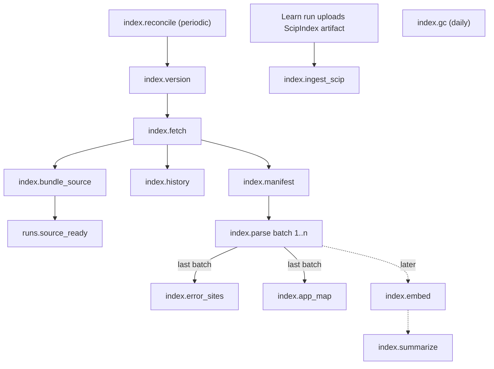

# Knowledge (indexer pipeline, layers, Knowledge MCP)

Owner of the ports `KnowledgeStore` (`mage_core::ports`), `GitRepoReader`, `Parser`, `ScipReader`,
`TextSearch`, `Embedder` (`mage_indexer::ports`), `IndexerLink` (`mage_server::ports`, new), and
of the use-case modules `mage_indexer::app::{index, live}` (indexer role) and
`mage_server::app::knowledge` (server role: Knowledge MCP queries, triage retrieval). Product
rules: [../design.md](../design.md) "Knowledge (Knowledge MCP)". Types from
[domain.md](domain.md) (`mage_core::domain`); tables and object keys in [storage.md](storage.md).

## Purpose

1. Turn a commit of a GitHub repo into queryable facts, layer by layer, incrementally by git blob
   hash, so a ticket's sha becomes useful within minutes and unchanged files cost nothing.
2. Serve those facts read-only to harness runs through the **Knowledge MCP** (server role), with
   every answer pinned to a sha, cited as `path:line@sha`, and labelled with the layer that
   answered.
3. Produce the **SourceBundle** (tar.zst of the tree at a sha) that runners download instead of
   cloning.
4. Provide the triage candidate retrieval pipeline and the metrics that say whether it works.

Non-goals: model training, cross-tenant sharing of facts, write access to repos (that is
[fix.md](fix.md)).

## Layers at a glance

The design numbers layers 1-6; the code uses `Layer` from [domain.md](domain.md). Design layer 2
is split into `Symbols` (tree-sitter, every indexed sha) and `Refs` (SCIP, only where a Learn run
produced an index).

| Design | `Layer` | Produced by job | Keyed by | Answers |
|---|---|---|---|---|
| 1 Files + text | `Files` | `index.manifest` (+ live text search on the indexer) | per sha (manifest) + per blob (content) | `read_file`, `search_code` text/path, `repo_overview`, evidence gate |
| 2 Symbols | `Symbols` | `index.parse` (batches) | per blob @ `ParserRev` | `find_symbol`, name-level `references`/`call_graph`, `glossary`, `explain` fallback |
| 2 Refs | `Refs` | `index.ingest_scip` | per SCIP index (artifact) | precise `references`, `call_graph` |
| 3 Error/log strings | `ErrorSites` | `index.error_sites` | per blob @ `ErrorsRev` | `lookup_error`, triage stage 1 |
| 4 App map | `AppMap` | `index.app_map` | facts per blob @ `AppMapRev`; graph per sha | `app_map`, `route_info` |
| 5 Semantic | `Semantic` | `index.embed`, `index.summarize` (later) | per blob @ `ChunkRev` | `explain`, `glossary` definitions, triage stage 3 |
| 6 History | `History` | `index.history` | per repo (commits, PRs) | `changes_between`, `blame`, triage history boost |
| + memory | n/a (`AnswerSource::Memory`) | resolutions ([triage.md](triage.md), [fix.md](fix.md)) | per ticket | `similar_tickets` |
| + recipe | n/a (`AnswerSource::Recipe`) | Learn runs ([runs.md](runs.md)) | per repo | `run_recipe` |

Rule from the domain: a query reads a layer only when that layer is `Ready` for the version it
answers about. Every tool response names its source in `layer`.

## Ports

### Crate placement

Role crates never depend on each other, so anything the indexer writes and the server reads lives
in `mage-core` (pure, no I/O).

| Item | Location | Why |
|---|---|---|
| `KnowledgeStore` trait + all fact types below (manifest, symbols, refs, literal sites, error sites, catalog, app facts/graph, SCIP rows, history rows, chunks) | `mage_core::ports::knowledge` | written by the indexer, read by the server |
| Shared DTOs of the indexer internal API (`TextQuery`, `TextHits`, `CommitInfo`, `LogQuery`, `FileChange`, `FileDiff`, `TreeDiffOptions`, `BlameHunk`, …) | `mage_core::wire::indexer` (serde) | used by `mage_indexer` ports and by `mage_server::ports::IndexerLink`; no mirror types |
| Pure shared functions: `tokenize`, `to_pattern`, ticket-id scanner, URL/route canonicalization and segment match | `mage_core::domain::knowledge` | the indexer builds patterns/routes, the server matches against them; must be identical |
| `GitRepoReader`, `Parser`, `ScipReader`/`ScipStream`, `TextSearch`, `Embedder` traits (+ their limits/errors) | `mage_indexer::ports` | indexer-only |
| Adapters `git`, `treesitter`, `scip`, `search` | `mage_indexer::adapters::driven::*` | |
| Indexer job worker, internal HTTP API | `mage_indexer::adapters::driving::{worker, http}` | |
| `KnowledgeStore` impl | `mage_infra::pg` | shared Postgres adapter |
| `IndexerLink` trait / impl | `mage_server::ports` / `mage_server::adapters::driven::indexer_link` | server-only |
| Knowledge MCP | `mage_server::adapters::driving::mcp` | server-only |
| Fakes | `mage_core::testing` (KnowledgeStore, RepoStore, …), `mage_indexer::testing` (indexer ports), `mage_server::testing` (IndexerLink) | |

`Embedder` is indexer-only today; when query-time embeddings ship (server), it moves to
`mage_core::ports` (used by two roles).

### Shared types (`mage_core::ports::knowledge`)

Domain additions (`RepoPath`, `Language`, `FileClass`, `SourceBundleRef`, `IndexRevs`,
`LayerEvent`) are listed in [Additions to the contract](#additions-to-the-contract).

```rust
pub struct ParserRev(pub u32);   // grammars + queries + treesitter adapter extraction code
pub struct ErrorsRev(pub u32);   // classifier tables + pattern rules (mage_indexer::app constant)
pub struct AppMapRev(pub u32);   // app extractors (treesitter adapter constant)
pub struct ChunkRev(pub u32);    // chunking + embedding model (later)

pub enum EntryKind { File, Symlink, Submodule }

pub struct ManifestEntry {
    pub path: RepoPath,
    pub kind: EntryKind,
    pub executable: bool,
    pub blob: BlobOid,            // for Submodule: the gitlink commit id bytes
    pub lang: Option<Language>,
    pub class: FileClass,
    pub size: u64,
    pub is_text: bool,
    pub line_count: u32,          // 0 when !is_text or Submodule
}

pub struct BlobMeta { pub oid: BlobOid, pub size: u64, pub line_count: u32, pub is_text: bool, pub content_stored: bool }

pub enum BlobStage { Parse(ParserRev), ErrorSites(ErrorsRev), AppFacts(AppMapRev), Chunks(ChunkRev) }
pub enum StageStatus { Ok, Partial { error_nodes: u32 }, Failed { reason: String } }

pub struct BlobInput { pub oid: BlobOid, pub path: RepoPath, pub lang: Language, pub bytes: Vec<u8> }

pub struct PageReq { pub limit: u32, pub after: Option<String> }   // `after`: adapter keyset, opaque to the app
pub struct Paged<T> { pub items: Vec<T>, pub next: Option<String> }
```

Fact types produced by `Parser` and persisted by `KnowledgeStore`:

```rust
pub enum SymbolKind {
    Module, Function, Method, Class, Struct, Interface, Trait, Enum, TypeAlias,
    Constant, Variable, Field, Macro, Test,
    Registered,                   // framework registration named by a key (re-frame event/sub/fx)
}

pub struct SymbolDef {
    pub ord: u32,                 // index within the blob, stable for a given ParserRev
    pub name: String,             // "Connect", ":connections/get"
    pub qualified: String,        // "Server.Connect", "webapp.connections.events/fetch"
    pub kind: SymbolKind,
    pub container: Option<u32>,   // ord of the enclosing SymbolDef
    pub span: LineRange,          // 1-based inclusive
    pub name_pos: (u32, u32),     // line, column (1-based, UTF-8 bytes)
    pub signature: Option<String>,// first line of the declaration, <= 200 chars
    pub doc: Option<String>,      // leading doc comment / docstring, <= 1 KiB
    pub exported: bool,
}

pub enum RefKind { Call, Type, Read, Import, Dispatch, Render }

pub struct NameRef {
    pub ord: u32,
    pub name: String,             // callee / referenced identifier, or module path for Import
    pub qualifier: Option<String>,// "http" in http.Error, ns alias in CLJS, import alias for Import
    pub kind: RefKind,
    pub pos: (u32, u32),
    pub enclosing: Option<u32>,   // ord of enclosing SymbolDef
}

pub enum Hole { Interp { expr: String }, Concat { expr: String } }   // expr <= 64 chars
pub enum LitPart { Text(String), Hole(Hole) }

pub enum Construct { Throw, Raise, Panic, Return, Call, Attribute, MapValue, Other }
pub enum ArgSummary { Int(i64), Ident(String), Str, Other }

pub struct LiteralContext {
    pub callee: Option<String>,        // normalized callee text: "fmt.Errorf", "log/error", "console.error"
    pub arg_index: Option<u8>,
    pub siblings: Vec<ArgSummary>,     // <= 4 other args of the same call
    pub construct: Construct,
    pub exception_type: Option<String>,// "ValueError", "Error", "ex-info"
    pub map_key: Option<String>,       // when the literal is a map/object value: "message", ":text"
    pub attribute: Option<String>,     // Rust: "error" in #[error("...")]
}

pub struct LiteralSite {
    pub ord: u32,
    pub parts: Vec<LitPart>,           // concatenation / interpolation already flattened
    pub pos: (u32, u32),
    pub enclosing: Option<u32>,
    pub context: LiteralContext,
}

pub struct ParsedBlob {
    pub lang: Language,
    pub status: StageStatus,
    pub symbols: Vec<SymbolDef>,
    pub refs: Vec<NameRef>,
    pub literals: Vec<LiteralSite>,
}

pub struct ParseLimits { pub max_bytes: u64, pub timeout: Duration, pub max_symbols: u32, pub max_refs: u32, pub max_literals: u32 }

pub struct CatalogEntry { pub key: String, pub locale: Option<String>, pub message: String, pub line: u32 }
pub struct Catalog { pub format: CatalogFormat, pub entries: Vec<CatalogEntry> }
pub enum CatalogFormat { Json, Yaml, Properties, Po, Edn }

pub enum FrameworkId {
    GoNetHttp, Gin, Chi, GorillaMux, Echo,
    JsFetch, Axios, ReactRouter, NextRoutes,
    ReFrame, CljsHttpMaps, Reitit,
    SqlStrings,
}
pub struct FrameworkScope { pub root: RepoPath, pub framework: FrameworkId }   // root = dir of go.mod/package.json/...

pub enum AppFact {
    RouteGroup { var: String, prefix: UrlTemplate, parent: Option<String> },
    RouteDecl  { method: Option<String>, path: UrlTemplate, group: Option<String>, handler: HandlerRef, middleware: Vec<String> },
    PageDecl   { path: UrlTemplate, component: String },
    HttpCall   { method: Option<String>, url: UrlTemplate, client: String },
    TableRef   { table: String, op: TableOp },
    JobRef     { name: String, role: JobRole },          // later
    FlagRead   { key: String },                          // later
}
pub enum HandlerRef { Named { name: String, qualifier: Option<String> }, Inline { enclosing: Option<u32>, line: u32 }, Param { index: u8 } }
pub struct UrlTemplate { pub parts: Vec<UrlPart> }
pub enum UrlPart { Lit(String), Var(Option<String>) }
pub enum TableOp { Select, Insert, Update, Delete, Unknown }
pub enum JobRole { Enqueue, Handle }

pub struct AppFactRecord { pub ord: u32, pub framework: FrameworkId, pub fact: AppFact, pub line: u32, pub enclosing: Option<u32> }
```

### `GitRepoReader` (`mage_indexer::ports`; adapter `mage_indexer::adapters::driven::git`)

`CommitInfo`, `ChangeKind`, `FileChange`, `TreeDiffOptions`, `Hunk`, `FileDiff`, `LogQuery`,
`BlameHunk` live in `mage_core::wire::indexer` (shared with `IndexerLink`); the rest here.

```rust
pub struct MirrorRef { pub org: OrgId, pub repo: RepoId }   // adapter maps to {data_dir}/mirrors/{org}/{repo}.git

pub struct FetchWants { pub all_heads_and_tags: bool, pub shas: Vec<CommitSha> }
pub struct FetchOutcome { pub updated_refs: Vec<(String, CommitSha)>, pub missing: Vec<CommitSha> }
pub struct MirrorState { pub exists: bool, pub size_bytes: u64, pub last_fetch: Option<OffsetDateTime> }

pub struct CommitInfo {
    pub sha: CommitSha, pub tree: TreeOid, pub parents: Vec<CommitSha>,
    pub author_name: String, pub author_time: OffsetDateTime, pub committer_time: OffsetDateTime,
    pub subject: String, pub body: String,            // body truncated to 4 KiB
    pub files: Option<Vec<FileChange>>,               // first-parent diff when LogQuery.with_files
}
pub enum ChangeKind { Added, Modified, Deleted, Renamed, TypeChanged }
pub struct FileChange { pub path: RepoPath, pub old_path: Option<RepoPath>, pub change: ChangeKind, pub adds: Option<u32>, pub dels: Option<u32> }

pub enum TreeEntryKind { File { oid: BlobOid, executable: bool }, Symlink { oid: BlobOid }, Submodule { commit: CommitSha } }
pub struct TreeEntry { pub path: RepoPath, pub kind: TreeEntryKind, pub size: Option<u64> }
pub struct TreeListing { pub tree: TreeOid, pub entries: Vec<TreeEntry>, pub skipped_paths: u32 } // non-UTF-8 / invalid paths

pub struct BlobRead { pub oid: BlobOid, pub size: u64, pub bytes: Option<Vec<u8>> }   // None if size > max_bytes

pub struct TreeDiffOptions { pub paths: Vec<RepoPath>, pub hunks: bool, pub context: u8, pub max_bytes_per_file: u32, pub renames: bool }
pub struct Hunk { pub old_start: u32, pub old_lines: u32, pub new_start: u32, pub new_lines: u32, pub text: String }
pub struct FileDiff { pub change: FileChange, pub hunks: Vec<Hunk>, pub binary: bool, pub truncated: bool }

pub struct LogQuery {
    pub include: Vec<CommitSha>, pub exclude: Vec<CommitSha>,     // git rev-list include --not exclude
    pub path_prefix: Option<RepoPath>, pub since: Option<OffsetDateTime>,
    pub skip: u32, pub max: u32, pub with_files: bool,
}
pub struct BlameHunk {
    pub start: u32, pub lines: u32, pub commit: CommitSha, pub author_name: String,
    pub author_time: OffsetDateTime, pub subject: String, pub orig_path: RepoPath, pub orig_start: u32,
}
pub struct ArchiveInfo { pub tree: TreeOid, pub bytes: u64, pub sha256: [u8; 32], pub entries: u32 }

#[async_trait]
pub trait GitRepoReader: Send + Sync {
    async fn mirror_state(&self, m: &MirrorRef) -> Result<MirrorState, GitError>;
    /// Create the bare mirror if absent, then fetch. Serialized per mirror inside the adapter.
    async fn fetch(&self, m: &MirrorRef, spec: &FetchSpec, wants: &FetchWants) -> Result<FetchOutcome, GitError>;
    /// Pin a sha so gc never prunes it (refs/mage/keep/<sha>); unpin on version GC.
    async fn pin(&self, m: &MirrorRef, sha: CommitSha) -> Result<(), GitError>;
    async fn unpin(&self, m: &MirrorRef, sha: CommitSha) -> Result<(), GitError>;
    async fn resolve(&self, m: &MirrorRef, rev: &str) -> Result<CommitSha, GitError>;
    async fn has_commit(&self, m: &MirrorRef, sha: CommitSha) -> Result<bool, GitError>;
    async fn commit(&self, m: &MirrorRef, sha: CommitSha) -> Result<CommitInfo, GitError>;
    /// Recursive listing of blobs, symlinks, gitlinks (no tree entries), sorted by path bytes.
    async fn list_tree(&self, m: &MirrorRef, sha: CommitSha) -> Result<TreeListing, GitError>;
    async fn read_blobs(&self, m: &MirrorRef, oids: &[BlobOid], max_bytes: u64) -> Result<Vec<BlobRead>, GitError>;
    async fn diff(&self, m: &MirrorRef, from: CommitSha, to: CommitSha, opts: &TreeDiffOptions) -> Result<Vec<FileDiff>, GitError>;
    async fn log(&self, m: &MirrorRef, q: &LogQuery) -> Result<Vec<CommitInfo>, GitError>;
    async fn blame(&self, m: &MirrorRef, sha: CommitSha, path: &RepoPath, lines: LineRange) -> Result<Vec<BlameHunk>, GitError>;
    /// Deterministic tar.zst of the tree at `sha` written to `dest` (see SourceBundle).
    async fn archive(&self, m: &MirrorRef, sha: CommitSha, dest: &Path) -> Result<ArchiveInfo, GitError>;
    /// Write the tree at `sha` as plain files under `dest` (read-only checkout for TextSearch).
    async fn materialize(&self, m: &MirrorRef, sha: CommitSha, dest: &Path) -> Result<(), GitError>;
    async fn maintain(&self, m: &MirrorRef) -> Result<(), GitError>;      // git maintenance / gc --auto
    async fn remove_mirror(&self, m: &MirrorRef) -> Result<(), GitError>;
}

pub enum GitError { NotFound, Conflict, Invalid(String), Unavailable(String), Unauthorized, Corrupt(String), Timeout }
```

`FetchSpec { url, username, token: InstallationToken }` is defined with `SourceHost` in
[intake.md](intake.md).

### `Parser` (`mage_indexer::ports`; adapter `mage_indexer::adapters::driven::treesitter`)

```rust
#[async_trait]
pub trait Parser: Send + Sync {
    fn rev(&self) -> ParserRev;
    fn app_rev(&self) -> AppMapRev;
    /// Languages with symbol/literal extraction.
    fn languages(&self) -> &[Language];
    /// Extension / filename / shebang (`head` = first 512 bytes). None = not a known language.
    fn detect_language(&self, path: &RepoPath, head: &[u8]) -> Option<Language>;
    /// Symbols, name refs, imports, literal sites. One result per input, same order.
    async fn parse(&self, blobs: Vec<BlobInput>, limits: ParseLimits) -> Vec<Result<ParsedBlob, ParseError>>;
    /// i18n message catalog; Ok(None) when the path/format is not a catalog.
    async fn catalog(&self, blob: BlobInput) -> Result<Option<Catalog>, ParseError>;
    /// Frameworks per project root from dependency manifests
    /// (go.mod, package.json, deps.edn, shadow-cljs.edn, project.clj, pyproject.toml, Cargo.toml).
    async fn detect_frameworks(&self, manifests: Vec<BlobInput>) -> Result<Vec<FrameworkScope>, ParseError>;
    /// App-map facts; `frameworks` are those whose root contains the blob path.
    async fn app_facts(&self, blobs: Vec<(BlobInput, Vec<FrameworkId>)>, limits: ParseLimits)
        -> Vec<Result<Vec<AppFactRecord>, ParseError>>;
}

pub enum ParseError { NotFound, Conflict, Invalid(String), Unavailable(String), Unsupported(Language), TooLarge, Timeout }
```

### `ScipReader` (`mage_indexer::ports`; adapter `mage_indexer::adapters::driven::scip`)

`ScipMetadata`, `ScipRange`, `ScipRoles`, `ScipOccurrence`, `ScipRelationship`,
`ScipSymbolInfo`, `ScipDocument` live in `mage_core::ports::knowledge` (`KnowledgeStore` persists
them); the trait, `ScipLimits`, `ScipError` here.

```rust
pub struct ScipLimits { pub max_documents: u32, pub max_occurrences_per_doc: u32, pub max_symbol_len: u32 }
pub struct ScipMetadata { pub tool_name: String, pub tool_version: String, pub project_root: String }
pub struct ScipRange { pub start_line: u32, pub start_col: u32, pub end_line: u32, pub end_col: u32 } // converted to 1-based lines
pub struct ScipRoles(pub u32);   // bit flags as in scip.proto SymbolRole: Definition=1, Import=2, WriteAccess=4, ReadAccess=8, Generated=16, Test=32
pub struct ScipOccurrence { pub range: ScipRange, pub symbol: String, pub roles: ScipRoles, pub enclosing: Option<ScipRange> }
pub struct ScipRelationship { pub symbol: String, pub is_reference: bool, pub is_implementation: bool, pub is_type_definition: bool, pub is_definition: bool }
pub struct ScipSymbolInfo { pub symbol: String, pub display_name: Option<String>, pub kind: Option<String>, pub documentation: Option<String>, pub relationships: Vec<ScipRelationship> }
pub struct ScipDocument { pub relative_path: String, pub language: String, pub occurrences: Vec<ScipOccurrence>, pub symbols: Vec<ScipSymbolInfo> }

#[async_trait]
pub trait ScipReader: Send + Sync {
    /// Open a local `index.scip` file (downloaded with ArtifactStore::get_to_file).
    async fn open(&self, file: &Path, limits: ScipLimits) -> Result<Box<dyn ScipStream>, ScipError>;
}

#[async_trait]
pub trait ScipStream: Send {
    fn metadata(&self) -> &ScipMetadata;
    /// Next `max` documents; empty Vec = end of documents.
    async fn next_documents(&mut self, max: usize) -> Result<Vec<ScipDocument>, ScipError>;
    /// Index.external_symbols; valid after documents are exhausted.
    async fn external_symbols(&mut self) -> Result<Vec<ScipSymbolInfo>, ScipError>;
}

pub enum ScipError { NotFound, Conflict, Invalid(String), Unavailable(String), LimitExceeded(String) }
```

Local symbols (`local N`) are document-scoped and dropped at ingest.

### `TextSearch` (`mage_indexer::ports`; adapter `mage_indexer::adapters::driven::search`)

`PatternKind`, `CaseMode`, `TextQuery`, `TextHit`, `Truncation`, `TextHits` live in
`mage_core::wire::indexer`; `Checkout`, the trait, and `SearchError` here.

```rust
pub struct Checkout { pub root: PathBuf, pub sha: CommitSha }
pub enum PatternKind { Literal, Regex }
pub enum CaseMode { Sensitive, Insensitive, Smart }

pub struct TextQuery {
    pub pattern: String,                      // <= 512 bytes
    pub kind: PatternKind,
    pub case: CaseMode,
    pub include: Vec<String>,                 // globs, <= 8
    pub exclude: Vec<String>,                 // globs, <= 8
    pub context: u8,                          // <= 3
    pub max_hits: u32,                        // <= 200
    pub max_line_len: u16,                    // preview truncation, default 240
    pub after: Option<(RepoPath, u32)>,       // keyset: hits strictly after (path, line)
    pub max_file_bytes: u64,                  // skip larger files, default 2 MiB
    pub timeout: Duration,                    // default 5 s
}
pub struct TextHit { pub path: RepoPath, pub line: u32, pub col: u32, pub text: String, pub before: Vec<String>, pub after: Vec<String> }
pub enum Truncation { Limit, Timeout }
pub struct TextHits { pub hits: Vec<TextHit>, pub next: Option<(RepoPath, u32)>, pub truncated: Option<Truncation>, pub files_scanned: u32 }

#[async_trait]
pub trait TextSearch: Send + Sync {
    /// Hits ordered by (path bytes, line). Deterministic for a given checkout and query.
    async fn search(&self, checkout: &Checkout, q: &TextQuery) -> Result<TextHits, SearchError>;
}

pub enum SearchError { NotFound, Conflict, Invalid(String) /* bad regex, bad glob */, Unavailable(String), Timeout }
```

### `KnowledgeStore` (`mage_core::ports::knowledge`; adapter `mage_infra::pg`)

All methods take `OrgId`. Blob facts are keyed `(org_id, blob_oid, rev)`; per-sha facts
`(org_id, repo_id, sha)`. Reads at a sha join `manifests` and filter blob facts by the version's
`IndexRevs`. All writes are idempotent (`ON CONFLICT DO NOTHING` / replace-in-transaction).

```rust
pub struct VersionStats { pub files: u32, pub bytes: u64, pub by_lang: Vec<(Language, u32 /*files*/, u64 /*lines*/)>, pub top_dirs: Vec<(RepoPath, u32)>, pub counts: FactCounts }
pub struct FactCounts { pub symbols: u32, pub error_sites: u32, pub endpoints: u32, pub pages: u32, pub tables: u32 }
pub enum DirEntryKind { Dir, File, Symlink, Submodule }
pub struct DirEntry { pub name: String, pub kind: DirEntryKind, pub size: Option<u64>, pub lang: Option<Language> }
pub enum PathMatch { Substring(String), Glob(String) }

pub enum NameMatch { Exact, CaseInsensitive, Prefix, Fuzzy }
pub struct SymbolQuery { pub name: String, pub qualifier: Option<String>, pub mode: NameMatch, pub kinds: Vec<SymbolKind>, pub lang: Option<Language>, pub path_prefix: Option<RepoPath>, pub include_tests: bool }
pub struct SymbolRef { pub path: RepoPath, pub blob: BlobOid, pub ord: u32 }
pub struct SymbolHit { pub at: SymbolRef, pub def: SymbolDef, pub score: f32 }
pub struct NameRefQuery { pub name: String, pub qualifier: Option<String>, pub kinds: Vec<RefKind>, pub include_tests: bool }
pub struct RefHit { pub path: RepoPath, pub pos: (u32, u32), pub kind: RefKind, pub enclosing: Option<SymbolRef> }

pub struct ScipIndexInfo { pub artifact: ArtifactId, pub sha: CommitSha, pub tool: String, pub languages: Vec<String>, pub documents: u32 }
pub struct ScipSymbolHit { pub symbol: String, pub display_name: Option<String>, pub def: Option<(RepoPath, ScipRange)> }
pub struct ScipDocRows { pub path: RepoPath, pub blob: BlobOid, pub occurrences: Vec<ScipOccurrence> }

pub enum CallDirection { Callers, Callees }
pub enum Precision { Precise, PreciseStale { from_sha: CommitSha }, Name }
pub struct CallEdge { pub from: SymbolRef, pub to: SymbolRef, pub sites: Vec<(RepoPath, u32)> }

pub enum ErrorSiteKind { Throw, Log, HttpResponse, UiMessage, I18nUse }
pub enum LogLevel { Error, Warn, Info, Debug, Fatal }
pub struct ErrorSiteRecord {
    pub ord: u32, pub literal_ord: u32, pub kind: ErrorSiteKind, pub level: Option<LogLevel>,
    pub template: String,          // display form: "connection {} not found: {w}"
    pub pattern: String,           // Rust `regex` syntax, unanchored
    pub tokens: Vec<String>,       // lowercased literal words, sorted, deduped
    pub specificity: u32,          // non-space literal chars
    pub pos: (u32, u32), pub enclosing: Option<u32>,
    pub http_status: Option<u16>, pub i18n_key: Option<String>,
}
pub struct CatalogEntryRecord { pub key: String, pub locale: Option<String>, pub template: String, pub pattern: String, pub tokens: Vec<String>, pub specificity: u32, pub line: u32 }
pub struct ErrorQuery { pub segments: Vec<String>, pub tokens: Vec<String>, pub max_candidates: u32, pub limit: u32, pub include_low_specificity: bool }
pub struct ErrorMatch { pub path: RepoPath, pub blob: BlobOid, pub site: ErrorSiteRecord, pub segment: u16, pub span: (u32, u32), pub verified: bool, pub score: f32 }
pub struct CatalogMatch { pub path: RepoPath, pub entry: CatalogEntryRecord, pub segment: u16, pub span: (u32, u32), pub verified: bool, pub score: f32 }

pub enum AppNodeKind { Page, Component, ClientCall, Endpoint, Handler, Table, Job, Flag, Event }
pub enum AppEdgeKind { Renders, CallsEndpoint, HandledBy, Dispatches, Reads, Writes, Enqueues, Checks }
pub struct AppNode { pub id: u32, pub kind: AppNodeKind, pub key: String /* canonical: "GET /api/connections/{}" */, pub label: String, pub framework: Option<FrameworkId>, pub at: Option<(RepoPath, u32)>, pub symbol: Option<SymbolRef> }
pub struct AppEdge { pub from: u32, pub to: u32, pub kind: AppEdgeKind, pub confidence: f32, pub evidence: Option<(RepoPath, u32)> }
pub struct AppGraph { pub nodes: Vec<AppNode>, pub edges: Vec<AppEdge> }
pub struct AppFactAt { pub path: RepoPath, pub blob: BlobOid, pub fact: AppFactRecord }

pub enum GlossarySource { Symbol, Table, Endpoint, Page, Event, CatalogKey, CatalogText }
pub struct GlossaryHit { pub source: GlossarySource, pub text: String, pub at: (RepoPath, u32), pub weight: f32 }

pub struct ManifestChange { pub path: RepoPath, pub change: ChangeKind, pub old: Option<BlobOid>, pub new: Option<BlobOid> }
pub struct CommitRecord { pub info: CommitInfo }   // files stored in commit_files
pub struct PullRequestRecord { pub number: u32, pub title: String, pub body_head: String, pub head_ref: String, pub base_ref: String, pub merge_commit: Option<CommitSha>, pub merged_at: Option<OffsetDateTime>, pub updated_at: OffsetDateTime, pub url: String }
pub enum LinkSource { CommitSubject, CommitBody, MergeBranch, PrTitle, PrBranch, PrBody }
pub struct TicketLink { pub identifier: String, pub source: LinkSource, pub commit: Option<CommitSha>, pub pr: Option<u32> }
pub enum LinkLookup { Identifier(String), Commits(Vec<CommitSha>), Prs(Vec<u32>) }
pub struct HistoryCursor { pub walked_heads: Vec<CommitSha> /* <= 50 */, pub prs_updated_after: Option<OffsetDateTime> }

#[async_trait]
pub trait KnowledgeStore: Send + Sync {
    // ---- Files (indexer writes) ----
    async fn put_manifest(&self, org: OrgId, key: &RepoVersionKey, entries: &[ManifestEntry]) -> Result<(), KnowledgeError>;
    async fn put_blob_meta(&self, org: OrgId, metas: &[BlobMeta]) -> Result<(), KnowledgeError>;
    async fn blob_meta(&self, org: OrgId, oids: &[BlobOid]) -> Result<Vec<BlobMeta>, KnowledgeError>;
    /// Oids from `oids` with no blob_stages row for (stage, rev).
    async fn missing(&self, org: OrgId, stage: BlobStage, oids: &[BlobOid]) -> Result<Vec<BlobOid>, KnowledgeError>;

    // ---- Symbols (indexer writes) ----
    /// Writes symbols, name_refs, literal_sites and the blob_stages marker per blob.
    async fn put_parsed(&self, org: OrgId, rev: ParserRev, blobs: &[(BlobOid, Result<ParsedBlob, String>)]) -> Result<(), KnowledgeError>;
    async fn literal_sites(&self, org: OrgId, rev: ParserRev, oids: &[BlobOid]) -> Result<Vec<(BlobOid, Language, Vec<LiteralSite>)>, KnowledgeError>;

    // ---- ErrorSites (indexer writes) ----
    async fn put_error_sites(&self, org: OrgId, rev: ErrorsRev, blobs: &[(BlobOid, Vec<ErrorSiteRecord>)]) -> Result<(), KnowledgeError>;
    async fn put_catalog(&self, org: OrgId, rev: ErrorsRev, blobs: &[(BlobOid, Vec<CatalogEntryRecord>)]) -> Result<(), KnowledgeError>;

    // ---- AppMap (indexer writes) ----
    async fn put_app_facts(&self, org: OrgId, rev: AppMapRev, blobs: &[(BlobOid, Vec<AppFactRecord>)]) -> Result<(), KnowledgeError>;
    async fn app_facts_at(&self, org: OrgId, key: &RepoVersionKey, rev: AppMapRev) -> Result<Vec<AppFactAt>, KnowledgeError>;
    async fn replace_app_graph(&self, org: OrgId, key: &RepoVersionKey, graph: &AppGraph) -> Result<(), KnowledgeError>;

    // ---- Refs (indexer writes) ----
    async fn begin_scip_index(&self, org: OrgId, key: &RepoVersionKey, artifact: ArtifactId, meta: &ScipMetadata) -> Result<(), KnowledgeError>;
    async fn put_scip_documents(&self, org: OrgId, artifact: ArtifactId, docs: &[ScipDocRows]) -> Result<(), KnowledgeError>;
    async fn put_scip_symbols(&self, org: OrgId, artifact: ArtifactId, symbols: &[ScipSymbolInfo]) -> Result<(), KnowledgeError>;
    async fn finish_scip_index(&self, org: OrgId, artifact: ArtifactId, languages: &[String], documents: u32) -> Result<(), KnowledgeError>;

    // ---- History (indexer writes) ----
    async fn put_commits(&self, org: OrgId, repo: RepoId, commits: &[CommitRecord]) -> Result<(), KnowledgeError>;
    async fn put_pull_requests(&self, org: OrgId, repo: RepoId, prs: &[PullRequestRecord]) -> Result<(), KnowledgeError>;
    async fn put_ticket_links(&self, org: OrgId, repo: RepoId, links: &[TicketLink]) -> Result<(), KnowledgeError>;
    async fn history_cursor(&self, org: OrgId, repo: RepoId) -> Result<HistoryCursor, KnowledgeError>;
    /// Merges: union of heads (keeps newest 50), max of prs_updated_after. Safe under concurrency.
    async fn merge_history_cursor(&self, org: OrgId, repo: RepoId, cursor: &HistoryCursor) -> Result<(), KnowledgeError>;

    // ---- Reads at a version (server; some used by the indexer) ----
    async fn manifest_entries(&self, org: OrgId, key: &RepoVersionKey, paths: &[RepoPath]) -> Result<Vec<ManifestEntry>, KnowledgeError>;
    async fn manifest_all(&self, org: OrgId, key: &RepoVersionKey, page: &PageReq) -> Result<Paged<ManifestEntry>, KnowledgeError>;
    async fn list_dir(&self, org: OrgId, key: &RepoVersionKey, dir: Option<&RepoPath>, page: &PageReq) -> Result<Paged<DirEntry>, KnowledgeError>;
    async fn find_paths(&self, org: OrgId, key: &RepoVersionKey, m: &PathMatch, page: &PageReq) -> Result<Paged<ManifestEntry>, KnowledgeError>;
    /// Exact basename match ("conn.go"), ordered by path length then path. Used for stack-frame
    /// suffix matching and evidence-gate "did you mean" hints.
    async fn paths_by_basename(&self, org: OrgId, key: &RepoVersionKey, basename: &str, limit: u16) -> Result<Vec<RepoPath>, KnowledgeError>;
    async fn version_stats(&self, org: OrgId, key: &RepoVersionKey) -> Result<VersionStats, KnowledgeError>;

    async fn find_symbols(&self, org: OrgId, key: &RepoVersionKey, q: &SymbolQuery, page: &PageReq) -> Result<Paged<SymbolHit>, KnowledgeError>;
    /// Enclosing chain at (path, line), innermost first.
    async fn symbols_at(&self, org: OrgId, key: &RepoVersionKey, path: &RepoPath, line: u32) -> Result<Vec<SymbolHit>, KnowledgeError>;
    async fn symbols_in_file(&self, org: OrgId, key: &RepoVersionKey, path: &RepoPath) -> Result<Vec<SymbolHit>, KnowledgeError>;
    async fn symbols_by_ref(&self, org: OrgId, key: &RepoVersionKey, refs: &[SymbolRef]) -> Result<Vec<SymbolHit>, KnowledgeError>;
    async fn name_refs(&self, org: OrgId, key: &RepoVersionKey, q: &NameRefQuery, page: &PageReq) -> Result<Paged<RefHit>, KnowledgeError>;
    /// One hop, batched. Name precision resolves callee names to defs at the version; Precise uses SCIP.
    async fn call_edges(&self, org: OrgId, key: &RepoVersionKey, from: &[SymbolRef], dir: CallDirection, precision: &Precision, limit: u32) -> Result<Vec<CallEdge>, KnowledgeError>;

    /// SCIP index for exactly this sha, else the newest index of the repo (caller reports PreciseStale).
    async fn scip_index_for(&self, org: OrgId, key: &RepoVersionKey) -> Result<Option<ScipIndexInfo>, KnowledgeError>;
    async fn scip_symbol_at(&self, org: OrgId, index: ArtifactId, path: &RepoPath, line: u32, col: Option<u32>) -> Result<Option<ScipSymbolHit>, KnowledgeError>;
    /// Occurrences of `symbol`, restricted to documents whose blob equals the manifest blob at `key`.
    async fn scip_occurrences(&self, org: OrgId, index: ArtifactId, key: &RepoVersionKey, symbol: &str, defs: bool, page: &PageReq) -> Result<Paged<RefHit>, KnowledgeError>;

    async fn match_errors(&self, org: OrgId, key: &RepoVersionKey, rev: ErrorsRev, q: &ErrorQuery) -> Result<Vec<ErrorMatch>, KnowledgeError>;
    async fn match_catalog(&self, org: OrgId, key: &RepoVersionKey, rev: ErrorsRev, q: &ErrorQuery) -> Result<Vec<CatalogMatch>, KnowledgeError>;
    async fn sites_for_i18n_key(&self, org: OrgId, key: &RepoVersionKey, rev: ErrorsRev, i18n_key: &str, page: &PageReq) -> Result<Paged<ErrorMatch>, KnowledgeError>;
    async fn error_sites_in(&self, org: OrgId, key: &RepoVersionKey, rev: ErrorsRev, symbol: &SymbolRef, limit: u32) -> Result<Vec<ErrorMatch>, KnowledgeError>;

    async fn app_nodes(&self, org: OrgId, key: &RepoVersionKey, kinds: &[AppNodeKind], page: &PageReq) -> Result<Paged<AppNode>, KnowledgeError>;
    /// Nodes within `depth` hops of `focus` (both directions), capped at `max_nodes`.
    async fn app_neighborhood(&self, org: OrgId, key: &RepoVersionKey, focus: &[u32], depth: u8, max_nodes: u32) -> Result<AppGraph, KnowledgeError>;
    async fn app_nodes_for_symbols(&self, org: OrgId, key: &RepoVersionKey, symbols: &[SymbolRef]) -> Result<Vec<AppNode>, KnowledgeError>;

    async fn glossary_hits(&self, org: OrgId, key: &RepoVersionKey, words: &[String], limit: u32) -> Result<Vec<GlossaryHit>, KnowledgeError>;
    async fn glossary_top(&self, org: OrgId, key: &RepoVersionKey, limit: u32) -> Result<Vec<GlossaryHit>, KnowledgeError>;

    async fn manifest_diff(&self, org: OrgId, from: &RepoVersionKey, to: &RepoVersionKey, prefix: Option<&RepoPath>, page: &PageReq) -> Result<Paged<ManifestChange>, KnowledgeError>;
    async fn has_commit(&self, org: OrgId, repo: RepoId, sha: CommitSha) -> Result<bool, KnowledgeError>;
    async fn commits(&self, org: OrgId, repo: RepoId, shas: &[CommitSha]) -> Result<Vec<CommitRecord>, KnowledgeError>;
    async fn pull_requests_for_commits(&self, org: OrgId, repo: RepoId, shas: &[CommitSha]) -> Result<Vec<(CommitSha, PullRequestRecord)>, KnowledgeError>;
    async fn ticket_links(&self, org: OrgId, repo: RepoId, by: &LinkLookup) -> Result<Vec<TicketLink>, KnowledgeError>;

    // ---- Semantic (later) ----
    async fn put_chunks(&self, org: OrgId, rev: ChunkRev, chunks: &[ChunkRecord]) -> Result<(), KnowledgeError>;
    async fn knn_chunks(&self, org: OrgId, key: &RepoVersionKey, rev: ChunkRev, query: &[f32], k: u32) -> Result<Vec<ChunkHit>, KnowledgeError>;
    async fn put_summary(&self, org: OrgId, s: &SummaryRecord) -> Result<(), KnowledgeError>;
    async fn summary(&self, org: OrgId, scope: &SummaryScope) -> Result<Option<SummaryRecord>, KnowledgeError>;

    // ---- GC ----
    async fn delete_version_facts(&self, org: OrgId, key: &RepoVersionKey) -> Result<(), KnowledgeError>;
    /// Delete blob facts + blobs rows not referenced by any manifest of the org and older than
    /// `grace`; returns the oids whose content objects the caller must delete.
    async fn sweep_unreferenced_blobs(&self, org: OrgId, grace: Duration, max: u32) -> Result<Vec<BlobOid>, KnowledgeError>;
}

pub enum KnowledgeError { NotFound, Conflict, Invalid(String), Unavailable(String), Timeout }
```

`ChunkRecord`, `ChunkHit`, `SummaryRecord`, `SummaryScope` are specified in
[Layer 5](#layer-5-semantic-later).

### `Embedder` (`mage_indexer::ports` for now; later)

```rust
pub struct EmbeddingModel { pub id: String, pub dims: u16, pub max_input_tokens: u32 }
pub enum EmbedPurpose { Document, Query }

#[async_trait]
pub trait Embedder: Send + Sync {
    fn model(&self) -> &EmbeddingModel;
    /// One vector per input, same order. Inputs are truncated by the adapter to max_input_tokens.
    async fn embed(&self, org: OrgId, purpose: EmbedPurpose, inputs: &[String]) -> Result<Vec<Vec<f32>>, EmbedError>;
}

pub enum EmbedError { NotFound, Conflict, Invalid(String), Unavailable(String), RateLimited { retry_after: Duration }, BudgetExceeded }
```

### `IndexerLink` (new; `mage_server::ports`; adapter `mage_server::adapters::driven::indexer_link`)

Server-side client for the indexer's internal API (see [Text search on Cloud Run](#text-search-blame-and-diff-on-cloud-run)).
All argument and result types are `mage_core::wire::indexer` DTOs.

```rust
#[async_trait]
pub trait IndexerLink: Send + Sync {
    /// `include_generated = false` drops hits in Generated/Vendored/Binary files (indexer side).
    async fn search(&self, org: OrgId, key: &RepoVersionKey, q: &TextQuery, include_generated: bool) -> Result<TextHits, IndexerLinkError>;
    async fn blame(&self, org: OrgId, key: &RepoVersionKey, path: &RepoPath, lines: LineRange) -> Result<Vec<BlameHunk>, IndexerLinkError>;
    async fn diff(&self, org: OrgId, repo: RepoId, from: CommitSha, to: CommitSha, opts: &TreeDiffOptions) -> Result<Vec<FileDiff>, IndexerLinkError>;
    async fn log(&self, org: OrgId, repo: RepoId, q: &LogQuery) -> Result<Vec<CommitInfo>, IndexerLinkError>;
}

pub enum IndexerLinkError { NotFound, Conflict, Invalid(String), Unavailable(String), Timeout }
```

### Ports used (defined elsewhere)

| Port | Methods used here | Role | Owner doc |
|---|---|---|---|
| `RepoStore` (`mage_core::ports`) | `add_version_reason`, `default_head` (both from [intake.md](intake.md)); `version`, `apply_layer_event`, `begin_layer_batches`, `finish_layer_batch`, `set_index_revs`, `set_source_bundle`, `bundle_for_tree`, `versions`, `version_reasons`, `delete_version`, `repo`, `active_repos_system`, `latest_recipe` | indexer, server | [storage.md](storage.md); new methods in [Additions](#additions-to-the-contract) |
| `JobQueue` (`mage_core::ports`) | `enqueue(NewJob{kind, payload, dedupe_key, run_after, max_attempts})`; lease/complete/fail via the job worker | indexer, server | [storage.md](storage.md) |
| `ArtifactStore` (`mage_core::ports`, impl `mage_infra::blob`) | `put`, `get`, `put_file`, `get_to_file`, `delete` | indexer (write), server (read) | [storage.md](storage.md) |
| `SourceHost` (`mage_core::ports`, impl `mage_infra::github`) | `fetch_spec`, `list_pull_requests` | indexer | [intake.md](intake.md) |
| `TicketStore` (`mage_server::ports`) | `similar_resolved` (new) | server | [storage.md](storage.md), addition below |
| `Clock`, `IdGen` (`mage_core::ports`) | `now`, ids | all | README |

## Use cases

### Which shas get indexed

`RepoVersion.reasons` drives everything. Intake writes `RepoVersion` rows and enqueues the entry
job; other areas enqueue the same entry job when they need a sha.

| `VersionReason` | Trigger (who enqueues `index.version`) | Priority (`JobPayload::priority()`) | Retention (`index.gc`) |
|---|---|---|---|
| `OnDemand(TicketId)` | intake (ticket target sha not indexed), triage, runs (run queued for an unindexed sha) | highest | 90 days after creation |
| `Deployed(env)` | intake on deployment observed ([intake.md](intake.md)) | high | while current for the env, then 90 days |
| `DefaultHead` | intake on push to the default branch (debounced: `run_after = now + 60 s`); `index.reconcile` | normal | current head + previous head; older heads 7 days |
| `Release(tag)` | intake on release/tag | low | latest 10 releases |

Entry job (adopted contract): `index.version` payload `{org_id, repo_id, sha, reason}`, dedupe
`index.version:{repo_id}:{sha}`. All derived `index.*` payloads carry `prio` copied from the
triggering reason so `JobPayload::priority()` orders the whole DAG.

### Job DAG per commit



Every successor is enqueued in the same transaction as the predecessor's final write
(`jobs: &[NewJob]` outbox argument on store methods). Job handlers are idempotent: a retried job
re-checks state and skips done work.

| Kind | Payload | Dedupe key | Max attempts / lease | Writes | Layer effect | Enqueues |
|---|---|---|---|---|---|---|
| `index.version` | `{org_id, repo_id, sha, reason}` | `index.version:{repo_id}:{sha}` | 5 / 1 min | `repo_versions` (reason, layers) | new layers `Pending` | `index.fetch` |
| `index.fetch` | `{org_id, repo_id, sha, prio}` | `index.fetch:{repo_id}:{sha}` | 6 / 10 min | mirror on local disk, keep ref | all `Failed` if unreachable | `index.manifest`, `index.history`, `index.bundle_source` |
| `index.manifest` | `{org_id, repo_id, sha, prio}` | `index.manifest:{repo_id}:{sha}` | 5 / 15 min | blob content objects, `blobs`, `manifests`, `layer_batches` | `Files` Running→Ready; `Symbols` Pending→Running | `index.parse` × n (or successors of parse when n = 0) |
| `index.parse` | `{org_id, repo_id, sha, prio, batch, oids}` | `index.parse:{repo_id}:{sha}:{batch}` | 3 / 10 min | `symbols`, `name_refs`, `literal_sites`, `blob_stages` | last batch: `Symbols` Ready | last batch: `index.error_sites`, `index.app_map` |
| `index.error_sites` | `{org_id, repo_id, sha, prio}` | `index.error_sites:{repo_id}:{sha}` | 3 / 20 min | `error_sites`, `catalog_entries`, `blob_stages` | `ErrorSites` Running→Ready | — |
| `index.app_map` | `{org_id, repo_id, sha, prio}` | `index.app_map:{repo_id}:{sha}` | 3 / 20 min | `app_facts`, `blob_stages`, `app_nodes`, `app_edges` | `AppMap` Ready or Skipped | — |
| `index.history` | `{org_id, repo_id, sha, prio}` | `index.history:{repo_id}:{sha}` | 5 / 30 min | `commits`, `commit_files`, `pull_requests`, `ticket_links`, `history_cursors` | `History` Ready | — |
| `index.bundle_source` | `{org_id, repo_id, sha, prio}` | `index.bundle_source:{repo_id}:{sha}` | 4 / 30 min | bundle object, `repo_versions.bundle_*` | none (not a layer) | `runs.source_ready {org_id, repo_id, sha}` (also on permanent failure) |
| `index.ingest_scip` | `{org_id, repo_id, sha, run_id, artifact_id, key}` | `index.ingest_scip:{artifact_id}` | 3 / 60 min | `scip_indexes`, `scip_symbols`, `scip_occurrences` | `Refs` Running→Ready | — |
| `index.reconcile` | `{}` | `index.reconcile` | 1 / 10 min; self-reschedules every 10 min | — | — | `index.version` (DefaultHead), rev rebuilds |
| `index.gc` | `{}` | `index.gc` | 1 / 60 min; daily | deletes | — | — |
| `index.embed` (later) | `{org_id, repo_id, sha, prio}` | `index.embed:{repo_id}:{sha}` | 3 | `chunks`, `blob_stages` | `Semantic` | `index.summarize` |
| `index.summarize` (later) | `{org_id, repo_id, sha, prio}` | `index.summarize:{repo_id}:{sha}` | 3 | `summaries`, `glossary_terms` | `Semantic` Ready | — |

`index.ingest_scip` is enqueued by the server when a `ScipIndex` artifact upload completes on a
Learn run ([runs.md](runs.md), [executor.md](executor.md)); `runs.source_ready` is handled by the
runs use case.

Indexer worker concurrency (config `[indexer.workers]`): `fetch` 2, `parse` = CPU cores,
`bundle_source` 2, others 4. One fetch per mirror at a time (adapter lock).

### UC `index.version`

1. `RepoStore::add_version_reason(org, repo, sha, reason)` (idempotent; creates the `RepoVersion`
   with all layers `Pending` if absent; intake usually did this already), then `version(org, key)`.
2. If `reason = DefaultHead` and `RepoStore::default_head(org, repo)` is a different (newer)
   sha and this version has no other reason: `apply_layer_event(Skip{"superseded"})` for every
   `Pending` layer; stop.
3. If every layer is `Ready`/`Skipped` and `version.revs == current IndexRevs`: stop (nothing to do).
4. Otherwise set stale layers to `Pending` (rev bump: see [Layer states](#layer-states)), set
   `Refs` to `Skipped{"no recipe"}` when the repo has no validated recipe (else leave `Pending`
   for a Learn run), `Semantic` to `Skipped{"disabled"}` until embeddings ship, and enqueue
   `index.fetch`.

### Mirror management (`index.fetch`)

- One bare mirror per repo: `{indexer.data_dir}/mirrors/{org}/{repo_id}.git`, on the indexer VM's
  local disk (pd-balanced/SSD). The mirror is a cache: deleting it is always safe.
- Steps:
  1. `SourceHost::fetch_spec(installation, RepoCoords)` → `FetchSpec { url, username, token }`
     (token scoped to this repo, `contents: read`, `pull_requests: read`; never stored).
  2. If `GitRepoReader::has_commit(sha)` → skip the network.
  3. Else `fetch(m, spec, FetchWants { all_heads_and_tags: true, shas: [sha] })`. The adapter
     first fetches `+refs/heads/*:refs/heads/*` and `+refs/tags/*:refs/tags/*` (with `--prune`),
     then fetches the sha by id if still missing (GitHub serves reachable commits by id
     [unverified for commits no longer reachable from any ref]).
  4. Still missing → permanent failure: every layer `Failed{"sha not reachable"}`, and
     `runs.source_ready` enqueued so waiting runs error out.
  5. `pin(sha)` creates `refs/mage/keep/<sha>` so force-pushes plus gc never drop an indexed sha.
  6. Enqueue `index.manifest`, `index.history`, `index.bundle_source`.
- Maintenance: `index.reconcile` calls `maintain` (git `maintenance run --auto`) weekly per mirror.
- `Unauthorized` (installation revoked/suspended) is not retried; layers `Failed{"source access
  revoked"}`; intake owns the integration status.

### UC `index.manifest` (layer `Files`)

1. `apply_layer_event(Files, Start)`.
2. `list_tree(sha)` → entries (sorted). Invalid/non-UTF-8 paths are skipped and counted.
3. For each entry: `lang = Parser::detect_language(path, head)`; `class` from path rules
   (`vendor/`, `node_modules/`, `third_party/` → Vendored; `dist/`, `build/`, `*.min.js`,
   `*_generated.go`, `*.pb.go`, header `Code generated ... DO NOT EDIT` → Generated; `*_test.go`,
   `test/`, `__tests__/`, `*.spec.ts`, `*_test.clj` → Test; `*.md`, `docs/` → Doc; config
   extensions → Config; NUL in first 8000 bytes → Binary).
4. Blob content cache: `KnowledgeStore::blob_meta(oids)`; for oids without a row, `read_blobs`
   (cap 2 MiB), compute `is_text` (no NUL in first 8000 bytes), `line_count` (count of `\n`,
   +1 if the last byte is not `\n`), and for text blobs `ArtifactStore::put(blob_content_key(org, oid), bytes)`.
   Then `put_blob_meta`. Content keys (`mage_core::domain::knowledge::blob_content_key(org, oid)`):
   `org/{org}/blobs/{oid_hex[0..2]}/{oid_hex}`, raw bytes.
   Blobs > 2 MiB get `content_stored = false`.
5. `put_manifest(org, key, entries)` (replace in one transaction).
6. `apply_layer_event(Files, Complete)`.
7. Parse plan: candidates = entries with `kind = File`, `lang ∈ Parser::languages()`,
   `class ∈ {Source, Test}`, `size ≤ 1 MiB`. `missing(Parse(rev), candidate oids)` → to-do set.
   Batches in path order, ≤ 256 blobs and ≤ 8 MiB each.
8. If n = 0: `apply_layer_event(Symbols, Complete, jobs = [error_sites, app_map])`.
   Else `begin_layer_batches(Symbols, n, jobs = [index.parse × n])` (also sets `Symbols` Running).

### Blob-hash caching

| Fact | Cache key | Skip rule |
|---|---|---|
| content object + `blobs` row | `(org_id, blob_oid)` | row exists |
| symbols / name refs / literal sites | `(org_id, blob_oid, ParserRev)` | `blob_stages(parse, rev)` exists (any status) |
| error sites | `(org_id, blob_oid, ErrorsRev)` | `blob_stages(error_sites, rev)` exists |
| catalog entries | `(org_id, blob_oid, ErrorsRev)` | same marker as error sites |
| app facts | `(org_id, blob_oid, AppMapRev)` | `blob_stages(app_facts, rev)` exists |
| chunks (later) | `(org_id, blob_oid, ChunkRev)` | `blob_stages(chunks, rev)` exists |
| SourceBundle | `(org_id, repo_id, tree_oid)` | `bundle_for_tree` returns a ref |

Consequences: a push that changes 3 files parses 3 blobs; two shas indexing concurrently may parse
the same new blob twice (writes are `ON CONFLICT DO NOTHING`, accepted waste); facts are never
shared across orgs even for identical blobs (no cross-tenant existence oracle). Per-sha work that
cannot be cached by blob: manifest rows, app graph linking, layer state.

### UC `index.parse` (layer `Symbols`)

1. `read_blobs(oids)`; `Parser::parse(inputs, limits)` with `ParseLimits { max_bytes: 1 MiB,
   timeout: 2 s, max_symbols: 20_000, max_refs: 100_000, max_literals: 5_000 }`.
2. `put_parsed(org, rev, results)`: per blob writes rows plus the `blob_stages` marker;
   `Err` results write a `Failed` marker (the blob is not retried until the rev changes).
3. `finish_layer_batch(Symbols, batch, on_last = [index.error_sites, index.app_map])` returns
   remaining; the store marks the batch done idempotently and, when remaining hits 0, applies
   `Complete` to `Symbols` and enqueues `on_last` in the same transaction.

A whole-batch failure (Postgres down, mirror missing) fails the job; per-blob parse failures
never fail the job.

### Layer states

`LayerState` transitions, implemented as `LayerState::apply(LayerEvent)` in `mage_core::domain`:

| From | Event | To |
|---|---|---|
| `Pending` | `Start` (first job for the layer runs) | `Running` |
| `Pending` | `Skip{reason}` (not applicable, superseded, prerequisite failed) | `Skipped{reason}` |
| `Running` | `Start` (job retry) | `Running` |
| `Running` | `Complete{at}` | `Ready{at}` |
| `Running` | `Fail{reason}` (job dead-lettered) | `Failed{reason}` |
| `Ready` | `Complete{at}` (shadow rebuild at a new rev finished) | `Ready{at}` |
| `Failed`, `Skipped` | `Reset` (manual reindex, rev bump, recipe validated for `Refs`) | `Pending` |
| `Ready` | `Reset` (manual "reindex from scratch" only) | `Pending` |

Dependencies: `Symbols` Failed → `ErrorSites`, `AppMap`, `Semantic` get `Skip{"symbols failed"}`.
`Files` Failed → every other layer except `History` gets `Skip{"files failed"}`.

Rev bumps (new `ParserRev`/`ErrorsRev`/`AppMapRev` in a deploy): the version keeps serving
`Ready` facts at its recorded `IndexRevs`; `index.reconcile` re-enqueues `index.version` for
retained versions (rate-limited, newest first); jobs write facts at the new rev; the final job of
each layer calls `set_index_revs` and `Complete` in one transaction, switching readers atomically.
Old-rev facts are removed by `index.gc` when no version references that rev.

### SourceBundle (`index.bundle_source`)

1. `commit(sha)` → `tree`, `committer_time`.
2. `RepoStore::bundle_for_tree(org, repo, tree)` → reuse the ref if present (identical trees share
   one bundle).
3. Else `GitRepoReader::archive(m, sha, {data_dir}/tmp/{uuid}.tar.zst)` → `ArchiveInfo`. Format:
   - exactly the git tree at `sha` (own tree walk; `export-ignore`/`export-subst` are NOT applied);
   - tar (pax headers for long paths), entries sorted by path bytes, directory entries for every
     parent dir (0755), files 0644 or 0755 (exec bit), symlinks as symlink entries, submodules as
     empty directories, no `.git`, LFS pointer files as-is;
   - mtime = commit `committer_time`, uid/gid 0, empty uname/gname;
   - zstd level 3, single-threaded (deterministic output for the same tree and adapter version
     [unverified across zstd versions]);
   - sha256 over the compressed bytes computed while writing.
4. Size cap `indexer.bundle_max_bytes` (default 2 GiB) → permanent failure.
5. `ArtifactStore::put_file(org/{org}/repos/{repo}/bundles/{tree_oid}.tar.zst, tmp,
   content_type = application/zstd)`.
6. `RepoStore::set_source_bundle(org, key, SourceBundleRef { key, tree, bytes, sha256 },
   jobs = [runs.source_ready {org_id, repo_id, sha}])` (dedupe `runs.source_ready:{repo_id}:{sha}`).
7. Delete the temp file.

The server turns the ref into a signed download URL in `RunAssignment` ([runs.md](runs.md)); the
runner verifies `sha256` after download. Bundles are not `Artifact` rows (`Artifact.run_id` is
mandatory and bundles belong to a version, not a run).

### Layer 1: Files

Written by `index.manifest` (above). Text search is not precomputed: it runs live on the indexer
over a materialized checkout (see [Text search on Cloud Run](#text-search-blame-and-diff-on-cloud-run)).

### Layer 2: Symbols (tree-sitter)

The treesitter adapter (`mage_indexer::adapters::driven::treesitter`) runs grammar queries per
language. Base queries are the grammars' `tags.scm` captures (`@definition.*`, `@reference.*`,
`@name`, `@doc`) where they exist, extended by Mage-owned query files vendored next to the adapter
module (`src/adapters/driven/treesitter/queries/<lang>/{symbols,refs,literals}.scm` in `mage-indexer`).
Any change to grammars, queries, or extraction code bumps `ParserRev`.

| Language | Grammar crate | Definitions (`SymbolKind`) | Name refs | Notes |
|---|---|---|---|---|
| Go | `tree-sitter-go` | `package_clause` → Module; `function_declaration` → Function; `method_declaration` → Method (container = receiver base type, `qualified = Type.Method`); `type_spec` → Struct / Interface / TypeAlias; package-level `const_spec`/`var_spec` → Constant/Variable; `Test*` funcs in `_test.go` → Test | `call_expression` callee (identifier or selector; selector operand → `qualifier`); `type_identifier` → Type; `import_spec` → Import (`name` = import path, `qualifier` = alias or last path segment) | exported = capitalized; doc = preceding `//` comment block |
| TypeScript / TSX | `tree-sitter-typescript` (typescript, tsx) | `function_declaration`, `class_declaration`, `method_definition`, `interface_declaration`, `type_alias_declaration`, `enum_declaration`; `const X = (…) =>`/`function` → Function; PascalCase function returning JSX → Function | `call_expression`, `new_expression`, `jsx_opening_element`/`jsx_self_closing_element` → Render; `import_statement` → Import | exported = `export` ancestor; doc = JSDoc `/** */` |
| JavaScript / JSX | `tree-sitter-javascript` | as TS minus types | as TS | |
| Python | `tree-sitter-python` | `function_definition` (Method inside class), `class_definition`, module-level assignments → Variable/Constant (UPPER_CASE) | `call` callee, `import_statement`/`import_from_statement` | doc = first string statement; decorators kept in `signature` |
| Rust | `tree-sitter-rust` | `function_item` (Method inside `impl_item`, container = impl type), `struct_item`, `enum_item`, `trait_item`, `type_item`, `const_item`, `static_item`, `macro_definition`, `mod_item`; `#[test]` fns → Test | `call_expression`, `macro_invocation`, `use_declaration` → Import | doc = `///` |
| Clojure / CLJS / CLJC | `tree-sitter-clojure` [unverified crate name and tree-sitter ABI compatibility] | Custom Rust walker, not tags queries (the grammar is purely syntactic: `list_lit`, `sym_lit`, `kwd_lit`, `str_lit`, `vec_lit`, `map_lit`, `meta_lit`). Top-level `list_lit` dispatch on head symbol: `ns` → Module; `defn`, `defn-` → Function; `def`, `defonce` → Variable; `defmacro` → Macro; `defmulti`/`defmethod` → Function; `defprotocol` → Interface; `defrecord`/`deftype` → Struct; `s/def` → TypeAlias; `deftest` → Test; re-frame `reg-event-db`/`reg-event-fx`/`reg-event-ctx`/`reg-sub`/`reg-fx`/`reg-cofx` (any alias of `re-frame.core`) → Registered, name = fully-qualified keyword | head `sym_lit` of every nested `list_lit` → Call; `(dispatch [:kw …])`, `(dispatch-sync …)`, `{:dispatch [:kw]}`/`:fx [[:dispatch [:kw]]]`, `(subscribe [:kw])` → Dispatch refs with the keyword as `name`; `(:require [x.y :as z])` → Import | Per-file alias table from the `ns` form: `z/foo` → qualifier resolved to `x.y`; `::foo` → `:<current-ns>/foo`; `::z/foo` → `:x.y/foo`. Docstring = string after the name in `defn`. |

Later languages (Java, Ruby, Kotlin) follow the same table. Files in other languages still get
`Files` and text search.

### Layer 2: Refs (SCIP ingestion)

SCIP needs installed dependencies, so indexers run on the runner during a Learn run after the Boot
gate passes ([executor.md](executor.md)); each language produces artifact
`scip/<language>.scip` (`ArtifactKind::ScipIndex`) with `project_root` = repo root.

UC `index.ingest_scip {org_id, repo_id, sha, run_id, artifact_id, key}`:

1. Require a `RepoVersion` for `(repo_id, sha)` with `Files` Ready; else fail retryable (the Learn
   run's sha is always indexed before the run is assigned, because it needs the SourceBundle).
2. `apply_layer_event(Refs, Start)`; `ArtifactStore::get_to_file(key, {data_dir}/scip/{artifact_id}.scip)`
   (cap 1 GiB).
3. `ScipReader::open(file, ScipLimits { max_documents: 200_000, max_occurrences_per_doc: 200_000, max_symbol_len: 1024 })`;
   `begin_scip_index(org, key, artifact_id, metadata)`.
4. Loop `next_documents(500)`: normalize `relative_path` to `RepoPath` (reject absolute, `..`,
   `.git`); look up the manifest entry; drop documents not in the manifest (generated files,
   dependencies); drop occurrences whose range exceeds the blob's `line_count`; drop `local N`
   symbols; `put_scip_documents` (rows carry the manifest `blob_oid`) and `put_scip_symbols`.
5. `external_symbols()` → `put_scip_symbols`. `finish_scip_index(languages, documents)`.
6. `apply_layer_event(Refs, Complete)`; delete the local file.

Readers use `scip_index_for(key)`: the index for exactly this sha (`Precision::Precise`), else
the newest index for the repo, restricted to documents whose `blob_oid` equals the manifest blob
at the queried sha (`Precision::PreciseStale { from_sha }`). Unchanged files keep valid ranges;
cross-file symbol identity may be stale, which the tool reports.

### Layer 3: Error sites

UC `index.error_sites`:

1. `apply_layer_event(ErrorSites, Start)`.
2. Source blobs: manifest blobs with `Parse` marker at `version.revs.parser` (or current rev in a
   rebuild); `missing(ErrorSites(rev), oids)`; in chunks of 1000: `literal_sites(org, parser_rev, oids)`
   → `classify` → `to_pattern` → `put_error_sites` (empty Vec still writes the marker).
3. Catalog blobs: manifest paths matching catalog rules (`**/locales/**/*.{json,yml,yaml}`,
   `**/i18n/**/*.{json,yml,yaml,edn}`, `**/*.po`, `**/messages*.properties`, `**/translations/**`);
   `missing(ErrorSites(rev))`; `read_blobs`; `Parser::catalog` → each entry's message through
   `to_pattern` with the catalog placeholder syntax → `put_catalog`.
4. `apply_layer_event(ErrorSites, Complete)` (+ `set_index_revs` in a rebuild).

`classify` is a pure function in `mage_indexer::app::index::errors`; `to_pattern` and `tokenize`
are pure functions in `mage_core::domain::knowledge` (the server tokenizes inputs the same way).
Both are versioned by `ErrorsRev`.

**Classification** (`LiteralSite` → `Option<ErrorSiteDraft>`), first matching rule wins:

| Kind | Rule | Examples |
|---|---|---|
| `Throw` | `construct ∈ {Throw, Raise, Panic}`; or callee ∈ error-constructor list; or Rust `attribute = "error"` | Go `errors.New`, `fmt.Errorf`, `errors.Wrap(f)`, `panic`; JS/TS `new Error/TypeError/…` in `throw`, `Promise.reject(new Error(…))`; Python `raise X("…")`; Rust `bail!`, `anyhow!`, `panic!`, `expect("…")`, `#[error("…")]`; Clojure `(ex-info "…" {…})`, `(js/Error. "…")`, `(throw …)` |
| `Log` | callee final segment ∈ {`Error`, `Errorf`, `Errorw`, `Warn`, `Warnf`, `Warning`, `Fatal`, `Fatalf`, `Panicf`, `Info`, `Infof`, `Printf`, `Println`, `error`, `warn`, `warning`, `exception`, `critical`, `info`} and receiver/qualifier ∈ {`log`, `logger`, `logging`, `slog`, `zap`, `logrus`, `l`, `console`, `timbre`, `tracing`} or a Rust log macro (`error!`, `warn!`, `info!`); `level` from the method | Go `log.Errorf("…")`, `slog.Error`, JS `console.error`, Python `logger.exception`, Clojure `(log/error …)`, `(timbre/warn …)`, `(js/console.error …)` |
| `HttpResponse` | a sibling arg is `Int(400..=599)` or `Ident` matching `Status*`/`http.Status*`/`StatusCode::*`/`HTTPStatus.*`; or `map_key ∈ {message, error, detail, msg, :message, :error}` inside a call whose siblings carry a status | Go `http.Error(w, "…", http.StatusUnauthorized)`, gin `c.JSON(http.StatusNotFound, gin.H{"message": "…"})`, Express `res.status(404).json({message: "…"})`, FastAPI `HTTPException(status_code=404, detail="…")`, Ring `{:status 404 :body {:message "…"}}` |
| `UiMessage` | callee ∈ {`toast.error`, `toast.warning`, `notify`, `alert`, `message.error`, `enqueueSnackbar`} or `map_key ∈ {:text, :message}` in a map that also has `:level :error`/`:type :error`, inside a `dispatch` | CLJS `(rf/dispatch [:show-snackbar {:level :error :text "…"}])` |
| `I18nUse` | callee ∈ {`t`, `i18n.t`, `$t`, `tr`, `gettext`, `_`, `formatMessage`, `i18n/t`} and `arg_index = 0`, or JSX attr `i18nKey` | `t("errors.connection_not_found")` → `i18n_key`, template empty |

Repos can extend callee lists via a repo setting `knowledge.error_callees` (stored with the repo,
part of the cache key through a hash folded into `ErrorsRev` for that repo) — see open questions.
Literals shorter than 3 letters, without any letter, or longer than 512 chars are ignored.

**Template.** The classifier rewrites `parts` into `Seg = Lit(String) | Var(VarClass)` using the
callee's format convention:

| Convention | Applies to | Placeholder → `VarClass` |
|---|---|---|
| printf | Go `fmt.*f`, `log.*f`, `errors.Wrapf`, Python `%`, C-style | `%d %i` → Int; `%f %g %e` → Float; `%q` → Quoted; `%w` → Wrapped (rest of an error chain); `%s %v %+v %x %T`, `%(name)s` → Any; `%%` → literal `%` |
| brace | Rust `format!`-family/`#[error]`, Python `.format`, slf4j, Serilog | `{}`, `{0}`, `{name}`, `{:?}`, `{name:>8}` → Any; `{{`/`}}` → literal |
| interpolation | JS template literals, Python f-strings, Clojure `(str …)`, `+` concatenation | `Hole::*` → Any |
| ICU / i18n | catalogs | `{name}`, `{{name}}` (i18next), `%{name}` (Rails), `{0}` (MessageFormat), `{name, plural, …}` → Any |

**Pattern** (`to_pattern(template) -> ErrorPatternDraft { pattern, tokens, specificity, low_specificity }`):

1. Merge adjacent `Var`s into one `Any`; drop leading and trailing `Var`s (log lines add prefixes
   and suffixes anyway).
2. Each `Lit`: escape regex metacharacters; collapse whitespace runs to `\s+`.
3. `Var`: Any → `.+?`; Int → `-?\d+`; Float → `-?\d+(?:\.\d+)?`; Quoted → `"[^"]*"`;
   Wrapped → `.*` (only kept when it was not trailing; trailing is dropped by step 1).
4. Prefix `\b` when the first literal starts with a word char; suffix `\b` when the last ends with
   one. No `^`/`$`.
5. `tokens` = lowercased words (`[a-z0-9]+`, length ≥ 2, not all digits) from literals, sorted,
   deduped. `specificity` = non-whitespace literal chars.
6. `low_specificity` when `specificity < 8` or fewer than 2 tokens; such sites are stored but only
   returned when `include_low_specificity` or when the whole input equals the literal.

Examples:

| Source | Template | Pattern | Matches |
|---|---|---|---|
| Go `fmt.Errorf("failed fetching connection %s: %w", name, err)` | `failed fetching connection {} : {w}` | `\bfailed\s+fetching\s+connection\s+.+?:\s+` | `level=error msg="failed fetching connection pg-prod: context deadline exceeded"` |
| Go `http.Error(w, "session expired", http.StatusUnauthorized)` | `session expired` (401) | `\bsession\s+expired\b` | `401 Unauthorized: session expired` |
| TS ``throw new Error(`Connection ${id} not found`)`` | `Connection {} not found` | `\bConnection\s+.+?\s+not\s+found\b` | `Uncaught Error: Connection 42 not found` |
| Python `logger.error("retry %d/%d failed for %s", n, m, host)` | `retry {int}/{int} failed for {}` | `\bretry\s+-?\d+/-?\d+\s+failed\s+for\b` | `ERROR retry 3/5 failed for db-1` |
| Rust `#[error("invalid token: {0}")]` | `invalid token: {}` | `\binvalid\s+token:` | `Error: invalid token: expired` |
| CLJS `(ex-info (str "Plugin " plugin-name " is not enabled") {})` | `Plugin {} is not enabled` | `\bPlugin\s+.+?\s+is\s+not\s+enabled\b` | `Plugin slack is not enabled` |
| catalog `"errors.conn_not_found": "Connection {{name}} not found"` | `Connection {} not found` | `\bConnection\s+.+?\s+not\s+found\b` | UI text → key `errors.conn_not_found` → every `t("errors.conn_not_found")` site |

**Matching** (`KnowledgeStore::match_errors`, used by `lookup_error` and triage):

1. App side (`mage_server::app::knowledge::errors::prepare`, pure): strip ANSI escapes; cap 4 KiB; extract
   message fields from JSON (`"msg"|"message"|"error"|"err":"…"`) and logfmt (`msg="…"`) by
   scanning; segments = whole input, each line, and for Go-style chains each `": "`-separated
   suffix; tokens = same tokenizer as indexing.
2. Adapter, candidates: `SELECT … FROM error_sites es JOIN manifests m ON (m.org_id, m.blob_oid) =
   (es.org_id, es.blob_oid) WHERE es.org_id = $org AND m.repo_id = $repo AND m.sha = $sha AND
   es.errors_rev = $rev AND es.tokens <@ $input_tokens LIMIT $max_candidates` (GIN `array_ops`
   on `tokens`: "all literal words of the site appear in the input").
3. Adapter, verification: compile each candidate `pattern` with the Rust `regex` crate (linear
   time, `size_limit` 1 MiB, compiled-pattern LRU) and run it on every segment; `verified = true`
   on a match, `span` = byte range in the input.
4. Fallback when fewer than `limit` verified: `tokens && $input_tokens` ranked by
   `|tokens ∩ input| / |tokens|` ≥ 0.6, `verified = false`.
5. Score = `verified ? 0.5 + 0.5 * specificity / len(segment) : 0.4 * overlap_ratio`. Sites matching
   disjoint spans of one input form a chain ordered by span start (outermost wrapper first).

### Layer 4: App map

UC `index.app_map`:

1. `apply_layer_event(AppMap, Start)`.
2. Framework detection: read dependency manifests at the sha (`go.mod`, `package.json`, `deps.edn`,
   `shadow-cljs.edn`, `project.clj`, `pyproject.toml`, `requirements.txt`, `Cargo.toml`, any depth,
   excluding Vendored) → `Parser::detect_frameworks` → `Vec<FrameworkScope>`. `NextRoutes` and
   `SqlStrings` are always considered. No scope at all → `Skip{"no supported framework"}` and stop.
3. Facts per blob: blobs under a scope root in a matching language,
   `missing(AppFacts(app_rev), oids)` → `Parser::app_facts` in batches of 256 → `put_app_facts`.
4. Link (pure, `mage_indexer::app::index::appmap::link`; canonicalization and segment matching from
   `mage_core::domain::knowledge`) over `app_facts_at(key, rev)` plus
   symbol lookups:
   1. Resolve route prefixes: follow `RouteDecl.group` → `RouteGroup.prefix` chains in the same
      file; when a group is a function parameter (`HandlerRef::Param`, e.g. Go
      `func Register(r *gin.RouterGroup)`), find call sites of that function via `name_refs` and
      take the prefix of the group variable passed there (one level).
   2. Canonicalize patterns: `:id`, `{id}`, `{id:[0-9]+}`, `*`, `[id]` (Next) → `{}`; strip
      trailing `/`; key = `METHOD /path/{}`. Method `None` → `ANY`.
   3. `Endpoint --HandledBy--> Handler`: `HandlerRef::Named` → `find_symbols(Exact, name, qualifier)`
      restricted to the same package dir (Go) / import-resolved module (TS) / ns alias (CLJS);
      `Inline` → enclosing symbol at the line. Unresolved → node without handler (counts against
      coverage).
   4. `ClientCall --CallsEndpoint--> Endpoint`: canonicalize the client URL (drop scheme/host,
      leading base-URL variable, query string), segment-match against endpoint keys (literal
      segments equal, `{}` matches one segment), prefer equal method; confidence = matched literal
      segments / total; keep edges with confidence ≥ 0.5, at most 3 per call.
   5. `Page --Renders--> Component` from `PageDecl.component` and `Render` name refs; component
      nodes are symbols with JSX/reagent render refs; `Component --CallsEndpoint-->` when a
      `ClientCall` lies inside the component's span or in a function it calls (≤ 2 hops).
   6. `Dispatches` (re-frame): `Dispatch` refs inside a component/handler → `Event` node of the
      `Registered` symbol with that keyword; event handler spans containing `ClientCall` facts
      produce `Event --CallsEndpoint--> Endpoint`.
   7. `Handler --Reads/Writes--> Table`: BFS over `call_edges(Callees, Name)` from the handler,
      depth ≤ 3, collecting `TableRef` facts in reached symbols. `Job`/`Flag` likewise (later).
5. `replace_app_graph(key, graph)`; `apply_layer_event(AppMap, Complete)`.

Extractor plug-in trait (internal to the treesitter adapter; registered in a static list; each
extractor's code is part of `AppMapRev`):

```rust
pub(crate) trait AppExtractor: Send + Sync {
    fn id(&self) -> FrameworkId;
    fn languages(&self) -> &'static [Language];
    /// Inspect dependency manifests under one project root.
    fn detect(&self, root: &RepoPath, manifests: &[ManifestFile<'_>]) -> bool;
    fn extract(&self, tree: &tree_sitter::Tree, src: &[u8], symbols: &[SymbolDef], out: &mut Vec<AppFactRecord>);
}
```

Initial extractors:

| `FrameworkId` | Detect | Extract |
|---|---|---|
| `GoNetHttp` | any Go root | `http.HandleFunc/Handle(pattern, h)`, `mux.HandleFunc/Handle` on `*http.ServeMux`; Go 1.22 patterns `"GET /items/{id}"` split into method + path |
| `Gin` | `go.mod` requires `github.com/gin-gonic/gin` | `X.GET/POST/PUT/PATCH/DELETE/HEAD/OPTIONS/Any/Handle(path, …handlers)`; `g := X.Group("/p", …)` → RouteGroup; last handler arg = handler, earlier = middleware |
| `Chi` | `github.com/go-chi/chi` | `r.Get/Post/…(path, h)`, `r.Method(m, path, h)`, `r.Route("/p", func(r chi.Router){…})` (nested group via closure param), `r.Mount("/p", sub)`, `r.Group(func…)` |
| `GorillaMux` | `github.com/gorilla/mux` | `r.HandleFunc(path, h).Methods("GET")` (method from the chained call), `r.PathPrefix("/p").Subrouter()` |
| `Echo` | `github.com/labstack/echo` | `e.GET/…(path, h)`, `g := e.Group("/p")` |
| `JsFetch` | any JS/TS root | `fetch(url, {method})`; URL from string, template literal, or concatenation (holes → `Var`) |
| `Axios` | `package.json` dep `axios` | `axios.get/post/…(url)`, `axios({url, method})`, `X.get(url)` where `X = axios.create({baseURL})` in the same file (baseURL prefix kept as `Var` unless literal) |
| `ReactRouter` | dep `react-router`/`react-router-dom` | `<Route path element={<C/>}>`/`component={C}`, `createBrowserRouter([{path, element}])` with nested `children` prefixes |
| `NextRoutes` | dep `next` | path-derived: `pages/**` and `app/**/page.{tsx,jsx}` → PageDecl; `pages/api/**`, `app/**/route.ts` → RouteDecl (exported `GET`/`POST` names give methods) |
| `ReFrame` | `deps.edn`/`shadow-cljs.edn`/`project.clj` mention `re-frame` | registrations (from Symbols) + `Dispatch` refs; no extra facts beyond `HttpCall` maps below |
| `CljsHttpMaps` | any CLJS root | map literals with `:uri` or `:url` (string or `(str …)`) and optional `:method` (keyword or string) → HttpCall; covers `:http-xhrio` effects and custom fetch effects [unverified which effect hoop's webapp uses] |
| `Reitit` | dep `metosin/reitit` | route vectors `["/path" {:name ::x :view v}]` with nested prefixes → PageDecl (frontend) or RouteDecl (backend, `:get`/`:post` handler keys) |
| `SqlStrings` | always | string literals matching `\b(FROM|JOIN|INTO|UPDATE)\s+([a-z_][a-z0-9_.]*)` (case-insensitive) → TableRef with op; Go gorm `db.Table("x")`, `db.Model(&X{})` → TableRef |

Clojure/CLJS support depends on `tree-sitter-clojure` plus the custom walkers above; quality on
macro-heavy code (custom `def*` macros) is expected to be lower and is measured by app-map
coverage.

### Layer 5: Semantic (later)

Off until it beats the non-semantic pipeline on recall@k (design "Revisit later").

- `index.embed`: chunks per symbol (Function/Method/Class bodies ≤ 120 lines; longer split with
  20-line overlap; files without symbols → one chunk per 120 lines). Chunk text = path + container
  + signature + doc + body, ≤ 2 KiB. `ChunkRecord { blob: BlobOid, ord: u32, symbol: Option<u32>,
  lines: LineRange, model: String, embedding: Vec<f32> }`; cached by `(org, blob, ChunkRev)`.
- `knn_chunks`: one HNSW index over `chunks.embedding` across orgs; queries filter `org_id` and
  semi-join the manifest at the sha, with `SET LOCAL hnsw.iterative_scan = relaxed_order`
  (pgvector ≥ 0.8) so filtering does not starve results. `ChunkHit { path, lines, symbol, distance }`.
- `index.summarize`: bottom-up summaries symbol → file → directory → repo brief.
  `SummaryScope = Symbol(BlobOid, u32) | File(BlobOid) | Dir(RepoVersionKey, RepoPath) | Repo(RepoVersionKey)`;
  `SummaryRecord { scope, text, model, created_at }`. Glossary definitions written to
  `glossary_terms`.
- Credentials: the indexer holds no model keys; see open questions.

### Layer 6: History

UC `index.history {org_id, repo_id, sha}`:

1. `apply_layer_event(History, Start)`.
2. `cursor = history_cursor(repo)`; `log(LogQuery { include: [sha], exclude: cursor.walked_heads,
   with_files: true, max: 20_000, since: now - 2 years (first backfill only) })`.
3. Per commit: `CommitRecord`; ticket links from subject and body; PR number from
   `Merge pull request #N from owner/branch` (branch also scanned for ticket ids) and squash
   subjects ending `(#N)`. Write in batches of 1000: `put_commits`, `put_ticket_links`.
4. PRs: `SourceHost::list_pull_requests(inst, repo, PrListQuery { state: Closed, sort: Updated,
   direction: Asc, updated_since: cursor.prs_updated_after, per_page: 100 })` until exhausted or
   1000 PRs per run (continues next run) → `put_pull_requests`, ticket links from title, head
   branch, body head.
5. `merge_history_cursor({walked_heads: [sha], prs_updated_after: max(updated_at)})`.
6. `apply_layer_event(History, Complete)`.

Ticket identifier scanner (pure, std only): tokens `[A-Z][A-Z0-9]{1,9}-[0-9]{1,6}` bounded by
non-alphanumerics in subjects, bodies, PR titles; case-insensitive in branch names
(`eng-123-fix-login` → `ENG-123`). All candidates are stored; non-ticket tokens (`UTF-8`,
`SHA-256`) never match a real identifier at query time, so no filter is needed at write time.

`blame` and commit ranges are computed live by git on the indexer (below); the tables enrich them.

### Storage writes per layer

| Layer | Job | Postgres rows | Objects | Idempotency |
|---|---|---|---|---|
| `Files` | `index.manifest` | `blobs` (per org+oid), `manifests` (per sha, replaced), `layer_batches` | `org/{org}/blobs/{aa}/{oid}` (text ≤ 2 MiB) | blob rows/objects write-once; manifest replace in tx |
| `Symbols` | `index.parse` | `symbols`, `name_refs`, `literal_sites`, `blob_stages(parse)` | — | `ON CONFLICT DO NOTHING` on `(org, oid, rev, ord)`; batch done marker |
| `ErrorSites` | `index.error_sites` | `error_sites`, `catalog_entries`, `blob_stages(error_sites)` | — | per blob marker |
| `AppMap` | `index.app_map` | `app_facts`, `blob_stages(app_facts)`, `app_nodes`, `app_edges` (per sha, replaced) | — | graph replace in tx |
| `Refs` | `index.ingest_scip` | `scip_indexes`, `scip_symbols`, `scip_occurrences` | reads `org/{org}/runs/{run}/scip_index/…` | rows keyed by artifact; re-ingest deletes the artifact's rows first |
| `History` | `index.history` | `commits`, `commit_files`, `pull_requests`, `ticket_links`, `history_cursors` | — | upserts by natural keys |
| `Semantic` | `index.embed`, `index.summarize` | `chunks`, `summaries`, `glossary_terms` | — | per blob marker |
| (bundle) | `index.bundle_source` | `repo_versions.bundle_*` | `org/{org}/repos/{repo}/bundles/{tree}.tar.zst` | reuse by tree oid |

Layer state, batches, and `IndexRevs` are written through `RepoStore`.

### Reconcile and GC

- `index.reconcile` (every 10 min): for each repo from `RepoStore::active_repos_system()`
  (system-only listing; every following call takes the row's `OrgId`): fetch refs, resolve the
  default branch head; if it differs from the latest `DefaultHead` version, enqueue
  `index.version {reason: DefaultHead}` (covers missed webhooks); enqueue rev rebuilds (≤ 20 per
  tick); re-enqueue layers stuck `Running` with no live job (lease expired and dead-lettered jobs
  already moved them to `Failed`).
- `index.gc` (daily): per repo, versions past retention ([table above](#which-shas-get-indexed);
  computed from `RepoStore::version_reasons(org, repo)`: `DefaultHead` and `Deployed(env)` are
  singleton reasons whose previous holder gets `ended_at`, so "previous head", "older heads 7 days"
  and "Deployed while current, then 90 days" are date comparisons) →
  `delete_version_facts`, `unpin`, `RepoStore::delete_version`, delete the bundle object if no
  remaining version shares its tree; then per org `sweep_unreferenced_blobs(grace = 24 h)` and
  delete returned content objects; drop facts at revs no version references; evict local
  checkouts over the size cap; `maintain` mirrors weekly; remove mirrors of deleted repos.

### Query side (`mage_server::app::knowledge`, server role)

#### Scope

The Knowledge MCP bearer token (`knowledge_token`, format and verification in
[server.md](server.md); claims `mem` and `disabled_layers`) yields:

```rust
pub struct KnowledgeScope {
    pub org: OrgId,
    pub run: RunId,
    pub repo: RepoId,
    pub sha: CommitSha,
    pub memory: MemoryCutoff,
    pub disabled_layers: Vec<Layer>,   // empty in normal runs; eval ablation
}
pub struct MemoryCutoff { pub exclude_tickets: Vec<TicketId>, pub as_of: Option<OffsetDateTime> }
```

| Argument | Rule |
|---|---|
| `repo` | optional; must equal `scope.repo` |
| `sha` | optional; must equal `scope.sha` (all tools except below) |
| `changes_between.from` | any commit of `scope.repo` known to History (`has_commit`) or an indexed version |
| similar tickets / memory | filtered by `memory.exclude_tickets` and `resolved_at < as_of` |
| `disabled_layers` | every tool and `Retriever` treat these layers as not Ready (fallbacks apply, `degraded.reason = "layer_disabled"`) |

Violations return tool error `out_of_scope`. Every store call passes `scope.org`.

#### Response envelope

All tools return one JSON object (MCP `content[0].text`, plus `structuredContent` with the same
object when enabled):

```json
{
  "repo": "repo_01j9…",
  "sha": "9f2c4e…40 hex…",
  "layer": "ErrorSites",
  "degraded": null,
  "items": [],
  "next_cursor": null,
  "truncated": false,
  "notes": []
}
```

- `layer`: `AnswerSource` = one of `Files|Symbols|Refs|ErrorSites|AppMap|Semantic|History|Recipe|Memory`.
- `degraded`: `{"reason": "...", "wanted": "<Layer>"}` when a fallback answered.
- Citation object (every item that points at code):
  `{"path": "gateway/api/conn.go", "start_line": 120, "end_line": 134, "sha": "<40 hex>", "ref": "gateway/api/conn.go:120-134@<40 hex>"}`
  (single line: `path:120@sha`). Maps 1:1 to domain `Citation { repo_id, sha, path, lines }`;
  `sha` is always the full 40-hex sha the evidence gate checks.
- Pagination: `next_cursor` = base64url(JSON `{"v":1,"t":"<tool>","h":"<FNV-1a 64 of canonical args without cursor>","k":"<keyset or offset>"}`).
  A cursor whose `t`/`h` does not match the call → `bad_cursor`. Cursors are not signed: scope is
  re-checked on every call.
- Size: serialized result ≤ 24 KiB; items beyond are cut, `truncated: true`, `next_cursor` set.
- Tool errors (MCP `isError: true`): `{"error": {"code": "...", "message": "...", "layers": {...}}}`
  with codes `version_not_ready` (Files not Ready; includes layer states), `layer_not_ready`,
  `out_of_scope`, `not_found`, `not_text`, `too_large`, `invalid_argument`, `bad_cursor`,
  `timeout`, `unavailable`, `rate_limited`.
- Every DB call runs under `statement_timeout = 3 s`; every `IndexerLink` call times out at 6 s.

#### `SourceReader` (shared with the evidence gate)

`mage_server::app::knowledge::SourceReader::read_lines(&self, org: OrgId, key: &RepoVersionKey, path: &RepoPath, lines: LineRange) -> Result<SourceLines, AppError>`,
`SourceLines { blob: BlobOid, total_lines: u32, first_line: u32, lines: Vec<String> }`:
`manifest_entries([path])` → `NotFound` | Submodule/`!is_text` → `NotText` | `size > 2 MiB` →
`TooLarge` → `ArtifactStore::get(blob_content_key(org, blob))` → split on `\n` (strip `\r`),
UTF-8 lossy → slice. The server composes `ArtifactStore` with an in-memory LRU decorator
(`mage_infra::blob`, 256 MiB, keyed by object key; blob objects are immutable so no invalidation).
`read_file` and the evidence gate ([triage.md](triage.md)) use this one function, so the agent
and the gate see identical text.

#### Text search, blame, and diff on Cloud Run

The server (Cloud Run) has no mirror and no worktree. Decision:

| Need | Served by | Why |
|---|---|---|
| `read_file` | blob objects in `ArtifactStore` (above) | most frequent call; GCS is highly available and independent of the indexer VM; immutable → cacheable |
| text/regex search | indexer internal API → `TextSearch` over a materialized checkout | the design's text index is ripgrep over worktrees; duplicating all text into Postgres (trigram over contents) costs storage and still needs regex verification; a later Zoekt/tantivy swap stays behind `TextSearch` on the indexer |
| `blame`, commit ranges, hunks | indexer internal API → `GitRepoReader` on the mirror | needs the object database; precomputing blame per file per sha is wasteful |
| everything else | Postgres via `KnowledgeStore` | precomputed facts |

Indexer internal API (driving adapter `mage_indexer::adapters::driving::http`, router
`/internal/v1`, listening on `indexer.internal_listen`, e.g. `10.x.x.x:8081`; request/response
DTOs in `mage_core::wire::indexer`, the same types the ports use):

| Endpoint | Request | Response |
|---|---|---|
| `POST /internal/v1/search` | `{org_id, repo_id, sha, query: TextQuery, include_generated: bool}` | `TextHits` |
| `POST /internal/v1/blame` | `{org_id, repo_id, sha, path, start_line, end_line}` (≤ 200 lines) | `{hunks: [BlameHunk]}` |
| `POST /internal/v1/diff` | `{org_id, repo_id, from, to, opts: TreeDiffOptions}` (≤ 20 paths, ≤ 8 KiB per file) | `{files: [FileDiff]}` |
| `POST /internal/v1/log` | `{org_id, repo_id, query: LogQuery}` (`max` ≤ 200) | `{commits: [CommitInfo]}` |
| `GET /internal/v1/health` | — | `{ok, mirrors, checkouts_bytes}` |

Indexer-side use case `mage_indexer::app::live`:

1. Verify the service token (below); body `org_id`/`repo_id` must equal the token's claims.
2. `RepoStore::version(org, key)` must exist with `Files` Ready (search/blame); for `diff`/`log`,
   both shas must be in the mirror (`has_commit`).
3. Search: ensure checkout `{data_dir}/checkouts/{org}/{repo}/{sha}` (per-sha single-flight lock;
   `materialize` into `{sha}.tmp`, then rename); LRU by last use, cap `indexer.checkout_cache_bytes`
   (default 20 GiB), refcounted so in-use checkouts are never evicted; DefaultHead and Deployed
   versions are materialized eagerly after `index.manifest`.
4. `TextSearch::search(checkout, query)`; unless `include_generated`, drop hits whose manifest
   `class ∈ {Generated, Vendored, Binary}` (`manifest_entries` for the hit paths) and refill.
5. Concurrency: 4 searches in flight per indexer; excess → 503 (server maps to `unavailable`).

Service authentication: the server signs a short-lived Ed25519 token per request (`mgi_` prefix,
compact JWS, aud `mage:indexer`, typ `mage-indexer+jwt`, claims `{org, repo, jti, iat, exp ≤ iat + 60 s}`;
format owned by [server.md](server.md), codec in `mage_core::wire::token`). The indexer holds no
signing key: it fetches the server's public keys from `GET /.well-known/mage/keys.json` (JWK set),
caches them, refreshes every 5 min and on an unknown `kid` (at most once per minute), and rejects
replayed `jti`s with an in-memory set covering the 60 s window. Network: Cloud Run Direct VPC
egress to the indexer's internal IP; VPC firewall allows `8081/tcp` only from the Cloud Run egress
subnet. Plain HTTP
inside the VPC in v1 [unverified: acceptability under the public-product compliance bar; switch to
TLS with an internal CA if required].

#### Tools

Layer column: primary source → fallback. "Files Ready" is required by every tool except
`similar_tickets` and `run_recipe`; otherwise `version_not_ready`.

| Tool | Layer → fallback | Default / max items |
|---|---|---|
| `repo_overview` | Files (+ Symbols, AppMap, Semantic sections when Ready) | n/a, ≤ 8 KiB |
| `search_code` | Files (indexer) / Symbols (symbol mode) → Symbols+ErrorSites name search | 20 / 50 |
| `read_file` | Files | 400 lines / 24 KiB |
| `find_symbol` | Symbols (+ Refs ids) → error `layer_not_ready` | 20 / 50 |
| `references` | Refs → Symbols (name) | 50 / 100 |
| `call_graph` | Refs → Symbols (name) | 40 / 100 nodes |
| `lookup_error` | ErrorSites → Files (literal search) | 10 / 20 |
| `app_map` | AppMap → error | 80 / 200 nodes |
| `route_info` | AppMap → Files (literal search) | 5 / 10 routes |
| `explain` | Semantic → Symbols fact sheet | n/a |
| `glossary` | Symbols (+ AppMap, ErrorSites catalogs; Semantic definitions later) | 20 / 50 |
| `changes_between` | Files (manifest diff) + History (commits) → Files only | 100 files, 50 commits / 200, 100 |
| `blame` | History (indexer git) → error `unavailable` | ≤ 200 lines |
| `similar_tickets` | Memory | 5 / 10 |
| `run_recipe` | Recipe | n/a |

##### `repo_overview`

- Input: `{ "repo"?: string, "sha"?: string }`.
- Steps: `version_stats`; layer states from `RepoStore::version`; entry points = `Function main`
  symbols in Go `package main` files, plus well-known files present (`go.mod`, `package.json`,
  `deps.edn`, `shadow-cljs.edn`, `Dockerfile`, `docker-compose*.yml`, `Makefile`, `README*`,
  `ARCHITECTURE*`, `docs/README*`) cited at line 1; frameworks = distinct `app_nodes.framework`;
  recipe status via `RepoStore::latest_recipe`; repo brief via `summary(Repo)` when Semantic Ready.
- Output (no `items`): `{"overview": {"languages": [{"lang","files","lines"}], "top_dirs": [{"path","files"}], "entry_points": [{"kind","citation"}], "frameworks": [...], "counts": {...}, "layers": {"Files":"Ready",...}, "recipe": {"status","validated_at_sha"}|null, "brief": string|null}}`.

##### `search_code`

- Input: `{ "query": string(1..512), "mode"?: "text"|"regex"|"symbol"|"path" = "text", "path_glob"?: string[≤8], "exclude_glob"?: string[≤8], "lang"?: string, "case"?: "smart"|"sensitive"|"insensitive" = "smart", "context"?: 0..3 = 1, "include_generated"?: bool = false, "limit"?: 1..50 = 20, "cursor"?: string }`.
- `text`/`regex`: `IndexerLink::search(…, include_generated)` (keyset cursor = last `(path, line)`); each hit enriched
  with its innermost enclosing symbol (`symbols_at`, batched) when Symbols is Ready. Rust `regex`
  syntax; invalid → `invalid_argument`.
- `symbol`: `find_symbols(Fuzzy)`; `path`: `find_paths(Substring|Glob)`.
- Item: `{"citation", "line_text", "before": [..], "after": [..], "symbol"?: {"name","kind"}}`;
  path mode: `{"citation" (line 1), "lang", "class"}`.
- Degraded: indexer `Unavailable`/`Timeout` in `text` mode → union of `find_symbols(Fuzzy, query)`,
  `find_paths(Substring(query))`, `match_errors(tokens of query)`; `layer: "Symbols"`,
  `degraded: {"reason": "text_search_unavailable", "wanted": "Files"}`. `regex` mode → `unavailable`.

##### `read_file`

- Input: `{ "path": string, "start_line"?: int ≥ 1 = 1, "end_line"?: int, "cursor"?: string }`.
- File: `SourceReader::read_lines`; window ≤ 400 lines and ≤ 24 KiB; lines > 2000 chars cut with
  `…[+N chars]`.
- Directory (path not a manifest entry but a prefix; `""` = root): `list_dir`, paged (200 entries).
- Output (file): `{"path","blob","lang","class","total_lines","start_line","end_line","text","citation","next_cursor"}`.
  `text` lines are `format!("{:>6}\t{}", line_no, line)` joined with `\n`, no trailing newline;
  consumers (the evidence gate) strip the prefix with `^ *\d+\t`. A line cut at 2000 chars ends
  with `…[+N chars]`; quotes containing that marker are not verbatim source.
  Output (directory): `{"path","entries":[{"name","kind","size","lang"}]}`.
- Symlink → `text` is the link target, note `"symlink"`. Submodule / binary → `not_text`;
  > 2 MiB → `too_large` (hint: use `search_code`).

##### `find_symbol`

- Input: `{ "name": string(1..256), "kind"?: SymbolKind[], "lang"?: string, "path_prefix"?: string, "match"?: "auto"|"exact"|"prefix"|"fuzzy" = "auto", "include_tests"?: bool = true, "limit"?: 1..50 = 20, "cursor"?: string }`.
  Qualified names are split: `pkg.Func`, `Type.Method`, `ns/fn`, `:ns/kw`, `Class::method`.
- `auto`: Exact → CaseInsensitive → Prefix → Fuzzy (`pg_trgm` similarity ≥ 0.3), first non-empty;
  `notes` says which. Ranking: exact > qualifier match > exported > Source over Test > shorter path.
- Item: `{"name","qualified","kind","signature","doc_head" (≤ 200 chars),"exported","container"?,"citation" (span),"scip_symbol"?}`
  (`scip_symbol` via `scip_symbol_at` when a Refs index covers the file).
- Symbols not Ready → `layer_not_ready` (hint: `search_code`).

##### `references`

- Input: `{ "symbol"?: string, "path"?: string, "line"?: int, "column"?: int, "kinds"?: ("call"|"read"|"write"|"import"|"type")[], "include_tests"?: bool = true, "limit"?: 1..100 = 50, "cursor"?: string }`;
  either `symbol` (qualified name or SCIP symbol string) or `path`+`line`.
- Refs path: `scip_index_for` → resolve SCIP symbol (`scip_symbol_at` at the position, or at the
  definition found by `find_symbols(Exact)`) → `scip_occurrences(defs = false)`.
- Name path (no SCIP index or symbol unresolved): `name_refs(name, qualifier)`; for Go, keep refs
  whose qualifier's import path maps to the definition's package directory; CLJS uses resolved
  ns aliases.
- Item: `{"citation","line_text","kind","enclosing"?: {"name","kind"},"precision": "precise"|"precise_stale"|"name"}`.
- `layer: "Refs"`, or `layer: "Symbols"` + `degraded: {"reason": "no SCIP index for this sha", "wanted": "Refs"}`.
  `precise_stale` adds note `"refs from sha <from_sha>, unchanged files only"`.

##### `call_graph`

- Input: `{ "symbol"?: string, "path"?: string, "line"?: int, "direction"?: "callers"|"callees"|"both" = "callers", "depth"?: 1..3 = 1, "limit"?: 1..100 = 40 }`.
- Root = enclosing symbol of the position or the resolved symbol. BFS in the app: per level one
  batched `call_edges(frontier, dir, precision, limit_remaining)`; visited set breaks cycles;
  stops at `limit` nodes.
- Output: `{"nodes": [{"id","name","kind","citation"}], "edges": [{"from","to","sites": [citation ≤ 3]}], "precision"}`.
- Layer as `references`.

##### `lookup_error`

- Input: `{ "text": string(1..4096), "limit"?: 1..20 = 10, "include_low_specificity"?: bool = false }`.
- Steps: `prepare` → `match_errors` + `match_catalog` (`max_candidates` 200) → for each site:
  enclosing symbol (`symbols_at`), routes (`app_nodes_for_symbols` on the enclosing symbol and its
  direct callers, when AppMap Ready), i18n (catalog match → `sites_for_i18n_key`).
- Item: `{"citation","kind","level"?,"template","score","verified","span":[s,e],"chain_position"?,"enclosing"?: {"name","kind","citation"},"http_status"?,"i18n"?: {"key","catalog": citation},"routes"?: [{"method","path","citation"}]}`.
  Sorted by verified, then score, then chain position.
- Degraded (ErrorSites not Ready): longest literal run of the input (≥ 12 chars, digits/hex/uuids
  removed) → `IndexerLink::search` literal; items have `verified: false`, `layer: "Files"`.

##### `app_map`

- Input: `{ "focus"?: {"kind": "route"|"page"|"component"|"symbol"|"table"|"path", "value": string}, "kinds"?: AppNodeKind[], "depth"?: 1..2 = 1, "limit"?: 1..200 = 80, "cursor"?: string }`.
- No focus: paged `app_nodes(kinds or [Page, Endpoint, Table])` (a site map).
- Focus: resolve to node ids (route → canonical match; symbol → `app_nodes_for_symbols`; path →
  nodes located in that file; table → key) → `app_neighborhood(depth, limit)`.
- Output: `{"nodes": [{"id","kind","key","label","framework","citation"?}], "edges": [{"from","to","kind","confidence","evidence"?}], "coverage": {"endpoints_with_handler": "x/y", "client_calls_linked": "x/y"}}`.
- AppMap `Skipped`/not Ready → `layer_not_ready` carrying the skip reason.

##### `route_info`

- Input: `{ "url": string (path or full URL; query/fragment ignored), "method"?: string }`.
- Steps: canonicalize; `app_nodes([Endpoint, Page])`; match segment-wise (pure); best = most
  literal segments, then method equality; for each (≤ 5): handler symbol (+ signature), callers
  (`ClientCall`/`Component`/`Event` nodes with `CallsEndpoint` edges), touched tables/jobs/flags,
  `error_sites_in(handler, 20)`.
- Item: `{"route": {"kind": "endpoint"|"page","method","pattern","framework","citation"},"handler"?: {"name","signature","citation"},"callers": [...],"touches": [{"kind","key","citation"?}],"error_sites": [{"template","kind","http_status"?,"citation"}]}`.
- Degraded: literal search for the longest static segment run (e.g. `/connections`) via
  `IndexerLink::search`; `layer: "Files"`.

##### `explain`

- Input: `{ "symbol"?: string, "path"?: string, "line"?: int }` (one of symbol or path).
- Semantic Ready and a summary exists → `summary` text, plus the fact sheet.
- Fact sheet (`layer: "Symbols"`, `degraded` when Semantic would apply): definition + signature +
  doc; container; for a path, the outline (`symbols_in_file`, ≤ 50); 1-hop caller/callee counts;
  routes handled (`app_nodes_for_symbols`); error sites (≤ 10); last 3 commits touching the file
  (`IndexerLink::log { include: [sha], path_prefix, max: 3 }`, omitted if unavailable).
- Output: `{"subject": {"name"?,"path","citation"},"summary"?: string,"facts": {...}}`.

##### `glossary`

- Input: `{ "term"?: string(1..128), "limit"?: 1..50 = 20 }`.
- Term → words (split camelCase/snake/kebab/`::`/`/`, lowercase, strip trailing `s`) →
  `glossary_hits` (union of: symbol names containing the words, table names, endpoint/page path
  segments, re-frame event keywords, catalog keys and catalog English messages) grouped by source.
  No term → `glossary_top` (tables, endpoint resources, exported type names, by occurrence count).
- Item: `{"term","sources": ["table","endpoint","type","ui_label","event"],"definition"?: string,"refs": [citation ≤ 5 per source]}`.
- `layer: "Symbols"`; `notes` lists contributing layers (AppMap, ErrorSites); `Semantic` when a
  definition came from `glossary_terms`.

##### `changes_between`

- Input: `{ "from": string (40-hex sha), "to"?: string = scope.sha, "path_prefix"?: string, "include"?: ("files"|"commits"|"hunks")[] = ["files","commits"], "limit"?: 1..200 = 100, "cursor"?: string }`.
- Files: if both shas are indexed versions → `manifest_diff` (paged); else `IndexerLink::diff(hunks: false)`.
- Commits: `IndexerLink::log { include: [to], exclude: [from], path_prefix, max: 50 }` enriched with
  `pull_requests_for_commits` and `ticket_links(Commits)`.
- Hunks: `IndexerLink::diff { paths: files of this page (≤ 20), hunks: true, context: 3, max_bytes_per_file: 8 KiB }`.
- Output: `{"files": [{"path","change","old_path"?}], "commits": [{"sha","subject","author_name","time","pr"?: {"number","title","url"},"tickets": [...]}], "hunks"?: [{"path","hunks": [...]}]}`.
- `layer: "History"` when commits included; indexer unavailable → files only from manifests,
  `layer: "Files"`, `degraded`.

##### `blame`

- Input: `{ "path": string, "start_line": int ≥ 1, "end_line": int (≤ start_line + 199) }`.
- `IndexerLink::blame` → enrich with PRs and ticket links.
- Item: `{"lines": [s, e],"commit": {"sha","subject","author_name","time"},"pr"?,"tickets": [...],"citation"}`.
  Author emails are never returned.
- `layer: "History"`; indexer unavailable → `unavailable`.

##### `similar_tickets`

- Input: `{ "text"?: string(≤ 4096), "limit"?: 1..10 = 5 }`; default text = the run's ticket
  title + body + error strings (from `TicketStore` via the run subject).
- `TicketStore::similar_resolved(org, SimilarQuery { repos: [scope.repo], text, error_strings,
  exclude: memory.exclude_tickets, as_of: memory.as_of }, limit)`. v1 scoring in Postgres: full-text
  rank (`websearch_to_tsquery` over title, body, root cause) + error-string token overlap; later +
  embeddings.
- Item: `{"ticket": {"identifier","title","url","resolved_at"},"similarity","matched_on": ["text","error_string"],"root_cause" (≤ 1 KiB),"cause_citations": [citation at its own sha + "exists_at_scope_sha": bool],"fix_pr_url"?}`
  (`exists_at_scope_sha` via `manifest_entries` at the scope sha).
- `layer: "Memory"`.

##### `run_recipe`

- Input: `{ "repo"?: string }`.
- `RepoStore::latest_recipe(org, repo)`: latest `Validated`, else latest `Draft`.
- Output: `{"status": "validated"|"draft"|"broken"|"none","hash","validated_at_sha"?,"toml": string (≤ 16 KiB)}`.
  Recipes contain fake keys only by policy ([executor.md](executor.md)).
- `layer: "Recipe"`.

#### Retrieval pipeline for triage

`mage_server::app::knowledge::Retriever` seeds the triage run ([triage.md](triage.md) owns prompting, model
rerank, and the evidence gate):

```rust
pub struct TicketContext { pub title: String, pub body: String, pub error_strings: Vec<String>, pub last_good: Option<CommitSha> }
pub enum Stage { StackFrame, ErrorMatch, I18nMatch, Route, Name, Glossary, Semantic, Graph, History, SimilarTicket }
pub struct Signal { pub stage: Stage, pub detail: String, pub contribution: f32 }
pub struct Candidate { pub citation: Citation, pub symbol: Option<SymbolSummary>, pub score: f32, pub signals: Vec<Signal> }
pub struct SymbolSummary { pub name: String, pub kind: SymbolKind, pub signature: Option<String> }
pub struct StageReport { pub stage: Stage, pub layer: AnswerSource, pub ran: bool, pub reason: Option<String>, pub hits: u32, pub elapsed: Duration }
pub struct CandidateSet { pub version: RepoVersionKey, pub candidates: Vec<Candidate>, pub similar: Vec<SimilarResolved>, pub stages: Vec<StageReport> }
pub struct RetrievalLimits { pub max_candidates: u32 /* 30 */, pub stage_timeout: Duration /* 1.5 s */, pub total_timeout: Duration /* 5 s */ }

impl Retriever {
    pub async fn triage_candidates(&self, scope: &KnowledgeScope, ctx: &TicketContext, limits: &RetrievalLimits) -> Result<CandidateSet, AppError>;
}
```

Candidate unit = (path, innermost symbol or ±10-line window). Score = Σ contributions; weights in
`[server.knowledge.retrieval]`, tuned with the eval below.

| # | Stage | Input extraction (pure, std only) | Lookup | Default weight |
|---|---|---|---|---|
| 1a | Stack frames | `at fn (path:line:col)`, `path.go:123`, `File "x.py", line 12`, `x.clj:12` | `paths_by_basename(basename)`, then longest common path suffix with the frame path (build prefixes like `/app/`, `webpack:///./` fall away) | 1.0 |
| 1b | Exact error | `error_strings` + body lines containing error words (`error|exception|failed|denied|invalid|not found|timeout|panic|unauthorized`) + quoted strings ≥ 3 words | `lookup_error` pipeline (`match_errors`) | 1.0 × match score |
| 1c | UI text | short quoted strings (1-6 words: `"Save"`, `'Connections'`) and error UI text | `match_catalog` → `sites_for_i18n_key` | 0.9 × score |
| 2a | Routes | URL paths in text (`https://app…/connections/abc/edit`, `/api/…`) | `route_info` matching → handler/page component | 0.7 |
| 2b | Names | identifiers: camelCase, snake_case, kebab-case, dotted, `ns/kw` (≥ 4 chars, not dictionary words) | `find_symbols(Exact → CaseInsensitive)` | 0.5 |
| 2c | Glossary | remaining nouns/noun phrases (title words minus stopwords) | `glossary_hits` | 0.4 |
| 3 | Semantic (later) | title + body | `Embedder::embed(Query)` → `knn_chunks(k = 20)` | 0.4 × (1 - distance) |
| 4 | Graph expansion | top 10 candidates | 1 hop `call_edges` (both directions) + app-map neighbors (Endpoint↔Handler↔ClientCall) | parent score × 0.5, ≤ 5 per seed |
| 5 | History boost | `last_good` (previous deployment of the customer's environment, else previous release, else none) | `manifest_diff(last_good, sha)` or `IndexerLink::diff(hunks: false)` | ×1.5 if the candidate's file changed; changed files touching top-10 seed files' symbols added at 0.2 |
| 6 | Similar tickets | title + body + error strings | `similar_resolved` (memory cutoff applied) → confirmed-cause citations still present at sha | 0.5 × similarity |

Each stage runs only when its layer is Ready (else `StageReport { ran: false, reason }`), under
`stage_timeout`; a failed stage never fails the call. Output: top `max_candidates` by score, each
with its signals, plus up to 5 similar tickets. Then (triage.md): model rerank via the harness
with Knowledge MCP, evidence gate.

#### Quality metrics

| Metric | Definition | Source |
|---|---|---|
| recall@k (k = 1, 5, 10, 30) | fraction of resolved tickets whose ground-truth file set G has ≥ 1 file in the top-k candidate files; also mean \|top-k ∩ G\| / \|G\| | replay `triage_candidates` (and full triage, separately) at the ticket's target sha with `MemoryCutoff { exclude: [ticket], as_of: ticket.created_at }`; G = files in the confirmed cause's evidence ∪ files changed by the linked fix PR (`commit_files` of its merge commit), mapped to paths existing at the target sha |
| `lookup_error` hit rate | fraction of real error strings (ticket `error_strings`) with ≥ 1 verified match; precision proxy = fraction whose match lies in G | same replay |
| App-map coverage | endpoints with a resolved handler / endpoints; client calls linked / client calls; pages with ≥ 1 component | computed at the end of `index.app_map`, stored as metrics |
| Push-to-ready latency | per layer: `Ready.at` - version creation (≈ webhook receipt), p50/p95 | `RepoStore` layer states; emitted as OpenTelemetry histograms |
| Blob cache hit rate | 1 - parsed blobs / candidate blobs per version | `index.manifest` |
| Degraded rate | fraction of tool calls with `degraded != null`, per tool | Knowledge MCP metrics |

The replay runs as `mage knowledge eval --org <org> [--repo <repo>] [--k 1,5,10,30]` (subcommand of
the `mage` binary in `mage-app`, calling `mage_server::app::knowledge::eval` with server config;
read-only; writes a JSON report to stdout). Layer 5 ships only if it raises recall@10.

## Adapter internals

### `mage_indexer::adapters::driven::git` (GitRepoReader)

- Reads (`list_tree`, `read_blobs`, `commit`, `has_commit`, `resolve`, `materialize`, `archive`)
  use `gix` against the bare mirror; object lookups run in `spawn_blocking` with a per-mirror
  `gix::ThreadSafeRepository`.
- `fetch`, `blame` (`git blame --porcelain -L a,b <sha> -- <path>`), `log` (`git rev-list`/`git log`
  with `--not`), and hunk `diff` (`git diff --no-color --unified=N`) use the `git` CLI. Tree-level
  `diff` without hunks uses gix.
- CLI hardening: `GIT_CONFIG_NOSYSTEM=1`, `GIT_CONFIG_GLOBAL=/dev/null`, `GIT_TERMINAL_PROMPT=0`,
  `-c core.hooksPath=/dev/null -c protocol.allow=never -c protocol.https.allow=always
  -c credential.helper=`, cleared environment except `PATH`/`HOME` (a dedicated empty dir).
  Credentials: `GIT_CONFIG_COUNT=1`, `GIT_CONFIG_KEY_0=http.https://github.com/.extraheader`,
  `GIT_CONFIG_VALUE_0=AUTHORIZATION: basic base64(username:token)` — the token never appears in
  argv, the mirror config, or on disk.
- Mirror creation: `git init --bare`, `remote.origin.url` without credentials,
  `fetch.prune=true`, `gc.auto` default, `core.repositoryformatversion` default.
- Locks: per-mirror `tokio::sync::Mutex` plus `flock` on `{mirror}.lock` around `fetch`, `pin`,
  `maintain`; readers take no lock (git object writes are atomic, ref updates are atomic).
- `materialize`/`archive` share one tree walker: rejects entries with `..`, absolute, or `.git`
  components; writes symlinks as symlinks (never followed); files `0444` in checkouts.
- Data dir:

```
{indexer.data_dir}/
  mirrors/{org}/{repo}.git        bare mirrors (+ .lock)
  checkouts/{org}/{repo}/{sha}/   read-only materialized trees (LRU)
  scip/{artifact_id}.scip         SCIP downloads (deleted after ingest)
  tmp/                            bundle staging
```

### `mage_indexer::adapters::driven::treesitter` (Parser)

- Grammar registry `Language → (tree_sitter::Language, queries)`; queries compiled once at start.
- `tree_sitter::Parser` is not `Sync`: a pool of per-thread parsers on a dedicated rayon pool sized
  `indexer.parse_threads` (default = cores); the async methods hand work to the pool and await a
  oneshot.
- Per-blob time limit via the parse progress callback / timeout API of the pinned tree-sitter
  version [unverified exact API in the pinned version]; exceeding it → `Timeout` for that blob.
- `ERROR`/`MISSING` nodes do not abort: extraction proceeds, status `Partial { error_nodes }`.
- Literal extraction flattens `+` concatenation, template literals, f-strings, `(str …)` into
  `parts`; `callee` normalized as source text of the callee with whitespace removed (≤ 64 chars).
- Catalog parsers: JSON/YAML via `tree-sitter-json`/`tree-sitter-yaml` (flattened dotted keys),
  `.properties` and gettext `.po` by line parsers, EDN via `tree-sitter-clojure` maps.
- Framework detection parses `go.mod` (require lines), `package.json` (`dependencies` +
  `devDependencies`), `deps.edn`/`shadow-cljs.edn`/`project.clj` (dependency symbols).

### `mage_indexer::adapters::driven::scip` (ScipReader)

- `scip` crate types (`protobuf`). Streaming: read the file with a buffered reader, iterate
  top-level `Index` fields (metadata = 1, documents = 2, external_symbols = 3 [unverified field
  numbers against the pinned scip.proto]) and decode one `Document` message at a time, so memory
  stays bounded by the largest document; external symbols are buffered until requested.
- Ranges: SCIP `range` has 3 elements (single line) or 4; lines are 0-based → converted to 1-based.
- Enforces `ScipLimits`; violations → `LimitExceeded`.

### `mage_indexer::adapters::driven::search` (TextSearch)

- `grep-searcher` + `grep-regex` (`RegexMatcherBuilder`, `fixed_strings(true)` for Literal,
  `case_smart`/`case_insensitive`, `size_limit`/`dfa_size_limit` 1 MiB); `ignore::WalkBuilder` with
  standard filters off (the checkout contains tracked files only), hidden files on, `follow_links(false)`,
  `sort_by_file_path` for deterministic order; `globset` for include/exclude.
- `BinaryDetection::quit(b'\0')`; files larger than `max_file_bytes` skipped.
- Keyset: skip paths `<` cursor path and lines `≤` cursor line in the cursor file.
- Timeout via a cancellation flag checked per file and per match; on timeout returns partial hits
  with `truncated = Timeout`.

### `mage_infra::pg` (KnowledgeStore)

Tables: [storage.md](storage.md). Query shapes:

```sql
-- manifest_entries
SELECT m.path, m.kind, m.executable, m.blob_oid, m.lang, m.class, m.size, b.is_text, b.line_count
FROM manifests m JOIN blobs b ON (b.org_id, b.blob_oid) = (m.org_id, m.blob_oid)
WHERE m.org_id = $1 AND m.repo_id = $2 AND m.sha = $3 AND m.path = ANY($4);

-- find_symbols (Exact), facts filtered by the version's parser rev
SELECT m.path, s.*
FROM symbols s
JOIN manifests m ON (m.org_id, m.blob_oid) = (s.org_id, s.blob_oid)
WHERE s.org_id = $1 AND s.parser_rev = $rev AND s.name = $name
  AND m.repo_id = $2 AND m.sha = $3
ORDER BY s.exported DESC, (m.class = 'test'), length(m.path), m.path, s.ord
LIMIT $limit;
-- Fuzzy: s.name % $name with GIN gin_trgm_ops on symbols.name, ORDER BY similarity DESC

-- call_edges (Name, Callers): refs named like the target, inside the version, grouped by enclosing symbol
SELECT m.path, r.blob_oid, r.enclosing, r.line
FROM name_refs r JOIN manifests m ON (m.org_id, m.blob_oid) = (r.org_id, r.blob_oid)
WHERE r.org_id = $1 AND r.parser_rev = $rev AND r.kind IN ('call','dispatch') AND r.name = ANY($names)
  AND m.repo_id = $2 AND m.sha = $3
LIMIT $limit;
```

- `match_errors`: candidate SQL as in [Layer 3](#layer-3-error-sites); verification in Rust with a
  process-wide LRU of compiled `regex::Regex` keyed by pattern hash.
- `put_*` use `COPY … FROM STDIN BINARY` into a temp table then `INSERT … ON CONFLICT DO NOTHING`
  for batches > 1000 rows.
- `manifest_diff`: `FULL OUTER JOIN` of the two manifests on path, filtered where blob differs.

### `mage_server::adapters::driven::indexer_link` (IndexerLink)

`reqwest` client to `server.knowledge.indexer_url`; per request a fresh `mgi_` token from a signer
closure injected by `mage_server::compose` (keeps this adapter independent of key management);
JSON DTOs from `mage_core::wire::indexer`; 6 s timeout; one retry on connect error only; maps
503 → `Unavailable`, 404 → `NotFound`, 400 → `Invalid`.

### Knowledge MCP (`mage_server::adapters::driving::mcp`)

- `rmcp` server with the streamable HTTP transport mounted at `POST /mcp/knowledge` in the server's
  axum router ([server.md](server.md)); stateless (no MCP session kept between requests), because
  Cloud Run spreads requests over instances [unverified: exact rmcp configuration flag for
  stateless/JSON-response mode in the pinned version].
- Tools declared with rmcp's tool macros and `schemars` input types (one Rust struct per tool
  input above; `deny_unknown_fields`) [unverified macro names in the pinned rmcp version]. Tool
  descriptions are constants in `mage_server::adapters::driving::mcp::knowledge::tools`; they say which tool to use when
  (e.g. "Use lookup_error first for any log line or error message").
- Auth: an axum layer before the MCP service verifies the bearer token (server.md), builds
  `KnowledgeScope`, and inserts it into request extensions; the tool handler reads it from the
  request context (rmcp exposes the HTTP request parts to handlers [unverified]) and calls
  `mage_server::app::knowledge::Service`. No scope → 401 before MCP handling.
- Limits per run: 20 calls/s burst, 3000 calls per run, 24 KiB per result; over → `rate_limited`.
- Errors: tool-level failures return `CallToolResult { is_error: true }` with the error object
  (the agent can adapt); malformed arguments → JSON-RPC `-32602`.
- Observability: one `tracing` span per call (`run`, `tool`, `layer`, `degraded`, `items`,
  `bytes`, `latency`); counters per tool/layer/degraded.

## Failure modes & recovery

| Failure | Detection | Effect | Recovery |
|---|---|---|---|
| GitHub unreachable / 5xx / rate limited | `fetch`/`list_pull_requests` error | job retried with backoff | automatic; `RateLimited { retry_at }` sets `run_after` |
| Installation revoked / token rejected | `Unauthorized` | layers `Failed{"source access revoked"}` | intake re-enables; manual reindex resets |
| sha not reachable (force-pushed, wrong sha) | still missing after fetch-by-id | layers `Failed`, `runs.source_ready` enqueued (runs error) | ticket sha override; manual reindex |
| Mirror corrupt | `Corrupt` from gix/CLI | job fails | adapter deletes and re-creates the mirror on the next attempt |
| Indexer disk full | write error | jobs fail retryable | `index.gc` evicts checkouts; alert on `data_dir` usage > 85% |
| Indexer crash mid-job | job lease expires | job re-leased | idempotent writes; batch markers prevent double fan-in |
| Blob parse error / timeout | per-blob `Err` | blob marker `Failed`, others proceed | retried only on rev bump |
| Grammar crash (panic) | `catch_unwind` around the blob | blob `Failed` | — (v2: parsing in a subprocess) |
| Last parse batch lost | `Symbols` stuck `Running`, no live job | — | `index.reconcile` re-enqueues missing batches from `layer_batches` |
| Layer job dead-lettered | JobQueue dead letter | `Failed{reason}`, dependents `Skipped` | manual reindex (`Reset`) |
| Invalid / oversized SCIP artifact | `ScipError` | `Refs` `Failed`; tools fall back to name refs | next Learn run |
| Bundle too large / write failure | `index.bundle_source` | runs for that sha error | raise cap or fix repo; manual reindex |
| Postgres unavailable / slow | errors, `statement_timeout` | jobs stall; tools `timeout`/`unavailable` | automatic when DB returns |
| Indexer API down | `IndexerLink` `Unavailable`/`Timeout` | text search, blame, commit ranges degraded | fallbacks in tool specs; health alerts |
| Version not indexed when a run needs it | `Files` not Ready | `version_not_ready` | triage waits for Files (triage.md); `OnDemand` priority |
| Push storm | many `index.version` | dedupe per (repo, sha); debounce; superseded heads skipped | — |
| Rev bump after deploy | revs differ | stale facts keep serving | shadow rebuild via reconcile |

## Security notes

- Tenant isolation: every `KnowledgeStore` method takes `OrgId`; blob facts are per org, never
  shared across orgs, so one tenant cannot detect another's file contents by oid. Postgres RLS as
  defense in depth per [storage.md](storage.md).
- Knowledge MCP is read-only, scoped to one org/repo/sha per run; tokens die with the run
  ([server.md](server.md)). No tool executes code or reaches the network.
- Repo content is untrusted text for the model (comments, strings can carry prompt injection).
  Tools return it as data in JSON fields; the read-only tool set limits what an injected
  instruction can do through this surface.
- Installation tokens: minted by `mage_infra::github` from the GitHub App key (indexer loads it via
  `mage_infra::config::SecretSource`; no SecretVault on the indexer), fetched per job, passed to
  git via environment-provided config, never logged (`AccessToken` redacts), never on disk; the
  indexer requests `contents: read` and `pull_requests: read` only.
- Git hardening: no hooks, no system/global config, no non-HTTPS protocols, no credential helpers;
  checkouts are written by Mage's tree walker (no `git checkout` filters/smudge), symlinks never
  followed by search or materialization.
- Parsing attacker-influenced content (public product): v1 runs trusted repos only. Before third
  party repos: parse in a sandboxed subprocess with CPU/memory limits; grammars are C code.
- Regex DoS: user regexes and generated patterns run on Rust `regex` (linear time) with size
  limits; Postgres only does indexable token containment.
- SCIP artifacts come from the data plane (runner): validated paths, ranges, sizes; worst case is
  wrong refs inside the same org's knowledge.
- Internal API: VPC-only, short-lived signed service tokens with org/repo claims checked against
  the body; the indexer holds no signing key.
- PII: `blame`/`changes_between` return author names, never emails; commit bodies truncated.
- Code at rest: blob contents and bundles are tenant code; encryption and retention follow
  [storage.md](storage.md). Signed bundle URLs are short-lived and per run ([runs.md](runs.md)).

## Testing

- **Port contract suites** (generic suites next to each port; fakes in `mage_core::testing` for
  `KnowledgeStore`/`RepoStore`, `mage_indexer::testing` for indexer ports, `mage_server::testing`
  for `IndexerLink`; run against fakes and real adapters):
  - `GitRepoReader`: fixture repos built by a test helper with the `git` CLI (renames, symlinks,
    submodule, exec bit, non-UTF-8 path, force-push); asserts `list_tree` order, `pin` survives
    `git gc --prune=now`, `archive` is byte-identical across two runs and equals the tree,
    `materialize` rejects traversal, `log` include/exclude semantics, `blame` ranges. Fake:
    in-memory commit graph.
  - `Parser`: golden fixtures per language under `mage-indexer`'s `tests/fixtures/treesitter/<lang>/`
    with expected `ParsedBlob` snapshots (`insta`); CLJS fixtures cover ns aliases, `::kw`
    expansion, re-frame registrations and dispatches. Fake: table `BlobOid → ParsedBlob`.
  - `ScipReader`: small fixture `index.scip` files produced once by `scip-typescript` and
    `scip-go` on fixture repos, committed as binary test data; limits enforcement.
  - `TextSearch`: ordering, keyset pagination equals one unpaged run, literal vs regex, smart
    case, binary skip, timeout partial result. Fake: substring/regex over in-memory files with the
    same ordering.
  - `KnowledgeStore`: Postgres in Docker; tenant isolation (same oid in two orgs, reads never
    cross), sha view correctness (two versions sharing blobs), rev filtering, idempotent `put_*`,
    `missing` after partial writes, `match_errors` containment + verification, `manifest_diff`,
    `sweep_unreferenced_blobs` grace.
  - `IndexerLink` ↔ indexer router: round trip against an in-process indexer with fakes.
- **Use cases** (fakes, deterministic `Clock`/`IdGen`):
  - DAG: a version reaches all layers `Ready` in order; second version with one changed file
    parses exactly one blob; duplicate `finish_layer_batch` enqueues successors once; dead-letter →
    `Failed` + dependents `Skipped`; superseded DefaultHead skipped; rev bump keeps old facts
    readable until the switch.
  - `LayerState::apply`: exhaustive `(state, event)` table in `mage_core::domain`.
  - Error patterns: table tests for the examples above; property test: render a template with
    random values per `VarClass`, the pattern matches; patterns compile under `regex` (dev-dep).
  - App-map linker: gin groups across functions, chi nested routes, client URL with base-URL
    variable, ambiguous matches → confidence ordering, CLJS dispatch chain.
  - Query: scope enforcement per tool (`sha`/`repo` mismatch → `out_of_scope`), cursor `t`/`h`
    mismatch → `bad_cursor`, 24 KiB cap with `next_cursor`, degraded paths when `IndexerLink`
    fails, memory cutoff excludes tickets.
- **Integration (opt-in)**: index the hoop repo end to end on a dev Mac; check `lookup_error`
  against a list of real log lines with known sites; app-map coverage report; run the
  `mage knowledge eval` replay on resolved internal tickets.

## Additions to the contract

| Addition | Where | Justification |
|---|---|---|
| Port `IndexerLink` in `mage_server::ports`, adapter module `mage_server::adapters::driven::indexer_link` (reqwest); DTOs `mage_core::wire::indexer` | README port catalog, server role | server on Cloud Run has no mirror/worktree; text search, blame, commit ranges run on the indexer |
| Indexer driving adapter `mage_indexer::adapters::driving::http`: router `/internal/v1` (search, blame, diff, log, health) | README indexer role ("internal search endpoint") | same; this doc defines the endpoints |
| Service token `mgi_` (aud `mage:indexer`) | [server.md](server.md) owns the format | authenticate server → indexer without giving the indexer a signing key |
| `KnowledgeScope.memory: MemoryCutoff { exclude_tickets, as_of }` (claim `mem`) and `KnowledgeScope.disabled_layers: Vec<Layer>` (claim `disabled_layers`) | [server.md](server.md) token claims | `similar_tickets` must not leak the ticket's own resolution; eval replay needs an `as_of` cutoff and layer ablation |
| Domain value types: `RepoPath` (normalized UTF-8, `/`-separated, no empty/`.`/`..` segments, no leading `/`, no NUL, ≤ 4096 bytes), `Language` (`Go, TypeScript, Tsx, JavaScript, Python, Rust, Java, Ruby, Clojure, ClojureScript, Cljc, Sql, Json, Yaml, Toml, Markdown, Html, Css, Shell, Proto, Other`), `FileClass` (`Source, Test, Generated, Vendored, Doc, Config, Data, Binary`) | `mage_core::domain` | used by citations, manifests, and ports across areas |
| `SourceBundleRef { key: String, tree: TreeOid, bytes: u64, sha256: [u8; 32] }` and `RepoVersion.bundle: Option<SourceBundleRef>` | `mage_core::domain` | `Artifact.run_id` is mandatory; bundles belong to a version |
| `IndexRevs { parser: ParserRev, errors: ErrorsRev, appmap: AppMapRev }` and `RepoVersion.revs: Option<IndexRevs>` (rev newtypes live in `mage_core::domain` for this) | `mage_core::domain` | readers pick a consistent rev; rev bumps rebuild in shadow |
| `LayerEvent = Start | Complete { at } | Fail { reason } | Skip { reason } | Reset` and `LayerState::apply` | `mage_core::domain` | transition table above |
| `mage_core::domain::knowledge`: `tokenize`, `to_pattern`, `blob_content_key`, ticket-id scanner, URL/route canonicalization + segment match | `mage_core::domain` | indexer and server must compute these identically |
| `AnswerSource = Layer(Layer) | Recipe | Memory` | `mage_server::app::knowledge` | `layer` field for tools not backed by a `Layer` |
| `RepoStore` methods: `version(org, key) -> RepoVersion`; `versions(org, repo) -> Vec<RepoVersion>`; `apply_layer_event(org, key, Layer, LayerEvent, jobs: &[NewJob]) -> LayerState`; `begin_layer_batches(org, key, Layer, n: u32, jobs) -> ()`; `finish_layer_batch(org, key, Layer, batch: u32, on_last: &[NewJob]) -> u32`; `set_index_revs(org, key, &IndexRevs) -> ()`; `set_source_bundle(org, key, &SourceBundleRef, jobs) -> ()`; `bundle_for_tree(org, repo, TreeOid) -> Option<SourceBundleRef>`; `delete_version(org, key) -> ()`; `repo(org, repo) -> Repo`; `latest_recipe(org, repo) -> Option<Recipe>`; `active_repos_system() -> Vec<(OrgId, RepoId)>` (system-only listing for reconcile/gc). `add_version_reason` and `default_head` are intake.md's. | `mage_core::ports::RepoStore` ([storage.md](storage.md)) unless an equivalent already exists there | layer status, fan-in, bundle, GC |
| `SourceHost::list_pull_requests(inst, &RepoCoords, &PrListQuery) -> PrPage` | defined in [intake.md](intake.md) | History layer PR titles/branches; GitHub App permission `pull_requests: read` |
| `TicketStore::similar_resolved(org, &SimilarQuery, limit) -> Vec<SimilarResolved>`; `SimilarQuery { repos: Vec<RepoId>, text: String, error_strings: Vec<String>, exclude: Vec<TicketId>, as_of: Option<OffsetDateTime> }`; `SimilarResolved { ticket: TicketId, identifier: String, title: String, url: String, resolved_at: OffsetDateTime, root_cause: String, cause_citations: Vec<Citation>, fix_pr_url: Option<String>, score: f32, matched_on: Vec<SimilarMatch /* Text | ErrorString */> }` | `mage_server::ports::TicketStore` | `similar_tickets`, triage stage 6, eval |
| Job kinds `index.fetch`, `index.manifest`, `index.parse`, `index.error_sites`, `index.app_map`, `index.history`, `index.bundle_source`, `index.ingest_scip`, `index.reconcile`, `index.gc`, later `index.embed`, `index.summarize` (entry `index.version` and `runs.source_ready` are already agreed) | `JobPayload` variants | DAG above |
| `GitRepoReader`, `Parser`, `ScipReader`/`ScipStream`, `TextSearch`, `KnowledgeStore`, `Embedder` full method lists | this doc | README delegates full lists here |

## Open questions

1. **SCIP beyond Learn runs.** Refs exist only at shas with a Learn run; other shas use the newest
   index filtered to unchanged blobs. Is a harness-less "prepare + SCIP" run kind worth adding for
   Deployed shas?
2. **Indexer scale-out.** Mirrors and checkouts live on one VM; a second indexer needs job affinity
   by repo (a `shard` column or per-indexer job kinds) and routing in `IndexerLink`.
3. **Embedding provider and credentials.** Anthropic has no embeddings API; candidates are Vertex
   embeddings or Voyage [unverified current offerings]. With BYOK, the indexer (no tenant keys)
   would need to call through the server's gateway with a service token, or embedding moves to the
   server role.
4. **Manifest growth.** Per-sha manifest rows grow with retained versions × files; dedupe by tree
   oid (manifests per subtree) if `manifests` exceeds ~100M rows.
5. **Submodules and LFS.** Bundles contain empty submodule dirs and LFS pointers; repos that need
   them to build need a recipe-level step or indexer support.
6. **Repo-specific error callees.** A repo setting `knowledge.error_callees` (wrappers such as a
   project-local `log.Errorf` wrapper) vs. automatic wrapper inference (a function forwarding its
   format parameter to a known log call). Hoop's own logging wrappers [unverified] decide this.
7. **Triage waiting policy.** How long triage waits for `Symbols`/`ErrorSites` on an OnDemand sha
   before running degraded (triage.md).
8. **Glossary materialization.** v1 computes glossary hits at query time; precompute per sha if
   `glossary_hits` exceeds the 3 s statement budget on large repos.
9. **History backfill depth.** 2 years / 20k commits default; very large monorepos may need path
   filtering or a deeper async backfill.
