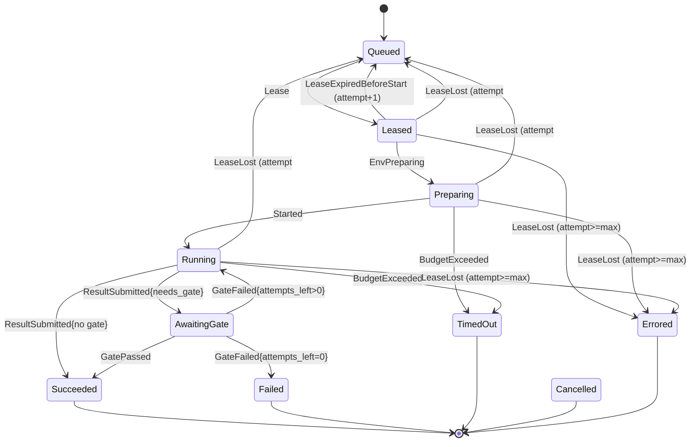
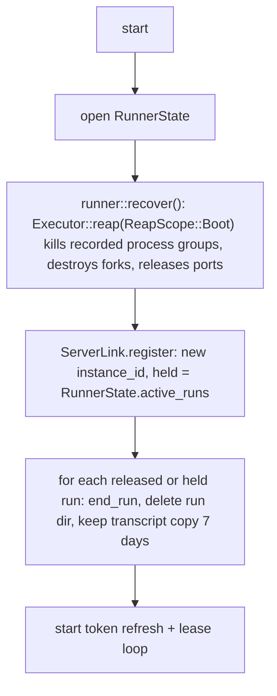
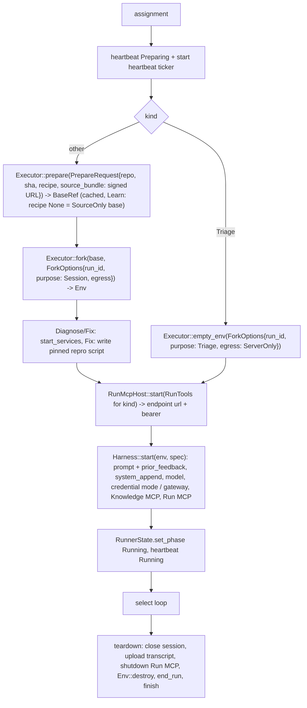
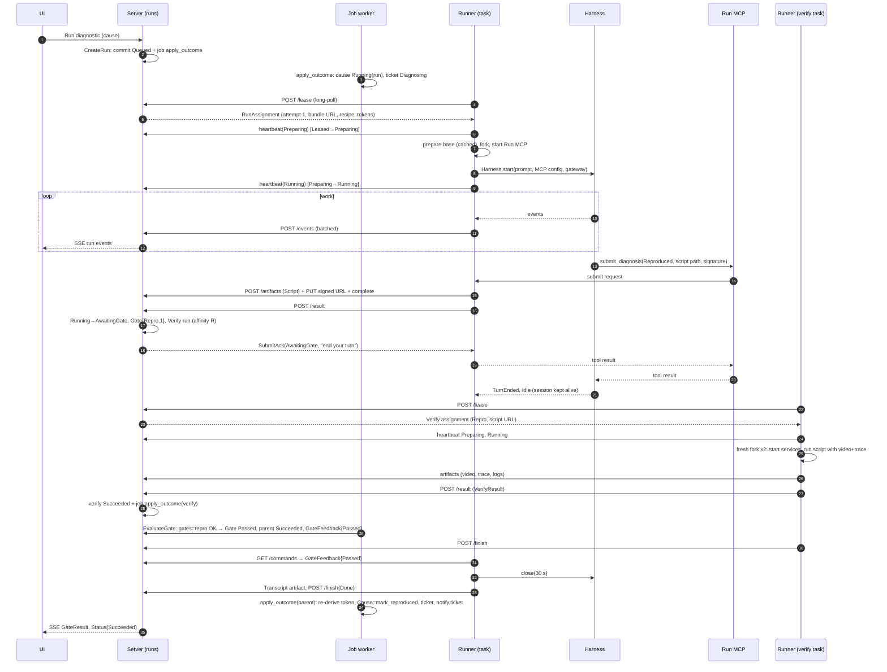
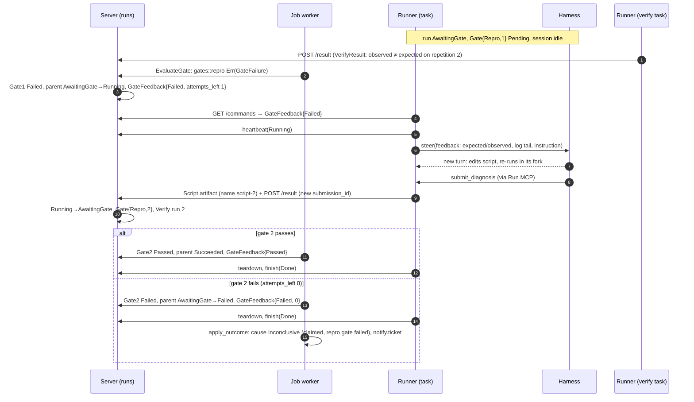

# Runs: run manager, gates, runner protocol, runner role

| Code | Crate path |
|---|---|
| Run manager use cases | `mage_server::app::runs` |
| `RunStore`, `RunSignals` ports | `mage_server::ports` |
| `RunStore`, `RunSignals` adapters | `mage_server::adapters::driven::pg` (migrations in `mage_infra::pg`) |
| `/runner/v1` router, SSE | `mage_server::adapters::driving::http` |
| Run-manager job handlers (`runs.*`) | `mage_server::adapters::driving` job worker → `app::runs` |
| Runner use cases (lease loop, run tasks, recovery) | `mage_runner::app::runner` (module set shared with [executor.md](executor.md)) |
| `ServerLink` port | `mage_runner::ports` |
| `ServerLink` adapter | `mage_runner::adapters::driven::link` |
| Protocol DTOs | `mage_core::wire::runner` |
| Domain types (`Run`, `Gate`, `RunStatus`, …) | `mage_core::domain` |

## Purpose

The run manager owns every `Run` from creation to its terminal state. That covers scheduling onto
runners, leases, the event log, the command queue, result intake per `RunKind`, gates, budget
enforcement, cancellation, timeouts, and applying gate proofs to the domain. The runner role
executes leased runs: it builds the environment, starts the Run MCP and the harness, streams
events, applies commands, turns `submit_*` tool calls into results, and tears everything down. This
doc also defines the runner ↔ server protocol (`/runner/v1`) that connects the two.

Non-goals: harness process details ([harness.md](harness.md)); environment, recipe, Run MCP tool and
Playwright internals ([executor.md](executor.md)); evidence rules and cause creation
([triage.md](triage.md)); fix gate semantics and PRs ([fix.md](fix.md)); token formats, HTTP auth,
the model gateway ([server.md](server.md)); SQL ([storage.md](storage.md)).

## Code layout

```
crates/core/src/
  domain/              Run, Gate, RunStatus, RunStatusEvent, RunCommand, VerifySpec, gates::*
  wire/runner.rs       /runner/v1 DTOs (used directly by ServerLink and the server's runner API)
crates/server/src/
  domain/runs.rs       RunSpec, RunRequirements (server-only)
  ports/runs.rs        RunStore, RunSignals (+ record types)
  app/runs/
    machine.rs         pure: RunRecord x RunStatusEvent -> new record + side effects
    create.rs          CreateRun
    lease.rs           RegisterRunner, LeaseRun, Heartbeat
    events.rs          IngestEvents, RecordUsage
    commands.rs        PollCommands, SteerRun, CancelRun
    artifacts.rs       RequestUpload, CompleteUpload, RefreshDownloads
    result.rs          SubmitResult (per RunKind)
    gates.rs           StartGate, EvaluateGate, feedback rendering
    outcome.rs         ApplyOutcome (job runs.apply_outcome)
    finish.rs          FinishRun
    reap.rs            ReapLeases (job runs.reap_leases)
    source.rs          SourceReady (job runs.source_ready)
    stream.rs          StreamEvents (SSE)
    fail.rs            FailRun (called by the model gateway, e.g. tenant key rejected)
    policy.rs          RunPolicy (config: TTLs, budgets, attempts)
  adapters/driving/http/runner.rs   /runner/v1 router
  adapters/driven/pg/runs.rs        RunStore, RunSignals
  testing/             fakes for server ports
crates/runner/src/
  ports/link.rs        ServerLink
  app/runner/
    daemon.rs          startup, lease loop, drain
    recover.rs         runner::recover (executor.md: Executor::reap) + register with held runs
    session.rs         harness run task (Learn, Triage, Diagnose, Fix)
    verify.rs          Verify run task
    scip.rs            Learn post-gate SCIP step (executor.md)
    tools.rs           RunTools: Run MCP tool implementations incl. submit_* (executor.md)
    pump.rs            event buffer + flusher, command poller, heartbeat ticker
  adapters/driven/link/  ServerLink over reqwest
  testing/             fakes for runner ports
```

The server's runner API use cases and the runner's `ServerLink` both speak the
`mage_core::wire::runner` DTOs directly, so neither side keeps a mirror. Domain value types
(`RunId`, `RunStatus`, `Usage`, `Budget`, `GateKind`, `FailureSignature`, `ArtifactKind`,
`CommitSha`, `VerifySpec`, `RunCommand`, …) appear inside the DTOs. Aggregates (`Run`, `Ticket`,
`Cause`) never go over the wire.

## Run lifecycle

`RunStatus` transitions are exactly the table in [domain.md](domain.md#run). Each row is one
`RunStatusEvent` variant (see [Additions](#additions-to-the-contract)). `Run::apply(event)` wraps
`RunStatus::apply` and also updates `attempt`, `runner`, `started_at` and `finished_at`.



`Cancel` (→ `Cancelled`) and `InfraError` (→ `Errored`) apply from every non-terminal state. They are
omitted from the diagram for readability.

| Event | From → To | Raised by |
|---|---|---|
| `Lease` | `Queued` → `Leased` | `LeaseRun`, inside `RunStore::lease_next` |
| `LeaseExpiredBeforeStart` | `Leased` → `Queued`, attempt + 1 | `ReapLeases`, when a `Leased` lease expires and `attempt < max_lease_attempts` |
| `EnvPreparing` | `Leased` → `Preparing` | `Heartbeat` with `phase ≥ Preparing` |
| `Started` | `Preparing` → `Running` | `Heartbeat` with `phase ≥ Running` (harness started or verify started) |
| `ResultSubmitted { needs_gate: true }` | `Running` → `AwaitingGate` | `SubmitResult` for: Learn; Diagnose claiming `Reproduced`; Fix; Triage final attempt with zero valid causes (followed by `GateFailed{0}` in the same commit) |
| `ResultSubmitted { needs_gate: false }` | `Running` → `Succeeded` | `SubmitResult` for: Triage after the inline evidence gate; Diagnose `NotReproduced`/`Inconclusive`; Verify. Also triage salvage |
| `GatePassed` | `AwaitingGate` → `Succeeded` | `EvaluateGate` |
| `GateFailed { attempts_left }` | `AwaitingGate` → `Running` / `Failed` | `EvaluateGate`. Also, in the same commit as `ResultSubmitted`: Fix patch-policy rejection and Triage zero-valid |
| `BudgetExceeded(limit)` | `Preparing`, `Running` → `TimedOut` | `IngestEvents`, `RecordUsage`, `Heartbeat`, `ReapLeases`, `EvaluateGate` (re-check on return to `Running`) |
| `Cancel` | non-terminal → `Cancelled` | `CancelRun`; a parent going terminal cascades it to its Verify children |
| `InfraError` | non-terminal → `Errored` | `FinishRun` (non-retryable `Failed`, `NoResult`), `FailRun` (gateway: `ModelAuth`), `SourceReady` (bundle failed permanently), `ReapLeases` (queue or gate wait), `EvaluateGate` (verify infra retries exhausted) |
| `LeaseLost { max_attempts }` | `Leased`, `Preparing`, `Running` → `Queued` (attempt + 1) if `attempt < max`, else `Errored` | `ReapLeases`; `RegisterRunner` (new instance); `FinishRun` (`Abandoned`, retryable `Failed`); `EvaluateGate`, when a gate fails for a parent whose session was lost |

Rules that follow from the table:

- `attempt` starts at 1 and is the **lease fencing token**. Every runner call carries it, and a
  requeue increments it, so a stale runner can never act on the new attempt.
- When a `Leased` lease expires, the reaper uses `LeaseExpiredBeforeStart` while
  `attempt < max_lease_attempts`, and `LeaseLost` (→ `Errored`) at the limit. Both are legal rows for
  `Leased`, and the switch bounds lease/crash loops.
- `AwaitingGate` has no lease-lost row. If the parent's runner disappears while its gate runs, the
  reaper clears the lease and sets `session_lost`, but leaves the status alone:
  - gate passes → `Succeeded` as usual;
  - gate fails with attempts left → `GateFailed` (→ `Running`) then `LeaseLost` in the same commit
    (→ `Queued`/`Errored`). The next attempt receives the feedback in `prior_feedback`.
- The wall-clock budget (`Usage.wall`) counts only time spent in `Preparing` and `Running`. Time in
  `AwaitingGate` does not count: there is no `BudgetExceeded` row for that state, and the Verify run
  has its own budget. Model usage recorded during `AwaitingGate` (the harness closing its turn) still
  accumulates. The budget is checked again when the run returns to `Running`.
- After a terminal transition the lease stays held until the runner calls `finish` or the lease
  expires. While it holds the lease, the runner can still upload artifacts (transcript, ScipIndex).

### Terminal side effects (`machine::step`)

Every commit that moves a run into a terminal state goes through `machine::step`, which adds:

1. a `Status(new)` event, `finished_at = now`, and closes the wall segment;
2. an `Abort { reason }` command, if the lease is held and the runner did not cause the transition
   itself (`Cancel`, `BudgetExceeded`, or `InfraError` raised by the reaper). `GatePassed` and
   `GateFailed{0}` send a `GateFeedback` command instead;
3. `Cancel` for every non-terminal Verify child, whose `Pending` gates become
   `Failed { reason: "parent terminal" }`;
4. job `runs.apply_outcome { run_id }`, dedupe key `runs.apply_outcome:{run_id}:{status}`;
5. `RunSignals` notifications, emitted by the store on commit.

From this point the server rejects the run's run-bound tokens (knowledge, gateway); see
[server.md](server.md).

## Ports

### Used

| Port | Crate | Use |
|---|---|---|
| `RunStore` | `mage_server::ports` | runs, events, commands, gates, leases, runner sessions, artifact metadata, idempotent replies (owned here) |
| `RunSignals` | `mage_server::ports` | wakeups for long-polls and SSE (owned here; see [Additions](#additions-to-the-contract)) |
| `TokenStore` | `mage_server::ports` | runner identity: `register_runner`, `get_runner`, `revoke_runner`, `touch_runner` ([server.md](server.md)) |
| `TicketStore` | `mage_server::ports` | causes and tickets, for subject projection |
| `JobQueue` | `mage_core::ports` | `NewJob`, written in the same transaction as run commits (outbox) |
| `ArtifactStore` | `mage_core::ports` | signed upload/download URLs; reading log tails for feedback |
| `RepoStore` | `mage_core::ports` | repo versions, `SourceBundleRef`, recipes (`Recipe::validate`) |
| `KnowledgeStore` | `mage_core::ports` | `ManifestView` for the inline evidence gate (through triage) |
| `Clock`, `IdGen` | `mage_core::ports` | time, ids |
| `ServerLink` | `mage_runner::ports` | everything the runner says to the server (owned here) |
| `Harness` / `HarnessSession` | `mage_runner::ports` | `start(env, spec: HarnessSpec)`, `events()`, `steer`, `abort`, `close(grace)`, `wait` ([harness.md](harness.md); `HarnessSpec` is the runner-side launch spec, distinct from the server's `RunSpec` here) |
| `Executor` / `Env` | `mage_runner::ports` | `capabilities`, `prepare`, `fork`, `empty_env`, `reap`; `start_services`, `health`, `exec`, `diff_against_base`, `apply_patch`, `rebuild`, `export`, `destroy` ([executor.md](executor.md)) |
| `RunMcpHost` | `mage_runner::ports` | `start(Arc<RunTools>) -> Box<dyn RunMcpHandle>` (endpoint url + bearer, `shutdown`) ([executor.md](executor.md)) |
| `BrowserRunner` | `mage_runner::ports` | `run(env, script, opts) -> BrowserOutcome`, used for Playwright repros in Verify runs ([executor.md](executor.md)) |
| `RunnerState` | `mage_runner::ports` | `begin_run`, `set_phase`, `attach_env`, `end_run`, `active_runs`, `record_process`, `clear_process`, `recovery_snapshot` ([executor.md](executor.md) owns the signature) |

Token minting and verification belong to [server.md](server.md). Runner, knowledge and gateway tokens
are all Ed25519 JWS. Run-bound tokens carry `org`, `run`, `attempt`, `scope`, `exp` and `jti`. The run
manager calls the token service when it builds an assignment.

### Record types (`mage_server::ports::runs`)

```rust
pub struct RunRecord {
    pub run: Run,                        // domain aggregate
    pub spec: RunSpec,                   // frozen at creation (mage_server::domain)
    pub version: u64,                    // optimistic concurrency
    pub lease: Option<LeaseMeta>,        // mirrors run.runner + fencing details
    pub session_lost: bool,              // lease dropped while AwaitingGate
    pub wall: WallClock,                 // accumulated + open segment start
    pub usage_reported: Usage,           // from runner events (harness-reported, advisory)
    pub usage_metered: Usage,            // from model gateway (authoritative in Gateway mode)
    pub source_ready: bool,
    pub affinity: Option<Affinity>,      // { runner_id, until }
    pub last_seq: u64,
    pub last_cmd_seq: u64,
    pub ingest_cursor: Option<IngestCursor>,   // { attempt, local_seq }
}
pub struct LeaseMeta { pub runner_id: RunnerId, pub instance_id: Uuid, pub attempt: u16,
                       pub until: OffsetDateTime, pub request_id: Uuid }
pub struct LeaseFence { pub runner_id: RunnerId, pub instance_id: Uuid, pub attempt: u16 }
pub struct WallClock { pub accumulated: Duration, pub segment_start: Option<OffsetDateTime> }

pub struct GateRecord {
    pub gate: Gate,
    pub feedback: Option<String>,        // rendered GateFeedback details; reused as prior_feedback
    pub details: Option<serde_json::Value>, // opaque, owned by the gate's module (e.g. triage)
}

pub struct NewRun { pub run: Run, pub spec: RunSpec, pub create_key: Option<String>, pub source_ready: bool }
pub struct RunUpdate { pub record: RunRecord, pub expected_version: u64 }
pub enum GateWrite { Insert(GateRecord), Update(GateRecord) }
pub struct RunEventDraft { pub run_id: RunId, pub attempt: u16, pub at: OffsetDateTime, pub kind: RunEventKind }
pub struct Ingest { pub run_id: RunId, pub attempt: u16, pub events: Vec<(u64 /*local_seq*/, RunEventDraft)> }
pub struct CommandDraft { pub run_id: RunId, pub attempt: u16, pub command: RunCommand }
pub struct CommandRecord { pub seq: u64, pub attempt: u16, pub issued_at: OffsetDateTime, pub command: RunCommand }
pub struct ArtifactRecord { pub artifact: Artifact, pub attempt: u16, pub name: String,
                            pub content_type: String, pub state: ArtifactState }
pub enum ArtifactState { Pending, Complete }
pub struct NewArtifact { pub run_id: RunId, pub attempt: u16, pub kind: ArtifactKind, pub name: String,
                         pub bytes: u64, pub sha256: [u8; 32], pub content_type: String }
pub struct IdempotentReply { pub scope: String, pub key: String, pub request_hash: [u8; 32], pub body: Vec<u8> }
pub struct StoredReply { pub request_hash: [u8; 32], pub body: Vec<u8> }

pub struct RunWrite {
    pub inserts: Vec<NewRun>,
    pub updates: Vec<RunUpdate>,
    pub gates: Vec<GateWrite>,
    pub events: Vec<RunEventDraft>,        // server-generated; seq assigned in the transaction
    pub ingest: Option<Ingest>,            // runner events; entries with local_seq <= cursor dropped
    pub commands: Vec<CommandDraft>,       // cmd seq assigned in the transaction
    pub complete_artifacts: Vec<(ArtifactId, u64 /*bytes observed*/)>,
    pub jobs: Vec<NewJob>,                 // JobQueue outbox (storage.md)
    pub reply: Option<IdempotentReply>,
}
pub struct CommitReceipt {
    pub versions: Vec<(RunId, u64)>,
    pub seqs: Vec<(RunId, u64 /*first*/, u64 /*last*/)>,
    pub ingested: Option<(u64 /*acked_local_seq*/, u64 /*last_seq*/)>,
}

pub struct RunQuery {
    pub kind: Option<RunKind>, pub subject: Option<RunSubject>, pub parent: Option<RunId>,
    pub ticket: Option<TicketId>, pub repo: Option<RepoId>, pub sha: Option<CommitSha>,
    pub statuses: Vec<RunStatus>,
    pub newest_first: bool, pub limit: u32, pub cursor: Option<RunId>,
}
pub struct LeaseQuery {
    pub runner_id: RunnerId, pub instance_id: Uuid, pub scope: RunnerScope,
    pub capabilities: Capabilities, pub free: SlotCounts, pub prepared: Vec<PreparedBaseKey>,
    pub request_id: Uuid, pub until: OffsetDateTime, pub now: OffsetDateTime, pub repo_limit: u16,
}
pub struct RunnerSession { pub runner_id: RunnerId, pub instance_id: Uuid, pub version: String,
                           pub capabilities: Capabilities, pub at: OffsetDateTime }
pub struct DueItem { pub org_id: OrgId, pub run_id: RunId, pub reason: DueReason }
pub enum DueReason { LeaseExpired, WallExceeded, QueueWait, GateWait }
```

`RunnerScope` (`Shared | Orgs(Vec<OrgId>)`) is part of the runner identity record, which `TokenStore`
owns ([server.md](server.md)).

### `RunStore` (owned here)

```rust
#[derive(Debug, thiserror::Error)]
pub enum RunStoreError {
    #[error("not found")] NotFound,
    #[error("conflict: {0:?}")] Conflict(RunConflict),
    #[error("invalid: {0}")] Invalid(String),
    #[error("unavailable: {0}")] Unavailable(String),
}
pub enum RunConflict {
    StaleVersion { run: RunId },          // expected_version mismatch: reload and retry
    Duplicate { run: RunId },             // create_key already used: return that run
    ReplyExists(StoredReply),             // idempotency key already recorded
    LeaseLost,                            // fence does not match current lease
}

#[async_trait]
pub trait RunStore: Send + Sync {
    // Runs
    async fn get(&self, org: OrgId, id: RunId) -> Result<RunRecord, RunStoreError>;
    async fn list(&self, org: OrgId, q: &RunQuery) -> Result<Vec<RunRecord>, RunStoreError>;
    /// One transaction. Fails as a whole on any StaleVersion / Duplicate / ReplyExists.
    /// Emits RunSignals for every touched run and for the queue when a run becomes leasable.
    async fn commit(&self, org: OrgId, w: RunWrite) -> Result<CommitReceipt, RunStoreError>;

    // Leasing (cross-tenant by design: runners serve a scope, not one org)
    async fn locate(&self, id: RunId) -> Result<OrgId, RunStoreError>;
    async fn lease_next(&self, q: &LeaseQuery) -> Result<Option<RunRecord>, RunStoreError>;
    async fn lease_by_request(&self, runner: RunnerId, request_id: Uuid)
        -> Result<Option<RunRecord>, RunStoreError>;
    /// Conditional on fence; does not bump `version` (heartbeats never conflict with commits).
    async fn extend_lease(&self, org: OrgId, id: RunId, fence: LeaseFence, until: OffsetDateTime)
        -> Result<RunRecord, RunStoreError>;
    async fn due(&self, now: OffsetDateTime, limit: u32) -> Result<Vec<DueItem>, RunStoreError>;
    async fn held_by(&self, runner: RunnerId) -> Result<Vec<(OrgId, RunId)>, RunStoreError>;
    async fn mark_source_ready(&self, org: OrgId, repo: RepoId, sha: CommitSha)
        -> Result<u32, RunStoreError>;
    /// Writes the runner's session columns; returns the previous instance_id, if any.
    async fn record_runner_session(&self, s: &RunnerSession) -> Result<Option<Uuid>, RunStoreError>;

    // Events and commands
    async fn events_after(&self, org: OrgId, run: RunId, after: u64, limit: u32)
        -> Result<Vec<RunEvent>, RunStoreError>;
    async fn commands_after(&self, org: OrgId, run: RunId, attempt: u16, after: u64, limit: u32)
        -> Result<Vec<CommandRecord>, RunStoreError>;

    // Gates
    async fn gates(&self, org: OrgId, run: RunId) -> Result<Vec<GateRecord>, RunStoreError>;
    async fn gate_for_verify(&self, org: OrgId, verify_run: RunId)
        -> Result<Option<GateRecord>, RunStoreError>;

    // Artifact metadata
    /// Idempotent on (run_id, attempt, kind, name): returns the existing record if present.
    async fn reserve_artifact(&self, org: OrgId, a: NewArtifact) -> Result<ArtifactRecord, RunStoreError>;
    async fn artifact(&self, org: OrgId, id: ArtifactId) -> Result<ArtifactRecord, RunStoreError>;
    async fn artifacts(&self, org: OrgId, run: RunId) -> Result<Vec<ArtifactRecord>, RunStoreError>;

    // Idempotent replies (scope encodes the caller, e.g. "runner:{id}:result:{run}")
    async fn reply(&self, scope: &str, key: &str) -> Result<Option<StoredReply>, RunStoreError>;
}
```

Store invariants (contract-tested):

- `lease_next` hands one `Queued` run to at most one caller. It applies `Lease` atomically: status,
  `runner`, `LeaseMeta`, and a `run_attempts` row. It only considers runs that have `source_ready`,
  match the runner's capabilities and scope, have a free slot of their `SlotClass`, and have a free
  repo slot.
- Repo slot: at most `repo_limit` runs of `SlotClass::Work` with a held lease per `(org, repo)` (v1:
  1). Verify runs share their parent's slot. Triage (`Light`) takes none.
- Event `seq` values are strictly increasing per run, with no gaps inside one commit. The same holds for command `seq`.
- `ingest` drops entries with `(attempt, local_seq) <= ingest_cursor` and advances the cursor.
- Methods not marked cross-tenant filter by `org`; asking for a run of another org returns `NotFound`.

### `RunSignals` (owned here)

```rust
pub enum SignalTopic { RunEvents(RunId), RunCommands(RunId), Queue }
pub enum Woke { Signal, Timeout }

#[async_trait]
pub trait RunSignals: Send + Sync {
    async fn subscribe(&self, topic: SignalTopic) -> Result<Box<dyn Subscription>, SignalError>;
}
#[async_trait]
pub trait Subscription: Send {
    /// Returns after >=1 notification since the previous call (coalesced) or after `timeout`.
    async fn wait(&mut self, timeout: Duration) -> Woke;
}
```

Signals are hints only. Delivery is at-most-once and coalesced, and the payload carries no data
beyond ids. Every waiter re-reads `RunStore` after a wake, and re-checks at least every 2 s anyway, so
correctness never depends on delivery. The `RunStore` adapter emits the signals inside `commit`; this
means the in-memory fakes of `RunStore` and `RunSignals` share one broadcast hub.

| Topic | Postgres channel | Payload | Emitted when |
|---|---|---|---|
| `RunEvents(run)` | `mage_run_events` (shared with the UI change feed, [server.md](server.md)) | `org:run:seq` | events appended (every status change appends a `Status` event) |
| `RunCommands(run)` | `mage_run_commands` | `org:run` | commands appended |
| `Queue` | `mage_queue` | empty | a run became leasable: inserted, requeued, `source_ready`, lease freed (slot release) |

### `ServerLink` (owned here)

```rust
#[derive(Debug, thiserror::Error)]
pub enum LinkError {
    #[error("not found")] NotFound,
    #[error("conflict: {0:?}")] Conflict(LinkConflict),
    #[error("invalid: {0}")] Invalid(String),
    #[error("rejected")] Rejected(Rejection),      // 422; returned to the agent as a tool error
    #[error("unauthorized")] Unauthorized,          // after one re-auth attempt
    #[error("forbidden")] Forbidden,                // runner revoked / run out of scope
    #[error("unavailable: {0}")] Unavailable(String), // retries exhausted for this call's deadline
}
pub enum LinkConflict { LeaseLost, RunTerminal(RunStatus), InvalidState(RunStatus), IdempotencyMismatch }

#[async_trait]
pub trait ServerLink: Send + Sync {
    /// Bootstrap grant on first start (no runner_id in the credential file), Assertion grant after.
    async fn register(&self, req: &Registration) -> Result<RegistrationAck, LinkError>;
    /// Long-poll up to req.wait (server caps at 25 s). Ok(None) = nothing to do.
    async fn lease(&self, req: &LeaseRequest) -> Result<Option<RunAssignment>, LinkError>;
    async fn heartbeat(&self, run: RunId, attempt: u16, phase: RunnerPhase)
        -> Result<HeartbeatAck, LinkError>;
    async fn push_events(&self, run: RunId, attempt: u16, events: &[OutboundEvent])
        -> Result<EventsAck, LinkError>;
    async fn poll_commands(&self, run: RunId, attempt: u16, after: u64, wait: Duration)
        -> Result<CommandBatch, LinkError>;
    async fn request_upload(&self, run: RunId, attempt: u16, spec: &ArtifactSpec)
        -> Result<UploadGrant, LinkError>;
    /// PUT the file to the signed URL (streamed). The runner token is never sent to the blob host.
    async fn upload(&self, grant: &UploadGrant, file: &Path) -> Result<(), LinkError>;
    async fn complete_upload(&self, run: RunId, attempt: u16, artifact: ArtifactId)
        -> Result<(), LinkError>;
    async fn refresh_downloads(&self, run: RunId, attempt: u16, refs: &[DownloadRef])
        -> Result<Vec<Download>, LinkError>;
    /// GET a signed URL to `dest`, verifying length and sha256; refreshes an expired URL once.
    async fn download(&self, run: RunId, attempt: u16, dl: &Download, dest: &Path)
        -> Result<(), LinkError>;
    async fn submit_result(&self, run: RunId, attempt: u16, submission_id: Uuid, result: &WireRunResult)
        -> Result<SubmitAck, LinkError>;
    async fn finish(&self, run: RunId, attempt: u16, report: &FinishReport)
        -> Result<RunStatus, LinkError>;
}
```

The adapter owns retries for transient failures (see [Retry rules](#retry-rules)) and the token
lifecycle. Use cases only see final outcomes.

### Protocol types (`mage_core::wire::runner`)

```rust
pub struct Capabilities {
    pub arch: Arch,                     // Arm64 | X86_64
    pub os: Os,                         // MacOs | Linux
    pub executor: ExecutorKind,         // Host | Aho
    pub harnesses: Vec<HarnessAvailability>,  // { kind, version, credential_modes } (harness.md)
    pub browser: bool,                  // Playwright + browsers installed
    pub slots: SlotCounts,
}
pub enum SlotClass { Light /*Triage*/, Work /*Learn, Diagnose, Fix*/, Verify }
pub struct SlotCounts { pub light: u16, pub work: u16, pub verify: u16 }
pub struct PreparedBaseKey { pub repo_id: RepoId, pub sha: CommitSha, pub recipe_hash: Option<RecipeHash> }

pub enum RegisterGrant {                // shapes owned by server.md
    Bootstrap { bootstrap_token: String, name: String, public_key: [u8; 32] },
    Assertion { runner_id: RunnerId, assertion: String },
}
pub struct Registration {
    pub grant: RegisterGrant,
    pub instance_id: Uuid,              // random per process start
    pub version: String,
    pub capabilities: Capabilities,
    pub held: Vec<HeldRun>,             // RunnerState::active_runs at startup (informational)
}
pub struct HeldRun { pub run_id: RunId, pub attempt: u16 }
pub struct RegistrationAck {
    pub runner_id: RunnerId,
    pub runner_token: String, pub expires_at: OffsetDateTime,
    pub released: Vec<ReleasedRun>,     // every lease of a previous instance, now lost
    pub lease: LeaseTerms, pub long_poll_max: Duration, pub min_version: String,
}
pub struct ReleasedRun { pub run_id: RunId, pub attempt: u16, pub status: RunStatus }
pub struct LeaseTerms { pub ttl: Duration, pub heartbeat_every: Duration }

pub struct LeaseRequest {
    pub request_id: Uuid,               // reused verbatim on retry of the same logical request
    pub wait: Duration,
    pub free: SlotCounts,
    pub prepared: Vec<PreparedBaseKey>, // from Executor::capabilities().bases, newest first, max 64
}
pub struct RunAssignment {
    pub run_id: RunId, pub org_id: OrgId, pub attempt: u16, pub kind: RunKind,
    pub lease: LeaseTerms,
    pub repo: Option<RepoRef>,          // { repo_id, owner, name }; None for repo-less Triage
    pub sha: Option<CommitSha>,
    pub source: Option<Download>,       // SourceBundle (tar.zst); None for Triage
    pub recipe: Option<RecipeRef>,      // { hash, toml }; Learn: current recipe if any
    pub harness: Option<HarnessAssignment>,  // None for Verify
    pub verify: Option<VerifySpec>,     // Some for Verify only
    pub downloads: Vec<Download>,       // artifacts referenced by `verify` (script, patch, …)
    pub knowledge: Option<KnowledgeAccess>,  // { url, knowledge_token }
    pub gateway: Option<GatewayAccess>,      // { base_url, gateway_token }; Some iff credential_mode = Gateway
    pub budget: Budget,
    pub prior_feedback: Vec<String>,    // gate feedback from earlier attempts of this run
    pub fix: Option<FixSpec>,           // Fix runs only (fix.md)
    pub trace: Option<String>,          // W3C traceparent of the run (server.md)
}
pub struct HarnessAssignment { pub kind: HarnessKind, pub model: String,
                               pub credential_mode: CredentialModeKind, pub prompt: String,
                               pub system_append: String }  // server-rendered, per kind
pub enum DownloadRef { SourceBundle { repo_id: RepoId, sha: CommitSha }, Artifact(ArtifactId) }
pub struct Download { pub what: DownloadRef, pub url: String, pub bytes: u64, pub sha256: [u8; 32],
                      pub expires_at: OffsetDateTime }

pub enum RunnerPhase { Preparing, Running, AwaitingGate, Finishing }
pub struct HeartbeatAck { pub status: RunStatus, pub lease: LeaseTerms, pub commands_pending: bool }

pub struct OutboundEvent { pub local_seq: u64, pub at: OffsetDateTime, pub kind: OutboundEventKind }
pub enum OutboundEventKind {           // subset of RunEventKind a runner may send
    AssistantText(String), ToolCall { name: String, args_preview: String },
    ToolResult { name: String, ok: bool, preview: String }, Usage(Usage), Notice(String), Error(String),
}
pub struct EventsAck { pub acked_local_seq: u64, pub last_seq: u64, pub status: RunStatus }
pub struct CommandEnvelope { pub seq: u64, pub attempt: u16, pub issued_at: OffsetDateTime, pub command: RunCommand }
pub struct CommandBatch { pub commands: Vec<CommandEnvelope>, pub status: RunStatus }

pub struct ArtifactSpec { pub kind: ArtifactKind, pub name: String, pub bytes: u64,
                          pub sha256: [u8; 32], pub content_type: String }
pub struct UploadGrant { pub artifact_id: ArtifactId, pub url: String, pub method: HttpMethod,
                         pub headers: Vec<(String, String)>, pub expires_at: OffsetDateTime,
                         pub already_complete: bool }

pub enum WireRunResult {                // mirrors the domain results; Triage carries the raw submission
    Learn(RecipeProposal), Triage(TriageSubmission /* { summary, causes, missing_info }, triage.md */),
    Diagnose(DiagnoseResult), Verify(VerifyResult), Fix(FixResult),
}
pub struct SubmitAck { pub status: RunStatus, pub gate: Option<GateTicket>, pub message: String }
pub struct GateTicket { pub gate_id: GateId, pub kind: GateKind, pub attempt: u8 }
pub struct Rejection { pub gate: Option<GateTicket>, pub message: String, pub items: Vec<RejectionItem> }
pub struct RejectionItem { pub path: String, pub reason: String }

pub struct FinishReport { pub outcome: FinishOutcome, pub message: Option<String> }
pub enum FinishOutcome {
    Done,                                   // server status is terminal; env destroyed
    NoResult,                               // harness ended without submit_* after the nudge
    Failed { stage: FailStage, reason: String, retryable: bool },  // runner-side failure
    Abandoned,                              // runner self-fenced or is shutting down
}
pub enum FailStage { Download, Prepare, Fork, RunMcp, Harness, Verify, Upload, Internal }
```

`SubmitAck.message` is written for the agent. The runner returns it verbatim as the `submit_*` tool
result, for example `"Submitted. Repro gate attempt 1 is running in a clean fork. End your turn now;
feedback will follow."` or `"Accepted 3 causes. End your turn."`.

## Server use cases (`mage_server::app::runs`)

Every use case that changes a run follows the same loop: `get`, then the pure `machine::step`, then
`commit` with `expected_version`. On `StaleVersion` it reloads and retries, up to 5 times, and then
returns `AppError::Unavailable`.

### RunPolicy (config, initial values)

| Setting | Default | Note |
|---|---|---|
| `lease_ttl` / `heartbeat_every` | 60 s / 15 s | the runner self-fences at `send_time + ttl - 5 s` |
| `max_lease_attempts` | 3 | `LeaseLost { max_attempts }` |
| `long_poll_max` | 25 s | Cloud Run; see [server.md](server.md) |
| `verify_affinity_wait` | 30 s | after this, any capable runner may take the Verify run |
| `repo_exec_concurrency` | 1 | Work-class runs per repo (v1 rule: one diagnostic per repo) |
| `queue_max_wait` | 2 h | `Queued` for longer → `InfraError` (`NoRunner`) |
| `gate_wait_max` | 30 min | gate `Pending` for longer → parent `InfraError`, child `Cancel` |
| `verify_infra_retries` | 2 | per gate attempt |
| `repro_repetitions` / `fix_repetitions` | 2 / 1 | copied into `VerifySpec` |
| `nudge_limit` | 1 | runner side: how many times to steer after a turn ends without `submit_*` |

Default budgets per kind. These are initial guesses; tune them with data.

| Kind | `max_wall` | `max_turns` | `max_cost_micros` | `max_gate_attempts` |
|---|---|---|---|---|
| Learn | 60 min | 200 | 20 000 000 | 3 (Boot) |
| Triage | 10 min | 40 | 3 000 000 | 3 (Evidence) |
| Diagnose | 45 min | 150 | 15 000 000 | 2 (Repro) |
| Fix | 45 min | 150 | 15 000 000 | 3 (Fix) |
| Verify | 15 min (Fix: 30 min) | n/a (`u32::MAX`) | n/a (`u64::MAX`) | 0 |

### CreateRun

Input: `CreateRun { org, kind, subject, harness, model, budget: Option<Budget>, parent,
requested_by, create_key: Option<String> }`.

Callers:
- the UI API (Learn, Diagnose, Fix);
- the triage job `triage.ticket` (Triage; `create_key` = job id);
- `StartGate` / `EvaluateGate` (Verify);
- the fix module (Verify `TestBaseline`).

Steps:

1. Resolve the subject to a `RunSpec` (repo, sha, ticket, recipe hash). Check that every linked
   aggregate has the same `org_id` (`DomainError::CrossTenant` otherwise).
2. Check the preconditions for the kind:
   - Learn: the `RepoVersion` exists. `recipe` is the repo's current recipe (any status), or none.
   - Triage: per [triage.md](triage.md).
   - Diagnose: the cause is `Untested | NotReproduced | Inconclusive`; the ticket is
     `Triaged | Diagnosing` (the domain has no `Diagnosed → Diagnosing` row); the repo recipe is
     `Validated`. Its hash is frozen into the spec.
   - Fix: per [fix.md](fix.md).
   - Verify: internal only. `parent` is required. Gate verify: the parent must be `AwaitingGate`.
     Verify runs created by the fix module (`TestBaseline`, rebase verify on a finished Fix run)
     follow [fix.md](fix.md); they have no gate row.
3. Render the prompt and `system_append` (the module that owns the kind provides the templates). Set the `SlotClass`, the
   priority (Verify 0, Triage 1, Diagnose 2, Fix 3, Learn 4) and `RunRequirements`:
   - executor kind from repo trust;
   - `arch` pinned to the parent runner's arch for Verify;
   - harness kind and credential mode (from server config: `LocalLogin` in dev, `Gateway` in
     production).
4. Set `source_ready`. It is true for Triage, and true when a `SourceBundleRef` exists for
   `(repo, sha)` (`RepoStore`). If the bundle is missing and no `RepoVersion` exists, add job
   `index.version {org_id, repo_id, sha, reason: OnDemand(ticket)}` (dedupe
   `index.version:{repo_id}:{sha}`).
5. `Run::new(…)` creates the run in `Queued` with attempt 1. Commit the `NewRun`, a `Status(Queued)`
   event and job `runs.apply_outcome {run_id}`, which projects `Running(run)` onto the cause and
   ticket. A `Duplicate { run }` conflict returns the existing run.

A partial unique index allows at most one non-terminal Diagnose or Fix run per `(kind, subject)`. A
second attempt returns `AppError::Conflict`, shown in the UI as "already running".

### RegisterRunner (`POST /register`)

1. Verify the grant with the token service and `TokenStore` ([server.md](server.md)):
   - `Bootstrap`: consumes the one-time token and records the runner's public key. A retry with the
     same token and the same public key within 10 min returns the same `runner_id`, so a lost
     response is recoverable.
   - `Assertion`: a JWS signed with the runner's key, used for restart and token refresh.
2. `record_runner_session` stores the `instance_id`, capabilities and version. If the previous
   `instance_id` differs (the process restarted), handle every `held_by(runner)` run:
   - in `Leased`, `Preparing` or `Running`, apply `LeaseLost { max_attempts }`;
   - in `AwaitingGate`, set `session_lost` and clear the lease;
   - in a terminal state, only clear the lease.
   Return these runs as `released`. A refresh (same `instance_id`) releases nothing.
3. Mint the runner token (15 min, claims include `inst` = `instance_id`) and return `RegistrationAck`.

### LeaseRun (`POST /lease`)

1. If `lease_by_request(runner, request_id)` finds a run still `Leased` to this runner and attempt,
   return the same assignment again (the original response was lost).
2. Run a bounded reaper pass (at most 20 `due` items), so leases still expire if the job worker lags.
3. Call `lease_next(q)`. Candidates are ordered by:
   1. affinity: Verify runs whose `affinity.runner_id` is the caller come first, and other runners skip
      them until `affinity.until`;
   2. a warm base: `(repo, sha, recipe_hash)` is in `prepared`;
   3. priority, then `created_at`.

   A candidate must also pass these filters: `source_ready`; scope; `executor`; `arch` (if pinned); the
   harness `kind` and `credential_mode` are advertised in `capabilities.harnesses`; `browser` if
   required; the slot class has `free > 0`; the repo slot is free.
4. If nothing matches, subscribe to `Queue` and loop: `wait(min(remaining, 2 s))`, then retry
   `lease_next`, until `wait` elapses. Return `None`.
5. Build the `RunAssignment`:
   - Sign a download URL (15 min TTL) for the `SourceBundle`, from `SourceBundleRef.key`, and for
     every artifact referenced by the `VerifySpec`.
   - Mint the `knowledge_token` (scope org/repo/sha, read-only) and, in Gateway mode, the
     `gateway_token`. Both get `exp = now + max_wall + max_gate_attempts × verify max_wall + 15 min`,
     capped at 24 h; revocation at terminal state or attempt change gives the tight bound.
   - Add `prior_feedback` from the failed gates of earlier attempts.

   Tokens are not stored. A retried lease mints fresh ones.

Verify affinity is set when the Verify run is created: `affinity = { runner_id:
parent.lease.runner_id, until: now + verify_affinity_wait }`. This reuses the base the parent prepared.

### Heartbeat (`POST /runs/{id}/heartbeat`)

1. `extend_lease(org, id, fence, now + ttl)`. A `LeaseLost` conflict returns 409 `lease_lost`.
2. If `phase` is ahead of the status, apply `EnvPreparing` and/or `Started`, in order. A phase behind
   the status is ignored, e.g. `AwaitingGate` reported while the server has already moved back to
   `Running`.
3. If the status is `Preparing | Running`, compute the wall time. If it exceeds `max_wall`, apply
   `BudgetExceeded(Wall)`.
4. Respond with `{status, lease, commands_pending}`. Leases on terminal runs keep being extended until
   `finish`.

### IngestEvents (`POST /runs/{id}/events`)

1. Check the fence. Validate the batch: at most 500 events and 4 MiB (the `/runner/v1` body limit in
   [server.md](server.md)); previews at most 4 KiB (truncated, not rejected); only
   `OutboundEventKind` (status, gate and artifact events are server-only).
2. Coalesce `Usage` to the last one in the batch. Runner `Usage` is cumulative for the attempt; in
   Gateway mode the runner does not send it at all ([harness.md](harness.md)). `usage_reported` is
   the per-field max for the current attempt plus the frozen totals of earlier attempts (frozen at
   `LeaseLost`).
3. The effective usage is `usage_metered` if the assignment had a gateway, else `usage_reported`.
   `wall` is always computed server-side. If `Usage::exceeds(&budget)` returns `Some(limit)` and the
   status is `Preparing | Running`, apply `BudgetExceeded(limit)`. For a Triage run, call the salvage
   hook first ([Triage salvage](#triage-salvage)).
4. `commit(RunWrite { ingest, updates (if usage or status changed), events, commands, jobs })`. The
   store assigns `seq`. Respond with `{acked_local_seq, last_seq, status}`.

### RecordUsage (called by the model gateway)

The gateway runs its own pre-check by reading `RunStore` ([server.md](server.md)). It allows status
`Running` or `AwaitingGate`; `AwaitingGate` is needed because the harness makes one more model call
to close its turn after `submit_*` returns. The pre-check also requires a matching `attempt` and a
budget that is not yet exceeded.

`RecordUsage { org, run, delta: Usage } -> Allow | Deny(reason)`:

- adds `delta` to `usage_metered`;
- in `Preparing | Running`, runs the budget check from IngestEvents step 3;
- in `AwaitingGate`, only records the usage. `EvaluateGate` re-checks the budget when the run returns
  to `Running`.

It returns `Deny` when the budget is exceeded or the run is terminal, so the gateway can stop a
streaming loop at once. The gateway is the hard stop: a runner that ignores `Abort` still cannot spend
tokens.

### PollCommands (`GET /runs/{id}/commands?attempt=&after=&wait_ms=`)

1. Check the fence. The runner holding a terminal run's lease may still poll.
2. `commands_after(org, id, attempt, after, 100)`. If it returns any commands, respond at once.
3. Otherwise subscribe to `RunCommands(id)` and loop until `wait_ms` (capped at 25 s) elapses.
   Respond with `{commands, status}`.

Commands are scoped to the attempt they were issued for. A requeued attempt never receives an
earlier attempt's `Steer`; gate feedback reaches it through `prior_feedback` instead.

| Command | Issued by | When |
|---|---|---|
| `Steer { text, by }` | `SteerRun` (UI, org member) | status `Running` only (409 in `AwaitingGate`: "gate running"); text at most 8 KiB; also logged as a `Notice` event |
| `Abort { reason }` | `machine::step` | a terminal transition the runner did not cause (`Cancelled`, `Budget(limit)`, `Infra`) |
| `GateFeedback(GateFeedback)` | `EvaluateGate`; Fix patch-policy rejection | a gate was decided |

### CancelRun

`CancelRun { org, run, by }`: a terminal run → no-op. Otherwise apply `Cancel` through
`machine::step`, which sends `Abort` if the run is leased, cascades to Verify children and enqueues
`apply_outcome`. A `Queued` run is cancelled without involving any runner. Users cancel the parent
run; Verify runs cannot be cancelled by users.

### RequestUpload / CompleteUpload / RefreshDownloads

`POST /runs/{id}/artifacts` (RequestUpload):

- Check the fence. Uploads are allowed in any status while the lease is held.
- Kinds a runner may upload: `Video | Trace | Screenshot | Log | Script | Patch | Transcript |
  ScipIndex`.
- `name` must match `[A-Za-z0-9._-]{1,128}`.
- Size caps per kind: Video 2 GiB, others 256 MiB.
- `reserve_artifact` is idempotent on `(run, attempt, kind, name)`. The server builds the key
  `org/{org}/runs/{run}/{kind}/{name}`.
- Respond with a signed PUT URL (15 min TTL) that requires the declared `Content-Type`.

`POST /runs/{id}/artifacts/{artifact_id}/complete` (CompleteUpload):

- `ArtifactStore` head: the stored size must equal the declared `bytes`, else 422.
- Commit `complete_artifacts` and an `Artifact(id)` event.
- For `ScipIndex`, also add job `index.ingest_scip {org_id, repo_id, sha, run_id, artifact_id, key}`
  (dedupe `index.ingest_scip:{artifact_id}`).
- Completing an artifact that is already complete is a no-op.

`POST /runs/{id}/downloads` (RefreshDownloads): re-signs URLs for `DownloadRef`s the run may read,
namely its own `SourceBundle` and the artifacts referenced by its `VerifySpec`. Anything else returns 403.

The sha256 is the runner's claim. Consumers that act on the bytes (the patch applied by the PR flow,
the scripts run in Verify) recompute it when they read them.

### SubmitResult (`POST /runs/{id}/result`)

Common steps:

1. Replay: `reply("runner:{runner}:result:{run}", submission_id)`. A hit with the same request hash
   returns the stored body. A different hash returns 409 `idempotency_mismatch`.
2. Check the fence. The status must be `Running`, else 409 `invalid_state` (or `run_terminal`).
3. The `result` variant must match `run.kind`. Every referenced artifact must belong to this run, be
   `Complete`, and have the right `ArtifactKind`.
4. Handle the result per kind (table below), which produces a `RunWrite`. The response body is stored
   as `reply` in the same commit.

| Kind | Validation | Outcome |
|---|---|---|
| Learn `RecipeProposal { toml, notes }` | parse + schema check ([executor.md](executor.md)); invalid → 422 with no gate row (a syntax error is not a gate attempt) | `RepoStore`: upsert `Recipe { status: Draft }` by hash (idempotent, done before the commit). Commit `ResultSubmitted{needs_gate}` + `StartGate(Boot)` |
| Triage `TriageSubmission { summary, causes, missing_info }` | `triage::EvidenceGate::evaluate_submission(org, &run, &spec, n, sub)` → `TriageGateDecision` ([triage.md](triage.md)) | see the Triage decisions below; the accepted `TriageResult` comes from the decision |
| Diagnose `DiagnoseResult { verdict, script, signature, summary }` | `script` is a complete `Script` artifact; signature `value` non-empty and at most 1 KiB; a `Regex` matcher must compile | verdict `Reproduced` → `ResultSubmitted{needs_gate}` + `StartGate(Repro)`. `NotReproduced` / `Inconclusive` → `ResultSubmitted{no gate}` → `Succeeded` |
| Fix `FixResult { patch, summary }` | `patch` is a complete `Patch` artifact; server-side patch policy ([fix.md](fix.md)) | policy failure → in one commit: `ResultSubmitted{needs_gate}` + `Gate{Fix, n, Failed, verify_run: None}` + `GateFailed{left}` + `GateFeedback`. Otherwise `ResultSubmitted{needs_gate}` + `StartGate(Fix)` |
| Verify `VerifyResult` | shape per [executor.md](executor.md) / [fix.md](fix.md) | `ResultSubmitted{no gate}` → `Succeeded`; `apply_outcome` then evaluates the parent's gate |

Triage decisions (`TriageGateDecision`):

| Decision | Effect |
|---|---|
| `Invalid { problems }` | 422; no gate row, no attempt consumed (bounded by the budget) |
| `Reject { details, feedback, attempts_left }` | commit `Gate{Evidence, n, Failed}` (`details`, `feedback` on the `GateRecord`) + events; 422 with `feedback`; the run stays `Running` |
| `Accept { result, details, message }` | `Gate{Evidence, n, Passed}` + `ResultSubmitted{no gate}` → `Succeeded`; 200 with `message` |
| `Fail { details, message }` | in one commit: `Gate{Evidence, n, Failed}` + `ResultSubmitted{needs_gate}` + `GateFailed{0}` → `Failed` (which also pushes `GateFeedback{Failed, 0}`); 422 `rejected` with the final feedback |

The gate attempt `n` is the number of existing gates of that kind on the run, plus 1.
`attempts_left = budget.max_gate_attempts - n`.

### StartGate

Runs inside the same commit as `ResultSubmitted{needs_gate}`:

1. Insert `Gate { kind, attempt: n, status: Pending, verify_run: Some(v) }`.
2. Create Verify run `v` with the `CreateRun` logic (no separate commit): `parent = run`,
   `subject = Run(parent)`, `harness = None`, and a `VerifySpec` built from the submission:
   - Boot → `VerifySpec::Boot`, with the proposal's recipe hash as the base;
   - Repro → `VerifySpec::Repro { script, signature, repetitions: repro_repetitions }`, with the
     Diagnose run's frozen recipe hash;
   - Fix → `VerifySpec::Fix { patch, script, signature, repetitions, regression, mode,
     upstream_check }`. [fix.md](fix.md) defines the field semantics and where `script` and
     `signature` come from.

   Affinity points at the parent's runner. `source_ready` is copied from the parent.
3. On the parent: events `GateStarted(kind)`, `Notice("verify run <v>")` and `Status(AwaitingGate)`.
   The wall segment closes.

### EvaluateGate (in `runs.apply_outcome` for a terminal Verify run)

1. `gate_for_verify(v)`. If there is no gate (e.g. `TestBaseline`), dispatch to [fix.md](fix.md) and
   stop. If the gate is no longer `Pending`, or `gate.verify_run != v` (superseded), do nothing.
2. Decide:

| Verify terminal | `VerifyResult.outcome` | Decision |
|---|---|---|
| `Succeeded` | `Completed`, `BootFailed`, `PatchRejected` | pure gate fn: `gates::boot(&verify)`, `gates::repro(&diagnose, &verify)` or `gates::fix(&fix, &verify)`. `Ok(token)` = pass; `Err(GateFailure)` = fail |
| `Succeeded` | `Errored { reason }` | infra retry |
| `TimedOut` | — | fail: `"verify exceeded max_wall"` (a hanging script is not a reproduction) |
| `Errored` | — | infra retry |
| `Cancelled` | — | no-op (only happens when the parent went terminal) |

3. Infra retry: if `verify_infra_retries` is not exhausted for this gate attempt, create a new
   Verify run with the same spec and point `gate.verify_run` at it. The gate stays `Pending` and no
   attempt is consumed. Otherwise apply `InfraError` to the parent with `RunError::VerifyInfra`.
4. Pass: set `Gate.status = Passed{at}`; parent `GatePassed` → `Succeeded`; command
   `GateFeedback{Passed}`; event `GateResult(kind, Passed)`. `machine::step` enqueues
   `apply_outcome {parent}`.
5. Fail: set `Gate.status = Failed{reason, at}` and render `feedback` onto the `GateRecord`. Apply
   parent `GateFailed{attempts_left}`, then:
   - `attempts_left > 0` and the session is alive → `Running`, command
     `GateFeedback{Failed{reason, details, attempts_left}}`, and the wall segment reopens. If the
     effective usage already exceeds the budget (spend during `AwaitingGate`), apply
     `BudgetExceeded` in the same commit (→ `TimedOut`).
   - `attempts_left > 0` and `session_lost` → `Running`, then `LeaseLost{max}` in the same commit.
     The next attempt receives the feedback through `prior_feedback`.
   - `attempts_left == 0` → `Failed`. The command `GateFeedback{Failed{.., attempts_left: 0}}` tells
     the runner to wrap up.

The proof token is never stored. A pass is recorded as `Gate.status = Passed`, and anyone who needs
the token re-derives it from the stored `DiagnoseResult`/`FixResult`/`VerifyResult`. That works
because the gate functions are pure and deterministic.

Feedback `details` (at most 8 KiB, rendered by `runs::gates::render_feedback`) contains:

- the expected `FailureSignature` and the observed candidates for each repetition;
- the script exit code, health-check failures, patch apply errors and the test exit code (Fix);
- the last 2 KiB of the Verify run's `Log` artifact (read through `ArtifactStore`);
- a fixed instruction per kind. Repro example: "The script did not fail the same way in a clean
  fork. Do not rely on edits to application code; seed data through the recipe or the script. Fix
  the script and call submit_diagnosis again."

### ApplyOutcome (job `runs.apply_outcome { run_id }`)

The job is idempotent: every status projection is guarded by "the subject still points at this run".
It is enqueued at creation and on every terminal transition.

| Kind | Non-terminal (creation) | Terminal |
|---|---|---|
| Learn | — | `Succeeded`: `gates::boot(&verify)` → `Recipe::validate(token)` (`RepoStore`). `Failed` with a proposal hash equal to the currently `Validated` recipe → `Broken { reason }`. Otherwise the recipe stays `Draft` |
| Triage | `triage::ApplyTriageOutcome` (no-op) | `triage::ApplyTriageOutcome` ([triage.md](triage.md)); non-success leads to `TriageFailed` |
| Diagnose | cause → `Running(run)`; ticket `Triaged → Diagnosing` | table below |
| Fix | `fix::ApplyFixOutcome` | `fix::ApplyFixOutcome`, with the `gates::fix` token on `Succeeded` ([fix.md](fix.md)) |
| Verify | — | `EvaluateGate`; `TestBaseline` → [fix.md](fix.md) |

Diagnose terminal projection (applied only while the cause is `Running(this run)`):

| Run | Result / gate | Cause | `notify.ticket` |
|---|---|---|---|
| `Succeeded` | Repro gate passed | `Cause::mark_reproduced(gates::repro(&diagnose, &verify)?)` → `Reproduced { run, gate }` | `DiagnosisVerdict` |
| `Succeeded` | verdict `NotReproduced` | `NotReproduced { run }` | `DiagnosisVerdict` |
| `Succeeded` | verdict `Inconclusive { reason }` | `Inconclusive { run, reason }` | `DiagnosisVerdict` |
| `Failed` | Repro gate exhausted | `Inconclusive { run, reason: "claimed reproduced; repro gate failed: …" }` | `DiagnosisVerdict` |
| `TimedOut` | — | `Inconclusive { run, reason: "budget: <limit>" }` | `DiagnosisVerdict` |
| `Errored`, `Cancelled` | — | restore the verdict of the latest earlier terminal Diagnose run of this cause, else `Untested` | none |

The notice is `notify.ticket {org_id, ticket_id, notice: DiagnosisVerdict{cause_id, run_id}}`, with
dedupe key `notify:{ticket_id}:diag:{run_id}`. After that, if every Diagnose run of the ticket is
terminal, the ticket moves `Diagnosing → Diagnosed` when at least one cause is `Reproduced`, and
`→ Triaged` otherwise.

If re-deriving a token fails (stored results changed, or a code regression), the job fails with a
permanent error and raises an alert. It never marks anything without a token.

A Diagnose or Fix run that ends `Errored` because the base did not boot at this sha
(`RunError::Runner { stage: Prepare, .. }`) leaves the recipe status unchanged, because the recipe
was validated at another sha. The UI offers a Learn run at this sha instead. Only a failed Boot gate
on a Learn run can mark a recipe `Broken`.

### Triage salvage

Before applying `BudgetExceeded`, or `InfraError` for `NoResult`, to a Triage run in `Running`, the
run manager loads the newest Evidence `GateRecord.details` and calls
`triage::salvage(&record, last_evidence) -> Option<TriageResult>` ([triage.md](triage.md)). If it returns
`Some`, apply `ResultSubmitted{no gate}` instead, so the run ends `Succeeded` with the salvaged causes.

### FinishRun (`POST /runs/{id}/finish`)

1. Replay: finishing an attempt that already finished returns the stored status.
2. Check the fence. An expired lease is still accepted if nobody else holds the run and the attempt
   is unchanged.
3. If the run is still non-terminal, act on the outcome:
   - `Done` → 409 `invalid_state`. This is a runner bug; the runner keeps the env until the reaper
     clears the lease.
   - `NoResult` → the salvage hook (Triage), else `InfraError` with `RunError::NoResult`.
   - `Failed { stage, reason, retryable: false }` → `InfraError` with `RunError::Runner { stage, reason }`.
   - `Failed { retryable: true, .. }` (e.g. harness `Unavailable`/`Protocol`/`Env` errors, transient
     download failures) → `LeaseLost { max_attempts }`: the runner hands the lease back, and the run
     is requeued until `max_lease_attempts`, then `Errored`.
   - `Abandoned` → `LeaseLost { max_attempts }`.
   - In `AwaitingGate`, every outcome other than `Done` sets `session_lost` instead (no status
     row exists there); the gate continues.
4. Clear the lease, close the `run_attempts` row and free the repo slot (which signals `Queue`).
   Respond with the final status.

### FailRun

`FailRun { org, run, error: RunError }` applies `InfraError` with the given error to a non-terminal
run (no-op if terminal). The model gateway calls it when the upstream rejects the tenant key
(`RunErrorCode::ModelAuth`, [server.md](server.md)), so the run does not burn its budget on
retries. `machine::step` sends `Abort` to the runner.

### ReapLeases (job `runs.reap_leases`)

The job reschedules itself every 15 s (dedupe key `runs.reap_leases`). Each server instance makes
sure the job exists at startup, and `LeaseRun` also runs bounded passes. Every `due(now, 200)` item is
handled in its own commit; conflicts are skipped and picked up on the next tick.

| Reason | Status | Action |
|---|---|---|
| `LeaseExpired` | `Leased` | `LeaseExpiredBeforeStart` if `attempt < max_lease_attempts`, else `LeaseLost` (→ `Errored`) |
| `LeaseExpired` | `Preparing`, `Running` | `LeaseLost { max_attempts }` |
| `LeaseExpired` | `AwaitingGate` | clear the lease, set `session_lost = true`, event `Notice("runner lost; gate continues")` |
| `LeaseExpired` | terminal | clear the lease (the runner never called `finish`; its recovery destroys the env) |
| `WallExceeded` | `Preparing`, `Running` | `BudgetExceeded(Wall)` (Triage: salvage hook first) |
| `QueueWait` | `Queued` | `InfraError` (`RunError::NoRunner`) |
| `GateWait` | `AwaitingGate` | `Cancel` the Verify child; gate `Failed{"gate timed out"}`; parent `InfraError` (`RunError::VerifyInfra`) |

### SourceReady (job `runs.source_ready {org_id, repo_id, sha}`)

The indexer enqueues this job when it records a `SourceBundleRef`, and also when bundling fails
permanently ([knowledge.md](knowledge.md)). The handler reads the `RepoVersion` (`RepoStore`):

- the bundle exists → `mark_source_ready(org, repo, sha)` sets `source_ready` on the matching
  `Queued` runs and signals `Queue`;
- no bundle (permanent failure) → each run from `list(RunQuery { repo, sha, statuses: [Queued] })`
  that still lacks `source_ready` gets `InfraError` with `RunError::SourceUnavailable`.

### StreamEvents (SSE to the UI)

Routes and session auth are defined in [server.md](server.md): live `GET /events/orgs/{org}/runs/{run}`
and paged history `GET /api/v1/orgs/{org}/runs/{run}/events?after=`. Both read through
`events_after`, and the caller must be a member of the org.

1. The cursor is the `Last-Event-ID` header (`seq`), default 0.
2. Loop over `events_after(org, run, cursor, 500)`. For each event, write `id: {seq}`, `event: run`
   and `data: {json}`, then advance the cursor.
3. When caught up: if the run is terminal and its lease is released, write `event: end` and close.
   Otherwise `wait(15 s)` on `RunEvents(run)`, and write a `: ping` comment on timeout.
4. Close voluntarily after `sse_max` (10 min, [server.md](server.md)) after writing `retry: 1000`.
   `EventSource` reconnects with `Last-Event-ID`, so no event is lost or duplicated.

Verify runs have their own stream. The parent's stream carries `GateStarted`/`GateResult` and a
`Notice` with the Verify run id, so the UI can open the child stream.

## Runner protocol (`/runner/v1`)

### Conventions

- Transport: HTTPS to the server role (Cloud Run) with JSON bodies. Request bodies may use
  `Content-Encoding: gzip` (events batches).
- Headers: `Authorization: Bearer <runner_token>` on every call except `register`, and
  `Mage-Protocol: 1`. An unknown major protocol version gets 400 `unsupported_protocol`.
- Fencing: every per-run call carries `attempt`. The server requires that the lease's `runner_id`,
  `instance_id` and `attempt` match the token's `sub`, the token's `inst` and the request's
  `attempt`. A mismatch returns 409 `lease_lost`.
- Long-polls: `POST /lease` (`wait_ms` in the body) and `GET /runs/{id}/commands` (`wait_ms` in the
  query). The server caps the wait at `min(wait_ms, 25000)` and returns 200 with an empty payload on
  timeout. The client's HTTP timeout is `wait + 10 s`. When the server receives SIGTERM, open
  long-polls return empty results at once.
- Formats: times are RFC 3339 UTC; durations are `*_ms` integers; byte arrays are lowercase hex; ids
  use their prefixed `Display` form.

### Endpoints

| Method + path | Request | Response (200) | Idempotency |
|---|---|---|---|
| `POST /register` | `Registration { grant, instance_id, version, capabilities, held }` | `RegistrationAck { runner_id, runner_token, expires_at, released, lease_ttl_ms, heartbeat_every_ms, long_poll_max_ms, min_version }` | Bootstrap: same token + same public key within 10 min → same runner. Assertion: `jti` single use; a new assertion per call |
| `POST /lease` | `LeaseRequest { request_id, wait_ms, free, prepared }` | `{ assignment: Option<RunAssignment> }` | `request_id` → same assignment |
| `POST /runs/{id}/heartbeat` | `{ attempt, phase }` | `{ status, lease_ttl_ms, heartbeat_every_ms, commands_pending }` | natural |
| `POST /runs/{id}/events` | `{ attempt, events: [OutboundEvent] }` | `{ acked_local_seq, last_seq, status }` | `(attempt, local_seq)` cursor |
| `GET /runs/{id}/commands?attempt=&after=&wait_ms=` | — | `{ commands: [CommandEnvelope], status }` | read-only |
| `POST /runs/{id}/artifacts` | `{ attempt, kind, name, bytes, sha256, content_type }` | `UploadGrant` | `(run, attempt, kind, name)` |
| `POST /runs/{id}/artifacts/{artifact_id}/complete` | `{ attempt }` | `{ artifact_id, state }` | no-op if complete |
| `POST /runs/{id}/downloads` | `{ attempt, refs: [DownloadRef] }` | `{ downloads: [Download] }` | read-only |
| `POST /runs/{id}/result` | `{ attempt, submission_id, result: WireRunResult }` | `SubmitAck { status, gate, message }` | `submission_id` → stored reply |
| `POST /runs/{id}/finish` | `{ attempt, outcome, message }` | `{ status }` | per `(run, attempt)` |

`WireRunResult` is serialized as `{"kind": "learn" | "triage" | "diagnose" | "verify" | "fix", …}`.

`RunCommand` on the wire:

```json
{"type":"steer","text":"…","by":"usr_…"}
{"type":"abort","reason":{"type":"budget","limit":"wall"}}
{"type":"gate_feedback","gate_id":"gat_…","kind":"repro","attempt":1,
 "outcome":{"type":"failed","reason":"signature mismatch","details":"…","attempts_left":1}}
```

### Errors

Error body: `WireError { code, message, status: Option<RunStatus>, details: Vec<RejectionItem>,
retry_after_ms: Option<u64> }`.

| HTTP | `code` | Meaning | Runner action |
|---|---|---|---|
| 400 | `invalid` | malformed body or params | bug: `Error` event, then `finish(Failed{Internal})` |
| 400 | `unsupported_protocol` | version skew | stop leasing and alert; keep running current runs if possible |
| 401 | `unauthorized` | token missing, expired or revoked | re-register with an Assertion once and retry; then stop |
| 403 | `forbidden` | runner revoked (generation bumped), run outside scope, download not allowed | revoked: drain; otherwise drop the run locally |
| 404 | `not_found` | unknown run or artifact | drop the run locally |
| 409 | `lease_lost` | fence mismatch, or the lease expired and was taken | self-fence: abort the harness, destroy the env, stop calling for this run |
| 409 | `run_terminal` | run already terminal (`status` set) | graceful teardown, upload the transcript, `finish(Done)` |
| 409 | `invalid_state` | e.g. a result while `AwaitingGate` | `Error` event; keep state; tool error to the agent |
| 409 | `idempotency_mismatch` | key reused with a different body | bug: `finish(Failed{Internal})` |
| 413 | `too_large` | batch or artifact over the cap | split the batch, or skip the artifact with a `Notice` |
| 422 | `rejected` | result failed validation or the inline gate (`details`) | return it to the agent as a tool error |
| 429 | `rate_limited` | per-runner limit | wait `retry_after_ms` |
| 500 | `internal` | server bug | retry with backoff |
| 503 | `unavailable` | DB down, or the instance is shutting down | retry with backoff |

### Retry rules

Every endpoint is safe to retry (see the Idempotency column). The link adapter retries network
errors, 500, 503 and 429, using full-jitter exponential backoff (250 ms base, ×2, 10 s cap). Each call
has its own deadline:

| Call | Deadline | When the deadline passes |
|---|---|---|
| `register`, `lease` | none (loop forever with backoff) | — |
| `heartbeat` | local lease deadline | self-fence (lease presumed lost) |
| `push_events` | none while the run is alive; events buffer meanwhile | at teardown: drop the rest with a local log line |
| `poll_commands` | none | — |
| `request_upload`, `upload`, `complete_upload` | 10 min per artifact | `Notice("artifact X not uploaded")`; for `Script`/`Patch`, the submit fails and the agent gets a tool error |
| `submit_result` | 5 min | tool error "server unavailable, retry submit". The agent may call again; the runner reuses the same `submission_id` while the payload is unchanged |
| `finish` | 10 min | give up; the reaper clears the lease |

The runner's local lease deadline is `send_time_of_last_acked_heartbeat + ttl - 5 s`. The server
extends a lease at some moment at or after the request's send time, so the runner always stops before
the server can hand the run to someone else.

## Runner role (`mage_runner::app::runner`)

### Startup and recovery



- In v1 no run survives a runner restart, because the harness processes are children of the daemon
  and die with it. The server learns about it from the next `register` (new `instance_id`), not only
  from lease expiry.
- Prepared bases do survive restarts: `RunnerState` keeps them, and `Executor::reap` validates them.
  `Executor::capabilities().bases` feeds `LeaseRequest.prepared`.
- Credentials: on first start the link adapter generates an Ed25519 key pair. The private key is
  stored with mode 0600 in the runner state dir and never leaves the host. The first `register` uses
  the one-time bootstrap token from config; every later one (restart, token refresh at 2/3 of the
  15 min TTL) uses an `Assertion` signed with the key.

### Lease loop

```
loop:
  if draining: break
  free = slots.free()                 // per SlotClass, from config ∩ Executor::capabilities().free_env_slots
  if free == 0: wait for a slot; continue
  req = LeaseRequest{ request_id (new unless retrying), wait: 25 s, free, prepared }
  match link.lease(req):
    Some(a) => RunnerState.begin_run(ActiveRun{…}); spawn task(a)
    None    => continue
    Err(Unauthorized | Forbidden) => re-register / drain
    Err(_)  => backoff
```

Draining starts on SIGTERM or when the server reports `RunnerStatus::Draining`:

1. Stop leasing and let tasks run for `drain_grace` (config, default 5 min).
2. Abort the remaining harness runs, destroy their envs and `finish(Abandoned)` them; the server
   requeues them through `LeaseLost`.

Preemptible/spot VMs get a short shutdown window on GCE [unverified exact duration], so runners should
use standard VMs.

### Harness run task (Learn, Triage, Diagnose, Fix)

Environment setup details (pinned script, service start, launch dir, isolation) are the session
use case in [executor.md](executor.md). This section covers the orchestration around them.



- `PrepareObserver` callbacks become `Notice` events, so the UI shows build progress.
- If `prepare` fails with `ExecError::SourceUrlExpired`, the task calls `refresh_downloads` and
  retries once. Other prepare failures end with `finish(Failed{Prepare, reason, retryable})`, where
  `retryable` is true only for transient causes (network, disk pressure). A recipe that does not boot
  is not retryable.

The select loop multiplexes these sources:

| Source | Handling |
|---|---|
| `session.events()` | convert per the mapping table in [harness.md](harness.md) and put the result in the event buffer |
| `HarnessEvent::TurnEnded`, no accepted submission, no gate pending | up to `nudge_limit` times: `session.steer("You ended without calling submit_<kind>. Call it now with your best result.")`. After that: teardown, `finish(NoResult)` |
| `RunTools` reports a submission outcome | see [Submit handling](#submit-handling) |
| command `Steer { text }` | `session.steer(text)` (only ever delivered in `Running`) |
| command `Abort { reason }` | `session.abort()`, teardown, `finish(Done)` (the server is already terminal) |
| command `GateFeedback { outcome: Passed }` | Learn: run the [SCIP post-step](#learn-post-gate-scip-step). Then teardown, `finish(Done)` |
| command `GateFeedback { outcome: Failed{attempts_left > 0} }` | set phase `Running`; `session.steer(render(feedback))` starts a new turn on the idle session |
| command `GateFeedback { outcome: Failed{attempts_left: 0} }` | teardown, `finish(Done)` |
| heartbeat reports a terminal status | teardown, `finish(Done)` |
| heartbeat 409 `lease_lost`, or the local lease deadline passes | self-fence: `session.close(Duration::ZERO)` (hard kill), `Env::destroy`, `end_run`, then `finish(Abandoned)` best effort |
| `session.wait()` returns unexpectedly, local phase `AwaitingGate` | teardown, `finish(Abandoned)`. The server sets `session_lost` and the gate continues; on a failed gate with attempts left the run is requeued with `prior_feedback` (see [Run lifecycle](#run-lifecycle)) |
| `session.wait()` returns unexpectedly, otherwise | teardown, `finish(Failed{Harness, reason, retryable})`. `retryable` follows the `HarnessError` class in [harness.md](harness.md) (`Unavailable`, `Protocol`, `Env` → true) |

Events: [harness.md](harness.md) owns the `HarnessEvent` → `RunEventKind` mapping (in Gateway mode
`Usage` is not forwarded). The runner adds two things on top of it: it truncates previews to 4 KiB,
and it scrubs known token strings (knowledge, gateway, Run MCP bearer) from all text.

Event buffer:

- Each event gets a `local_seq`, monotonic per attempt.
- The buffer flushes every 250 ms, at 100 events, or at 256 KiB, and sends one batch at a time.
- `Usage` is coalesced to the latest value.
- At 10 000 events or 8 MiB unacked, it drops the oldest `AssistantText` first and records a
  `Notice("n events dropped")`.

Command poller: one long-poll at a time, with `after` = the last applied seq. That seq is kept in
memory only, because commands are attempt-scoped and attempts do not survive restarts.

Heartbeat ticker: sends a heartbeat every `heartbeat_every` with the local phase (`RunPhase` in
`RunnerState` maps onto the wire `RunnerPhase`: `PostGate` and `TearingDown` report as `Finishing`).

Teardown order:

1. `session.close(30 s)` (graceful).
2. Upload the `Transcript` (session dir as tar.zst) while the lease is still held.
3. Run MCP `shutdown()`.
4. `Env::destroy`.
5. `RunnerState.end_run`.
6. Flush events.
7. `finish`.

### Submit handling

`RunTools::submit_*` (the Run MCP tool implementation in [executor.md](executor.md)) does the per-tool
checks and work below, calls `ServerLink::submit_result`, and reports the outcome to the session
task over a channel, which is how the task tracks the phase. The tool call returns as soon as the
server answers; it never blocks on a gate. While a gate is pending, further `submit_*` calls return
the tool error "gate in progress".

| Tool | Runner work before `submit_result` |
|---|---|
| `submit_triage` | schema check only; the raw `TriageSubmission` is forwarded ([triage.md](triage.md)) |
| `submit_recipe` | parse and validate the TOML locally for a fast error |
| `submit_diagnosis` | local checks (script present, signature well-formed and observed in a precheck, per [executor.md](executor.md)); read the script from the fork; upload a `Script` artifact and complete it |
| `submit_fix` | `Env::diff_against_base(&DiffOptions)` → `PatchOutput` (exclusions per [fix.md](fix.md), rejections per [executor.md](executor.md)); upload a `Patch` artifact and complete it. The agent never supplies the diff |

Mapping of `submit_result` outcomes:

- `Ok(ack)` with `status = AwaitingGate`: the local phase becomes `AwaitingGate`, and `ack.message`
  is the tool result. The harness ends its turn; the session stays alive and idle, and heartbeats
  continue.
- `Ok(ack)` with `status = Succeeded`: `ack.message` is the tool result. The task tears down after
  the next `TurnEnded` (or after 60 s).
- `Err(Rejected(r))`: an MCP tool error with `r.message` and the items. The run stays `Running`,
  unless the server reports a terminal status (Triage `Fail`), in which case the task tears down.
- `Err(Conflict(InvalidState | RunTerminal))`: the tool error "run no longer accepts results", then
  the task follows the status.

A new `submission_id` is generated for each distinct submission. It is reused only to retry the same
payload.

### Verify run task

A Verify run has no harness, no Run MCP and no knowledge or gateway tokens; the assignment omits them.

1. `heartbeat(Preparing)`. Make sure the base for `(repo, sha, recipe.hash)` exists: either a warm
   hit, or `Executor::prepare` (which downloads the `SourceBundle`). How prepare failures are reported:
   - caused by the recipe (a build step, migrate or seed fails) → `VerifyResult { outcome:
     BootFailed { reason } }`, which counts as a gate failure;
   - infrastructure (disk, network, missing toolchain) → `outcome: Errored { reason }`, which costs
     no gate attempt.
2. Download the artifacts listed in `assignment.downloads` (script, patch), verifying sha256. On an
   expired URL, call `refresh_downloads` once.
3. `heartbeat(Running)` ("verify started").
4. Run the `VerifySpec`. Every fork uses `ForkPurpose::Verify`; details are in
   [executor.md](executor.md) and [fix.md](fix.md).
   - `Boot`: fork, `start_services`, `health`, destroy.
   - `Repro`: repeat `repetitions` times, each time in a **fresh fork** (its DB is cloned from the
     template, so migrate and seed already ran in prepare):
     1. `start_services`;
     2. run the script, through `BrowserRunner::run` with video and trace for Playwright, or
        `Env::exec` otherwise;
     3. extract the observed signature candidates of the expected signature's `kind`;
     4. upload the staged video, trace and log;
     5. destroy the fork.
   - `Fix`: in fresh fork(s): `apply_patch`, `rebuild(Changed)`, `start_services`, run the script
     `repetitions` times, then run the recipe test command through `Env::exec`.
   - `TestBaseline`: per [fix.md](fix.md).
5. `submit_result(Verify(result))`, then `finish(Done)`.

The runner never compares signatures; matching happens on the server through the pure gate
functions. A Verify run never touches the parent's fork.

### Learn post-gate SCIP step

This step runs on `GateFeedback{Passed}` for a Learn run. At that point the server status is already
`Succeeded` and the lease is still held. The local phase is `PostGate`, reported as `Finishing`.

1. `prepare(recipe: Some(proposed))`. It is a warm hit if the Boot Verify ran on this runner;
   otherwise the base is prepared now.
2. `fork(base, ForkOptions { purpose: Scip, egress: Registries })`. Run the indexers from the
   recipe's `[[scip]]` entries, or the runner defaults for the detected languages
   ([executor.md](executor.md)), through `Env::exec`, with a 20 min cap in total.
3. `Env::export` each index to the outbox. Upload one `ScipIndex` artifact per language and complete
   each one; the server then enqueues `index.ingest_scip`.
4. Destroy the fork and continue with the normal teardown. A failure here emits a `Notice` and does
   not change the run status.

## Sequences

### Diagnose, Repro gate passes



### Repro gate fails, feedback, second attempt



## Adapter internals

### `mage_server::adapters::driven::pg`: `RunStore`, `RunSignals`

Tables and SQL are defined in [storage.md](storage.md): `runs`, `run_attempts`, `run_events`,
`run_commands`, `gates`, `artifacts`, `runners` (session columns), and `idempotency_replies`. Every
run table has `org_id` leading its primary key. The points below matter for behavior.

`commit`:
- runs as one transaction;
- updates runs with `UPDATE … WHERE org_id = $1 AND id = $2 AND version = $3`; no matching row means
  `StaleVersion`;
- takes event seq ranges with `UPDATE runs SET last_seq = last_seq + n RETURNING last_seq`. The row
  lock serializes appends per run, which is acceptable at this event rate;
- inserts jobs into the shared jobs table in the same transaction (outbox);
- ends with `pg_notify` per topic. Postgres delivers notifications only on commit.

`lease_next`:
- runs as one transaction: select a candidate in the order described above with
  `FOR UPDATE SKIP LOCKED LIMIT 1`, then update it;
- the v1 repo limit of 1 is a unique partial index on `runs(org_id, repo_id)` for held Work-class
  leases. A unique violation means "slot taken", and the store tries the next candidate, up to 5,
  before returning `None`;
- raising the limit above 1 replaces the index with a per-repo advisory lock plus a count.

`extend_lease` touches only the lease columns, never `version`.

`RunSignals`:
- one `sqlx::postgres::PgListener` per process, listening on `mage_run_events`, `mage_run_commands`
  and `mage_queue`;
- notifications are fanned out to in-process subscribers through a `tokio::sync::broadcast` per
  topic;
- on reconnect, every subscriber is woken so it re-reads the store;
- `PgListener` reconnection behavior and its compatibility with the Cloud SQL connector are
  [unverified]. The 2 s re-check keeps correctness either way.

### `mage_runner::adapters::driven::link`: `ServerLink`

- `reqwest` client with HTTP/2 and connection pooling. The per-call timeout is `wait + 10 s` for
  long-polls and 30 s otherwise.
- Token lifecycle: it keeps `runner_token` in memory and re-registers with an `Assertion` (same
  `instance_id`) at 2/3 of the TTL, or on a 401. Re-registration is single-flight. The Ed25519 key
  file and the `runner_id` live in its own credential file in the runner state dir.
- Retries follow the [Retry rules](#retry-rules). Backoff uses the injected `Clock` so tests are
  deterministic.
- `upload` streams the file with `Content-Length` and the grant's headers, and never sends the runner
  token to the signed URL host.
- `download` streams to `dest.partial`, checks size and sha256, then renames. On 403/400 from the blob
  host (an expired URL) it calls `refresh_downloads` once.
- It maps `WireError.code` to `LinkError` per the [Errors](#errors) table.

### `mage_server::adapters::driving::http`: `/runner/v1` router

- An axum router behind a runner-token extractor. The extractor verifies the signature and `exp`,
  checks revocation and that the generation matches `runners.generation`, and requires runner status
  `Active` (or `Draining` for per-run calls).
- Per-runner rate limit: token bucket, 50 req/s, burst 200.
- Body limits: events 4 MiB (after decompression, [server.md](server.md)), result 1 MiB, everything
  else 64 KiB.
- Long-poll handlers watch the server shutdown signal and return empty responses on SIGTERM.

## Failure modes and recovery

| Failure | Detection | Recovery |
|---|---|---|
| Runner process crash or VM reboot | restart → `register` with a new `instance_id`; or lease expiry | The server applies `LeaseLost` (requeue up to `max_lease_attempts`), or keeps the gate running for `AwaitingGate`. The runner's `runner::recover()` calls `Executor::reap(Boot)`, which kills recorded process groups and destroys forks, then `RunnerState.end_run` for each released run. Up to 250 ms of unflushed events are lost; the transcript stays on disk for 7 days |
| Runner gone for good | lease expiry (at most 60 s) | Same server path. `Queued` runs wait for another runner, up to `queue_max_wait` |
| Network partition between runner and server | heartbeat failures | The runner self-fences at its local deadline, before the server's, and sends `finish(Abandoned)` once the server is reachable (a 409 is ignored). The server's reaper applies `LeaseLost` |
| Lease response lost | the runner retries with the same `request_id` | `lease_by_request` returns the same run; tokens are re-minted |
| Result response lost | the runner retries with the same `submission_id` | the stored reply is returned; no second gate is created |
| Server instance restart or scale-in | in-flight requests fail; long-polls end | The runner retries; every endpoint is idempotent. State lives in Postgres, so commands and gates persist. SSE clients reconnect with `Last-Event-ID`. The reaper job is re-ensured at startup. `LISTEN` is re-established, and the 2 s re-check covers the gap |
| Postgres failover | 503s | The runner retries with backoff. Heartbeats fail meanwhile; if the outage outlasts the lease TTL, runners self-fence and their runs are requeued after recovery. Accepted for v1 (Cloud SQL HA failover typically takes under a minute [unverified]) |
| Job worker lagging | `apply_outcome` delayed | The UI shows the run status immediately, from the runs table, and projections catch up later. `LeaseRun` runs bounded reaper passes |
| Harness hangs with no events | wall budget | `BudgetExceeded(Wall)` → `Abort` → the runner calls `session.abort()` and `close(grace)`, and the process is killed after the grace period |
| Harness ignores abort | close deadline | The harness adapter kills the process group. The gateway denies terminal runs, so there is no further spend |
| Harness exits while `AwaitingGate` | `session.wait()` in the session task | `finish(Abandoned)` → `session_lost`. Gate pass → `Succeeded`. Gate fail with attempts left → `Running` then `LeaseLost` (requeue with `prior_feedback`, or `Errored` at `max_lease_attempts`). Gate fail with no attempts left → `Failed` |
| Verify infra failure | verify ends `Errored` | A new Verify run (up to `verify_infra_retries`), then the parent goes `Errored` |
| No capable runner | `queue_max_wait` / `gate_wait_max` | `Errored` with `NoRunner` / `VerifyInfra` |
| Artifact upload fails | upload deadline | A `Notice`. Required artifacts (script, patch) make the submit fail, so the agent retries |
| Signed URL expired before download | blob host 403, or prepare's expired-URL error | `refresh_downloads` once |
| Runner reports a phase out of order | heartbeat | Intermediate events are applied in order; regressions are ignored |
| Duplicate `runs.apply_outcome` | dedupe key + guards | The projection no-ops |
| Steer arrives while the session is mid-turn | normal | `steer` queues it as steering ([harness.md](harness.md)) |

## Security notes

- The runner never holds GCS, GitHub, Linear, Slack, DB or tenant model credentials. It gets only:
  - signed URLs (15 min, one object each);
  - a run-bound `knowledge_token` (read-only, scoped to org/repo/sha);
  - a run-bound `gateway_token`;
  - its own runner token, minted from a key that never leaves the host.

  `mage_runner` depends only on `mage_core`, so no DB or blob client is even linked into it.
- Run-bound tokens carry `attempt` and are rejected once the run is terminal. A leaked token is
  therefore only useful for the run's lifetime, and a fenced-off attempt cannot spend through the
  gateway.
- The server derives every authority decision. The runner cannot send `Status`, `Gate*` or
  `Artifact` events, cannot pick artifact keys, and cannot declare a gate outcome. Gates are
  evaluated server-side by pure functions over the `VerifyResult`, which comes from a fresh fork the
  agent never touched.
- The patch is computed by the runner from the fork, never taken from the agent. The server
  recomputes its sha256 when it reads the patch bytes.
- What the gates prove in v1: that the agent did not cheat inside its own fork. They do not prove
  that the runner host is uncompromised. Agent processes run as `mage-agent` with a cleared env, while
  the runner daemon and its state dir (key file included) belong to a different OS user. The agent
  therefore cannot forge a `VerifyResult` or steal the runner key (v1 rules in
  [executor.md](executor.md)).
- The Run MCP bearer token is generated by the runner per run, bound to loopback, and never sent to
  the server. Knowledge and gateway tokens are visible to the agent by design; they are scrubbed from
  event previews and logs.
- `NOTIFY` payloads carry only ids, because any session that runs `LISTEN` can read them.
- `Steer` text and gate feedback are injected into the agent. Steer requires org membership and is
  logged as an event. Feedback contains application output (log tails), which is untrusted text at
  the same trust level as what the agent already reads in its fork.
- Artifact names are validated (`[A-Za-z0-9._-]`) and keys are built server-side, so a runner cannot
  traverse into other runs' prefixes.
- The bootstrap token is one-time. Revoking a runner bumps its generation
  (`TokenStore::revoke_runner`), which invalidates its outstanding tokens on the next request.

## Testing

Use cases, tested against fakes from `mage_server::testing` / `mage_runner::testing` /
`mage_core::testing` with deterministic `Clock`/`IdGen`:

- Repro gate paths:
  - Diagnose happy path through the Repro gate;
  - gate fails → `GateFeedback` → the second submission passes;
  - gate exhausted → `Failed`, and the cause becomes `Inconclusive`.
- `machine::step` against every row of the domain `RunStatus` table. Each `RunStatusEvent` from each
  state must give the expected status, attempt and side effects (Abort, cascade, `apply_outcome`
  job). Illegal pairs return `InvalidTransition`.
- Leases:
  - expiry in `Leased` at attempt < max and at attempt = max, and in `Preparing`/`Running`;
  - lease loss in `AwaitingGate` followed by a gate pass (→ `Succeeded`);
  - lease loss in `AwaitingGate` followed by a gate fail with attempts left (→ `Queued`, with the
    feedback in the next assignment's `prior_feedback`).
- Budget:
  - usage events crossing `max_cost_micros` → `TimedOut` + `Abort`;
  - gateway `RecordUsage` crossing it;
  - wall time excludes `AwaitingGate`;
  - spend during `AwaitingGate` followed by a gate fail with attempts left → `TimedOut`.
- Idempotency:
  - a retried lease returns the same assignment;
  - a retried result returns the stored reply and creates exactly one gate;
  - finish twice;
  - duplicate event batches are ingested once.
- Repo concurrency: two Diagnose runs on one repo and two runners → the second run stays `Queued`
  until the first finishes. A Verify child still gets leased while its parent holds the slot.
- Affinity: the Verify run goes to the parent's runner. Another runner gets it only after
  `verify_affinity_wait`.
- `CancelRun` in each non-terminal state, including `AwaitingGate` (the child is cancelled and the
  gate fails).
- Triage:
  - each `TriageGateDecision` (`Invalid` keeps `Running` with no gate row; `Reject` keeps `Running`
    with a gate row; `Accept`; `Fail` → `Failed` via `AwaitingGate` in one commit);
  - salvage on budget exhaustion and on `NoResult`.
- `ApplyOutcome` when a gate passed but the stored results no longer satisfy `gates::repro`: nothing
  is marked and the job fails.
- `RegisterRunner`: same `instance_id` releases nothing; a new `instance_id` releases every held run
  with the right event per status.

Port contract tests (`fn contract<P: RunStore>(…)`), run against the fake and the pg adapter:

- N concurrent `lease_next` calls on one `Queued` run → exactly one winner.
- The repo slot stays unique under concurrent leasing.
- `seq` is strictly increasing under concurrent commits on one run; the ingest cursor drops
  duplicates.
- `StaleVersion` on concurrent updates; `Duplicate` on `create_key`; `ReplyExists`.
- `extend_lease` fails after `LeaseLost` and does not change `version`.
- `RunSignals`: a subscriber to `RunEvents(x)` wakes after a commit that appends events to x, and does
  not wake for a rolled-back commit.

`ServerLink` contract: the same suite runs against the fake and against the link adapter talking to
the in-process server router, which is backed by the runs use cases on fakes over real HTTP on
loopback. A fault-injecting tower layer drops responses after commit, returns 503s and delays
long-polls, which proves the retry and idempotency rules end to end. This test lives in `mage-app`
(the binary crate), the only crate allowed to depend on both `mage-server` and `mage-runner`.

Wire compatibility: JSON round trips of every `mage_core::wire::runner` DTO against checked-in
samples, so a runner and a server one version apart keep working.

Runner tasks, with fake `Harness`, `Executor`, `RunMcpHost`, `BrowserRunner`, `ServerLink` and
`RunnerState`:

- Submit → `AwaitingGate` → `GateFeedback{Failed}` → `steer` is called with the rendered feedback.
- `Abort` → `abort`, `close`, `destroy`, `finish(Done)`, in that order.
- Missed heartbeats → self-fence exactly at the local deadline (fake clock).
- Turn ended without submit → one nudge → `finish(NoResult)`.
- Recovery: with `RunnerState` pre-populated with two active runs, register reports them, and each
  is destroyed and ended.
- Verify: `Repro` uses a fresh fork per repetition; a prepare failure becomes `BootFailed`.

Integration (opt-in): local dev end to end via `mage start all` on the Mac (Postgres in Docker, a
fixture repo with a known bug, real `omp`). The Diagnose run must reach `Reproduced`. A chaos variant
sends `kill -9` to the runner task process mid-run, and restarts the server during a long-poll; this
needs separate processes, so it runs with `mage start server` + `mage start runner`.

## Additions to the contract

| Addition | Where | Justification |
|---|---|---|
| `RunSignals` port + `Subscription` (above) | `mage_server::ports`, adapter `mage_server::adapters::driven::pg` | long-polls and SSE across Cloud Run instances need cross-instance wakeups; correctness stays in `RunStore` |
| `RunStatusEvent` enum: `Lease`, `LeaseExpiredBeforeStart`, `EnvPreparing`, `Started`, `ResultSubmitted { needs_gate }`, `GatePassed`, `GateFailed { attempts_left }`, `BudgetExceeded(BudgetLimit)`, `Cancel`, `InfraError`, `LeaseLost { max_attempts }` | `mage_core::domain` | names the events of the domain transition table. `Run::apply(event)` updates status and attempt (+1 on both requeue rows) |
| `RunCommand = Steer { text, by: UserId } \| Abort { reason: AbortReason } \| GateFeedback(GateFeedback)`; `AbortReason = Cancelled { by: Option<UserId> } \| Budget(BudgetLimit) \| Infra`; `GateFeedback { gate_id, kind, attempt, outcome: GateOutcome }`; `GateOutcome = Passed \| Failed { reason, details, attempts_left }` | `mage_core::domain` | persisted by `RunStore` and carried as-is in `mage_core::wire` |
| `RunError { code: RunErrorCode, message }`, `RunErrorCode = NoResult \| NoRunner \| VerifyInfra \| SourceUnavailable \| ModelAuth \| Runner(FailStage) \| Internal` | `mage_core::domain` (type of `Run.error`) | `Run.error` was untyped |
| `RunSpec { repo_id, sha, ticket_id, recipe_hash, prompt, system_append, model, requirements: RunRequirements, verify: Option<VerifySpec>, triage: Option<TriageSpec>, fix: Option<FixSpec>, trace: Option<String>, slot: SlotClass, priority }`, `RunRequirements { arch: Option<Arch>, executor: ExecutorKind, harness: Option<(HarnessKind, CredentialModeKind)>, browser: bool }` | `mage_server::domain` (persisted by `RunStore`) | the inputs a run was created with, frozen for reproducibility and for lease matching. `TriageSpec` is defined in [triage.md](triage.md), `FixSpec` in [fix.md](fix.md); `trace` is the run's W3C trace context ([server.md](server.md)) |
| `VerifySpec = Boot \| Repro { script: ArtifactId, signature, repetitions } \| Fix { patch, script, signature, repetitions, regression, mode, upstream_check } \| TestBaseline` | `mage_core::domain` | the `Fix` fields and `TestBaseline` are defined in [fix.md](fix.md); `VerifyResult` field types in [executor.md](executor.md) / [fix.md](fix.md) |
| `gates::{boot, repro, fix}` return `Result<Token, GateFailure { reason: String }>` | `mage_core::domain` | the feedback needs a failure reason |
| `Cause` transitions besides `mark_reproduced`: `start_run(RunId)`, `record_not_reproduced(RunId)`, `record_inconclusive(RunId, reason)`, `restore(previous)` | `mage_core::domain` | used by `ApplyOutcome`; if [triage.md](triage.md) names them differently, its names win |
| `GateRecord { gate, feedback, details }` | `mage_server::ports` (`RunStore`) | stores feedback for `prior_feedback`, plus module-owned details (triage salvage) |
| Runner protocol types: `Capabilities`, `SlotClass`, `SlotCounts`, `PreparedBaseKey`, `Registration`, `RunAssignment`, … (above) | `mage_core::wire::runner` | shared contract between `mage_server` and `mage_runner` |
| Runner token claim `inst` (instance id); register body fields `instance_id`, `version`, `capabilities`, `held`; response fields `released`, lease terms | [server.md](server.md) grant shapes, extended here | lease fencing per process instance, and crash detection on restart |
| Runner identity record field `scope: RunnerScope` | `TokenStore` ([server.md](server.md)) | lease matching by tenant scope |
| Endpoints `POST /runs/{id}/artifacts/{artifact_id}/complete` and `POST /runs/{id}/downloads` | `/runner/v1` | completion is needed to verify size, emit `Artifact` events and trigger `index.ingest_scip`; download URLs expire during long prepares |
| `RecordUsage` and `FailRun` use cases | `mage_server::app::runs` | the gateway's hooks for authoritative usage, hard budget stops, and tenant-key failures ([server.md](server.md)) |
| `FinishOutcome::Failed { retryable }` | `mage_core::wire::runner` | lets the runner hand a lease back for transient failures (requeue by attempt count), as [harness.md](harness.md) expects |
| `triage::salvage(&RunRecord, Option<&EvidenceGateDetails>) -> Option<TriageResult>` hook | called by `mage_server::app::runs` with the newest Evidence `GateRecord.details` (deserialized by triage) | the triage salvage rule ([triage.md](triage.md)) |

## Open questions

1. A runner crash loses up to 250 ms of events. Should the outbox persist in `RunnerState`, with a
   late-ingest window for released attempts? Today the transcript copy on disk is the forensic record.
2. Run-bound tokens use a fixed `exp` sized for the worst case. A loopback gateway proxy on the runner
   would allow short tokens with refresh, at the cost of one more moving part.
3. A `Diagnosed` ticket cannot start new Diagnose runs, because the domain has no
   `Diagnosed → Diagnosing` row. Should support be able to diagnose a second cause after one has
   reproduced?
4. Can Claude Code in `-p` stream-json mode stay alive idle for many minutes during a gate
   [unverified] ([harness.md](harness.md))? If not, a gate failure needs a resumed session (`--resume`)
   instead of `steer`.
5. Cloud Run: the job worker and the `LISTEN` connection need CPU outside requests (instance-based
   billing / no CPU throttling) [unverified setting name]. Otherwise the reaper has to move to Cloud
   Scheduler calling an internal endpoint.
6. Fairness across orgs when runners are `Shared` (public product): per-org quotas in `lease_next`.
7. v2 (Firecracker via `shared/vmm` / aho-cloud runtime-agent) constraints:
   - `exec_vm` / `exec_ahocloud` build forks by creating a VM disk from the base image (L1); there is
     no snapshot/fork in aho-cloud today (L2 needs Firecracker snapshot/restore).
   - The patch has to be computed inside the guest (git via exec).
   - Each Verify repetition and the SCIP step use their own VM; the fresh-fork-per-step design
     already does this.
   - Base images are per arch, so Verify keeps its `arch` pinning.
8. The per-repo limit of 1 also serializes Learn runs at different shas. Revisit once fork isolation
   is proven.
