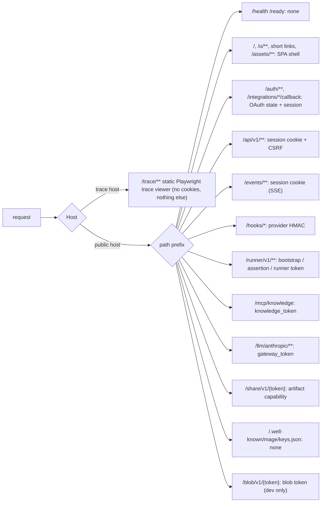
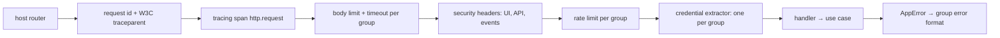
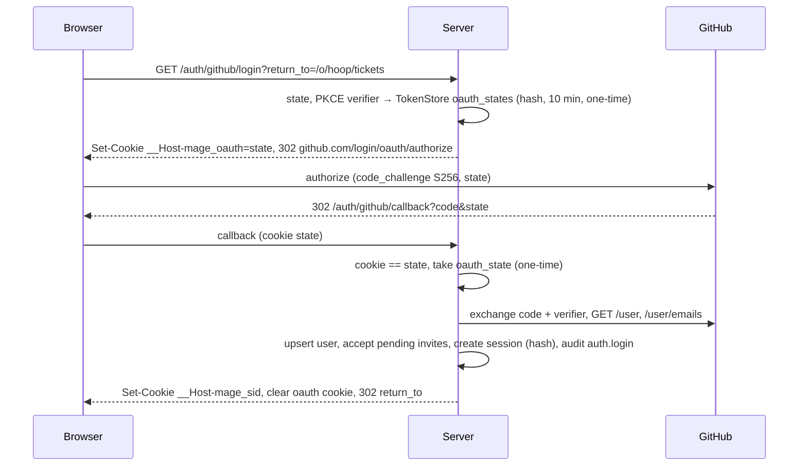
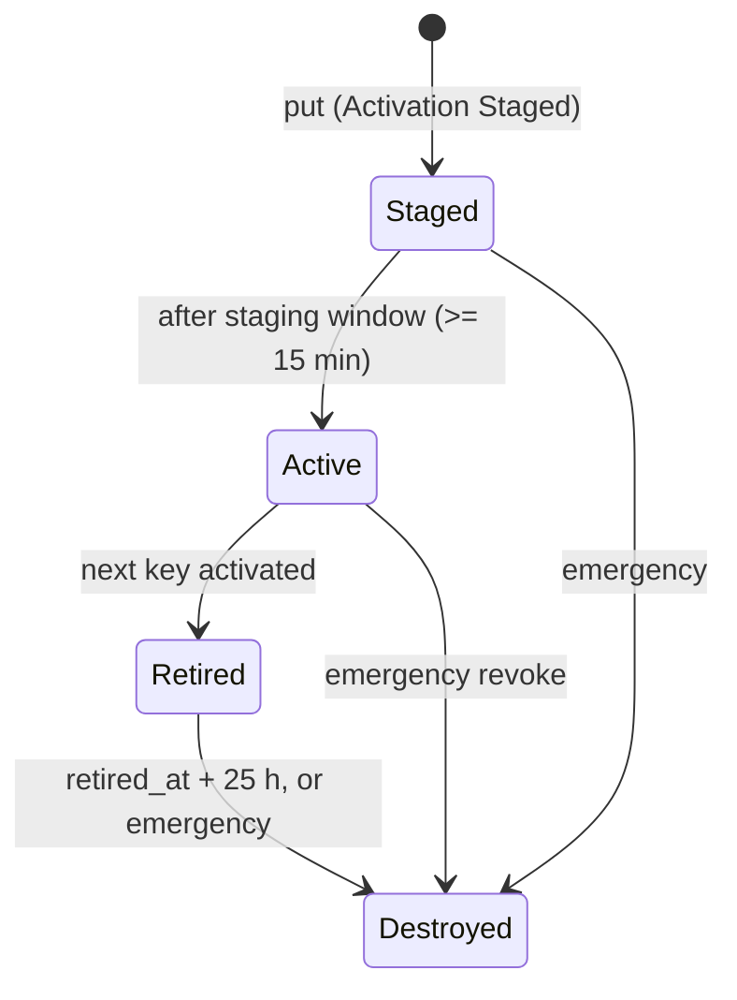
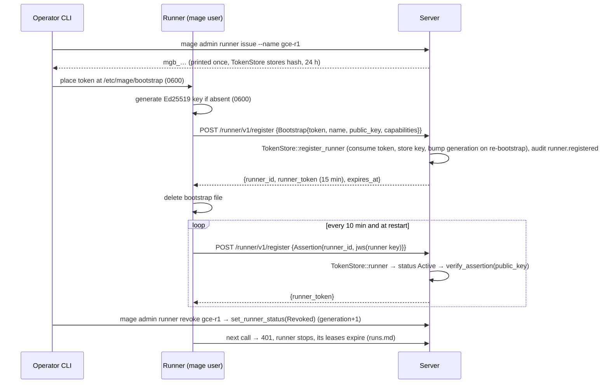
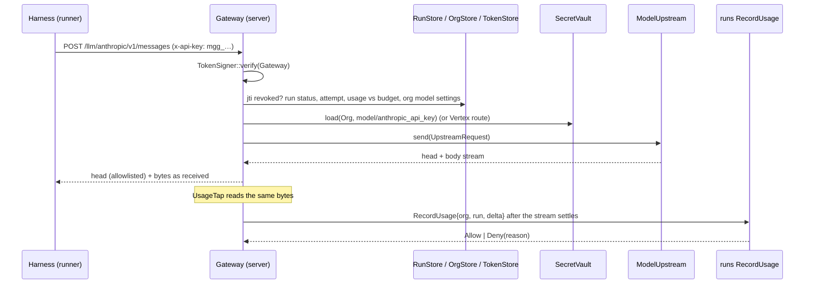

# Server role (`mage start server`)

The control plane's outward surface and its cross-cutting security: the HTTP router
(`mage_server::adapters::driving::http`, axum), user auth, every token Mage issues, secrets
(`SecretVault`), the model gateway (`ModelUpstream`), live updates (SSE), serving the UI (`mage/web-app`),
Cloud Run deployment, and observability.

Semantics owned elsewhere and only referenced here: runner protocol and run state
([runs.md](runs.md)), webhook verification and normalization ([intake.md](intake.md)), Knowledge
MCP tools ([knowledge.md](knowledge.md)), schema and stores ([storage.md](storage.md)), fix flows
([fix.md](fix.md)), triage ([triage.md](triage.md)).

## Purpose

- Serve one public origin for browsers, webhooks, runners and harnesses, with **exactly one
  credential type per route group**.
- Hold every secret. Hand the data plane only scoped, short-lived, run-bound credentials; the
  runner never holds tenant model keys, GitHub/Linear/Slack credentials, database or blob-store
  credentials.
- Forward model calls with the tenant's credential (BYOK) or Vertex, meter usage, enforce budgets.
- Push live state to the UI over SSE that survives Cloud Run's request timeout.
- Record who did what (audit log) and why it was allowed (tracing).

### Decisions in this doc

| Topic | Decision |
|---|---|
| UI rendering | React + TypeScript SPA (`mage/web-app` standalone, or Mage pages inside the aho-cloud console), served as embedded static assets; data only via `/api/v1` + SSE. See [deployment.md](deployment.md) |
| Login | Self-host: GitHub OAuth (PKCE S256 + `state`) and Google OIDC; identity only, provider tokens discarded after login. On aho-cloud: the edge authenticates and Mage verifies `X-Principal-JWT` (`edge_jwt` adapter) |
| Sessions | Opaque, server-side (`TokenStore`, hash only), `__Host-` cookie, `SameSite=Lax` |
| CSRF | HMAC-derived token header + `Origin` check + JSON-only mutations |
| Org selection | Immutable org slug in the path; membership checked on every request |
| Signed tokens | Compact JWS, `alg = EdDSA` (Ed25519) only, typed by prefix + `typ` + `aud`; codec in `mage_core::wire::token`; key ring is a `SecretVault` secret with staged rotation |
| Runner auth | One-time bootstrap token → runner registers its own Ed25519 public key → 15-min runner tokens refreshed by signed assertion (no refresh tokens) |
| Secrets | Envelope encryption: AES-256-GCM DEK per secret version, DEK wrapped by a Cloud KMS KEK (local key file in dev) |
| Background jobs | Job worker runs **inside the server instances** on Cloud Run with `--no-cpu-throttling` and `min-instances >= 1` |
| Knowledge MCP | rmcp streamable HTTP in **stateless** mode (no MCP session), safe behind many Cloud Run instances |
| Trace viewer | Served from a **separate, cookie-less origin**; trace fetched through a 10-min capability URL |
| Health paths | `/health`, `/ready` (Cloud Run reserves some paths ending in `z`, e.g. `/healthz`, on `*.run.app`) |

## Ports used and defined

### Crate placement

| Code | Location |
|---|---|
| Ports owned here | `mage_server::ports::{vault, llm, auth, feed, audit}` |
| Use cases | `mage_server::app::{auth, settings, gateway, members, integrations}` (plus `intake`, `triage`, `runs`, `fix`, `knowledge` owned by their docs) |
| HTTP, SSE | `mage_server::adapters::driving::http` |
| Knowledge MCP mount | `mage_server::adapters::driving::mcp` |
| Job worker | `mage_server::adapters::driving::jobs` |
| Vault, token signer | `mage_server::adapters::driven::vault` |
| Model upstreams | `mage_server::adapters::driven::llm_upstream` |
| Identity provider | `mage_server::adapters::driven::github` (on `mage_infra::github` client) |
| Change feed, audit log | `mage_server::adapters::driven::pg` |
| DTOs (UI API, SSE, runner) | `mage_core::wire` |
| Token codec + claim structs | `mage_core::wire::token` (Addition) |
| Fakes | `mage_server::testing` |
| UI | `mage/web` + `mage/web-app` (React; types generated from `mage_core::wire::api`) |
| Composition | `mage_server::compose` builds adapters from `ServerConfig`; `mage-app` embeds the `mage/web-app` bundle and calls `mage_server::run` |

### Ports used (owned by other docs)

| Port | Owner | Server surface uses it for |
|---|---|---|
| `OrgStore` | storage.md | orgs, members, user identities, pending invites, integrations, org settings (model, fix, triage, budgets) |
| `TicketStore` | storage.md | ticket and cause API |
| `RunStore` | runs.md / storage.md | run reads, event paging, gateway pre-check |
| `RepoStore`, `KnowledgeStore` | knowledge.md | repo/recipe API; Knowledge MCP |
| `JobQueue` | storage.md | enqueue from API; in-process worker |
| `WebhookInbox`, `OutboundLog` | intake.md | `/hooks/*` |
| `TokenStore` | storage.md | sessions, OAuth/install states, runner bootstrap + registration (`register_runner`, `runner`, `set_runner_status`), `token_revocations` by jti |
| `SecretStore` | storage.md | sealed secret rows and org data keys; used only inside the vault adapter |
| `ArtifactStore` | storage.md | artifact content (`get_range`), signed URLs |
| `RunSignals` | runs.md | wakeups for run SSE and runner long-polls (channels per runs.md) |
| `SourceHostAdmin`, `TicketTracker`, `ChatNotifier` | intake.md | integration install exchanges (`complete_install`), called through `intake::BindIntegration` |
| `PullRequests` | fix.md | via fix use cases only |
| `Clock`, `IdGen` | README | time, ids |

### `SecretVault` (owned)

Envelope encryption plus versioned storage of platform and tenant secrets. The adapter persists
through `SecretStore`; it never opens its own database connection.

```rust
// mage_server::ports::vault
pub enum SecretScope { Platform, Org(OrgId) }
pub struct SecretName(String);              // "<area>/<name>", [a-z0-9_./-]{1,128}
pub struct SecretVersion(pub u32);
pub enum SecretState { Staged, Active, Retired, Destroyed }
pub enum Activation { Now, Staged }
pub struct SecretBytes(/* Vec<u8>; no Debug/Display/Serialize; zeroed on drop with volatile writes */);
pub struct Ciphertext(Vec<u8>);             // self-describing: [fmt=1][dek_version u32][nonce 12][ct+tag]
pub struct SecretMeta {
    pub scope: SecretScope, pub name: SecretName, pub version: SecretVersion,
    pub state: SecretState,
    pub fingerprint: String,                // display-safe, e.g. "sk-ant-…a1b2" or sha256 prefix
    pub created_by: Actor, pub created_at: OffsetDateTime, pub state_changed_at: OffsetDateTime,
}
pub struct RewrapReport { pub scanned: u32, pub rewrapped: u32, pub remaining: u32 }

#[async_trait]
pub trait SecretVault: Send + Sync {
    /// New version. `Now`: becomes Active, previous Active becomes Retired (one transaction).
    async fn put(&self, scope: &SecretScope, name: &SecretName, value: SecretBytes,
                 activation: Activation, actor: &Actor) -> Result<SecretMeta, VaultError>;
    /// Active version.
    async fn load(&self, scope: &SecretScope, name: &SecretName)
        -> Result<(SecretMeta, SecretBytes), VaultError>;
    /// Staged, Active or Retired version (signing-key verification needs non-active versions).
    async fn load_version(&self, scope: &SecretScope, name: &SecretName, version: SecretVersion)
        -> Result<SecretBytes, VaultError>;
    async fn versions(&self, scope: &SecretScope, name: &SecretName)
        -> Result<Vec<SecretMeta>, VaultError>;
    async fn list(&self, scope: &SecretScope) -> Result<Vec<SecretMeta>, VaultError>;
    /// Allowed: Staged→Active (old Active→Retired), Active→Retired, Retired→Destroyed,
    /// Staged→Destroyed. Destroyed deletes the wrapped DEK and ciphertext (crypto-shred).
    async fn set_state(&self, scope: &SecretScope, name: &SecretName, version: SecretVersion,
                       state: SecretState, actor: &Actor) -> Result<SecretMeta, VaultError>;
    /// Encrypt tenant data with the org's active data key; AAD binds the ciphertext to its use.
    async fn encrypt(&self, org: OrgId, aad: &[u8], plaintext: &[u8]) -> Result<Ciphertext, VaultError>;
    async fn decrypt(&self, org: OrgId, aad: &[u8], ciphertext: &Ciphertext) -> Result<SecretBytes, VaultError>;
    /// Re-wrap DEKs whose KEK version is not the KEK's primary version.
    async fn rewrap(&self, batch: u32) -> Result<RewrapReport, VaultError>;
}

pub enum VaultError {
    NotFound, Conflict, Invalid(String), Unavailable(String),
    Integrity,          // AEAD tag or AAD mismatch: tampered or moved row
    Forbidden,          // KEK permission denied
}
```

### `ModelUpstream` (owned)

```rust
// mage_server::ports::llm
pub struct ModelId(pub String);                 // Anthropic model id, e.g. "claude-…"
pub enum UpstreamOp { Messages, CountTokens }
pub enum ModelRoute {
    /// BYOK or the operator's own key, loaded from SecretVault by the gateway use case.
    AnthropicApi { api_key: SecretBytes },
    /// Mage's GCP project; credential is the adapter's ADC (service account).
    Vertex { project: String, region: String, model: String /* Vertex model id from model_map */ },
}
pub struct UpstreamRequest {
    pub op: UpstreamOp,
    pub route: ModelRoute,
    pub stream: bool,
    pub anthropic_version: Option<String>,
    pub anthropic_beta: Vec<String>,
    pub body: Bytes,                            // client JSON as received
}
pub struct UpstreamHead { pub status: u16, pub headers: Vec<(String, String)> /* allowlisted */ }
pub type ByteStream = Pin<Box<dyn Stream<Item = Result<Bytes, UpstreamError>> + Send>>;
pub enum UpstreamBody { Full(Bytes), Stream(ByteStream) }
pub struct UpstreamResponse { pub head: UpstreamHead, pub body: UpstreamBody }

#[async_trait]
pub trait ModelUpstream: Send + Sync {
    /// Non-2xx upstream responses are Ok(UpstreamResponse) and passed through;
    /// Err only for transport/protocol failures.
    async fn send(&self, req: UpstreamRequest) -> Result<UpstreamResponse, UpstreamError>;
    fn supports(&self, route: &ModelRoute, op: UpstreamOp) -> bool;
}

pub enum UpstreamError { Invalid(String), Unavailable(String), Timeout, Protocol(String) }
```

### `TokenSigner`, `IdentityProvider`, `ChangeFeed`, `AuditLog` (owned, Additions)

```rust
// mage_server::ports::auth
pub enum TokenKind { Runner, Knowledge, Gateway, Artifact, Blob, Indexer }
pub struct MemoryCutoff { pub exclude_tickets: Vec<TicketId>, pub as_of: Option<OffsetDateTime> }
pub enum TokenScope {
    Runner    { runner: RunnerId, generation: u32, instance: Uuid /* runner process instance (runs.md) */ },
    Knowledge { org: OrgId, run: RunId, attempt: u16, repo: RepoId, sha: CommitSha,
                memory: MemoryCutoff, disabled_layers: Vec<Layer> /* eval ablation; empty otherwise */ },
    Gateway   { org: OrgId, run: RunId, attempt: u16, models: Vec<ModelId> },
    Artifact  { org: OrgId, artifact: ArtifactId },
    Blob      { org: OrgId, key: String, method: BlobMethod, max_bytes: u64 },
    Indexer   { org: OrgId, repo: RepoId },
}
pub struct TokenClaims {
    pub scope: TokenScope,          // kind derives from the variant
    pub iat: OffsetDateTime, pub exp: OffsetDateTime,
    pub jti: Uuid,
}
pub struct SignedToken(String);     // "mg?_" + compact JWS; charset [A-Za-z0-9_.-]
pub struct RunnerAssertion { pub runner: RunnerId, pub iat: OffsetDateTime, pub exp: OffsetDateTime, pub jti: Uuid }
pub struct PublicKeyInfo { pub kid: String, pub state: SecretState, pub public_key: [u8; 32] }

#[async_trait]
pub trait TokenSigner: Send + Sync {
    fn sign(&self, claims: &TokenClaims) -> Result<SignedToken, TokenError>;
    /// Stateless checks only (format, alg, kid, signature, iss/aud/typ, time).
    /// Revocation and run state are checked by the calling use case.
    fn verify(&self, token: &str, expected: TokenKind, now: OffsetDateTime) -> Result<TokenClaims, TokenError>;
    /// Runner-signed assertion verified against the runner's registered public key.
    fn verify_assertion(&self, assertion: &str, runner_public_key: &[u8; 32], now: OffsetDateTime)
        -> Result<RunnerAssertion, TokenError>;
    /// Reload the key ring from SecretVault.
    async fn reload(&self) -> Result<(), TokenError>;
    /// Staged, Active and Retired public keys (for /.well-known/mage/keys.json).
    fn public_keys(&self) -> Vec<PublicKeyInfo>;
}
pub enum TokenError { Malformed, WrongKind, UnknownKey, BadSignature, Expired, NotYetValid, Unavailable(String) }

pub enum IdentityProviderKind { GitHub, Google, AhoCloudEdge }
pub struct AuthorizeParams { pub state: String, pub pkce_challenge: String, pub redirect_uri: String }
pub struct ExternalIdentity {
    pub provider: IdentityProviderKind,
    pub subject: String,                 // GitHub numeric user id / Google `sub` / aho-cloud principal id (stable)
    pub login: String, pub name: Option<String>,
    pub email: Option<String>,           // primary verified email, if readable
    pub avatar_url: Option<String>,
}

#[async_trait]
pub trait IdentityProvider: Send + Sync {
    fn authorize_url(&self, params: &AuthorizeParams) -> String;
    /// Exchange code (+ PKCE verifier) and fetch identity; the provider token is dropped here.
    async fn exchange(&self, code: &str, pkce_verifier: &str, redirect_uri: &str)
        -> Result<ExternalIdentity, IdentityError>;
    /// Resolve a login to a stable subject (invites).
    async fn lookup_login(&self, login: &str) -> Result<Option<ExternalIdentity>, IdentityError>;
}
pub enum IdentityError { Denied, Invalid(String), Unavailable(String) }
```

```rust
// mage_server::ports::feed — read side of the per-org feed. Rows are written by the pg store
// methods (adapters::driven::pg) in the same transaction as the state change (storage.md, org_feed).
pub struct FeedId(pub i64);             // per-org monotonic; commit order == id order (storage.md)
pub enum FeedKind { Ticket, Cause, Run, Repo, Recipe, Integration, Settings, Member }
pub struct FeedEntry { pub id: FeedId, pub org: OrgId, pub kind: FeedKind, pub subject: String /* prefixed id */, pub at: OffsetDateTime }
pub enum FeedNotice { Entry { org: OrgId, id: FeedId }, Lagged }
pub type NoticeStream = Pin<Box<dyn Stream<Item = FeedNotice> + Send>>;

#[async_trait]
pub trait ChangeFeed: Send + Sync {
    async fn subscribe(&self, org: OrgId) -> Result<NoticeStream, FeedError>;
    async fn after(&self, org: OrgId, after: FeedId, limit: u32) -> Result<Vec<FeedEntry>, FeedError>;
    async fn head(&self, org: OrgId) -> Result<FeedId, FeedError>;
}
pub enum FeedError { NotFound, Conflict, Invalid(String), Unavailable(String) }

// mage_server::ports::audit
pub enum Actor { User(UserId), Runner(RunnerId), Operator { os_user: String }, System }
pub enum AuditOutcome { Success, Denied, Failed }
pub struct AuditTarget { pub kind: &'static str, pub id: String }
pub struct AuditEvent {
    pub org: Option<OrgId>,                     // None = platform-level
    pub actor: Actor,
    pub action: AuditAction,                    // closed enum; Display "area.verb", table below
    pub target: AuditTarget,
    pub outcome: AuditOutcome,
    pub ip: Option<IpAddr>, pub request_id: Option<String>,
    pub details: Vec<(&'static str, String)>,   // fingerprints and ids only; never secret values
}
pub struct AuditRecord { pub id: i64, pub at: OffsetDateTime, pub event: AuditEvent }
pub struct AuditFilter { pub action: Option<AuditAction>, pub actor: Option<Actor>, pub before: Option<i64> }

#[async_trait]
pub trait AuditLog: Send + Sync {
    async fn record(&self, event: AuditEvent) -> Result<i64, AuditError>;
    async fn list(&self, org: OrgId, filter: AuditFilter, limit: u32) -> Result<Vec<AuditRecord>, AuditError>;
}
pub enum AuditError { NotFound, Conflict, Invalid(String), Unavailable(String) }
```

## HTTP surface

### Router map



Anything not listed below returns 404.

### Endpoint catalog

Auth column: `none`, `session` (cookie; + `CSRF` on mutations), `role` = minimum org role,
`hmac`, `runner`, token kinds by name. `…` = `/api/v1/orgs/{org}`.

**Probes, static, keys**

| Method | Path | Auth | Purpose |
|---|---|---|---|
| GET | `/health` | none | Liveness: process alive; touches no dependency |
| GET | `/ready` | none | Readiness: DB ping, key ring loaded, org-feed listener connected, migrations at the expected version. Body `ok` / `not ready`, no details |
| GET | `/`, `/login`, `/o/{org}/**` | none | SPA shell (`index.html`); carries no data |
| GET | `/tickets/{ticket}`, `/runs/{run}`, `/causes/{cause}/brief`, `/artifacts/{artifact}` | none | Short links used in Linear/Slack/fix briefs; the SPA calls `/api/v1/resolve/{id}` and routes to `/o/{org}/…` |
| GET | `/assets/{file}` | none | Hashed js/css; `Cache-Control: immutable` |
| GET | `/.well-known/mage/keys.json` | none | Public Ed25519 keys (RFC 8037 OKP JWK set: `kid`, `crv`, `x`, `state`) for verifiers outside the server (indexer internal API) |

**Login and integration callbacks**

| Method | Path | Auth | Purpose |
|---|---|---|---|
| GET | `/auth/github/login?return_to=` | none | Create login state (TokenStore oauth_states: state hash, PKCE verifier, return_to), set `__Host-mage_oauth`, 302 to GitHub |
| GET | `/auth/github/callback?code&state` | pre-login cookie + one-time state | Exchange, upsert user, accept pending invites, new session, 302 to `return_to` |
| GET | `/auth/google/login?return_to=` | none | Same as GitHub with OIDC `nonce`; 302 to Google (self-host) |
| GET | `/auth/google/callback?code&state` | pre-login cookie + one-time state | Exchange, verify `id_token`, upsert user, accept pending invites, new session |
| POST | `/auth/logout` | session + CSRF | Delete this session (`?all=true`: all of the user's sessions) |
| GET | `/integrations/github/callback` | session + install state | GitHub read-app setup redirect → `intake::BindIntegration` → `SourceHostAdmin::complete_install(Read, …)`, which verifies the installation via `/user/installations` (intake.md) |
| GET | `/integrations/github-fix/callback` | session (Owner) + install state | Fix app install (fix.md, P6) → `SourceHostAdmin::complete_install(Fix, …)` |
| GET | `/integrations/linear/callback` | session + install state | Linear OAuth (`TicketTracker::complete_install`) |
| GET | `/integrations/slack/callback` | session + install state | Slack OAuth (`ChatNotifier::complete_install`) |

**UI JSON API** (`/api/v1`, JSON only, DTOs in `mage_core::wire::api`)

| Method | Path | Auth | Purpose |
|---|---|---|---|
| GET | `/api/v1/session` | session | User, memberships `[{org, name, role}]`, `csrf_token`, feature flags |
| GET | `/api/v1/resolve/{id}` | session | Prefixed id (`tkt_`, `run_`, `cau_`, `art_`) → `{org, kind}` if the user is a member, else 404 |
| POST | `/api/v1/orgs` | session + CSRF | Create org, caller becomes Owner. Public only; v1 returns 404 (CLI `mage admin org create`) |
| GET | `…/tickets` | Member | List: status, repo, customer, text filter, cursor |
| GET | `…/tickets/{ticket}` | Member | Detail: target (`assumed`), causes, run summaries, Linear/Slack links |
| POST | `…/tickets/{ticket}/retriage` | Member + CSRF | `RequestRetriage` (triage.md); cost-cap bypass needs Admin, checked in the use case |
| PUT | `…/tickets/{ticket}/target` | Member + CSRF | Override repo/sha |
| POST | `…/tickets/{ticket}/resolve` | Member + CSRF | Record `Resolution` |
| POST | `…/tickets/{ticket}/causes/{cause}/diagnose` | Member + CSRF | Start a Diagnose run (`{harness?}`) |
| GET | `…/tickets/{ticket}/causes/{cause}/fix-brief?version=` | Member | Fix brief (fix.md) |
| POST | `…/tickets/{ticket}/causes/{cause}/fix` | Member + CSRF | `StartFixRun` (fix.md; org `fix.run`) |
| POST | `…/tickets/{ticket}/causes/{cause}/pull-request` | Member + CSRF | Enqueue `fix.open_pr` (fix.md; `fix.pull_requests`, manual mode) |
| GET | `…/runs` | Member | List: kind, status, subject, cursor |
| GET | `…/runs/{run}` | Member | Status, attempts, gates, usage vs budget, result |
| GET | `…/runs/{run}/events?after=&limit=` | Member | Paged event history (initial load before SSE) |
| POST | `…/runs/{run}/steer` | Member + CSRF | Queue a `Steer` command (runs.md); text ≤ 8 KiB |
| POST | `…/runs/{run}/cancel` | Member + CSRF | User cancel |
| GET | `…/runs/{run}/artifacts` | Member | Artifact list |
| GET | `…/artifacts/{artifact}` | Member | Metadata |
| GET | `…/artifacts/{artifact}/content` | Member | Bytes with `Range`; kinds `SourceBundle`, `ScipIndex` refused (403) |
| POST | `…/artifacts/{artifact}/share` | Member + CSRF | Mint a 10-min capability URL for the trace origin (`Trace` kind only) |
| GET | `…/repos` | Member | Repos with layer status at default head, recipe status |
| GET | `…/repos/{repo}` | Member | Versions, layers, recipe, deployments, last Learn run |
| GET | `…/integrations/github/repositories` | Admin | Installation repos not yet connected |
| POST | `…/repos` | Admin + CSRF | Connect a repo; enqueue `index.version` for default head |
| DELETE | `…/repos/{repo}` | Admin + CSRF | Disconnect (retention per storage.md) |
| POST | `…/repos/{repo}/versions` | Member + CSRF | On-demand index of a ref/sha (`index.version`) |
| POST | `…/repos/{repo}/learn` | Admin + CSRF | Start a Learn run (onboarding wizard) |
| GET | `…/repos/{repo}/recipes` | Member | Current recipe + history |
| PUT | `…/repos/{repo}/recipe` | Admin + CSRF | Save Draft TOML: parse, normalize, hash, secret-pattern scan (fix.md `SecretScanner` rules) |
| POST | `…/repos/{repo}/recipe/verify` | Admin + CSRF | Boot gate Verify run |
| GET | `…/repos/{repo}/deployments` | Member | Environment → sha |
| PUT | `…/repos/{repo}/deployments/{environment}` | Admin + CSRF | Manual mapping |
| GET | `…/customers` | Member | Customers and environments |
| POST, PUT | `…/customers`, `…/customers/{customer}` | Admin + CSRF | Create/update customer |
| GET | `…/settings` | Member | Non-secret org settings |
| PUT | `…/settings` | Admin + CSRF | Harness default, budgets, `TriageSettings`, `FixSettings`. Rejects `ClaudeCode` in production unless server config `harness.claude_code.gateway_verified = true` (triage.md) |
| GET | `…/settings/model` | Admin | Route, allowed models, key metadata (fingerprint, set_at, set_by) |
| PUT | `…/settings/model` | Owner + CSRF | Route (`anthropic` / `vertex` if operator-enabled), allowed models, `max_tokens` cap |
| PUT | `…/settings/model/key` | Owner + CSRF | Set BYOK Anthropic key; write-only; validated upstream before storing |
| DELETE | `…/settings/model/key` | Owner + CSRF | Destroy BYOK key |
| GET | `…/integrations` | Admin | Status per integration |
| POST | `…/integrations/{kind}/connect` | Admin + CSRF (`github-fix`: Owner) | Create install state; return provider URL |
| DELETE | `…/integrations/{kind}/{external_id}` | Admin + CSRF (`github-fix`: Owner) | Revoke; destroy stored tokens |
| GET | `…/members` | Member | Members and pending invites |
| POST | `…/members/invites` | Admin + CSRF | Invite a GitHub login (resolved to the stable GitHub id); invited role ≤ caller's role |
| DELETE | `…/members/invites/{invite}` | Admin + CSRF | Withdraw invite |
| PUT | `…/members/{user}` | Owner + CSRF | Change role |
| DELETE | `…/members/{user}` | Admin + CSRF (Member targets), Owner (any) | Remove; the last Owner cannot be removed |
| GET | `…/audit?action=&before=` | Admin | Audit log |
| GET | `…/usage?from=&to=&group_by=` | Admin | Cost by run / ticket / model |

**Live updates**

| Method | Path | Auth | Purpose |
|---|---|---|---|
| GET | `/events/orgs/{org}/feed` | session, Member | Org feed (ids only); `Last-Event-ID` = feed id |
| GET | `/events/orgs/{org}/runs/{run}` | session, Member | Run events; `Last-Event-ID` = `seq` |

**Webhooks** (verification, dedupe, ack-then-enqueue: [intake.md](intake.md))

| Method | Path | Auth | Purpose |
|---|---|---|---|
| POST | `/hooks/github` | `X-Hub-Signature-256` with `github/webhook_secret` | Read app: installation, repository, push, deployment events |
| POST | `/hooks/github-fix` | `X-Hub-Signature-256` with `github_fix/webhook_secret` | Fix app (fix.md): installation lifecycle, `pull_request` events → `fix.pr_event` |
| POST | `/hooks/linear` | `Linear-Signature` (hex HMAC-SHA256 of raw body) + `webhookTimestamp` window | Issue events |
| POST | `/hooks/slack` | Slack v0 signature over `v0:{timestamp}:{body}` + timestamp window | Events API incl. `url_verification` |

**Runner protocol** (semantics, DTOs, fencing: [runs.md](runs.md))

| Method | Path | Auth | Purpose |
|---|---|---|---|
| POST | `/runner/v1/register` | body: one-time bootstrap token **or** runner assertion | Issue a runner token |
| POST | `/runner/v1/lease` | runner token | Long-poll ≤ 25 s for a `RunAssignment` |
| POST | `/runner/v1/runs/{run}/heartbeat` | runner token, lease holder, `attempt` | Extend lease, report phase |
| POST | `/runner/v1/runs/{run}/events` | same | Batched events |
| GET | `/runner/v1/runs/{run}/commands?after=` | same | Long-poll: `Steer`, `Abort`, `GateFeedback` |
| POST | `/runner/v1/runs/{run}/artifacts` | same | Register artifact, get signed upload URL |
| POST | `/runner/v1/runs/{run}/result` | same | Submit result (Triage evidence gate inline) |
| POST | `/runner/v1/runs/{run}/finish` | same | Teardown done; lease released |

Per-run routes: token `sub` must equal the run's lease holder and the body/query `attempt` must
equal `Run.attempt`, else 409 `lease_lost`.

**MCP, model gateway, capabilities**

| Method | Path | Auth | Purpose |
|---|---|---|---|
| POST | `/mcp/knowledge` | `Authorization: Bearer mgk_…` | Knowledge MCP JSON-RPC (stateless). GET/DELETE → 405 |
| POST | `/llm/anthropic/v1/messages` | `mgg_…` via `x-api-key` or `Authorization: Bearer` | Anthropic Messages, streaming or not |
| POST | `/llm/anthropic/v1/messages/count_tokens` | same | Token counting; 404 `not_found_error` if the route's upstream can't serve it (Claude Code falls back) |
| any | `/llm/anthropic/**` (other) | — | 404 Anthropic-shaped `not_found_error` |
| GET | `/share/v1/{token}` | `mgc_…` in path | Trace bytes for the trace origin; CORS allows only `trace_origin`, no credentials |
| GET, PUT | `/blob/v1/{token}` | `mgx_…` in path | Local blob backend only (dev); not mounted when `blob.backend = "gcs"` |

**Trace origin** (separate host, same Cloud Run service, host-routed)

| Method | Path | Auth | Purpose |
|---|---|---|---|
| GET | `https://{trace_host}/trace/**` | none | Pinned Playwright trace viewer static bundle. Nothing else is served on this host |

### Request pipeline



| Group | Body limit | Handler timeout | Rate limit (per instance, approximate) |
|---|---|---|---|
| `/api/v1` | 1 MiB (recipe PUT 256 KiB) | 30 s | 20 req/s per session, burst 60 |
| `/auth`, `/integrations` | 16 KiB | 10 s | 10/min per client IP |
| `/hooks/github`, `/hooks/github-fix` | 25 MiB (GitHub's payload cap [unverified]) | ack ≤ 8 s | none before signature check; signature failures counted |
| `/hooks/linear`, `/hooks/slack` | 1 MiB | ack ≤ 2.5 s (Slack expects 3 s) | as above |
| `/runner/v1` | 4 MiB (event batches) | 30 s (long-polls return ≤ 25 s) | 50 req/s per runner |
| `/mcp/knowledge` | 1 MiB | 120 s per call | 20 calls/s per run |
| `/llm/anthropic` | 32 MiB (Cloud Run HTTP/1 request limit) | none in-process; upstream idle 5 min; Cloud Run 60 min | per-run in-flight cap (default 4) → 429 |
| `/events` | — | server closes after 10 min | 6 streams per session |
| `/share`, `/blob` | `max_bytes` claim | 10 min | — |

Client IP for rate limits is the address appended by Google's front end to `X-Forwarded-For`
[unverified: exact position rules]; only the rightmost trusted hop is used.

### Error formats

| `AppError` | `/api`, `/events`, `/auth` | `/runner/v1` | `/mcp/knowledge` | `/llm/anthropic` |
|---|---|---|---|---|
| `NotFound`, cross-tenant, non-member org | 404 | 404 | JSON-RPC error | 404 `not_found_error` |
| Unauthenticated | 401 | 401 | HTTP 401 | 401 `authentication_error` |
| Forbidden | 403 | 403 | HTTP 403 | 403 `permission_error` |
| `Conflict` | 409 | 409 (`lease_lost`) | tool error | 409 `invalid_request_error` |
| `Invalid` | 422 | 422 | tool error | 400 `invalid_request_error` |
| `Unavailable` | 503 + `Retry-After` | 503 | HTTP 503 | 503 `api_error` |
| Budget exceeded | — | — | — | 403 `permission_error` |

API body: `{"error": {"code": "<snake_case>", "message": "…", "request_id": "…"}}`. Gateway body:
`{"type": "error", "error": {"type": "…", "message": "mage: …"}}` so harnesses parse it as an
Anthropic error.

## Authentication and authorization

### Login (GitHub, self-host)

- The GitHub **read app**'s user authorization (OAuth web flow) with PKCE (S256; GitHub supports
  it since 2025-07) and `state`. Calls `GET /user` and the primary verified email
  (`GET /user/emails`, needs the app's email permission [unverified]). The user token is dropped
  inside `IdentityProvider::exchange`; Mage never stores it.
- Identity key: `(provider, subject)`. `OrgStore` maps `(provider, subject) → UserId` and updates
  login/name/avatar on each login.
- Provisioning: v1 — first org and Owner via CLI (`mage admin org create --owner <login>`); others
  join by invite. A user with no memberships gets a session and a "no access" page. Public — any
  user may create an org.
- `return_to` must be a relative path starting with `/` and not `//` or `/\`; otherwise `/`.

### Login (Google, self-host)

- OIDC authorization code flow with PKCE (S256), `state` and `nonce`; `id_token` verified against
  Google's JWKS (issuer, audience = client id, expiry, nonce). `email_verified` must be true.
  Adapter `adapters::driven::identity::google_oidc` (shared code in `shared/auth`).
- A second provider is linked only while logged in (Settings → "Connect Google/GitHub"); never
  auto-linked by matching email. Invites by email resolve on first login with a verified email.

### Login on aho-cloud (`edge_jwt`, feature `ahocloud`)

- Mage runs as an aho-cloud project behind the edge; the edge handles passkeys, GitHub and Google.
  Every request carries `X-Principal-JWT`; Mage verifies it against the project JWKS, maps the
  principal to `UserId` (`provider = AhoCloudEdge`), and reads roles from `OrgDirectory`
  (`ahocloud_orgs`). No Mage sessions or CSRF cookies in this mode; authz stays in Mage.



### Sessions

| Property | Value |
|---|---|
| Cookie | `__Host-mage_sid` = 256-bit random, base64url; `Secure; HttpOnly; SameSite=Lax; Path=/`; no `Domain` |
| Storage | `TokenStore`: SHA-256 of the id, user, created/last-seen/expiry, IP, user agent |
| Lifetime | Idle 12 h, absolute 7 d (config) |
| Rotation | New id on every login; pre-login cookie cleared |
| Revocation | Logout, logout-all, user removal by an Owner, operator CLI; effective on the next request (lookup per request, no cache) |
| `last_seen` | Updated at most every 5 min |

`SameSite=Lax` (not `Strict`) so the OAuth callback and links from Linear/Slack arrive logged in;
safety comes from CSRF checks on every mutation and GET handlers never mutating.

### CSRF

- Token: `base64url(HMAC-SHA256(auth/csrf_key, session_id_hash))`, returned by
  `GET /api/v1/session`, held in memory by the UI. Nothing extra is stored.
- Every POST/PUT/PATCH/DELETE in session groups requires all of: `X-CSRF-Token` equal
  (constant-time); `Origin` equal to `public_url` (if absent, `Sec-Fetch-Site: same-origin`;
  neither → reject); `Content-Type: application/json` when a body is present.
- Token-authenticated groups never read cookies, so they are not CSRF targets.

### Org selection

- `{org}` is the org's slug, immutable. The `OrgCtx` extractor resolves session user + slug →
  membership → `OrgCtx { org_id, user_id, role }`. Unknown org and non-member get the same 404.
- Handlers pass `org_id` explicitly to use cases; every store method takes `OrgId`, so an id from
  another org resolves to `NotFound` → 404.
- The UI keeps the last org in `localStorage`; `/` redirects there or to the org picker.

### RBAC

Roles are ordered `Owner > Admin > Member`. Each route declares its minimum role with a typed
extractor (`RequireRole<Admin>`); rules that depend on data (invite role ≤ caller's role, last
Owner, cost-cap bypass) are pure functions in `mage_server::domain` called by the use case.

| Capability | Member | Admin | Owner |
|---|---|---|---|
| Read tickets, causes, runs, artifacts, repos, recipes, non-secret settings, members | yes | yes | yes |
| Retriage, set target, resolve, run diagnostic, steer/cancel runs, fix brief, start fix run, open PR (when the org enables them) | yes | yes | yes |
| Connect/disconnect repos, Learn runs, edit/verify recipes, deployments, customers | — | yes | yes |
| Org settings (harness, budgets, triage/fix settings), connect/revoke GitHub/Linear/Slack, invites, remove Members, audit log, usage | — | yes | yes |
| Model route, BYOK key, GitHub fix app (code write access), role changes, remove Admins/Owners, delete org | — | — | yes |

Platform operations (create org in v1, runners, platform secrets, signing keys) have **no HTTP
route**; they are `mage admin …` CLI commands run with server config and the operator's own GCP
credentials, audited as `Actor::Operator`.

### Credential isolation

- One extractor per route group. Cookie groups ignore `Authorization` and `x-api-key`; token
  groups ignore cookies. No route accepts two credential types.
- The expected token kind comes from the route, never from the token. A `mgk_` token on
  `/llm/anthropic` fails before signature verification.

## Tokens and credentials

### Catalog

| Credential | Format | Issuer → verifier | Audience | Scope / claims | TTL | Revocation | Held by |
|---|---|---|---|---|---|---|---|
| User session | `__Host-mage_sid`, 256-bit random | server → server | same origin | user | idle 12 h / abs 7 d | delete row | browser cookie; TokenStore hash |
| CSRF token | HMAC of session hash | server → server | session | session | session | session deletion | UI memory; not stored |
| Login / install state | 256-bit random + PKCE verifier | server → server | provider round trip | `Login` or `Install { org, provider }`, user | 10 min, one-time | consumed | TokenStore hash; `__Host-mage_oauth` (login) |
| Runner bootstrap token | `mgb_` + 256-bit random | operator CLI → server | `/runner/v1/register` | one runner name | 24 h, one-time | consumed / expired | runner host file (deleted after use); TokenStore hash |
| Runner key | Ed25519 keypair, generated by the runner | runner | — | runner identity | until re-bootstrap or revoke | `set_runner_status(Revoked)` | private key: runner disk 0600 (`mage` user); public: `runners.public_key` |
| Runner assertion | compact JWS EdDSA, runner key | runner → server | `{public_url}/runner/v1/register` | `sub` runner | ≤ 60 s | — | transient |
| Runner token | `mgr_` + JWS EdDSA | server → server | `mage:runner` | runner, `gen`, `inst` (process instance) | 15 min (refresh at 10) | status ≠ Active/Draining, `gen` ≠ `runners.generation`, jti; `inst` checked against leases (runs.md fencing) | runner memory |
| `knowledge_token` | `mgk_` + JWS | server (at lease) → server (Knowledge MCP) | `mage:knowledge` | org, run, attempt, `repo`, `sha`, `mem` {excl, as_of}, `dl` (disabled layers) | run lifetime + 15 min, ≤ 24 h | run terminal, attempt changed, jti | harness MCP config on the runner |
| `gateway_token` | `mgg_` + JWS | server (at lease) → server (gateway) | `mage:gateway` | org, run, attempt, `models` | same | run terminal, attempt changed, jti; budget → 403 | harness env/config on the runner |
| Run MCP token | 256-bit random | runner → runner (Run MCP) | the run's loopback listener | one run's tools | run lifetime | dropped at run end | runner + harness config; **never sent to the server** |
| Signed blob URL | GCS V4 (RSA via IAM `signBlob`; `object_store`'s GCS signer using `signBlob` for ADC credentials without a private key is [unverified], else a small signer over the IAM Credentials API) | server → GCS | one object | method + key (+ content type) | upload 15 min; download 15 min (SourceBundle 30 min) | TTL only | runner |
| Artifact capability | `mgc_` + JWS, in path | server → server | `mage:artifact` | org, artifact (`Trace`) | 10 min | jti | trace viewer tab |
| Local blob token | `mgx_` + JWS, in path | server → server | `mage:blob` | org, key, method, `max_bytes` | as signed URLs | — | runner (dev only) |
| Indexer call token | `mgi_` + JWS | server → indexer internal API | `mage:indexer` | org, repo | ≤ 60 s | jti replay set on the indexer | server request (knowledge.md) |

Credentials Mage uses but does not issue: GitHub installation tokens (minted from the read-app
key by server and indexer, 1 h, permission-downscoped per request), Vertex/KMS/GCS access tokens
(ADC of the service account), Linear/Slack OAuth tokens (SecretVault, `Org` scope).

### Signed token format

- Compact JWS (RFC 7515): `b64url(header).b64url(payload).b64url(sig)`, prefixed with the kind
  prefix (`mgr_`, `mgk_`, `mgg_`, `mgc_`, `mgx_`, `mgi_`). Charset `[A-Za-z0-9_.-]`: safe as a
  literal in harness config files and env (harness.md relies on this).
- Header is exactly `{"alg":"EdDSA","kid":"<kid>","typ":"mage-<kind>+jwt"}`; the verifier rejects
  any other `alg` before looking at the key.
- Payload: `iss` (= `public_url`), `aud`, `sub`, `iat`, `nbf`, `exp`, `jti` (UUID v7) + kind claims.
- Verify order: prefix = expected kind → header → `alg`/`typ` → `kid` in ring (Staged, Active, or
  Retired) → `ed25519-dalek` `verify_strict` → `iss`/`aud` → time (leeway 30 s) → claims. Then
  the use case checks state: jti not in `token_revocations`; for run-bound kinds, run non-terminal
  and `Run.attempt == attempt`; for runner tokens, status Active or Draining and `gen` matches.
- Codec + claim structs live in `mage_core::wire::token` (pure, wasm-compatible) so the runner
  (assertions) and indexer (`mgi_` verification) share it without depending on `mage-server`.
  No generic JWT library: no algorithm negotiation surface.

### Signing keys and rotation

- Key ring = versions of platform secret `auth/token_signing_key` (32-byte Ed25519 seed).
  `kid = v{version}-{hex(sha256(public_key))[..8]}`.
- Every server instance loads the ring at startup (readiness waits for it) and reloads every
  5 min. The indexer refreshes `/.well-known/mage/keys.json` every 5 min and on unknown `kid`
  (≤ 1/min).



- Job `auth.rotate_signing_key` (every 30 days, or `mage admin keys rotate`): put Staged →
  reschedule itself `run_after = +15 min` → `set_state(Active)` (vault retires the old Active in
  the same transaction) → reschedule → destroy Retired keys older than 25 h.
- Emergency (`mage admin keys revoke <kid>`): Destroyed immediately, new key Active immediately.
  Runners re-authenticate by assertion. In-flight run-bound tokens die; those runs fail and are
  retried per runs.md. Acceptable: a leaked signing key is total data-plane credential compromise.

### Runner credential lifecycle



- No refresh tokens: a crash between rotation and persistence cannot lock a runner out, and
  nothing secret is stored server-side.
- `Draining` status: runner token stays valid for current runs; `lease` returns nothing.
- Per request: signature, `gen`, status (`TokenStore::runner`, cached 30 s per instance → revocation
  latency ≤ 30 s), jti.
- Production runner VMs have **no GCE service account** attached, so the metadata server issues
  no Google credentials [unverified: `--no-service-account --no-scopes` behaviour]; agent users are
  additionally blocked from `169.254.169.254` (executor.md).

### Run-bound tokens

Issued by the runs `Lease` use case (runs.md) through `TokenSigner`, delivered in `RunAssignment`.

| `RunKind` | `knowledge_token` | `gateway_token` |
|---|---|---|
| Learn | repo@sha of the RepoVersion | yes |
| Triage | ticket target repo@sha, `mem` excludes the ticket, `dl` only in eval (triage.md) | yes, `models` = triage model(s) |
| Diagnose | ticket target repo@sha | yes |
| Fix | ticket target repo@sha | yes |
| Verify | — (no harness) | — |

- **Attempt binding**: a re-lease (attempt + 1) issues new tokens; tokens of the old attempt fail the
  `attempt` check, so an orphaned harness from a lost lease cannot keep spending.
- **TTL** covers the run's maximum lifetime (budget `max_wall` plus gate time, per runs.md) +
  15 min, capped at 24 h. Runs never need token refresh.
- **Dev mode**: server `gateway.mode = "harness-login"` omits `gateway_token`; the runner then uses
  the developer's own harness login only if its config has `allow_harness_login = true`, which is
  refused when `environment = "production"`.

## Secrets and per-role config

### Envelope design (`SecretVault`)

- Each secret version: random 256-bit DEK; value sealed with AES-256-GCM (96-bit random nonce);
  AAD = `mage-secret/v1|{scope}|{name}|{version}`. The DEK is wrapped by the KEK with the same AAD.
  `SecretStore` keeps `{scope, name, version, state, wrapped_dek, kek_version, nonce, ciphertext,
  fingerprint, created_by, timestamps}`. Copying a row to another name or org fails with
  `Integrity`.
- Org data keys (`encrypt`/`decrypt`): one DEK per org and version in `SecretStore` data keys,
  wrapped by the org's KEK, unwrapped DEKs cached 10 min in memory.
- KEKs:

| Scope | Prod KEK | IAM | Holds |
|---|---|---|---|
| `Platform` | Cloud KMS `mage-kek-platform` | server SA only | signing keys, CSRF key, webhook secrets, OAuth client secrets, GitHub fix-app key |
| `Org(org)` v1 | `mage-kek-platform` | server SA only | BYOK key, integration tokens, org data keys |
| `Org(org)` public | `mage-kek-org-{org_id}` (created with the org) | server SA only | same; destroying the KEK crypto-shreds the tenant |

- Dev: one 32-byte local key file serves every scope.
- Plaintext caches: secrets ≤ 60 s per instance keyed by `(scope, name, version)`; the signing ring
  until reload. `SecretBytes` zeroes on drop and has no `Debug`.
- Rotation: secret values → `put(.., Activation::Now)`; KEK → KMS automatic rotation (90 days; new
  primary encrypts, old versions still decrypt) + daily job `vault.rewrap`.
- Operator CLI: `mage admin secret put <platform|org:slug> <name> --stdin`, `list`, `retire`,
  `destroy`. Values only via stdin or file, never argv.

### Secret inventory

| Name | Scope | Loaded by | Purpose |
|---|---|---|---|
| `auth/token_signing_key` | Platform | server | Ed25519 key ring |
| `auth/csrf_key` | Platform | server | CSRF HMAC |
| `github/webhook_secret` | Platform | server | read-app webhook HMAC |
| `github/oauth_client_secret` | Platform | server | login + install code exchange |
| `github_fix/app_private_key`, `github_fix/webhook_secret` | Platform | server | F3 (fix.md) |
| `linear/oauth_client_secret`, `linear/webhook_secret` | Platform | server | intake.md |
| `slack/oauth_client_secret`, `slack/signing_secret` | Platform | server | intake.md |
| `model/anthropic_api_key` | Org | server, gateway path only | BYOK (internal org: hoop's own key, same path) |
| `integration/linear/{workspace}/oauth`, `integration/linear/{workspace}/api_key` (v1) | Org | server | Linear |
| `integration/slack/{team}/bot_token` | Org | server | Slack |

Not in `SecretVault`:

- **GitHub read-app private key**: shared by server and indexer through `mage_infra::github`, so
  each role loads it with `mage_infra::config::SecretSource` (prod: one GCP Secret Manager secret
  readable by the server and indexer service accounts; dev: file).
- **Database credential**: needed before `SecretStore` is reachable. Prefer Cloud SQL IAM database
  authentication through the Cloud SQL Auth Proxy with `--auto-iam-authn` (no password)
  [unverified on Cloud Run multi-container]; fallback a password URL in Secret Manager exposed as
  `MAGE_DATABASE_URL`.
- **Google APIs** (KMS, GCS, IAM signBlob, Vertex): ADC of the attached service account; no key
  files anywhere.

### Per-role credentials

| Credential | server | indexer | runner | Enforced by |
|---|---|---|---|---|
| Postgres | yes | yes | no | runner config has no `database`; `mage-runner` does not depend on `mage-infra` |
| GCS | yes (ADC) | yes (ADC) | no — signed URLs only | runner VM has no service account |
| KMS `mage-kek-platform`, org KEKs | yes | no | no | IAM; vault exists only in `mage-server` |
| Token signing key | yes | no (public keys only) | no | Platform secret |
| GitHub read-app key | yes | yes | no | Secret Manager IAM |
| GitHub fix-app key | yes | no | no | Platform secret |
| Linear / Slack tokens, webhook secrets | yes | no | no | Platform / Org secrets |
| Tenant BYOK keys | yes (gateway only) | no | **no** | Org secret; never in `RunAssignment` |
| Vertex | yes (ADC, `aiplatform.user`) | no | no | IAM |
| Bootstrap token, runner key | no | no | yes | file permissions |
| `knowledge_token`, `gateway_token` | issues | no | holds per run | scoped, run-bound |
| Run MCP token | no | no | generates | loopback only |
| Developer harness login | no | no | dev only | `allow_harness_login` refused in production |

### Config

One TOML file + `MAGE_*` overrides, deserialized into `ServerConfig` / `IndexerConfig` /
`RunnerConfig` (types live in each role crate; `mage-app` loads them). A role refuses to start if
its section is missing, if another role's section is present (except `mage start all`, which is
refused when `environment = "production"`), or if any field holds an inline secret value (names
ending `_secret`, `_key`, `_token`, `password` must be references).

```toml
[server]
environment = "production"            # | "development"
public_url  = "https://mage.example.com"
trace_url   = "https://mage-trace.example.com"
bind        = "0.0.0.0:8080"          # Cloud Run $PORT

[server.database]
url_source = "env:MAGE_DATABASE_URL"  # or "iam" via Cloud SQL Auth Proxy
pool_max   = 15

[server.blob]
backend = "gcs"                       # | "local"
bucket  = "mage-artifacts"            # public: per-org buckets (storage.md)

[server.vault]
backend      = "gcp-kms"              # | "local-key-file"
platform_kek = "projects/p/locations/l/keyRings/mage/cryptoKeys/mage-kek-platform"
# local_key_file = "~/.config/mage/dev.key"

[server.github]
app_id          = 123456
client_id       = "Iv1.xxxx"
app_private_key = "gcpsm:projects/p/secrets/github-read-app-key/versions/latest"   # SecretSource

[server.gateway]
mode               = "gateway"        # | "harness-login" (dev only)
anthropic_base_url = "https://api.anthropic.com"
vertex             = { project = "p", region = "us-east5", enabled_orgs = ["hoop"] }
per_run_in_flight  = 4
beta_allowlist_vertex = []
[server.gateway.pricing."claude-model-id"]   # micros per million tokens; operator-maintained
input = 0
output = 0
cache_write = 0
cache_read = 0

[server.harness.claude_code]
gateway_verified = false              # triage.md

[server.jobs]
slots = 8
kinds = ["intake.", "triage.", "notify.", "runs.", "fix.", "auth.", "vault."]

[server.telemetry]
otlp_endpoint = "http://localhost:4317"
service_name  = "mage-server"
```

Indexer: `database`, `blob`, `github.app_private_key` (SecretSource), `server_keys_url`
(`{public_url}/.well-known/mage/keys.json`), `jobs.kinds = ["index."]`. Runner: `server_url`,
`state_dir`, `bootstrap_token_file`, `key_file`, `allow_harness_login`; nothing else secret.

## Model gateway

Use case `mage_server::app::gateway::Forward`; routes in the HTTP adapter. Mirrors the harness
contract in harness.md: base URL `{public_url}/llm/anthropic`; harnesses append `/v1/messages`.



### Request handling

1. **Credential**: `x-api-key` or `Authorization: Bearer`; both present and different → 401.
2. **Token**: `verify(token, Gateway)`; jti not revoked; `RunStore` read: run status ∈ {`Running`,
   `AwaitingGate`} (a harness finishes its turn after `submit_*`), `Run.attempt == attempt`,
   `!usage.exceeds(&budget)`. Terminal or mismatched → 401 `authentication_error`
   ("mage: run is not active"); over budget → 403 `permission_error`.
3. **Parse**: top-level only (map of `RawValue`): `model`, `stream`, `max_tokens`. The original
   bytes are forwarded unchanged to the Anthropic API.
4. **Model policy** (`OrgStore` model settings): `model` ∈ token `models` (empty = org allowlist) ∩
   org allowlist, else 400 `invalid_request_error`; `max_tokens` ≤ org cap, else 400 (no body
   rewrite). Every allowed model must have a pricing entry (checked at config load).
5. **Route**: `AnthropicApi` with the org's BYOK key, or `Vertex` if the operator enabled it for
   the org. Missing key → 403 `permission_error` ("mage: no model key configured").
6. **Concurrency**: per-run in-flight semaphore (per instance, default 4) → 429 `rate_limit_error`
   with `retry-after: 1`.
7. **Forward**: headers to upstream: `content-type`, `anthropic-version` (default `2023-06-01`),
   `anthropic-beta` (Anthropic route: verbatim; Vertex: filtered to `beta_allowlist_vertex`,
   unknown betas dropped silently), credential set by the adapter. Nothing else (no cookies,
   client auth, `X-Forwarded-*`).
8. **Respond**: status passed through; headers allowlisted: `content-type`, `request-id`,
   `retry-after`, `anthropic-ratelimit-*`. Upstream 401/403 caused by the tenant key → 403
   `permission_error` ("mage: tenant model key rejected"), then
   `runs::FailRun { org, run, error: RunError { code: RunErrorCode::ModelAuth, .. } }` (runs.md:
   `Errored`, `Abort` to the runner), audit `byok.key_rejected`, org feed `Settings` notice.
9. **Stream**: body chunks are forwarded as received (`Body::from_stream`), no buffering or
   re-chunking, upstream `ping` events included (Claude Code has an idle watchdog on non-first-party
   hosts). `UsageTap` (pure, `mage_server::app::gateway`) reads `&[u8]` slices and keeps only an
   incomplete-line buffer (≤ 64 KiB; longer → tap marks usage `unknown`, bytes still flow).
10. **Settle** on stream end, client disconnect or upstream error, in a detached task (the HTTP
    adapter spawns it so a client disconnect cannot cancel metering): `ObservedUsage` → delta →
    `runs::RecordUsage { org, run, delta }`. `Deny` makes the next request fail at step 2; the
    runs use case owns the `TimedOut` transition and `Abort`.

### Metering

- Sources: non-streaming body `usage`; streaming `message_start.message.usage` and
  `message_delta.usage`. Streamed usage is cumulative: input and cache fields repeat in
  `message_delta` and output is final there, so take the last value per field, never a sum.
- `ObservedUsage { model, input_tokens, cache_creation_input_tokens, cache_read_input_tokens,
  output_tokens, estimated, completed }` → domain `Usage` delta: `input_tokens` = sum of the three
  input fields; `output_tokens`; `cost_micros` = Σ field × price; `turns` = 1 if completed.
- Partial stream without `message_delta`: input exact from `message_start`; output estimated as
  `ceil(streamed delta text bytes / 4)`, `estimated = true` [heuristic].
- Authority: in gateway mode the gateway's metering is the source of truth for tokens and cost;
  harness-reported usage events are informational (runs.md). In harness-login mode the harness
  report is all there is.
- Overshoot: pre-check + post-settle means concurrent calls can exceed the budget by at most
  `in-flight × max cost of one call`; bounded by the per-run cap and `max_tokens` cap.
- The gateway never retries upstream (harnesses retry; no double billing).
- Logged: span fields only (model, stream, status, tokens, cost, TTFB). Bodies never.

### Upstream adapters

| | Anthropic API | Vertex AI |
|---|---|---|
| URL | `{anthropic_base_url}/v1/messages`, `/v1/messages/count_tokens` | `https://{region}-aiplatform.googleapis.com/v1/projects/{project}/locations/{region}/publishers/anthropic/models/{model}:streamRawPredict` (stream) or `:rawPredict`; `global` location uses host `aiplatform.googleapis.com` [unverified] |
| Body | client bytes unchanged | top-level rewrite: remove `model`, add `"anthropic_version": "vertex-2023-10-16"`; nested values stay raw |
| Auth | `x-api-key` from `ModelRoute::AnthropicApi` | `Authorization: Bearer` ADC token, cached until 5 min before expiry |
| Betas | verbatim | allowlist; how Vertex accepts betas [unverified] |
| count_tokens | supported | `count-tokens:rawPredict` [unverified]; unsupported → `supports() == false` → 404 `not_found_error` |
| Model ids | Anthropic id | explicit `model_map` (Anthropic id → Vertex id, e.g. `name@date`) [unverified per model]; no string munging |
| Response | Anthropic format | same event and JSON shapes as the Messages API |

HTTP client: one `reqwest` client per adapter (rustls, pooled, HTTP/2 where offered), connect
timeout 10 s, non-stream total 10 min, stream idle 5 min.

## Live updates (SSE)

| Stream | Event | `id` | Data |
|---|---|---|---|
| `/events/orgs/{org}/runs/{run}` | `run` | `seq` | `RunEvent` DTO (`mage_core::wire::api`) |
| `/events/orgs/{org}/feed` | `feed` | feed id | `{kind, subject}` only — the UI refetches through `/api/v1`, so RBAC applies to all data |
| both | `reconnect` | — | server rotation or shutdown; client reconnects |
| run | `end` | — | run terminal and all events sent; client closes |

1. Authenticate session, resolve `OrgCtx` (Member).
2. Read `Last-Event-ID` (EventSource sends it on reconnect) or `?after=` on first connect.
3. Subscribe **first** (`RunSignals` for runs, `ChangeFeed::subscribe` for the feed), then replay
   from the store in pages of 500 (`RunStore` events after `seq`, `ChangeFeed::after`).
4. On each signal, fetch `> last_sent`; ids are monotonic so duplicates are skipped. `Lagged` or a
   listener reconnect → resync from the store; fallback poll every 5 s.
5. `retry: 2000` at start, `: ping` comment every 15 s, re-check session every 60 s (gone → close).
6. Close with `reconnect` after 10 min (well below Cloud Run's request timeout) and immediately on
   SIGTERM.

The UI keeps one feed stream per tab plus at most one run stream (HTTP/1.1 browsers allow 6
connections per host; Cloud Run serves HTTP/2 to browsers [unverified for custom domains]).

## UI (`mage/web`, `mage/web-app`)

- React + TypeScript, aho-cloud's design system (`packages/ui`); details in
  [deployment.md](deployment.md). `mage-app` embeds the `mage/web-app` build and passes it to
  `mage_server::run` as a static asset service; in aho-cloud mode the console hosts the same pages.
- Data: typed client over `fetch` (types generated from `mage_core::wire::api` with ts-rs) with
  `X-CSRF-Token` on mutations (self-host); org-feed SSE invalidates matching queries; run view loads
  `GET runs/{run}` + `events?after=0`, then SSE from the last `seq`. Errors show `request_id`.

| Page | Route | Content | Data |
|---|---|---|---|
| Login (self-host) | `/login` | "Sign in with GitHub", "Sign in with Google" | `/auth/github/login`, `/auth/google/login` |
| Org picker | `/` | memberships | `/api/v1/session` |
| Tickets | `/o/{org}/tickets` | identifier, title, status, top cause + confidence, target sha (`assumed` badge), updated; filters | `tickets`, feed SSE |
| Ticket detail | `/o/{org}/tickets/{ticket}` | Linear/Slack links, customer, target override; sanitized body; ranked causes with citations (GitHub permalinks `blob/{sha}/{path}#L{a}-L{b}`), repro steps, confirm/rule-out, status; **Run diagnostic** (harness picker), fix brief tab (Copy/Download), **Let Mage fix**, **Open PR**, Resolve | `tickets/{ticket}`, fix routes, feed SSE |
| Run view | `/o/{org}/runs/{run}` | status timeline, gates + attempts, live events (assistant text, collapsed tool calls, notices), steer box, cancel, usage/cost vs budget; result (verdict, signature, summary); artifacts: video player, **Open trace**, logs (virtualized), repro script, patch diff, transcript download | `runs/{run}`, events, run SSE |
| Repos | `/o/{org}/repos` | layer status at default head, recipe status, last Learn run; **Connect repo** (Admin) | `repos`, feed SSE |
| Repo detail | `/o/{org}/repos/{repo}` | versions × layers, recipe TOML viewer/editor, deployments, customers | `repos/{repo}` |
| Onboarding wizard | `/o/{org}/repos/{repo}/onboard` | 1 connect → 2 index progress → 3 Learn run (live) → 4 review/edit proposed recipe (diff vs proposal) → 5 Boot gate verify (live) → 6 copy/download `.mage/env.toml` (PR option when F3 is enabled) | repo, learn, recipe, verify routes |
| Settings | `/o/{org}/settings/{general,integrations,model,members,audit,usage}` | defaults, budgets, triage/fix settings; connect/revoke integrations; model route + BYOK (write-only: fingerprint, set by/at); members + invites; audit; usage | settings, integrations, members, audit, usage routes |

### Untrusted content

- Ticket bodies, agent text, logs, scripts, patches, recipe TOML, repo content are untrusted.
  Rendered as text nodes by default. Markdown (ticket body, cause explanation, fix brief, agent
  summary) via `pulldown-cmark` then `ammonia`: no raw HTML, links `http`/`https` only with
  `rel="noopener noreferrer nofollow"`, images shown as links (no remote loads).
- Video: `<video src="…/artifacts/{id}/content">`; the server serves `Range` via
  `ArtifactStore::get_range` with a fixed content type per kind and `X-Content-Type-Options: nosniff`.
  Non-media kinds are sent with `Content-Disposition: attachment`.
- Headers on UI/API/events: `Content-Security-Policy: default-src 'none'; script-src 'self';
  style-src 'self'; img-src 'self' data: https://avatars.githubusercontent.com
  https://lh3.googleusercontent.com; media-src 'self'; connect-src 'self'; font-src 'self';
  base-uri 'none'; form-action 'self' https://github.com https://accounts.google.com; frame-ancestors 'none'`, `Strict-Transport-Security`,
  `Referrer-Policy: no-referrer`, `X-Content-Type-Options: nosniff`.

### Trace viewer origin

The trace viewer renders DOM snapshots of the app under test (untrusted). Serving it on Mage's
origin would let snapshot content run next to the session cookie if the viewer's isolation fails
[unverified: snapshot script stripping and iframe sandboxing]. So:

1. `trace_url` is a second host mapped to the same Cloud Run service; the host router serves only
   `/trace/**` there (the Playwright `traceViewer` bundle copied from `playwright-core`, version
   pinned to the runner's Playwright [unverified bundle path]). The `__Host-` session cookie is
   never sent to it.
2. **Open trace** → `POST …/artifacts/{id}/share` → `mgc_` token (10 min) →
   new tab `{trace_url}/trace/index.html?trace={urlencode(public_url + "/share/v1/" + token)}`.
3. `/share/v1/{token}` streams the trace with `Access-Control-Allow-Origin: {trace_url}`, no
   credentials; audit `artifact.shared`.

## Cloud Run deployment

| Setting | Value | Why |
|---|---|---|
| Request timeout | 3600 s (maximum) | gateway streams; SSE rotates at 10 min anyway |
| Concurrency | 250 | requests are I/O-bound; long-lived SSE, long-polls and gateway streams each hold a slot (default 80, max 1000) |
| Min instances | 1 (2 when HA matters) | webhook latency (Slack expects an ack within 3 s), always-on job worker |
| Max instances | 10 (v1) | bound Cloud SQL connections |
| Billing | instance-based, `--no-cpu-throttling` | job worker, SSE pings, feed listener, key reload run outside requests |
| Startup CPU boost | on | key-ring unwrap + pool warm-up |
| Probes | startup `/ready`, liveness `/health` | paths ending in `z` are reserved on `*.run.app` |
| Ingress | all | browsers, webhooks, runners, harnesses |
| Protocol | HTTP/1 to the container | 32 MiB request limit is enough (artifacts go to GCS by signed URL) |
| Egress | Direct VPC egress | Cloud SQL private IP, indexer internal API |
| Service account | `mage-server` | Cloud SQL client, GCS object admin on artifact bucket(s), KMS encrypter/decrypter on platform + org KEKs, `iam.serviceAccounts.signBlob` on itself (GCS V4 signing), `aiplatform.user`, Secret Manager accessor (DB URL, GitHub read key), trace/log/metric writer |

Constraints and responses:

- **Request timeout**: no request outlives 60 min. SSE closes itself at 10 min; runner long-polls
  return within 25 s; gateway streams are far shorter than 60 min.
- **No client mTLS on Cloud Run**: runners authenticate with signed runner tokens. Optional later:
  external Application Load Balancer + Cloud Armor allowlisting the runner NAT IPs for
  `/runner/v1`.
- **Many instances, no affinity**: no request depends on instance memory. Sessions, states,
  revocations, runs in Postgres; Knowledge MCP stateless; SSE wakeups via LISTEN/NOTIFY. In-process
  rate limits and the per-run gateway semaphore are per instance (approximate by design).
- **Database connections**: `max_instances × (pool_max + 1 org-feed listener + RunSignals
  listener)` must stay below Cloud SQL `max_connections` for the tier.
- **Shutdown** (SIGTERM, 10 s before SIGKILL): mark not ready → send `reconnect` to every SSE
  stream → job worker stops leasing, waits ≤ 7 s for in-flight jobs, abandons the rest (lease
  expiry retries them; handlers are idempotent) → long-polls return empty → in-flight gateway
  streams are cut (harness retries; that call's usage is unsettled, see Failure modes) → flush OTel.

### Background jobs: decision

**Run the job worker inside the server instances** (`mage_server::adapters::driving::jobs`) with
`--no-cpu-throttling` and `min-instances >= 1`. It leases `intake.*`, `triage.*`, `notify.*`,
`runs.*`, `fix.*`, `auth.*`, `vault.*`; the indexer leases `index.*`.

| Option | Verdict | Reason |
|---|---|---|
| In-process worker, CPU always allocated | **chosen** | Same binary, config and secrets as the use cases it runs; jobs are I/O-bound (API calls, DB, enqueueing runs — triage itself runs on a runner); the always-on instance is already needed for webhook latency |
| Request-based billing (CPU throttled) | rejected | CPU is throttled outside requests; workers, SSE pings and listeners stall |
| Move server jobs to the indexer VM | rejected | Indexer would need Linear/Slack/BYOK/signing secrets (breaks per-role least privilege), and latency-sensitive notifications would compete with CPU-heavy indexing |
| Separate Cloud Run service / jobs for workers | not now | Another deployable with the same secrets; cold start per execution. Revisit when job volume needs independent scaling |

Periodic work (`runs` lease sweeps, `auth.sweep_sessions`, `auth.rotate_signing_key`,
`vault.rewrap`) is a ticker in every instance that enqueues `{kind}` with dedupe key
`{kind}:{time bucket}`, so exactly one job per bucket runs regardless of instance count.

## Observability and audit

### Tracing

- Root span per request `http.request { method, route, status, request_id }`; fields `org_id`,
  `user_id`, `ticket_id`, `cause_id`, `run_id`, `runner_id` are recorded (`Span::record`) as soon as
  an extractor or use case knows them. Job spans `job { kind, job_id, attempt, org_id }`; use-case
  spans `uc.<area>.<name>`; gateway spans `gateway.messages { org_id, run_id, model, stream,
  route, status, input_tokens, output_tokens, cost_micros, ttfb_ms, estimated }`.
- W3C `traceparent` accepted from runners; each run gets a trace context at creation
  (`RunSpec.trace`), delivered as `RunAssignment.trace` so runner spans link to it (runs.md).
- Export: `tracing` + `tracing-opentelemetry` + OTLP (`mage_infra::telemetry`) to a collector
  (sidecar on Cloud Run, agent on VMs) or Google's OTLP endpoint [unverified]. Logs: JSON on stdout
  with `severity`, `message`, `logging.googleapis.com/trace` for Cloud Logging correlation
  [unverified field handling for OTel-native traces].
- Metrics: request latency/status per route; SSE streams open; long-poll waiters; job queue depth
  and age per kind; gateway tokens and cost per org/model; token verification failures per kind
  and reason; webhook signature failures per provider; runs per status; vault cache hit rate and
  KMS latency.
- Redaction: request/response bodies are never logged for `/llm`, `/mcp`, `/hooks`, `/runner`,
  `/auth`, settings key routes; header logging is allowlisted; a log-layer filter masks any value
  matching `mg[a-z]_[A-Za-z0-9_.-]{16,}`, `sk-ant-…`, `ghs_…`/`ghp_…`, `xox[abpr]-…` as a backstop.

### Audit log

`AuditLog::record` after each security-relevant action (same request; a failed audit write fails
the request with 500 and logs at error). Append-only table; the app database role has no
UPDATE/DELETE on it (storage.md). Retention follows org retention settings; platform rows kept
1 year.

| Action | Actor | Notes |
|---|---|---|
| `auth.login`, `auth.login_failed`, `auth.logout`, `auth.sessions_revoked` | User / System | failures aggregated per IP per minute |
| `org.created`, `org.deleted` | User / Operator | |
| `member.invited`, `member.invite_withdrawn`, `member.joined`, `member.role_changed`, `member.removed` | User | old/new role |
| `integration.connected`, `integration.revoked`, `integration.install_rejected` | User | provider, external id |
| `byok.key_set`, `byok.key_deleted`, `byok.key_rejected` | User / System | fingerprint only |
| `settings.changed`, `model.route_changed` | User | changed keys, not values of secrets |
| `run.started`, `run.cancelled`, `run.steered` | User | steer text length, not text |
| `pr.opened` | User / System | fix.md |
| `artifact.downloaded`, `artifact.shared` | User | kind, artifact id |
| `runner.bootstrap_issued`, `runner.registered`, `runner.revoked`, `runner.key_replaced` | Operator / Runner | refreshes are not audited (metric only) |
| `secret.put`, `secret.state_changed` | Operator / User / System | name, version, state |
| `keys.rotated`, `keys.revoked` | System / Operator | kid |
| `token.revoked` | Operator | kind, jti |

## Use cases (step-by-step)

### UC1 Login

1. `GET /auth/github/login`: validate `return_to`; random `state` + PKCE verifier; TokenStore
   stores hashes (10 min); set `__Host-mage_oauth` (state, Lax, 10 min); 302 to
   `IdentityProvider::authorize_url`.
2. Callback: cookie `state` equals query `state`; take the TokenStore state (one-time).
3. `IdentityProvider::exchange(code, verifier, redirect_uri)` → `ExternalIdentity`.
4. `OrgStore`: upsert user by `(GitHub, subject)`; convert pending invites for that subject into
   memberships (feed `Member`, audit `member.joined`).
5. New session (TokenStore, hash), set `__Host-mage_sid`, clear oauth cookie, audit `auth.login`,
   302 `return_to`. Any failure → `/login?error=…`, audit `auth.login_failed`.

### UC2 Org-scoped API call

1. Extract session cookie → TokenStore lookup by hash → expired/missing → 401.
2. Mutation: CSRF token, `Origin`/`Sec-Fetch-Site`, content type.
3. `OrgCtx` from slug + membership; route minimum role.
4. Call the use case with `org_id` and `Actor::User`; data-dependent permission checks inside.
5. Map `AppError`; record ids on the span.

### UC3 Connect an integration

1. Admin `POST …/integrations/{kind}/connect` → TokenStore install state
   `Install { org, provider }` bound to the user (10 min, one-time) → provider URL (GitHub app
   install with `state`; Linear/Slack OAuth with `state` and PKCE where supported).
2. Callback: session user equals the state's user and is still Admin (Owner for `github-fix`);
   take the state.
3. `intake::BindIntegration` runs the provider exchange (intake.md):
   `SourceHostAdmin::complete_install(Read | Fix, installation_id, code)` — rejects unless
   `/user/installations` lists the id, defeating spoofed setup URLs;
   `TicketTracker::complete_install`; `ChatNotifier::complete_install`.
4. `BindIntegration` stores tokens in `SecretVault` (`Org` scope), writes `Integration`, enqueues
   the first sync; audit `integration.connected`; 302 to settings.

### UC4 Invite a member

1. Admin posts `{github_login, role}`; domain rule: role ≤ caller's role.
2. `IdentityProvider::lookup_login` → stable subject (unknown login → 422).
3. `OrgStore` pending invite keyed by subject (expires 14 days); audit `member.invited`.
4. The invitee's next login (UC1 step 4) turns it into a membership.

### UC5 Set a BYOK key

1. Owner `PUT …/settings/model/key {api_key}`; body never logged; length/prefix sanity check.
2. Validate with a cheap upstream call using the candidate key (`count_tokens` on a 1-token
   message); upstream 401/403 → 422 "key rejected" (key not stored).
3. `SecretVault::put(Org(org), "model/anthropic_api_key", key, Activation::Now, actor)`; previous
   version Retired then Destroyed by the same use case (no reason to keep old BYOK keys).
4. Audit `byok.key_set` with fingerprint; response = `SecretMeta` (fingerprint, set_at, set_by);
   gateway caches expire within 60 s.

### UC6 Runner bootstrap and refresh

See the sequence above. Server side of `register`:

1. Bootstrap grant: hash token → `TokenStore::register_runner(hash, RunnerRegistration { name,
   public_key, capabilities })` (consumes, inserts or replaces key + bumps generation; a retry
   with the same token and the same `public_key` within 10 min returns the same `runner_id`, so a
   lost response cannot strand the runner). The runner's `scope` (`Shared | Orgs`) is recorded
   with the bootstrap token by `mage admin runner issue --scope …`, never taken from the runner.
   Audit `runner.registered` / `runner.key_replaced`.
2. Assertion grant: `TokenStore::runner(id)` → status Active or Draining → `verify_assertion`
   (aud = register URL, `exp - iat ≤ 60 s`) → jti not seen in the last 2 min (in-memory set;
   replay within that window only yields another token for the same runner).
3. Sign `Runner { runner, generation, instance }`, 15 min. Register body and response carry the
   runs.md fields (`instance_id`, `version`, `capabilities`, `held`; `released`, lease terms): the
   same `instance_id` is a refresh; a new one makes the server release the old instance's leases.
   Session fields are written by `RunStore::record_runner_session` (runs.md).

### UC7 Issue run-bound tokens (at lease)

1. The runs `Lease` use case (runs.md) picks a run, sets the lease and attempt.
2. For harness kinds: sign `Knowledge { org, run, attempt, repo, sha, memory, disabled_layers }`
   and `Gateway { org, run, attempt, models }` with `exp` = run deadline + 15 min (≤ 24 h).
3. Signed GCS URLs for the SourceBundle and uploads are created per request (runs.md).
4. Tokens are not stored; `jti`s are logged on the lease span for emergency revocation.

### UC8 Model call

Steps 1–10 of [Request handling](#request-handling).

### UC9 Knowledge MCP call

1. Auth layer: `Authorization: Bearer mgk_…` → `verify(Knowledge)` → jti, run non-terminal,
   attempt (run state cached 10 s per instance).
2. Insert `KnowledgeScope { org, run, repo, sha, memory, disabled_layers }` (knowledge.md) into
   request extensions.
3. rmcp handles JSON-RPC statelessly; tools (knowledge.md) read the scope and pass `org` to stores.

### UC10 Live run view

1. UI loads run + first event page, opens `EventSource(/events/orgs/{org}/runs/{run})` with
   `?after={last seq}`.
2. Server follows the SSE algorithm; on `end` the UI closes; on network drop or `reconnect` the
   browser reconnects with `Last-Event-ID`.

### UC11 View video and trace

1. Video: `<video>` → `…/artifacts/{id}/content` (session, Member) → `ArtifactStore::get_range`
   streamed with `206`; audit `artifact.downloaded` once per artifact per session.
2. Trace: UI `POST …/share` → capability URL → new tab on the trace origin → viewer fetches
   `/share/v1/{token}` cross-origin.

### UC12 Rotate the signing key

Job `auth.rotate_signing_key` as in [Signing keys and rotation](#signing-keys-and-rotation); each
step is idempotent (inspect key states, do the next transition, reschedule).

### UC13 Rewrap secrets

Job `vault.rewrap` (daily): `SecretVault::rewrap(500)` until `remaining == 0`; KMS decrypt picks
the right KEK version from the ciphertext; encrypt with the current primary; `kek_version` updated.

## Adapter internals

### HTTP (`adapters::driving::http`)

- `Router` built per group with `.nest()`; one `AppState` holding `Arc` use cases; host routing
  as the outermost layer (trace host vs public host).
- Extractors: `SessionUser`, `OrgCtx`, `RequireRole<R>`, `Csrf`, `RunnerAuth`, `KnowledgeAuth`,
  `GatewayAuth`, `CapabilityToken<K>`. Each group's router only has its own extractor available.
- SSE via `axum::response::sse::Sse` with a custom keep-alive comment and a per-stream deadline.
- Gateway body: `Body::from_stream` over the upstream stream wrapped in a tap that forwards each
  `Bytes` unchanged; on drop it sends the tap state to a spawned settle task.
- Static assets: `ServeDir`-like service over the embedded bundle; SPA fallback only for the UI
  path set, never for `/api`, `/hooks`, `/runner`, `/mcp`, `/llm`.
- Graceful shutdown via `axum::serve(..).with_graceful_shutdown` driven by the SIGTERM sequence.

### Knowledge MCP (`adapters::driving::mcp`)

- rmcp `StreamableHttpService` nested at `/mcp/knowledge` behind the `KnowledgeAuth` layer.
- Stateless: rmcp 3.x `legacy_session_mode = false` (sessions would live in one instance's memory
  and break across Cloud Run instances); JSON responses where the client accepts them.
- `allowed_hosts` = the public host (rmcp defaults to localhost only); Origin validation enforced
  (harness clients send none; browsers are rejected). Config names checked against rmcp 3.5;
  [unverified] for other versions.

### Vault and signer (`adapters::driven::vault`)

- `EnvelopeVault<K: Kek>` over `Arc<dyn SecretStore>`; internal `Kek` trait
  `{ wrap(aad, dek) -> (wrapped, kek_version), unwrap(aad, wrapped) -> dek }`.
- `LocalKeyFileKek`: AES-256-GCM with a 32-byte file key; refuses a file not mode 0600 and refuses
  `environment = "production"`.
- `GcpKmsKek`: Cloud KMS `cryptoKeys.encrypt`/`decrypt` with `additionalAuthenticatedData` and
  CRC32C integrity fields; decrypt detects the key version from the ciphertext; the version used
  on encrypt is read from the response `name` [unverified field]. Client: REST over `reqwest` with
  ADC tokens, or Google's Rust client crates [unverified maturity].
- `Ed25519TokenSigner`: key ring snapshot behind an `ArcSwap`; `reload` loads all non-destroyed
  versions of `auth/token_signing_key`; signs with the single Active key; codec from
  `mage_core::wire::token`.

### Model upstreams (`adapters::driven::llm_upstream`)

`RoutedUpstream { anthropic: AnthropicApi, vertex: Option<VertexUpstream> }` dispatching on
`ModelRoute`. Vertex body rewrite parses the top level into `BTreeMap<String, Box<RawValue>>`
(nested content is not re-encoded). ADC token cache shared with no other adapter.

### Org feed and audit (`adapters::driven::pg`)

- `ChangeFeed`: one dedicated LISTEN connection on `mage_org_feed` (payload `org_id:feed_id`) per
  instance, fan-out through a `tokio::sync::broadcast`; per-org filtering in `subscribe`; receiver
  lag or listener reconnect (exponential backoff) emits `Lagged`. Reads from `org_feed`
  (storage.md: per-org counter so commit order equals id order).
- `AuditLog`: single INSERT; `list` by `(org_id, id DESC)`.

### Identity (`adapters::driven::github`)

On the `mage_infra::github` client. `authorize_url` → `https://github.com/login/oauth/authorize`
with `client_id`, `redirect_uri`, `state`, `code_challenge`, `code_challenge_method=S256`;
`exchange` → `POST https://github.com/login/oauth/access_token` with `code_verifier`, then
`GET /user`, `GET /user/emails`; `lookup_login` → `GET /users/{login}` with an installation token.

## Failure modes and recovery

| Failure | Detection | Effect | Recovery |
|---|---|---|---|
| Postgres down | `/ready` fails; store `Unavailable` | API/runner 503; webhooks 503 | Providers redeliver per their policy (GitHub does not retry automatically [unverified]; intake.md reconciles); runners back off |
| KMS down | vault `Unavailable` | Cached secrets keep working ≤ 60 s; then gateway 503 `api_error`, logins fail; new instances not ready | Automatic when KMS returns; alert on KMS error rate |
| Key ring not loadable | startup | instance never ready | Cloud Run keeps old revision serving |
| Upstream 429/529/5xx | status | passed through with `retry-after` | Harness retries; no usage recorded for errors without usage |
| Tenant key rejected | upstream 401/403 | 403 to harness; gateway calls `runs::FailRun` with `ModelAuth` → `Errored` + `Abort` (runs.md, triage.md) | Owner replaces key (UI banner from feed) |
| Client disconnects mid-stream | body dropped | upstream request cancelled | Settle partial usage (output estimated) |
| Instance killed mid-stream | — | that call's usage unsettled (under-metering ≤ one call) | Accepted; reconcile with provider usage reports later (Open questions) |
| Budget exceeded | `RecordUsage` → `Deny` | next call 403 | runs.md: `TimedOut`, `Abort` |
| Feed/RunSignals listener lost | connection error | SSE gets `Lagged` | resync from store; 5 s poll fallback |
| SSE dropped (timeout, deploy) | browser | — | `EventSource` reconnects with `Last-Event-ID` |
| Runner down > 15 min | — | token expired | assertion refresh on restart (key-based) |
| Runner key lost | assertion fails | runner cannot authenticate | Operator issues a new bootstrap token (same name → key replaced) |
| Runner token stolen | anomaly (two IPs, revoked jti use) | attacker can lease runs ≤ 15 min | `set_runner_status(Revoked)`; jti revocation |
| Run-bound token leaked | — | spend ≤ run budget; read-only knowledge of that repo@sha | Cancel run (token dies); jti revocation |
| Signing key compromise | — | all signed tokens forgeable | Emergency revoke + rotate (above) |
| Webhook burst on cold start | latency metric | — | min instances ≥ 1; ack before work |
| Clock skew | verification failures `NotYetValid`/`Expired` | — | 30 s leeway; NTP on GCE and Cloud Run |

## Security notes

- **What crosses to the data plane**: run spec, recipe TOML (fake keys only; recipe save scans for
  live-secret patterns), ticket text for triage, signed URLs, `knowledge_token`, `gateway_token`,
  budget. **Never**: tenant model keys, GitHub/Linear/Slack credentials, database or GCS
  credentials, signing keys, user sessions. The runner crate cannot even link the vault or database
  code (`mage-runner` depends only on `mage-core`).
- **Agent-reachable credentials (v1)**: processes run by the harness as `mage-agent` can read the
  run's `gateway_token`, `knowledge_token` and Run MCP token (they are in the harness config/env).
  Worst case: spend up to the run's budget on allowed models, read the same repo@sha the agent
  already has, call its own Run MCP. They cannot read the runner key or runner token (file
  permissions), cannot reach the metadata server (executor.md firewall rule), and egress is
  firewalled. Tokens die when the run ends or its attempt changes.
- **v2**: the guest VM never receives any Mage token; the harness and Run MCP stay on the sandbox
  host.
- **Confused deputy**: one credential type per route group; token kind from the route; cross-org ids
  → 404; non-member orgs → 404 (no enumeration).
- **SSRF**: upstream URLs come from server config only; BYOK is a key, never an endpoint. Webhook
  handlers fetch nothing named by the payload except provider APIs.
- **Open redirect**: `return_to` relative-path rule.
- **Constant-time** comparisons for CSRF tokens, webhook signatures, Run MCP tokens, token hashes.
- **Secrets never logged**: `SecretBytes` without `Debug`, body logging off on sensitive groups,
  redaction filter, settings key route body excluded from extractor error messages.
- **`mage start all`** puts every role in one process (dev only); production refuses it because it
  removes the per-role credential separation.
- **Public product deltas**: per-org KEKs and buckets, BYOK only (Vertex only for operator-enabled
  orgs), no harness-login mode, v2 sandbox runners, per-tenant runner pools.

## Testing

### Contract tests (one generic suite per owned port, run against fake and real adapter)

| Port | Properties |
|---|---|
| `SecretVault` | put/load round trip; `Now` retires previous Active atomically; Staged not returned by `load`; Retired loadable by version, Destroyed not; moving a sealed row to another name/scope/org → `Integrity`; `encrypt`/`decrypt` with wrong AAD or org → `Integrity`; rewrap preserves plaintext |
| `TokenSigner` | sign/verify round trip per kind; wrong kind (prefix and `typ`) → `WrongKind`; `alg` ≠ EdDSA, tampered payload/header, truncated token → rejected; unknown kid; Staged/Retired kids verify, Destroyed don't; exp/nbf with leeway boundaries; assertion with wrong key or aud rejected |
| `ModelUpstream` | against a local HTTP stub: header allowlist both ways, body passthrough byte-identical (Anthropic), Vertex rewrite (no `model`, `anthropic_version` added, nested bytes unchanged), streaming chunks arrive unbuffered, non-2xx passed through, timeout mapping, `supports` |
| `ChangeFeed` | entries appear in commit order; `after` pagination; subscriber receives notices for its org only; forced listener drop yields `Lagged` |
| `AuditLog` | append-only (no update path); `list` order and filters; org isolation |
| `IdentityProvider` | recorded GitHub responses: exchange with PKCE, missing email, denied |

Fakes in `mage_server::testing`: in-memory vault (real AES-GCM with a fixed key so AAD
properties hold), signer with a fixed seed, scripted upstream (recorded SSE fixtures), in-memory
feed, vector-backed audit log.

### HTTP integration (router with fakes, `tower::ServiceExt::oneshot`)

- **Auth matrix**: every route in the catalog × {anonymous, wrong credential type, Member, Admin,
  Owner, member of another org, missing CSRF, bad Origin} → expected status. A route added without
  a matrix row fails the test (the catalog is consumer-visible security behaviour).
- Login: state mismatch, replayed state, open-redirect attempts, session rotation.
- Gateway: SSE usage tap over recorded Anthropic streams split at every byte boundary; streams
  with `error` events; missing `message_delta`; cumulative `message_delta` usage not double
  counted; budget pre-check; terminal run → 401; attempt mismatch → 401; model not allowed → 400;
  both headers different → 401; per-run cap → 429.
- SSE: resume with `Last-Event-ID` yields no gaps or duplicates under concurrent appends
  (property test); `end` on terminal; `reconnect` at the deadline.

### Adapter integration

- Vault: local key file against Postgres in Docker; GCP KMS against a real test key behind an
  opt-in flag (no official KMS emulator [unverified]).
- ChangeFeed/AuditLog: Postgres in Docker, two listeners, concurrent writers.

### End-to-end (opt-in)

- Real `claude` with `ANTHROPIC_BASE_URL={server}/llm/anthropic` and a gateway token, against the
  scripted upstream and, behind a flag, the real Anthropic API: proves design risk 7 and sets
  `harness.claude_code.gateway_verified`.
- Real `omp` with a `models.yml` provider pointing at the gateway.
- Staging Cloud Run smoke: `/health`, `/ready`, SSE across the 10-min rotation and a revision
  deploy, webhook ack latency with min instances 1, gateway stream > 5 min.

## Additions to the contract

| Addition | Where | Justification |
|---|---|---|
| Port `TokenSigner` | `mage_server::ports::auth`, adapter `adapters::driven::vault` | Key ring lifecycle is I/O (vault); signing/verification must be one audited implementation |
| Port `IdentityProvider` | `mage_server::ports::auth`, adapter `adapters::driven::github` | Login is not `SourceHost` (user identity vs installation access) |
| Port `ChangeFeed` (read side of `org_feed`) | `mage_server::ports::feed`, adapter `adapters::driven::pg` | Org-level SSE needs resumable ids and cross-instance wakeups; run-level wakeups stay on runs.md `RunSignals` |
| Port `AuditLog` | `mage_server::ports::audit`, adapter `adapters::driven::pg` | Security-relevant actions need an append-only record |
| Types `Actor`, `SecretScope`, `SecretName`, `SecretBytes`, `SecretState`, `TokenKind`, `TokenScope`, `TokenClaims`, `ModelRoute`, `ObservedUsage` | `mage_server::ports` / `app` | Port signatures above |
| Module `mage_core::wire::token` (compact-JWS codec, claim DTOs) and `ed25519-dalek` as a `mage-core` dependency | `mage-core` | Runner (assertions) and indexer (`mgi_`) need the codec without depending on `mage-server`; pure and wasm-compatible |
| Ports may use `bytes::Bytes` and `futures_core::Stream` | `mage_server::ports` | Zero-copy streaming in `ModelUpstream` and `ChangeFeed` |
| Public route `/.well-known/mage/keys.json` and token kind `mgi_` | this doc + knowledge.md | Indexer internal API verifies server-signed calls with public keys only |
| `runners.public_key` + assertion grant on `/runner/v1/register` | storage.md, runs.md | Key-based refresh; no stored refresh secrets |
| `gateway_token` claim `models` | runs.md (`Lease`), triage.md | Run-scoped model restriction |
| `knowledge_token` claims `repo`, `sha`, `mem`, `dl` | knowledge.md, triage.md | Memory cutoff without answer leakage; layer ablation for triage eval |
| `runner_token` claim `inst`; register fields `instance_id`, `version`, `capabilities`, `held`; runner `scope: Shared \| Orgs` | runs.md, storage.md | Lease fencing per process instance; tenant-restricted runners |
| Job kinds `auth.rotate_signing_key`, `auth.sweep_sessions`, `vault.rewrap` (areas `auth.*`, `vault.*`) | JobQueue | Periodic security maintenance |
| `OrgStore`: user identities `(provider, subject) → UserId`, pending invites by subject, org model settings `{route, allowed_models, model_map, max_tokens_cap}` | storage.md | Login, invites, gateway policy |
| `RunAssignment.trace` (from `RunSpec.trace`) and use case `runs::FailRun` called by the gateway | runs.md | Cross-role trace correlation; tenant-key failures end the run immediately |
| Shared `mage_infra::config::SecretSource` (`file:`, `env:`, `gcpsm:`) for the GitHub read-app key and DB URL | `mage-infra` | Credentials needed by shared adapters in two roles, outside the server-only vault |

## Open questions

1. **First paint**: the SPA is client-rendered; revisit server rendering only if first-load time
   on the tickets page becomes a problem.
2. **Runner attestation**: replace the one-time bootstrap token with GCE instance identity tokens
   in production (no static secret on disk)?
3. **Loopback model proxy** on the runner so `gateway_token` never enters the harness environment
   (harness authenticates with the Run MCP token instead). Same capability, smaller blast radius
   on token leakage.
4. **Transactional audit**: pass `AuditEvent`s into pg store transactions like outbox jobs, so
   a mutation and its audit row commit together.
5. **Usage reconciliation**: compare gateway metering with provider usage/billing reports to catch
   unsettled calls (instance kills).
6. **Vertex for tenants**: BYOK Vertex via Workload Identity Federation into the tenant's project.
7. **Budget reservations** instead of post-metering, if overshoot proves material.
8. **Per-run OS users** on the runner, so concurrent runs cannot read each other's Run MCP and
   gateway tokens (v1 runs one diagnostic per repo; all share `mage-agent`).
9. **Edge**: external ALB + Cloud Armor (WAF for `/hooks`, IP allowlist for `/runner/v1`) and IAP for
   the UI in the internal phase.
10. **Login provider**: GitHub App user authorization (chosen) vs a separate OAuth App for login.
