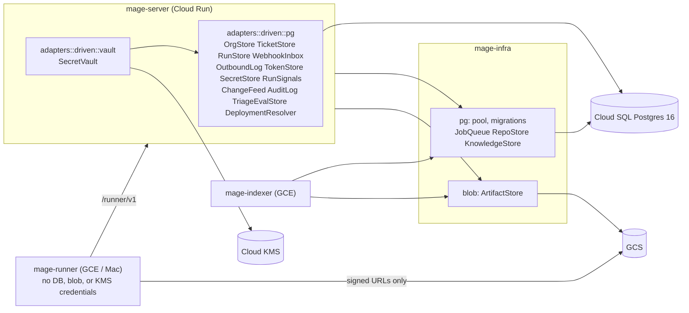
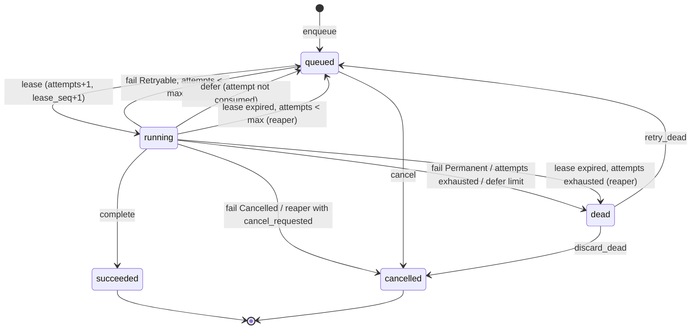

# Storage

Postgres schema, job queue, webhook inbox, blob layout, tenancy, encryption, retention.

| Code | Contents |
|---|---|
| `mage_infra::pg` | pool, **all** migrations, shared helpers (tx, errors, outbox), `JobQueue`, `RepoStore`, `KnowledgeStore` |
| `mage_infra::blob` | `ArtifactStore` (object_store: GCS / local FS / in-memory), signed URLs, dev blob routes |
| `mage_server::adapters::driven::pg` | server-only stores: `OrgStore`, `TicketStore`, `RunStore`, `WebhookInbox`, `OutboundLog`, `TokenStore`, `SecretStore`, `RunSignals`, `ChangeFeed`, `AuditLog`, `TriageEvalStore`, `DeploymentResolver` (manual mapping) |
| `mage_server::adapters::driven::vault` | `SecretVault` (Cloud KMS / local key file), persists through `SecretStore` |

## Purpose

- One Postgres database (Cloud SQL for PostgreSQL 16 with `vector` (pgvector) and `pg_trgm`) holds
  metadata, knowledge facts, queue state, tokens, and sealed secrets. Local dev: the same schema in
  Docker (`pgvector/pgvector:pg16` image).
- One object store holds bytes: run artifacts, raw source blobs, source bundles, later base images.
  GCS in production, local filesystem in dev, both through `object_store`.
- Cloud KMS holds key-encryption keys only.
- This doc owns: the schema and migrations; full signatures of the core ports `JobQueue`,
  `RepoStore`, `ArtifactStore` and the server ports `OrgStore`, `TicketStore`, `WebhookInbox`,
  `TokenStore`, `SecretStore`; the table layout behind ports owned by other docs.



## Ports

### Port map

| Port | Trait lives in | Owner doc (signatures) | Implementation | Tables / objects |
|---|---|---|---|---|
| `JobQueue` | `mage_core::ports` | storage.md | `mage_infra::pg::PgJobQueue` | `jobs` |
| `RepoStore` | `mage_core::ports` | storage.md | `mage_infra::pg::PgRepoStore` | `repos`, `repo_versions`, `repo_version_reasons`, `layer_status`, `layer_batches`, `recipes`, `deployments` |
| `KnowledgeStore` | `mage_core::ports` | knowledge.md | `mage_infra::pg::PgKnowledgeStore` | `blobs`, `blob_stages`, `symbols`, `name_refs`, `literal_sites`, `error_sites`, `catalog_entries`, `app_facts`, `chunks`, `summaries`, `manifests`, `app_nodes`, `app_edges`, `glossary_terms`, `commits`, `commit_files`, `pull_requests`, `ticket_links`, `history_cursors`, `scip_indexes`, `scip_symbols`, `scip_occurrences`; GCS `org/{org}/blobs/…` |
| `ArtifactStore` | `mage_core::ports` | storage.md | `mage_infra::blob::ObjectBlobs` | GCS bucket / local dir |
| `OrgStore` | `mage_server::ports` | storage.md | `…::driven::pg::PgOrgStore` | `orgs`, `users`, `user_identities`, `memberships`, `invites`, `org_settings`, `integrations`, `org_intake_config`, `customers`, `customer_refs` |
| `TicketStore` | `mage_server::ports` | storage.md | `…::driven::pg::PgTicketStore` | `tickets`, `ticket_thread_snapshots`, `causes`, `cause_citations`, `fix_briefs`, `fix_pull_requests`, `resolutions` |
| `RunStore` | `mage_server::ports` | runs.md | `…::driven::pg::PgRunStore` | `runs`, `run_attempts`, `run_events`, `run_commands`, `gates`, `artifacts`, `runners` (session columns), `idempotency_replies` |
| `WebhookInbox` | `mage_server::ports` | storage.md (mirrors intake.md) | `…::driven::pg::PgWebhookInbox` | `webhook_inbox` (+ `jobs` in the same tx) |
| `OutboundLog` | `mage_server::ports` | intake.md | `…::driven::pg::PgOutboundLog` | `outbound_messages` |
| `TokenStore` | `mage_server::ports` | storage.md | `…::driven::pg::PgTokenStore` | `sessions`, `oauth_states`, `runner_bootstrap_tokens`, `runners` (identity columns), `token_revocations` |
| `SecretStore` | `mage_server::ports` | storage.md | `…::driven::pg::PgSecretStore` | `secrets`, `data_keys` |
| `SecretVault` | `mage_server::ports` | server.md | `…::driven::vault::EnvelopeVault<KmsKek \| LocalKeyFileKek>` | via `SecretStore` |
| `RunSignals` | `mage_server::ports` | runs.md | `…::driven::pg::PgRunSignals` | NOTIFY `mage_run_events`, `mage_run_commands`, `mage_queue` |
| `ChangeFeed` | `mage_server::ports` | server.md | `…::driven::pg::PgChangeFeed` | `org_feed`, `org_feed_heads`, NOTIFY `mage_org_feed` |
| `AuditLog` | `mage_server::ports` | server.md | `…::driven::pg::PgAuditLog` | `audit_log` |
| `TriageEvalStore` | `mage_server::ports` | triage.md | `…::driven::pg::PgTriageEvalStore` | `triage_evals`, `triage_eval_cases`, `triage_labels` |
| `DeploymentResolver` (manual) | `mage_server::ports` | intake.md | `…::driven::pg::PgDeploymentResolver` | `deployments`, `customers` (read-only) |

Every domain aggregate has a home: Org / User / Membership / Integration → `orgs` / `users` /
`memberships` / `integrations`; Repo → `repos`; RepoVersion → `repo_versions` +
`repo_version_reasons` + `layer_status`; Recipe → `recipes`; Customer → `customers` +
`customer_refs`; Deployment → `deployments`; Ticket → `tickets`; Cause → `causes` +
`cause_citations`; Run → `runs` + `run_attempts`; RunEvent → `run_events`; Gate → `gates`;
Artifact → `artifacts`; FixBrief → `fix_briefs`; Resolution → `resolutions`.

Server pg adapters reuse `mage_infra::pg` helpers (pool type, `with_org_tx`, error mapping,
`jobs::enqueue_in`), so the outbox and tenancy rules have one implementation.

### Common types (`mage_core::ports::common`)

```rust
pub struct PageRequest { pub after: Option<Cursor>, pub limit: u16 }   // limit clamped to 1..=200
pub struct Page<T> { pub items: Vec<T>, pub next: Option<Cursor> }
pub struct Cursor(pub String);                                        // opaque keyset token (adapter-encoded)
pub struct Versioned<T> { pub value: T, pub rev: u64 }
```

Each port has its own error enum with at least `NotFound`, `Conflict`, `Invalid(String)`,
`Unavailable(String)`. One mapping function in `mage_infra::pg::error`:

| Postgres / sqlx | Port error |
|---|---|
| `RowNotFound` | `NotFound` |
| `23505` unique_violation | `Conflict` |
| `23503` foreign_key_violation | `Invalid("dangling reference: <constraint>")` |
| `23514` check_violation, `22P02` invalid_text_representation | `Invalid` |
| `40001` serialization_failure, `40P01` deadlock_detected | retried inside the adapter up to 3 times, then `Unavailable` |
| pool timeout, I/O, `57P01` admin_shutdown | `Unavailable` |
| CAS miss (`expect` / `expected_rev` mismatch, 0 rows updated) | `Conflict` |

### `JobQueue` (core)

```rust
// mage_core::domain::job — serde types shared by every role that enqueues or works jobs
#[derive(Serialize, Deserialize)]
#[serde(tag = "kind")]
pub enum JobPayload { /* one variant per job kind; see "Job kinds" */ }
impl JobPayload {
    pub fn kind(&self) -> JobKind;
    pub fn org_id(&self) -> Option<OrgId>;      // None only for platform (ops.*) jobs
    pub fn priority(&self) -> i16;              // higher first; default 0
}
#[derive(Clone, Copy)]
pub enum JobKind { /* fieldless mirror of JobPayload variants */ }
impl JobKind {
    pub fn as_str(self) -> &'static str;        // "triage.ticket"
    pub fn lane(self) -> JobLane;               // Indexer for index.*, Server otherwise
    pub fn retry_policy(self) -> RetryPolicy;
}
pub enum JobLane { Server, Indexer }
pub struct RetryPolicy {
    pub base: Duration, pub cap: Duration, pub max_attempts: u16,
    pub lease: Duration, pub max_defers: u16,
}

// mage_core::ports::jobs
pub struct NewJob {
    pub kind: JobKind,                          // must equal payload.kind()
    pub payload: JobPayload,
    pub dedupe_key: Option<String>,
    pub run_after: Option<OffsetDateTime>,      // None = now (Clock)
    pub max_attempts: Option<u16>,              // None = kind.retry_policy().max_attempts
}
impl NewJob {
    pub fn new(payload: JobPayload) -> Self;    // fills kind
    pub fn dedupe(self, key: impl Into<String>) -> Self;
    pub fn after(self, at: OffsetDateTime) -> Self;
}
pub enum Enqueued { New(JobId), Duplicate(JobId) }
pub struct JobLease { pub job_id: JobId, pub lease_seq: u32 }          // fencing token
pub struct LeaseRequest { pub lane: JobLane, pub kinds: Option<Vec<JobKind>>, pub worker: String, pub max: u16 }
pub struct LeasedJob {
    pub lease: JobLease, pub kind: JobKind, pub org_id: Option<OrgId>, pub payload: JobPayload,
    pub attempt: u16, pub max_attempts: u16, pub leased_until: OffsetDateTime, pub enqueued_at: OffsetDateTime,
}
pub enum Heartbeat { Extended { until: OffsetDateTime }, CancelRequested { until: OffsetDateTime } }
pub enum JobFailure {
    Retryable { error: String, retry_at: Option<OffsetDateTime> },   // None = backoff
    Permanent { error: String },
    Cancelled,
}
pub enum FailOutcome { Retrying { at: OffsetDateTime }, Dead, Cancelled }
pub enum CancelOutcome { Cancelled, Requested, AlreadyFinished }
pub enum JobState { Queued, Running, Succeeded, Dead, Cancelled }
pub struct JobRecord {
    pub id: JobId, pub kind: JobKind, pub org_id: Option<OrgId>, pub payload: JobPayload,
    pub dedupe_key: Option<String>, pub state: JobState, pub attempts: u16, pub max_attempts: u16,
    pub defers: u16, pub run_after: OffsetDateTime, pub last_error: Option<String>,
    pub created_at: OffsetDateTime, pub finished_at: Option<OffsetDateTime>,
}
pub enum JobError { NotFound, Conflict, Invalid(String), Unavailable(String), LeaseLost }

#[async_trait]
pub trait JobQueue: Send + Sync {
    async fn enqueue(&self, job: NewJob) -> Result<Enqueued, JobError>;
    async fn enqueue_all(&self, jobs: &[NewJob]) -> Result<Vec<Enqueued>, JobError>;   // one tx
    async fn lease(&self, req: &LeaseRequest) -> Result<Vec<LeasedJob>, JobError>;
    async fn heartbeat(&self, lease: &JobLease) -> Result<Heartbeat, JobError>;
    async fn complete(&self, lease: &JobLease, follow_ups: &[NewJob]) -> Result<(), JobError>;
    async fn fail(&self, lease: &JobLease, failure: JobFailure) -> Result<FailOutcome, JobError>;
    async fn defer(&self, lease: &JobLease, until: OffsetDateTime) -> Result<(), JobError>;
    async fn cancel(&self, job: JobId) -> Result<CancelOutcome, JobError>;
    async fn cancel_org(&self, org: OrgId) -> Result<u64, JobError>;
    async fn reap_expired(&self, limit: u32) -> Result<u32, JobError>;
    async fn get(&self, job: JobId) -> Result<JobRecord, JobError>;
    async fn list_dead(&self, kind: Option<JobKind>, page: PageRequest) -> Result<Page<JobRecord>, JobError>;
    async fn retry_dead(&self, job: JobId) -> Result<(), JobError>;
    async fn discard_dead(&self, job: JobId) -> Result<(), JobError>;
    async fn purge_finished(&self, succeeded_before: OffsetDateTime, dead_before: OffsetDateTime, limit: u32)
        -> Result<u64, JobError>;
}
```

`JobQueue` takes no `OrgId` argument: the tenant is `payload.org_id()`, written to the `org_id`
column. `kind != payload.kind()` → `Invalid`. Exact semantics:
[Job queue semantics](#job-queue-semantics).

### `RepoStore` (core)

Method names merge intake.md and knowledge.md usage; `IndexRevs`, `LayerEvent`, `SourceBundleRef`,
`RepoAccess` are their domain additions.

```rust
pub struct VersionReasonRecord {
    pub sha: CommitSha, pub reason: VersionReason,
    pub added_at: OffsetDateTime, pub ended_at: Option<OffsetDateTime>,   // ended = moved to another sha
}

#[async_trait]
pub trait RepoStore: Send + Sync {
    // repos
    async fn upsert_repo(&self, repo: &Repo, jobs: &[NewJob]) -> Result<Repo, RepoStoreError>;   // by (org, external_id)
    async fn repo(&self, org: OrgId, id: RepoId) -> Result<Repo, RepoStoreError>;
    async fn get_by_external_id(&self, org: OrgId, external_id: u64) -> Result<Option<Repo>, RepoStoreError>;
    async fn repo_by_name(&self, org: OrgId, owner: &str, name: &str) -> Result<Option<Repo>, RepoStoreError>;
    async fn list_repos(&self, org: OrgId) -> Result<Vec<Repo>, RepoStoreError>;
    async fn set_access(&self, org: OrgId, repo: RepoId, access: RepoAccess) -> Result<(), RepoStoreError>;
    async fn active_repos_system(&self) -> Result<Vec<(OrgId, RepoId)>, RepoStoreError>;  // platform listing (reconcile, gc)

    // versions
    async fn add_version_reason(&self, org: OrgId, repo: RepoId, sha: CommitSha, reason: VersionReason)
        -> Result<bool, RepoStoreError>;                        // true = version created (all layers Pending)
    async fn default_head(&self, org: OrgId, repo: RepoId) -> Result<Option<CommitSha>, RepoStoreError>;
    async fn set_default_head(&self, org: OrgId, repo: RepoId, sha: CommitSha) -> Result<bool, RepoStoreError>;
    async fn version(&self, org: OrgId, key: RepoVersionKey) -> Result<RepoVersion, RepoStoreError>;
    async fn versions(&self, org: OrgId, repo: RepoId) -> Result<Vec<RepoVersion>, RepoStoreError>;
    async fn version_reasons(&self, org: OrgId, repo: RepoId) -> Result<Vec<VersionReasonRecord>, RepoStoreError>;
    async fn delete_version(&self, org: OrgId, key: RepoVersionKey) -> Result<(), RepoStoreError>;

    // layers (knowledge.md)
    async fn apply_layer_event(&self, org: OrgId, key: RepoVersionKey, layer: Layer, event: LayerEvent, jobs: &[NewJob])
        -> Result<LayerState, RepoStoreError>;                  // row lock + LayerState::apply
    async fn begin_layer_batches(&self, org: OrgId, key: RepoVersionKey, layer: Layer, n: u32, jobs: &[NewJob])
        -> Result<(), RepoStoreError>;
    async fn finish_layer_batch(&self, org: OrgId, key: RepoVersionKey, layer: Layer, batch: u32, on_last: &[NewJob])
        -> Result<u32, RepoStoreError>;                         // remaining; on_last enqueued when it hits 0
    async fn set_index_revs(&self, org: OrgId, key: RepoVersionKey, revs: &IndexRevs) -> Result<(), RepoStoreError>;

    // source bundles
    async fn set_source_bundle(&self, org: OrgId, key: RepoVersionKey, bundle: &SourceBundleRef, jobs: &[NewJob])
        -> Result<(), RepoStoreError>;
    async fn bundle_for_tree(&self, org: OrgId, repo: RepoId, tree: TreeOid) -> Result<Option<SourceBundleRef>, RepoStoreError>;

    // recipes
    async fn put_recipe(&self, org: OrgId, recipe: &Recipe) -> Result<bool, RepoStoreError>;  // insert-if-absent by hash
    async fn get_recipe(&self, org: OrgId, repo: RepoId, hash: RecipeHash) -> Result<Recipe, RepoStoreError>;
    async fn latest_recipe(&self, org: OrgId, repo: RepoId) -> Result<Option<Recipe>, RepoStoreError>;  // latest Validated, else latest Draft
    async fn list_recipes(&self, org: OrgId, repo: RepoId, page: PageRequest) -> Result<Page<Recipe>, RepoStoreError>;
    async fn update_recipe(&self, org: OrgId, recipe: &Recipe, expect: &RecipeStatus, jobs: &[NewJob])
        -> Result<(), RepoStoreError>;                          // writes status + validated_at_sha

    // deployments (append-only history)
    async fn record_deployment(&self, org: OrgId, deployment: &Deployment) -> Result<bool, RepoStoreError>;
    async fn latest_deployment(&self, org: OrgId, repo: RepoId, environment: &str, as_of: OffsetDateTime)
        -> Result<Option<Deployment>, RepoStoreError>;          // newest observed_at <= as_of
    async fn list_deployments(&self, org: OrgId, repo: RepoId, page: PageRequest) -> Result<Page<Deployment>, RepoStoreError>;
}
```

- `add_version_reason` is idempotent. `Release(tag)` and `OnDemand(ticket)` are additive.
  `DefaultHead` (one per repo) and `Deployed(env)` (one per env) *move*: in the same transaction the
  previous holder's reason row gets `ended_at = $now`. `set_default_head` is the `DefaultHead` form.
  `version_reasons` exposes `added_at`/`ended_at` for `index.gc`'s retention table (knowledge.md).
- `RepoVersion.reasons` holds current reasons only (`ended_at IS NULL`).
- `delete_version` removes `repo_versions`, `repo_version_reasons`, `layer_status`, and
  `layer_batches` rows in one transaction; `KnowledgeStore::delete_version_facts` runs first.
  Citations and runs reference `repos`, not `repo_versions`, so version GC never blocks on them.
- `apply_layer_event` locks the `layer_status` row, calls the domain `LayerState::apply`, writes
  the result, and enqueues `jobs` in the same transaction. An invalid transition is `Invalid`.
- `finish_layer_batch` marks `layer_batches.done_at` idempotently (a repeated batch does not count
  twice) and returns the remaining count.

### `ArtifactStore` (core)

Bytes by key plus signed URLs (one trait: `mage_infra` cannot implement a `mage_server` port, and
only the server signs).

```rust
pub struct BlobKey(String);                     // validated; see "Blob layout"
impl BlobKey {
    pub fn run_artifact(org: OrgId, run: RunId, kind: ArtifactKind, name: &str) -> Result<Self, BlobError>;
    pub fn blob_content(org: OrgId, oid: BlobOid) -> Self;      // wraps mage_core::domain::knowledge::blob_content_key
    pub fn source_bundle(org: OrgId, repo: RepoId, tree: TreeOid) -> Self;
    pub fn org_prefix(org: OrgId) -> Self;
    pub fn parse(s: &str) -> Result<Self, BlobError>;
    pub fn org(&self) -> Option<OrgId>;
    pub fn as_str(&self) -> &str;
}
pub struct PutOptions { pub content_type: String, pub if_absent: bool }
pub struct PutReceipt { pub bytes: u64, pub sha256: [u8; 32], pub created: bool }
pub struct ObjectMeta { pub bytes: u64, pub content_type: Option<String>, pub updated_at: OffsetDateTime }
pub struct UploadPolicy { pub content_type: String, pub max_bytes: u64, pub ttl: Duration }
pub struct DownloadPolicy { pub ttl: Duration }
pub enum HttpMethod { Get, Put }
pub struct SignedUrl {
    pub method: HttpMethod, pub url: String,
    pub headers: Vec<(String, String)>,         // the client MUST send exactly these (they are signed)
    pub expires_at: OffsetDateTime,
}
pub enum BlobError { NotFound, Conflict, Invalid(String), Unavailable(String), TooLarge { limit: u64 } }

#[async_trait]
pub trait ArtifactStore: Send + Sync {
    async fn put(&self, key: &BlobKey, body: Vec<u8>, opts: &PutOptions) -> Result<PutReceipt, BlobError>;
    async fn put_file(&self, key: &BlobKey, src: &Path, opts: &PutOptions) -> Result<PutReceipt, BlobError>;  // multipart, streamed
    async fn get(&self, key: &BlobKey, max_bytes: u64) -> Result<Vec<u8>, BlobError>;   // TooLarge if bigger
    async fn get_range(&self, key: &BlobKey, range: Range<u64>) -> Result<Vec<u8>, BlobError>;
    async fn get_to_file(&self, key: &BlobKey, dst: &Path) -> Result<u64, BlobError>;   // streamed to dst.tmp, fsync, rename
    async fn head(&self, key: &BlobKey) -> Result<ObjectMeta, BlobError>;
    async fn delete(&self, key: &BlobKey) -> Result<(), BlobError>;                     // NotFound is Ok
    async fn delete_prefix(&self, prefix: &BlobKey) -> Result<u64, BlobError>;
    async fn list_prefix(&self, prefix: &BlobKey, page: PageRequest) -> Result<Page<(BlobKey, ObjectMeta)>, BlobError>;
    async fn signed_upload(&self, key: &BlobKey, policy: &UploadPolicy) -> Result<SignedUrl, BlobError>;
    async fn signed_download(&self, key: &BlobKey, policy: &DownloadPolicy) -> Result<SignedUrl, BlobError>;
}
```

`if_absent: true` (content-addressed keys) is a conditional create (`PutMode::Create`); an existing
object returns `created: false` and is not rewritten.

### `OrgStore` (server)

```rust
pub enum SettingsArea { General, Model, Triage, Fix }
pub struct Invite {
    pub id: InviteId, pub org_id: OrgId, pub provider: String, pub subject: String, pub login: String,
    pub role: MemberRole, pub invited_by: UserId, pub created_at: OffsetDateTime, pub expires_at: OffsetDateTime,
}

#[async_trait]
pub trait OrgStore: Send + Sync {
    // orgs
    async fn create_org(&self, org: &Org, owner: UserId, retention: &RetentionPolicy) -> Result<(), OrgStoreError>; // org + Owner membership
    async fn get_org(&self, org: OrgId) -> Result<Org, OrgStoreError>;
    async fn org_by_slug(&self, slug: &str) -> Result<Option<Org>, OrgStoreError>;      // platform lookup
    async fn org_state(&self, org: OrgId) -> Result<OrgState, OrgStoreError>;
    async fn set_org_state(&self, org: OrgId, expect: OrgState, next: OrgState, jobs: &[NewJob]) -> Result<(), OrgStoreError>;
    async fn retention(&self, org: OrgId) -> Result<RetentionPolicy, OrgStoreError>;
    async fn set_retention(&self, org: OrgId, policy: &RetentionPolicy) -> Result<(), OrgStoreError>;

    // settings (one jsonb row per area; serde types owned by server.md / triage.md / fix.md)
    async fn triage_settings(&self, org: OrgId) -> Result<TriageSettings, OrgStoreError>;
    async fn set_triage_settings(&self, org: OrgId, s: &TriageSettings) -> Result<(), OrgStoreError>;
    async fn fix_settings(&self, org: OrgId) -> Result<FixSettings, OrgStoreError>;
    async fn set_fix_settings(&self, org: OrgId, s: &FixSettings) -> Result<(), OrgStoreError>;
    async fn model_settings(&self, org: OrgId) -> Result<ModelSettings, OrgStoreError>;
    async fn set_model_settings(&self, org: OrgId, s: &ModelSettings) -> Result<(), OrgStoreError>;
    async fn general_settings(&self, org: OrgId) -> Result<GeneralSettings, OrgStoreError>;
    async fn set_general_settings(&self, org: OrgId, s: &GeneralSettings) -> Result<(), OrgStoreError>;

    // users, identities, memberships, invites (users are global, memberships per org)
    async fn upsert_user_by_identity(&self, identity: &ExternalIdentity, new_id: UserId) -> Result<User, OrgStoreError>; // key (provider, subject)
    async fn get_user(&self, id: UserId) -> Result<User, OrgStoreError>;
    async fn put_membership(&self, m: &Membership) -> Result<(), OrgStoreError>;
    async fn remove_membership(&self, org: OrgId, user: UserId) -> Result<(), OrgStoreError>;  // Conflict if last Owner
    async fn membership(&self, org: OrgId, user: UserId) -> Result<Option<Membership>, OrgStoreError>;
    async fn members(&self, org: OrgId, page: PageRequest) -> Result<Page<(User, Membership)>, OrgStoreError>;
    async fn orgs_for_user(&self, user: UserId) -> Result<Vec<(Org, Membership)>, OrgStoreError>;
    async fn create_invite(&self, invite: &Invite) -> Result<(), OrgStoreError>;        // Conflict if pending for (org, provider, subject)
    async fn invites(&self, org: OrgId) -> Result<Vec<Invite>, OrgStoreError>;
    async fn withdraw_invite(&self, org: OrgId, id: InviteId) -> Result<(), OrgStoreError>;
    async fn accept_invites(&self, provider: &str, subject: &str, user: UserId) -> Result<Vec<Membership>, OrgStoreError>; // platform; unexpired only

    // integrations
    async fn upsert_integration(&self, integration: &Integration, jobs: &[NewJob]) -> Result<(), OrgStoreError>; // Conflict if active in another org
    async fn integrations(&self, org: OrgId) -> Result<Vec<Integration>, OrgStoreError>;
    async fn set_integration_status(&self, org: OrgId, kind: IntegrationKind, external_id: &str,
        status: IntegrationStatus, jobs: &[NewJob]) -> Result<(), OrgStoreError>;
    async fn integration_by_external(&self, kind: IntegrationKind, external_id: &str)
        -> Result<Option<Integration>, OrgStoreError>;          // cross-tenant: webhook tenant resolution only
    async fn intake_config(&self, org: OrgId) -> Result<IntakeConfig, OrgStoreError>;
    async fn put_intake_config(&self, org: OrgId, config: &IntakeConfig) -> Result<(), OrgStoreError>;

    // customers
    async fn put_customer(&self, customer: &Customer) -> Result<(), OrgStoreError>;     // replaces refs in the same tx
    async fn get_customer(&self, org: OrgId, id: CustomerId) -> Result<Customer, OrgStoreError>;
    async fn find_customers_by_refs(&self, org: OrgId, refs: &[ExternalRef]) -> Result<Vec<Customer>, OrgStoreError>;
    async fn list_customers(&self, org: OrgId, page: PageRequest) -> Result<Page<Customer>, OrgStoreError>;
}
```

- Settings getters return the type's `Default` when no row exists.
- `accept_invites` (login, server.md UC1): one transaction converts every unexpired invite for the
  subject into a membership and deletes the invites.
- Integration credentials are not columns: they live in `SecretStore` under names from server.md's
  secret catalog (e.g. `integration/linear/{workspace_id}/api_key`). Per-kind non-secret settings
  (Linear auth mode, Slack `team_domain`, GitHub account login) go in `integrations.settings`.

### `TicketStore` (server)

```rust
pub struct TicketTransition { pub expect: TicketStatus, pub next: TicketStatus }
pub struct TriageWrite {
    pub ticket: TicketId,
    pub expect: TicketStatus,                   // Triaging
    pub content_hash: ContentHash,              // must equal the stored hash
    pub triage_run: RunId,                      // must equal tickets.triage_run (fencing)
    pub causes: Vec<Cause>,
    pub next: TicketStatus,                     // Triaged
}
pub struct TicketFilter {
    pub status: Option<Vec<TicketStatus>>, pub customer: Option<CustomerId>,
    pub repo: Option<RepoId>, pub text: Option<String>,
}

#[async_trait]
pub trait TicketStore: Send + Sync {
    // tickets (intake.md)
    async fn get_ticket(&self, org: OrgId, id: TicketId) -> Result<Versioned<Ticket>, TicketStoreError>;
    async fn get_by_linear_issue(&self, org: OrgId, issue_id: &str) -> Result<Option<Versioned<Ticket>>, TicketStoreError>;
    async fn list_tickets(&self, org: OrgId, filter: &TicketFilter, page: PageRequest) -> Result<Page<Ticket>, TicketStoreError>;
    async fn list_open_assumed(&self, org: OrgId, repo: RepoId) -> Result<Vec<TicketId>, TicketStoreError>;
    async fn save_ingested(&self, org: OrgId, ticket: &Ticket, expected_rev: Option<u64>, jobs: &[NewJob])
        -> Result<u64, TicketStoreError>;                       // None = insert; returns the new rev
    async fn transition(&self, org: OrgId, ticket: TicketId, expect: TicketStatus, next: TicketStatus, jobs: &[NewJob])
        -> Result<Ticket, TicketStoreError>;
    async fn set_target(&self, org: OrgId, ticket: TicketId, target: Option<TicketTarget>, expected_rev: u64, jobs: &[NewJob])
        -> Result<u64, TicketStoreError>;
    async fn get_thread_snapshot(&self, org: OrgId, ticket: TicketId) -> Result<Option<ThreadSnapshot>, TicketStoreError>;
    async fn put_thread_snapshot(&self, org: OrgId, ticket: TicketId, s: &ThreadSnapshot) -> Result<(), TicketStoreError>;

    // triage (triage.md)
    async fn begin_triage(&self, org: OrgId, ticket: TicketId, expect: &[TicketStatus], content_hash: ContentHash,
        triage_run: RunId) -> Result<Ticket, TicketStoreError>;
    async fn apply_triage(&self, org: OrgId, w: TriageWrite, jobs: &[NewJob]) -> Result<Ticket, TicketStoreError>;
    async fn fail_triage(&self, org: OrgId, ticket: TicketId, triage_run: RunId, jobs: &[NewJob]) -> Result<Ticket, TicketStoreError>;

    // causes
    async fn causes(&self, org: OrgId, ticket: TicketId, include_superseded: bool) -> Result<Vec<Cause>, TicketStoreError>;
    async fn get_cause(&self, org: OrgId, id: CauseId) -> Result<Cause, TicketStoreError>;
    async fn set_cause_status(&self, org: OrgId, id: CauseId, expect: &CauseStatus, next: CauseStatus,
        ticket: Option<TicketTransition>, jobs: &[NewJob]) -> Result<Cause, TicketStoreError>;

    // fix briefs and pull requests (fix.md)
    async fn put_fix_brief(&self, org: OrgId, brief: FixBrief, jobs: &[NewJob]) -> Result<FixBrief, TicketStoreError>; // version = max+1 per cause
    async fn latest_fix_brief(&self, org: OrgId, cause: CauseId) -> Result<Option<FixBrief>, TicketStoreError>;
    async fn fix_briefs(&self, org: OrgId, cause: CauseId) -> Result<Vec<FixBrief>, TicketStoreError>;
    async fn upsert_pull_request(&self, org: OrgId, pr: FixPullRequest, jobs: &[NewJob])
        -> Result<(FixPullRequest, bool), TicketStoreError>;    // keyed by (org, ticket, change_set); bool = created
    async fn set_pull_request_state(&self, org: OrgId, id: FixPullRequestId, expect: &FixPrState, next: FixPrState,
        jobs: &[NewJob]) -> Result<FixPullRequest, TicketStoreError>;
    async fn pull_request_by_number(&self, org: OrgId, repo: RepoId, number: u64)
        -> Result<Option<FixPullRequest>, TicketStoreError>;

    // resolutions and memory
    async fn resolve(&self, org: OrgId, resolution: Resolution, expect: TicketStatus, jobs: &[NewJob])
        -> Result<Ticket, TicketStoreError>;                    // resolution row + ticket -> Resolved, one tx
    async fn resolution(&self, org: OrgId, ticket: TicketId) -> Result<Option<Resolution>, TicketStoreError>;
    async fn similar_resolved(&self, org: OrgId, q: &SimilarQuery, limit: u16) -> Result<Vec<SimilarResolved>, TicketStoreError>;
}
```

Every ticket write bumps `tickets.rev`. Transactions:

| Method | One transaction |
|---|---|
| `save_ingested` | `INSERT` (None) or `UPDATE … WHERE rev = $expected` (0 rows → `Conflict`); duplicate Linear issue on insert → `Conflict`; enqueue `jobs` |
| `begin_triage` | `UPDATE tickets SET status = 'triaging', triaged_hash = $h, triage_run = $run, rev = rev + 1 WHERE status = ANY($expect) AND content_hash = $h` (0 rows → `Conflict`) |
| `apply_triage` | `SELECT … FOR UPDATE`; `Conflict` unless `status = expect AND triage_run = w.triage_run AND content_hash = w.content_hash`; `UPDATE causes SET superseded_at = $now WHERE ticket_id = $t AND status = 'untested' AND superseded_at IS NULL`; insert causes + `cause_citations`; ticket → `next`; enqueue `jobs` |
| `fail_triage` | `UPDATE … SET status = 'triage_failed' WHERE status = 'triaging' AND triage_run = $run` (0 rows → `Conflict`); enqueue `jobs` |
| `set_cause_status` | cause CAS by variant; optional ticket CAS by status; enqueue `jobs` |
| `put_fix_brief` | `version = COALESCE(max(version), 0) + 1` for the cause under a row lock on the cause; insert; enqueue `jobs` |
| `resolve` | insert `resolutions`; ticket CAS `expect → resolved`; enqueue `jobs` |

`similar_resolved` v1 (knowledge.md scoring): `websearch_to_tsquery('simple', $text)` against
`tickets.search` and `resolutions.search`, plus error-string token overlap, filtered to resolved
tickets in `q.repos` and `resolved_at <= q.as_of`, excluding `q.exclude`.

### `WebhookInbox` (server)

Mirrors intake.md exactly (`mage_server::ports::inbox`):

```rust
pub enum WebhookSource { GitHub, GitHubFix, Linear, Slack }
pub struct NewDelivery {
    pub source: WebhookSource,
    pub delivery_id: String,          // X-GitHub-Delivery | Linear-Delivery | Slack event_id
    pub event: String,                // X-GitHub-Event | Linear-Event | Slack event.type
    pub org_id: Option<OrgId>,        // None until the job resolves the tenant
    pub body: Vec<u8>,                // raw bytes as verified; the pg adapter computes body_sha256 and received_at
}
pub enum Accepted { New { job_id: JobId }, Duplicate { first_seen_at: OffsetDateTime } }
pub struct Delivery {
    pub source: WebhookSource, pub delivery_id: String, pub event: String,
    pub org_id: Option<OrgId>, pub received_at: OffsetDateTime,
    pub body: Option<Vec<u8>>,        // None after body purge
    pub body_sha256: [u8; 32],
    pub outcome: Option<InboxOutcome>, pub processed_at: Option<OffsetDateTime>,
}
pub enum InboxOutcome { Processed, Ignored(String), Rejected(String) }
pub enum InboxError { NotFound, Conflict, Invalid(String), Unavailable(String) }

#[async_trait]
pub trait WebhookInbox: Send + Sync {
    async fn accept(&self, d: NewDelivery, job: NewJob) -> Result<Accepted, InboxError>;
    async fn get(&self, source: WebhookSource, delivery_id: &str) -> Result<Delivery, InboxError>;
    async fn resolve_org(&self, source: WebhookSource, delivery_id: &str, org: OrgId) -> Result<(), InboxError>;
    async fn mark_processed(&self, source: WebhookSource, delivery_id: &str, outcome: InboxOutcome) -> Result<(), InboxError>;
    async fn purge(&self, bodies_before: OffsetDateTime, rows_before: OffsetDateTime) -> Result<u64, InboxError>;
}
```

Semantics: [Webhook inbox semantics](#webhook-inbox-semantics).

### `TokenStore` (server)

Runner, knowledge, and gateway tokens are signed Ed25519 tokens verified statelessly
(server.md). Postgres stores only what must be server-side: UI sessions (hash), login/install
states (hash, one-time), runner bootstrap tokens (hash, one-time), runner identities, and revoked
`jti`s.

```rust
pub struct Jti(pub [u8; 16]);
pub struct NewSession {
    pub id_hash: [u8; 32], pub user_id: UserId, pub csrf_secret: Vec<u8>,
    pub expires_at: OffsetDateTime, pub ip: Option<IpAddr>, pub user_agent: Option<String>,
}
pub struct Session {
    pub id_hash: [u8; 32], pub user_id: UserId, pub csrf_secret: Vec<u8>, pub created_at: OffsetDateTime,
    pub last_seen_at: OffsetDateTime, pub expires_at: OffsetDateTime, pub ip: Option<IpAddr>, pub user_agent: Option<String>,
}
pub enum OAuthPurpose { Login, Install { org: OrgId, provider: IntegrationKind } }
pub struct OAuthState {
    pub state_hash: [u8; 32], pub purpose: OAuthPurpose, pub user: Option<UserId>,
    pub pkce_verifier: Option<String>, pub return_to: Option<String>, pub expires_at: OffsetDateTime,
}
pub enum RunnerScope { Shared, Orgs(Vec<OrgId>) }
pub struct NewBootstrapToken {
    pub token_hash: [u8; 32], pub name: String, pub scope: RunnerScope,
    pub expires_at: OffsetDateTime, pub created_by: Actor,
}
pub struct RunnerRegistration {
    pub id: RunnerId,                           // used only when the name is new
    pub name: String,                           // must equal the bootstrap token's name
    pub public_key: [u8; 32],
    pub capabilities: RunnerCapabilities,       // runs.md
}
pub enum RunnerStatus { Active, Draining, Revoked }
pub struct Runner {
    pub id: RunnerId, pub name: String, pub scope: RunnerScope, pub status: RunnerStatus, pub public_key: [u8; 32],
    pub generation: u32, pub registered_at: OffsetDateTime, pub last_seen_at: Option<OffsetDateTime>,
}
pub struct Revocation { pub jti: Jti, pub org_id: Option<OrgId>, pub reason: String, pub expires_at: OffsetDateTime }
pub enum TokenError { NotFound, Conflict, Invalid(String), Unavailable(String) }

#[async_trait]
pub trait TokenStore: Send + Sync {
    async fn create_session(&self, s: &NewSession) -> Result<(), TokenError>;
    async fn session(&self, id_hash: &[u8; 32]) -> Result<Option<Session>, TokenError>;    // None if expired
    async fn touch_session(&self, id_hash: &[u8; 32], expires_at: OffsetDateTime) -> Result<(), TokenError>;
    async fn delete_session(&self, id_hash: &[u8; 32]) -> Result<(), TokenError>;
    async fn delete_user_sessions(&self, user: UserId) -> Result<u64, TokenError>;

    async fn put_oauth_state(&self, s: &OAuthState) -> Result<(), TokenError>;
    async fn take_oauth_state(&self, state_hash: &[u8; 32]) -> Result<Option<OAuthState>, TokenError>; // DELETE … RETURNING, unexpired only

    async fn create_bootstrap(&self, b: &NewBootstrapToken) -> Result<(), TokenError>;
    async fn register_runner(&self, bootstrap_hash: &[u8; 32], reg: &RunnerRegistration) -> Result<Runner, TokenError>;
    async fn runner(&self, id: RunnerId) -> Result<Runner, TokenError>;
    async fn set_runner_status(&self, id: RunnerId, status: RunnerStatus) -> Result<Runner, TokenError>;   // Revoked bumps generation

    async fn revoke(&self, r: &Revocation) -> Result<(), TokenError>;
    async fn is_revoked(&self, jti: &Jti) -> Result<bool, TokenError>;
    async fn purge_expired(&self, limit: u32) -> Result<u64, TokenError>;   // sessions, states, bootstrap tokens, revocations
}
```

`register_runner`, one transaction:

1. `SELECT … FROM runner_bootstrap_tokens WHERE token_hash = $h FOR UPDATE`. Missing or expired →
   `Invalid("bootstrap token invalid")`. `reg.name != token.name` → `Invalid`.
2. Already used: if `runners.public_key = reg.public_key` for `token.runner_id` and `used_at` is
   within 10 min → return that runner (lost-response retry, server.md). Otherwise `Invalid`.
3. Insert the runner with `scope` copied from the token row (never from the request), or, if the
   name exists, replace `public_key`, `generation = generation + 1`, `status = 'active'`
   (re-bootstrap). Write `capabilities`.
4. `UPDATE runner_bootstrap_tokens SET used_at = $now, runner_id = $id`.

`RunStore::record_runner_session` (runs.md) writes the session columns (`instance_id`,
`capabilities`, `version`, `last_seen_at`).

### `SecretStore` (server)

Persists sealed rows for `SecretVault` (server.md), which holds `Arc<dyn SecretStore>` and does
all cryptography; this port never sees plaintext. `SecretScope`, `SecretName`, `SecretVersion`,
`SecretState`, `Actor` are server.md types.

```rust
pub struct SealedSecret {
    pub scope: SecretScope, pub name: SecretName, pub version: SecretVersion, pub state: SecretState,
    pub wrapped_dek: Option<Vec<u8>>, pub kek_version: String, pub nonce: [u8; 12],
    pub ciphertext: Option<Vec<u8>>,            // None once Destroyed
    pub fingerprint: String, pub created_by: Actor,
    pub created_at: OffsetDateTime, pub state_changed_at: OffsetDateTime,
}
pub enum DataKeyState { Active, Retired, Destroyed }
pub struct SealedDataKey {
    pub org: OrgId, pub version: u32, pub wrapped_dek: Option<Vec<u8>>, pub kek_version: String,
    pub state: DataKeyState, pub created_at: OffsetDateTime,
}
pub enum WrapRef { Secret { scope: SecretScope, name: SecretName, version: SecretVersion }, DataKey { org: OrgId, version: u32 } }
pub struct WrapInfo { pub r: WrapRef, pub kek_version: String }
pub enum SecretStoreError { NotFound, Conflict, Invalid(String), Unavailable(String) }

#[async_trait]
pub trait SecretStore: Send + Sync {
    async fn next_secret_version(&self, scope: &SecretScope, name: &SecretName) -> Result<SecretVersion, SecretStoreError>;
    async fn insert_secret(&self, s: &SealedSecret) -> Result<(), SecretStoreError>;    // Conflict unless version = max+1;
                                                                                        // state Active retires the previous Active
    async fn active_secret(&self, scope: &SecretScope, name: &SecretName) -> Result<Option<SealedSecret>, SecretStoreError>;
    async fn secret_version(&self, scope: &SecretScope, name: &SecretName, version: SecretVersion) -> Result<SealedSecret, SecretStoreError>;
    async fn secret_versions(&self, scope: &SecretScope, name: &SecretName) -> Result<Vec<SealedSecret>, SecretStoreError>;
    async fn list_secrets(&self, scope: &SecretScope) -> Result<Vec<SealedSecret>, SecretStoreError>;
    async fn set_secret_state(&self, scope: &SecretScope, name: &SecretName, version: SecretVersion, state: SecretState)
        -> Result<SealedSecret, SecretStoreError>;              // allowed transitions per server.md; Destroyed wipes DEK + ciphertext

    async fn insert_data_key(&self, key: &SealedDataKey) -> Result<(), SecretStoreError>;  // Active retires the previous Active
    async fn active_data_key(&self, org: OrgId) -> Result<Option<SealedDataKey>, SecretStoreError>;
    async fn data_key(&self, org: OrgId, version: u32) -> Result<SealedDataKey, SecretStoreError>;

    async fn list_wraps(&self, after: Option<&WrapRef>, limit: u32) -> Result<Vec<WrapInfo>, SecretStoreError>;  // vault.rewrap
    async fn rewrap(&self, r: &WrapRef, expect_kek_version: &str, wrapped_dek: &[u8], kek_version: &str)
        -> Result<(), SecretStoreError>;                        // CAS on the old kek_version
    async fn destroy_org(&self, org: OrgId) -> Result<u64, SecretStoreError>;   // org deletion: wipe all org rows
}
```

### Ports owned elsewhere (tables only here)

`RunStore`, `RunSignals` (runs.md); `KnowledgeStore` (knowledge.md); `OutboundLog`,
`DeploymentResolver` (intake.md); `SecretVault`, `ChangeFeed`, `AuditLog` (server.md);
`TriageEvalStore` (triage.md). Their tables follow the conventions below. Column sets are those
docs'; they are reproduced here so the schema is complete in one place.

## Schema

### Conventions

- **Postgres 16** baseline (`NULLS NOT DISTINCT` needs ≥ 15). Extensions: `vector`, `pg_trgm`.
- **Tenant tables** have `org_id uuid NOT NULL` as the first PK column and in every FK:
  `FOREIGN KEY (org_id, ticket_id) REFERENCES tickets (org_id, id)`. A row cannot reference
  another org's row; the database enforces it, not only the code.
- **Platform tables** (no tenant or nullable `org_id`): `orgs`, `users`, `user_identities`,
  `runners`, `runner_bootstrap_tokens`, `sessions`, `oauth_states`, `token_revocations`, `jobs`,
  `webhook_inbox`, `idempotency_replies`, `audit_log`, `secrets`. Reached only through the methods
  listed in [Tenancy enforcement](#tenancy-enforcement).
- **Ids**: `uuid` from `IdGen` (v7). The database generates no ids except `audit_log.id`
  (bigserial) and `org_feed.id` (per-org counter).
- **Time**: `timestamptz` from the `Clock` port (adapters hold `Arc<dyn Clock>`). SQL never calls
  `now()`, so the fake and the real adapter pass the same contract tests under a fake clock.
- **Git ids** (`sha`, `*_oid`): `bytea CHECK (octet_length(x) = 20)`. **Hashes** (`hash`,
  `content_hash`, `triaged_hash`, `*_sha256`, `snippet_hash`, digests): `bytea`, 32 bytes. The
  sketches below omit these checks.
- **Enums**: `text` + `CHECK (x IN (…))` with the snake_case variant name; no Postgres enum types
  (widening a CHECK is one cheap migration; `ALTER TYPE … ADD VALUE` has transaction caveats).
  Variant payloads go into typed side columns when queried (`status_run`, `status_reason`) and into
  `jsonb` when opaque (`budget`, `result`).
- **jsonb** holds serde of `mage_core` / `mage_server` domain types. A breaking serde change needs a
  data migration or a tolerant reader.
- **Paths**: `text` (`RepoPath`, knowledge.md: normalized UTF-8; non-UTF-8 paths are skipped).
- **Outbox**: mutating store methods run in one transaction and accept `jobs: &[NewJob]`.
- **CAS**: `expect` parameters compare the stored variant only (payload ignored); `expected_rev`
  compares `rev` / `version`. A miss is `Conflict`.
- Cyclic FKs (`causes` ↔ `runs`, `causes` → `gates` → `runs`) are `DEFERRABLE INITIALLY IMMEDIATE`
  so org deletion can remove a cycle in one transaction.
- Migration order: orgs/users → repos → runs-area tables → ticket-area tables, then
  `ALTER TABLE runs ADD FOREIGN KEY` to `tickets` / `causes` once both exist.

### Core: orgs, users, settings, integrations, customers

```sql
CREATE TABLE orgs (
  id                    uuid PRIMARY KEY,
  slug                  text NOT NULL UNIQUE,
  name                  text NOT NULL,
  state                 text NOT NULL CHECK (state IN ('active','deleting')),
  retention             jsonb NOT NULL,                 -- RetentionPolicy
  kek_name              text NULL,                      -- Cloud KMS CryptoKey resource; NULL in dev
  created_at            timestamptz NOT NULL,
  deletion_requested_at timestamptz NULL
);

CREATE TABLE users (
  id uuid PRIMARY KEY, email text NOT NULL, name text NOT NULL, created_at timestamptz NOT NULL
);
CREATE UNIQUE INDEX users_email ON users (lower(email));

CREATE TABLE user_identities (                            -- server.md: login identity key
  provider text NOT NULL, subject text NOT NULL,          -- ('github', numeric user id)
  user_id  uuid NOT NULL REFERENCES users (id),
  login    text NOT NULL, avatar_url text NULL,
  created_at timestamptz NOT NULL, updated_at timestamptz NOT NULL,
  PRIMARY KEY (provider, subject)
);
CREATE INDEX user_identities_user ON user_identities (user_id);

CREATE TABLE memberships (
  org_id     uuid NOT NULL REFERENCES orgs (id),
  user_id    uuid NOT NULL REFERENCES users (id),
  role       text NOT NULL CHECK (role IN ('owner','admin','member')),
  created_at timestamptz NOT NULL,
  PRIMARY KEY (org_id, user_id)
);
CREATE INDEX memberships_user ON memberships (user_id);

CREATE TABLE invites (
  org_id uuid NOT NULL REFERENCES orgs (id), id uuid NOT NULL,
  provider text NOT NULL, subject text NOT NULL, login text NOT NULL,
  role text NOT NULL CHECK (role IN ('owner','admin','member')),
  invited_by uuid NOT NULL REFERENCES users (id),
  created_at timestamptz NOT NULL, expires_at timestamptz NOT NULL,   -- 14 days (server.md)
  PRIMARY KEY (org_id, id),
  UNIQUE (org_id, provider, subject)
);
CREATE INDEX invites_subject ON invites (provider, subject);

CREATE TABLE org_settings (
  org_id uuid NOT NULL REFERENCES orgs (id),
  area   text NOT NULL CHECK (area IN ('general','model','triage','fix')),
  value  jsonb NOT NULL,                                  -- GeneralSettings | ModelSettings | TriageSettings | FixSettings
  updated_at timestamptz NOT NULL, updated_by text NOT NULL,          -- Actor
  PRIMARY KEY (org_id, area)
);

CREATE TABLE integrations (
  org_id      uuid NOT NULL REFERENCES orgs (id),
  kind        text NOT NULL CHECK (kind IN ('github','github_fix','linear','slack')),
  external_id text NOT NULL,          -- installation id / Linear workspace id / Slack team id
  status      text NOT NULL CHECK (status IN ('active','revoked')),
  settings    jsonb NOT NULL DEFAULT '{}',                -- per-kind non-secret settings (intake.md)
  created_at  timestamptz NOT NULL,
  updated_at  timestamptz NOT NULL,
  PRIMARY KEY (org_id, kind, external_id)
);
-- one active owner per external account: webhook tenant resolution is unambiguous
CREATE UNIQUE INDEX integrations_active ON integrations (kind, external_id) WHERE status = 'active';

CREATE TABLE org_intake_config (
  org_id uuid PRIMARY KEY REFERENCES orgs (id), config jsonb NOT NULL, updated_at timestamptz NOT NULL
);

CREATE TABLE customers (
  org_id uuid NOT NULL REFERENCES orgs (id), id uuid NOT NULL,
  name text NOT NULL, environment text NULL,
  created_at timestamptz NOT NULL, updated_at timestamptz NOT NULL,
  PRIMARY KEY (org_id, id)
);
CREATE TABLE customer_refs (                              -- ExternalRef (intake.md variants)
  org_id uuid NOT NULL, customer_id uuid NOT NULL,
  system text NOT NULL CHECK (system IN ('linear_customer','linear_label','slack_channel')),
  value  text NOT NULL,                                   -- slack_channel: "{team}/{channel}"
  PRIMARY KEY (org_id, system, value),                    -- a ref names at most one customer
  FOREIGN KEY (org_id, customer_id) REFERENCES customers (org_id, id)
);
CREATE INDEX customer_refs_customer ON customer_refs (org_id, customer_id);
```

### Core: repos, versions, layers, recipes, deployments

```sql
CREATE TABLE repos (
  org_id uuid NOT NULL REFERENCES orgs (id), id uuid NOT NULL,
  external_id     bigint NOT NULL,                        -- GitHub repository id, stable across renames
  owner text NOT NULL, name text NOT NULL, default_branch text NOT NULL,
  installation_id bigint NOT NULL,
  access text NOT NULL CHECK (access IN ('granted','lost')),          -- RepoAccess (intake.md)
  created_at timestamptz NOT NULL,
  PRIMARY KEY (org_id, id),
  UNIQUE (org_id, external_id)
);
CREATE INDEX repos_name ON repos (org_id, lower(owner), lower(name));

CREATE TABLE repo_versions (
  org_id uuid NOT NULL, repo_id uuid NOT NULL, sha bytea NOT NULL,
  tree_oid      bytea NULL,                               -- set by index.manifest / index.bundle_source
  revs          jsonb NULL,                               -- IndexRevs {parser, errors, appmap} of the Ready layers
  bundle_key    text NULL, bundle_bytes bigint NULL, bundle_sha256 bytea NULL,   -- SourceBundleRef (tree = tree_oid)
  created_at    timestamptz NOT NULL,
  PRIMARY KEY (org_id, repo_id, sha),
  FOREIGN KEY (org_id, repo_id) REFERENCES repos (org_id, id),
  CHECK ((bundle_key IS NULL) = (bundle_sha256 IS NULL))
);
CREATE INDEX repo_versions_bundle_tree ON repo_versions (org_id, repo_id, tree_oid) WHERE bundle_key IS NOT NULL;

CREATE TABLE repo_version_reasons (
  org_id uuid NOT NULL, repo_id uuid NOT NULL, sha bytea NOT NULL,
  reason   text NOT NULL CHECK (reason IN ('default_head','release','deployed','on_demand')),
  detail   text NOT NULL DEFAULT '',                      -- tag / environment / ticket id
  added_at timestamptz NOT NULL,
  ended_at timestamptz NULL,                              -- singleton reason moved to another sha
  PRIMARY KEY (org_id, repo_id, sha, reason, detail, added_at),
  FOREIGN KEY (org_id, repo_id, sha) REFERENCES repo_versions (org_id, repo_id, sha)
);
CREATE UNIQUE INDEX reasons_current     ON repo_version_reasons (org_id, repo_id, sha, reason, detail) WHERE ended_at IS NULL;
CREATE UNIQUE INDEX reasons_head_single ON repo_version_reasons (org_id, repo_id) WHERE reason = 'default_head' AND ended_at IS NULL;
CREATE UNIQUE INDEX reasons_env_single  ON repo_version_reasons (org_id, repo_id, detail) WHERE reason = 'deployed' AND ended_at IS NULL;

CREATE TABLE layer_status (
  org_id uuid NOT NULL, repo_id uuid NOT NULL, sha bytea NOT NULL,
  layer  text NOT NULL CHECK (layer IN ('files','symbols','refs','error_sites','app_map','semantic','history')),
  state  text NOT NULL CHECK (state IN ('pending','running','ready','failed','skipped')),
  reason text NULL,                                       -- Failed / Skipped
  ready_at timestamptz NULL, updated_at timestamptz NOT NULL,
  PRIMARY KEY (org_id, repo_id, sha, layer),
  FOREIGN KEY (org_id, repo_id, sha) REFERENCES repo_versions (org_id, repo_id, sha)
);

CREATE TABLE layer_batches (                              -- fan-in for batched layers (knowledge.md)
  org_id uuid NOT NULL, repo_id uuid NOT NULL, sha bytea NOT NULL,
  layer text NOT NULL, batch int NOT NULL, done_at timestamptz NULL,
  PRIMARY KEY (org_id, repo_id, sha, layer, batch),
  FOREIGN KEY (org_id, repo_id, sha) REFERENCES repo_versions (org_id, repo_id, sha)
);

CREATE TABLE recipes (
  org_id uuid NOT NULL, repo_id uuid NOT NULL, hash bytea NOT NULL,   -- RecipeHash
  body             text NOT NULL,                         -- normalized TOML
  status           text NOT NULL CHECK (status IN ('draft','validated','broken')),
  validated_at_sha bytea NULL, validated_at timestamptz NULL,
  broken_reason    text NULL, broken_at timestamptz NULL,
  created_at       timestamptz NOT NULL,
  PRIMARY KEY (org_id, repo_id, hash),
  FOREIGN KEY (org_id, repo_id) REFERENCES repos (org_id, id)
);
CREATE INDEX recipes_validated ON recipes (org_id, repo_id, validated_at DESC) WHERE status = 'validated';
CREATE INDEX recipes_recent    ON recipes (org_id, repo_id, created_at DESC);

CREATE TABLE deployments (                                -- append-only history
  org_id uuid NOT NULL, repo_id uuid NOT NULL, environment text NOT NULL,
  observed_at timestamptz NOT NULL, sha bytea NOT NULL,
  source text NOT NULL CHECK (source IN ('github_deployments','manual','tag')),
  PRIMARY KEY (org_id, repo_id, environment, observed_at),   -- latest_deployment = backward PK scan
  FOREIGN KEY (org_id, repo_id) REFERENCES repos (org_id, id)
);
```

`bundle_for_tree`: `SELECT bundle_key, bundle_bytes, bundle_sha256, tree_oid FROM repo_versions
WHERE org_id = $1 AND repo_id = $2 AND tree_oid = $3 AND bundle_key IS NOT NULL LIMIT 1`.

### Core: tickets, causes, fixes, resolutions, outbound

```sql
CREATE TABLE tickets (
  org_id uuid NOT NULL REFERENCES orgs (id), id uuid NOT NULL,
  source            text NOT NULL CHECK (source IN ('linear')),
  source_issue_id   text NOT NULL, source_identifier text NOT NULL, source_url text NOT NULL,
  title text NOT NULL, body text NOT NULL,
  content_hash bytea NOT NULL,
  triaged_hash bytea NULL,                                -- written by begin_triage (intake.md, triage.md)
  triage_run   uuid NULL,                                 -- fencing token: current triage run
  slack_team text NULL, slack_channel text NULL, slack_ts text NULL,
  customer_id uuid NULL,
  target_repo_id uuid NULL, target_sha bytea NULL,
  target_origin text NULL CHECK (target_origin IN ('override','directive','deployment','default_head')),
  target_environment text NULL,                           -- TargetOrigin::Deployment { environment }
  error_strings text[] NOT NULL DEFAULT '{}',
  status text NOT NULL CHECK (status IN ('new','triaging','triaged','triage_failed','diagnosing',
                                         'diagnosed','fixing','fix_ready','pr_open','resolved','closed')),
  rev    bigint NOT NULL,
  search tsvector GENERATED ALWAYS AS (to_tsvector('simple', title || ' ' || body)) STORED,
  created_at timestamptz NOT NULL, updated_at timestamptz NOT NULL,
  PRIMARY KEY (org_id, id),
  UNIQUE (org_id, source, source_issue_id),
  FOREIGN KEY (org_id, customer_id)    REFERENCES customers (org_id, id),
  FOREIGN KEY (org_id, target_repo_id) REFERENCES repos (org_id, id),
  CHECK ((target_repo_id IS NULL) = (target_sha IS NULL) AND (target_sha IS NULL) = (target_origin IS NULL))
);
CREATE INDEX tickets_status  ON tickets (org_id, status, updated_at DESC);
CREATE INDEX tickets_assumed ON tickets (org_id, target_repo_id)
  WHERE target_origin = 'default_head' AND status NOT IN ('resolved','closed');    -- list_open_assumed
CREATE INDEX tickets_search  ON tickets USING gin (search);

CREATE TABLE ticket_thread_snapshots (                    -- intake.md ThreadSnapshot
  org_id uuid NOT NULL, ticket_id uuid NOT NULL,
  snapshot jsonb NOT NULL, fetched_at timestamptz NOT NULL,
  PRIMARY KEY (org_id, ticket_id),
  FOREIGN KEY (org_id, ticket_id) REFERENCES tickets (org_id, id)
);

CREATE TABLE causes (
  org_id uuid NOT NULL, id uuid NOT NULL, ticket_id uuid NOT NULL,
  triage_run   uuid NOT NULL,
  rank smallint NOT NULL, title text NOT NULL, explanation text NOT NULL,
  repro_steps  text[] NOT NULL, confirm_if text NOT NULL, rule_out_if text NOT NULL,
  confidence   real NOT NULL CHECK (confidence BETWEEN 0 AND 1),
  method       text NOT NULL CHECK (method IN ('ui','api','job','unknown')),
  status       text NOT NULL CHECK (status IN ('untested','running','reproduced','not_reproduced','inconclusive')),
  status_run   uuid NULL, status_gate uuid NULL, status_reason text NULL,
  superseded_at timestamptz NULL,
  created_at timestamptz NOT NULL, updated_at timestamptz NOT NULL,
  PRIMARY KEY (org_id, id),
  FOREIGN KEY (org_id, ticket_id)   REFERENCES tickets (org_id, id),
  FOREIGN KEY (org_id, triage_run)  REFERENCES runs (org_id, id)  DEFERRABLE INITIALLY IMMEDIATE,
  FOREIGN KEY (org_id, status_run)  REFERENCES runs (org_id, id)  DEFERRABLE INITIALLY IMMEDIATE,
  FOREIGN KEY (org_id, status_gate) REFERENCES gates (org_id, id) DEFERRABLE INITIALLY IMMEDIATE,
  CHECK ((status = 'untested') = (status_run IS NULL)),
  CHECK (status <> 'reproduced' OR status_gate IS NOT NULL)      -- mirrors ReproGatePassed
);
CREATE INDEX causes_ticket ON causes (org_id, ticket_id, rank) WHERE superseded_at IS NULL;

CREATE TABLE cause_citations (
  org_id uuid NOT NULL, cause_id uuid NOT NULL, ord smallint NOT NULL,
  repo_id uuid NOT NULL, sha bytea NOT NULL, path text NOT NULL,
  line_start int NOT NULL CHECK (line_start >= 1),
  line_end   int NOT NULL CHECK (line_end >= line_start),
  snippet_hash bytea NULL,                                -- triage.md rule
  note         text NULL CHECK (char_length(note) <= 200),
  PRIMARY KEY (org_id, cause_id, ord),
  FOREIGN KEY (org_id, cause_id) REFERENCES causes (org_id, id),
  FOREIGN KEY (org_id, repo_id)  REFERENCES repos (org_id, id)      -- not repo_versions: version GC must not block
);

CREATE TABLE fix_briefs (                                 -- fix.md
  org_id uuid NOT NULL, id uuid NOT NULL, cause_id uuid NOT NULL,
  diagnose_run_id uuid NOT NULL, artifact_id uuid NOT NULL,
  version int NOT NULL, markdown text NOT NULL, created_at timestamptz NOT NULL,
  PRIMARY KEY (org_id, id),
  UNIQUE (org_id, cause_id, version),
  FOREIGN KEY (org_id, cause_id)        REFERENCES causes (org_id, id),
  FOREIGN KEY (org_id, diagnose_run_id) REFERENCES runs (org_id, id),
  FOREIGN KEY (org_id, artifact_id)     REFERENCES artifacts (org_id, id)
);

CREATE TABLE fix_pull_requests (                          -- fix.md
  org_id uuid NOT NULL, id uuid NOT NULL, ticket_id uuid NOT NULL,
  fix_run_id uuid NOT NULL, gate_id uuid NOT NULL,
  changeset_digest bytea NOT NULL, branch text NOT NULL, base_sha bytea NOT NULL,
  head_commit bytea NULL, pr_number bigint NULL, pr_url text NULL,
  state  text NOT NULL CHECK (state IN ('planned','commit_created','branch_created','opened','closed')),
  merged boolean NULL,                                    -- FixPrState::Closed { merged }
  created_at timestamptz NOT NULL, updated_at timestamptz NOT NULL,
  PRIMARY KEY (org_id, id),
  UNIQUE (org_id, ticket_id, changeset_digest),
  FOREIGN KEY (org_id, ticket_id)  REFERENCES tickets (org_id, id),
  FOREIGN KEY (org_id, fix_run_id) REFERENCES runs (org_id, id),
  FOREIGN KEY (org_id, gate_id)    REFERENCES gates (org_id, id),
  CHECK ((state = 'closed') = (merged IS NOT NULL))
);
CREATE INDEX fix_prs_number ON fix_pull_requests (org_id, pr_number) WHERE pr_number IS NOT NULL;
-- pull_request_by_number joins runs on fix_run_id to filter repo_id

CREATE TABLE resolutions (
  org_id uuid NOT NULL, ticket_id uuid NOT NULL,
  confirmed_cause uuid NULL, root_cause text NOT NULL, fix_pr_url text NULL,
  repro_script uuid NULL,                                 -- artifact id; pinned by retention
  resolved_by uuid NOT NULL REFERENCES users (id), at timestamptz NOT NULL,
  search tsvector GENERATED ALWAYS AS (to_tsvector('simple', root_cause)) STORED,
  PRIMARY KEY (org_id, ticket_id),                        -- Resolved is terminal: one per ticket
  FOREIGN KEY (org_id, ticket_id)       REFERENCES tickets (org_id, id),
  FOREIGN KEY (org_id, confirmed_cause) REFERENCES causes (org_id, id),
  FOREIGN KEY (org_id, repro_script)    REFERENCES artifacts (org_id, id)
);
CREATE INDEX resolutions_search ON resolutions USING gin (search);

CREATE TABLE outbound_messages (                          -- intake.md (OutboundLog)
  org_id uuid NOT NULL, id uuid NOT NULL, ticket_id uuid NOT NULL,
  target      text NOT NULL CHECK (target IN ('linear_comment','slack_reply')),
  notice_key  text NOT NULL,
  client_id   uuid NOT NULL,                              -- pre-allocated Linear comment id, reused on retry
  state       text NOT NULL CHECK (state IN ('pending','sent','failed','skipped')),
  uncertain   boolean NOT NULL DEFAULT false,
  external_id text NULL, body_sha256 bytea NOT NULL,
  attempts smallint NOT NULL DEFAULT 0, last_error text NULL,
  created_at timestamptz NOT NULL, sent_at timestamptz NULL,
  PRIMARY KEY (org_id, id),
  UNIQUE (org_id, ticket_id, target, notice_key),
  FOREIGN KEY (org_id, ticket_id) REFERENCES tickets (org_id, id)
);
CREATE INDEX outbound_external ON outbound_messages (org_id, target, external_id) WHERE external_id IS NOT NULL;
```

### Runs (columns per runs.md)

```sql
CREATE TABLE runners (                                    -- platform table
  id uuid PRIMARY KEY,
  -- identity (TokenStore)
  name text NOT NULL UNIQUE,
  scope jsonb NOT NULL,                                   -- RunnerScope: Shared | Orgs([..]), copied from the bootstrap token
  status text NOT NULL CHECK (status IN ('active','draining','revoked')),
  public_key bytea NOT NULL,                              -- Ed25519, 32 bytes
  generation int NOT NULL DEFAULT 1,
  registered_at timestamptz NOT NULL,
  -- session (RunStore::record_runner_session)
  instance_id uuid NULL, capabilities jsonb NOT NULL DEFAULT '{}', version text NULL,
  last_seen_at timestamptz NULL
);

CREATE TABLE runs (
  org_id uuid NOT NULL REFERENCES orgs (id), id uuid NOT NULL,
  kind   text NOT NULL CHECK (kind IN ('learn','triage','diagnose','verify','fix')),
  ticket_id uuid NULL, cause_id uuid NULL, parent_run_id uuid NULL,      -- subject + denormalized target
  repo_id uuid NULL, sha bytea NULL,
  harness text NULL CHECK (harness IN ('omp','claude_code')),
  status  text NOT NULL CHECK (status IN ('queued','leased','preparing','running','awaiting_gate',
                                          'succeeded','failed','timed_out','cancelled','errored')),
  attempt  smallint NOT NULL,
  version  bigint NOT NULL,                               -- optimistic concurrency (RunStore::commit)
  spec     jsonb NOT NULL,                                -- RunSpec snapshot
  slot_class text NOT NULL CHECK (slot_class IN ('work','light','verify')),
  priority smallint NOT NULL,
  source_ready boolean NOT NULL,
  budget jsonb NOT NULL, usage_reported jsonb NOT NULL, usage_metered jsonb NOT NULL,
  wall_accum_ms bigint NOT NULL DEFAULT 0, wall_segment_start timestamptz NULL,
  runner_id uuid NULL REFERENCES runners (id), lease_until timestamptz NULL,
  lease_request_id uuid NULL, runner_instance uuid NULL,
  session_lost boolean NOT NULL DEFAULT false,
  affinity_runner uuid NULL, affinity_until timestamptz NULL,
  next_seq bigint NOT NULL DEFAULT 1, next_cmd_seq bigint NOT NULL DEFAULT 1,
  ingest_attempt int NULL, ingest_local_seq bigint NULL,  -- ingest cursor (runner event dedupe)
  result jsonb NULL, error jsonb NULL,
  idempotency_key text NULL,
  created_at timestamptz NOT NULL, started_at timestamptz NULL, finished_at timestamptz NULL,
  PRIMARY KEY (org_id, id),
  FOREIGN KEY (org_id, parent_run_id) REFERENCES runs (org_id, id),
  FOREIGN KEY (org_id, repo_id)       REFERENCES repos (org_id, id),
  -- (org_id, ticket_id) -> tickets and (org_id, cause_id) -> causes: ALTER TABLE after those exist, DEFERRABLE
  CHECK (CASE kind
    WHEN 'learn'    THEN repo_id IS NOT NULL AND sha IS NOT NULL
    WHEN 'triage'   THEN ticket_id IS NOT NULL
    WHEN 'diagnose' THEN cause_id IS NOT NULL AND repo_id IS NOT NULL AND sha IS NOT NULL
    WHEN 'fix'      THEN cause_id IS NOT NULL AND repo_id IS NOT NULL AND sha IS NOT NULL
    WHEN 'verify'   THEN parent_run_id IS NOT NULL AND repo_id IS NOT NULL AND sha IS NOT NULL
  END)
);
CREATE UNIQUE INDEX runs_idempotency ON runs (org_id, idempotency_key) WHERE idempotency_key IS NOT NULL;
CREATE UNIQUE INDEX runs_one_active_per_subject ON runs (org_id, kind, cause_id)
  WHERE kind IN ('diagnose','fix') AND status NOT IN ('succeeded','failed','timed_out','cancelled','errored');
CREATE UNIQUE INDEX runs_repo_work_slot ON runs (org_id, repo_id)      -- v1: one work slot per repo
  WHERE runner_id IS NOT NULL AND slot_class = 'work';
CREATE INDEX runs_leasable  ON runs (priority DESC, created_at) WHERE status = 'queued' AND source_ready;
CREATE INDEX runs_await_src ON runs (org_id, repo_id, sha) WHERE status = 'queued' AND NOT source_ready;
CREATE INDEX runs_lease_exp ON runs (lease_until) WHERE runner_id IS NOT NULL;
CREATE INDEX runs_held_by   ON runs (runner_id) WHERE runner_id IS NOT NULL;
CREATE INDEX runs_ticket    ON runs (org_id, ticket_id, kind, created_at DESC);
CREATE INDEX runs_cause     ON runs (org_id, cause_id, created_at DESC);
CREATE INDEX runs_parent    ON runs (org_id, parent_run_id);

CREATE TABLE run_attempts (
  org_id uuid NOT NULL, run_id uuid NOT NULL, attempt smallint NOT NULL,
  runner_id uuid NOT NULL REFERENCES runners (id),
  leased_at timestamptz NOT NULL, ended_at timestamptz NULL, end_reason text NULL,
  PRIMARY KEY (org_id, run_id, attempt),
  FOREIGN KEY (org_id, run_id) REFERENCES runs (org_id, id)
);

CREATE TABLE run_events (
  org_id uuid NOT NULL, run_id uuid NOT NULL, seq bigint NOT NULL,   -- from runs.next_seq in the same tx
  attempt smallint NOT NULL, at timestamptz NOT NULL,
  kind jsonb NOT NULL,                                    -- RunEventKind (previews <= 4 KiB)
  PRIMARY KEY (org_id, run_id, seq),
  FOREIGN KEY (org_id, run_id) REFERENCES runs (org_id, id)
);

CREATE TABLE run_commands (
  org_id uuid NOT NULL, run_id uuid NOT NULL, seq bigint NOT NULL,   -- from runs.next_cmd_seq
  attempt smallint NOT NULL, issued_at timestamptz NOT NULL,
  command jsonb NOT NULL,                                 -- Steer | Abort | GateFeedback
  PRIMARY KEY (org_id, run_id, seq),
  FOREIGN KEY (org_id, run_id) REFERENCES runs (org_id, id)
);

CREATE TABLE gates (
  org_id uuid NOT NULL, id uuid NOT NULL, run_id uuid NOT NULL,
  kind    text NOT NULL CHECK (kind IN ('evidence','boot','repro','fix')),
  attempt smallint NOT NULL,
  status  text NOT NULL CHECK (status IN ('pending','passed','failed')),
  reason text NULL,
  feedback text NULL,                                     -- rendered GateFeedback details, reused as prior_feedback
  details jsonb NULL,                                     -- opaque, owned by the gate's module (e.g. EvidenceGateDetails)
  verify_run uuid NULL,
  created_at timestamptz NOT NULL, decided_at timestamptz NULL,
  PRIMARY KEY (org_id, id),
  UNIQUE (org_id, run_id, kind, attempt),
  FOREIGN KEY (org_id, run_id)     REFERENCES runs (org_id, id),
  FOREIGN KEY (org_id, verify_run) REFERENCES runs (org_id, id),
  CHECK ((status = 'pending') = (decided_at IS NULL))
);

CREATE TABLE artifacts (
  org_id uuid NOT NULL, id uuid NOT NULL, run_id uuid NOT NULL, attempt smallint NOT NULL,
  kind text NOT NULL CHECK (kind IN ('video','trace','screenshot','log','script','patch',
                                     'transcript','scip_index','fix_brief')),   -- source bundles live on repo_versions
  name text NOT NULL,
  key  text NOT NULL UNIQUE,                              -- org/{org}/runs/{run}/{kind}/{name}
  content_type text NOT NULL,
  bytes bigint NULL, sha256 bytea NULL,                   -- set on completion
  state text NOT NULL CHECK (state IN ('pending','complete')),
  created_at timestamptz NOT NULL, completed_at timestamptz NULL,
  PRIMARY KEY (org_id, id),
  UNIQUE (org_id, run_id, attempt, kind, name),
  FOREIGN KEY (org_id, run_id) REFERENCES runs (org_id, id),
  CHECK ((state = 'complete') = (bytes IS NOT NULL AND sha256 IS NOT NULL))
);
CREATE INDEX artifacts_age ON artifacts (org_id, created_at);

CREATE TABLE idempotency_replies (                        -- platform table (runs.md), TTL 24 h
  scope text NOT NULL, key text NOT NULL, org_id uuid NULL,
  request_hash bytea NOT NULL, response jsonb NOT NULL, created_at timestamptz NOT NULL,
  PRIMARY KEY (scope, key)
);
CREATE INDEX idempotency_replies_age ON idempotency_replies (created_at);
```

- `RunStore` returns only `complete` artifacts as domain `Artifact`s; `pending` rows are upload
  reservations created by `POST /runner/v1/runs/{id}/artifacts` and completed by
  `POST /runs/{id}/artifacts/{artifact_id}/complete` (runs.md).
- `runs_repo_work_slot` makes the v1 "one diagnostic per repo" rule a database invariant;
  `lease_next` catches `23505` on that index and tries the next candidate (runs.md). Verify runs use
  `slot_class = 'verify'`, so a parent idling in `AwaitingGate` never blocks its own gate.
- `run_events.seq` is allocated with `UPDATE runs SET next_seq = next_seq + $n … RETURNING` in the
  writing transaction; the row lock serializes writers per run, so commit order equals `seq` order
  and an SSE reader resuming at `Last-Event-ID` never skips an event.
- Usage metering (`RecordUsage`, runs.md) is a single `UPDATE runs SET usage_metered = … RETURNING`
  under the row lock; concurrent gateway calls for one run serialize on it.

### Knowledge (columns per knowledge.md)

#### Content-addressed keys

Facts derived from one file depend only on the file's bytes and the extractor revision, so they are
keyed by `(org_id, blob_oid, <stage>_rev, ord)`, not by commit:

- A blob shared by 40 indexed shas is parsed and stored once per org.
- Indexing a new sha costs one manifest row per path plus extraction of blobs with no
  `blob_stages` marker at the current rev. A typical push touches a handful of blobs.
- `org_id` is in every key. Two orgs with the same blob get separate rows: sharing would leak "org
  B also has this file" through timing and existence, and would make per-org deletion and
  encryption impossible.
- `blob_stages` is the "done at this rev" marker, written even when a blob yields zero rows.
- A rev bump writes rows under the new rev beside the old ones; `set_index_revs` switches the
  version's `repo_versions.revs` atomically when the rebuild is complete; `index.gc` drops rows of
  revs no version references.

Facts that depend on the whole tree (app graph, SCIP occurrences, glossary) are keyed per sha or
per SCIP index.

```sql
-- blob-keyed (no FKs: high-volume ingest; integrity by ingest order)
CREATE TABLE blobs (
  org_id uuid NOT NULL, blob_oid bytea NOT NULL,
  size bigint NOT NULL, line_count int NULL, is_text boolean NOT NULL,
  content_stored boolean NOT NULL,                        -- raw bytes at org/{org}/blobs/{aa}/{oid}
  PRIMARY KEY (org_id, blob_oid)
);
CREATE TABLE blob_stages (
  org_id uuid NOT NULL, blob_oid bytea NOT NULL,
  stage  text NOT NULL CHECK (stage IN ('parse','error_sites','app_facts','chunks')),
  rev    smallint NOT NULL,
  lang   text NULL, status text NOT NULL CHECK (status IN ('ok','partial','failed')),
  error  text NULL, at timestamptz NOT NULL,
  PRIMARY KEY (org_id, blob_oid, stage, rev)
);
CREATE TABLE symbols (
  org_id uuid NOT NULL, blob_oid bytea NOT NULL, parser_rev smallint NOT NULL, ord int NOT NULL,
  name text NOT NULL, kind text NOT NULL, container text NULL,
  start_line int NOT NULL, end_line int NOT NULL, signature text NULL, doc text NULL,
  PRIMARY KEY (org_id, blob_oid, parser_rev, ord)
);
CREATE INDEX symbols_name      ON symbols (org_id, name);
CREATE INDEX symbols_name_trgm ON symbols USING gin (name gin_trgm_ops);    -- fuzzy find_symbol
CREATE TABLE name_refs (
  org_id uuid NOT NULL, blob_oid bytea NOT NULL, parser_rev smallint NOT NULL, ord int NOT NULL,
  name text NOT NULL, kind text NOT NULL, line int NOT NULL, col int NOT NULL, enclosing_ord int NULL,
  PRIMARY KEY (org_id, blob_oid, parser_rev, ord)
);
CREATE INDEX name_refs_name ON name_refs (org_id, name);
CREATE TABLE literal_sites (
  org_id uuid NOT NULL, blob_oid bytea NOT NULL, parser_rev smallint NOT NULL, ord int NOT NULL,
  parts jsonb NOT NULL, context jsonb NOT NULL, line int NOT NULL, col int NOT NULL, enclosing_ord int NULL,
  PRIMARY KEY (org_id, blob_oid, parser_rev, ord)
);
CREATE TABLE error_sites (
  org_id uuid NOT NULL, blob_oid bytea NOT NULL, errors_rev smallint NOT NULL, ord int NOT NULL,
  literal_ord int NOT NULL,
  kind text NOT NULL CHECK (kind IN ('throw','log','http_response','ui_message','i18n_use')),
  level text NULL, template text NOT NULL, pattern text NOT NULL,
  tokens text[] NOT NULL,                                 -- lowercased literal words, sorted, deduped
  specificity int NOT NULL, line int NOT NULL, col int NOT NULL, enclosing_ord int NULL,
  http_status smallint NULL, i18n_key text NULL,
  PRIMARY KEY (org_id, blob_oid, errors_rev, ord)
);
CREATE INDEX error_sites_tokens ON error_sites USING gin (tokens);         -- array_ops: tokens <@ $input
CREATE TABLE catalog_entries (
  org_id uuid NOT NULL, blob_oid bytea NOT NULL, errors_rev smallint NOT NULL, key text NOT NULL,
  locale text NULL, template text NOT NULL, pattern text NOT NULL,
  tokens text[] NOT NULL, specificity int NOT NULL, line int NOT NULL,
  PRIMARY KEY (org_id, blob_oid, errors_rev, key)
);
CREATE INDEX catalog_entries_tokens ON catalog_entries USING gin (tokens);
CREATE TABLE app_facts (
  org_id uuid NOT NULL, blob_oid bytea NOT NULL, appmap_rev smallint NOT NULL, ord int NOT NULL,
  extractor text NOT NULL, kind text NOT NULL, data jsonb NOT NULL, line int NOT NULL, enclosing_ord int NULL,
  PRIMARY KEY (org_id, blob_oid, appmap_rev, ord)
);
CREATE TABLE chunks (                                     -- later; chunk text is not stored
  org_id uuid NOT NULL, blob_oid bytea NOT NULL, chunk_rev smallint NOT NULL, ord int NOT NULL,
  symbol_ord int NULL, start_line int NOT NULL, end_line int NOT NULL,
  model text NOT NULL, embedding halfvec(1024) NOT NULL,  -- dims fixed when the Embedder is chosen
  PRIMARY KEY (org_id, blob_oid, chunk_rev, ord)
);
CREATE INDEX chunks_embedding ON chunks USING hnsw (embedding halfvec_cosine_ops) WITH (m = 16, ef_construction = 64);
CREATE TABLE summaries (                                  -- later; scope_key = sha256(serialized SummaryScope)
  org_id uuid NOT NULL, scope_key bytea NOT NULL, scope jsonb NOT NULL,
  text text NOT NULL, model text NOT NULL, created_at timestamptz NOT NULL,
  PRIMARY KEY (org_id, scope_key)
);

-- per sha
CREATE TABLE manifests (
  org_id uuid NOT NULL, repo_id uuid NOT NULL, sha bytea NOT NULL, path text NOT NULL,
  blob_oid   bytea NOT NULL,                              -- submodule: the pinned commit
  kind       text NOT NULL CHECK (kind IN ('file','symlink','submodule')),
  executable boolean NOT NULL, lang text NULL,
  class      text NOT NULL CHECK (class IN ('source','test','generated','vendored','doc','config','data','binary')),
  size       bigint NOT NULL,
  PRIMARY KEY (org_id, repo_id, sha, path)
);
CREATE INDEX manifests_blob ON manifests (org_id, repo_id, sha, blob_oid);
CREATE TABLE app_nodes (
  org_id uuid NOT NULL, repo_id uuid NOT NULL, sha bytea NOT NULL, id int NOT NULL,
  kind text NOT NULL, key text NOT NULL, label text NOT NULL, framework text NULL,
  path text NULL, line int NULL, symbol_blob bytea NULL, symbol_ord int NULL,
  PRIMARY KEY (org_id, repo_id, sha, id)
);
CREATE INDEX app_nodes_key ON app_nodes (org_id, repo_id, sha, kind, key);
CREATE TABLE app_edges (
  org_id uuid NOT NULL, repo_id uuid NOT NULL, sha bytea NOT NULL,
  src int NOT NULL, dst int NOT NULL, kind text NOT NULL, confidence real NOT NULL,
  evidence_path text NULL, evidence_line int NULL,
  PRIMARY KEY (org_id, repo_id, sha, src, dst, kind)
);
CREATE INDEX app_edges_dst ON app_edges (org_id, repo_id, sha, dst);
CREATE TABLE glossary_terms (                             -- later (L5); v1 glossary is a query-time union
  org_id uuid NOT NULL, repo_id uuid NOT NULL, sha bytea NOT NULL, term text NOT NULL,
  data jsonb NOT NULL, PRIMARY KEY (org_id, repo_id, sha, term)
);

-- per repo history
CREATE TABLE commits (
  org_id uuid NOT NULL, repo_id uuid NOT NULL, sha bytea NOT NULL,
  parents bytea[] NOT NULL, author_name text NOT NULL, author_email text NOT NULL,
  committed_at timestamptz NOT NULL, subject text NOT NULL, body text NOT NULL,   -- body truncated (knowledge.md)
  PRIMARY KEY (org_id, repo_id, sha)
);
CREATE TABLE commit_files (
  org_id uuid NOT NULL, repo_id uuid NOT NULL, sha bytea NOT NULL, path text NOT NULL,
  change text NOT NULL, old_path text NULL, old_blob bytea NULL, new_blob bytea NULL,
  PRIMARY KEY (org_id, repo_id, sha, path)
);
CREATE INDEX commit_files_path ON commit_files (org_id, repo_id, path);
CREATE TABLE pull_requests (                              -- history; distinct from fix_pull_requests
  org_id uuid NOT NULL, repo_id uuid NOT NULL, number int NOT NULL,
  title text NOT NULL, body_head text NOT NULL, head_ref text NOT NULL, base_ref text NOT NULL,
  merge_commit bytea NULL, merged_at timestamptz NULL, updated_at timestamptz NOT NULL, url text NOT NULL,
  PRIMARY KEY (org_id, repo_id, number)
);
CREATE TABLE ticket_links (
  org_id uuid NOT NULL, repo_id uuid NOT NULL, identifier text NOT NULL,
  source text NOT NULL CHECK (source IN ('commit_subject','commit_body','merge_branch','pr_title','pr_branch','pr_body')),
  commit_sha bytea NULL, pr_number int NULL,
  UNIQUE NULLS NOT DISTINCT (org_id, repo_id, identifier, source, commit_sha, pr_number)
);
CREATE INDEX ticket_links_commit ON ticket_links (org_id, repo_id, commit_sha) WHERE commit_sha IS NOT NULL;
CREATE TABLE history_cursors (
  org_id uuid NOT NULL, repo_id uuid NOT NULL,
  walked_heads bytea[] NOT NULL, prs_updated_after timestamptz NULL, updated_at timestamptz NOT NULL,
  PRIMARY KEY (org_id, repo_id)
);

-- SCIP (per index; ingested from a Learn run's ScipIndex artifact)
CREATE TABLE scip_indexes (
  org_id uuid NOT NULL, scip_index_id uuid NOT NULL,
  repo_id uuid NOT NULL, sha bytea NOT NULL, artifact_id uuid NOT NULL,
  tool text NOT NULL, languages text[] NOT NULL, documents int NOT NULL,
  status text NOT NULL, created_at timestamptz NOT NULL,
  PRIMARY KEY (org_id, scip_index_id),
  UNIQUE (org_id, artifact_id),
  FOREIGN KEY (org_id, artifact_id) REFERENCES artifacts (org_id, id)
);
CREATE TABLE scip_symbols (
  org_id uuid NOT NULL, scip_index_id uuid NOT NULL, symbol text NOT NULL,
  kind text NULL, display_name text NULL, documentation text NULL,
  PRIMARY KEY (org_id, scip_index_id, symbol)
);
CREATE TABLE scip_occurrences (
  org_id uuid NOT NULL, scip_index_id uuid NOT NULL, path text NOT NULL, ord int NOT NULL,
  blob_oid bytea NOT NULL, range int4[] NOT NULL, symbol text NOT NULL, roles int NOT NULL,
  PRIMARY KEY (org_id, scip_index_id, path, ord)
);
CREATE INDEX scip_occurrences_symbol ON scip_occurrences (org_id, scip_index_id, symbol);
```

Column sets are knowledge.md's; storage fixes keys, indexes, and tenancy. Where knowledge.md and
this sketch differ on a non-key column, knowledge.md wins.

#### A commit's view is a join

A `(repo, sha)` has no copy of its facts. Its view is `manifests` filtered to that sha, joined to
blob-keyed facts on `(org_id, blob_oid)` at the revs in `repo_versions.revs`:

```sql
-- read_file(path @ sha): manifest lookup, then ArtifactStore::get(BlobKey::blob_content(org, oid))
SELECT m.blob_oid, b.content_stored, b.size
FROM manifests m JOIN blobs b ON b.org_id = m.org_id AND b.blob_oid = m.blob_oid
WHERE m.org_id = $org AND m.repo_id = $repo AND m.sha = $sha AND m.path = $path;

-- find_symbol(name @ sha): start from the symbol index, semi-join the manifest
SELECT m.path, s.name, s.kind, s.start_line, s.end_line
FROM symbols s
JOIN manifests m ON m.org_id = s.org_id AND m.blob_oid = s.blob_oid
WHERE s.org_id = $org AND s.name = $name AND s.parser_rev = $parser_rev   -- revs.parser
  AND m.repo_id = $repo AND m.sha = $sha;

-- lookup_error(input @ sha): token containment via GIN, regex verified in Rust inside the adapter
SELECT m.path, e.*
FROM error_sites e
JOIN manifests m ON m.org_id = e.org_id AND m.blob_oid = e.blob_oid
WHERE e.org_id = $org AND e.errors_rev = $errors_rev AND e.tokens <@ $input_tokens
  AND m.repo_id = $repo AND m.sha = $sha
LIMIT $max_candidates;

-- changes_between(a, b): manifest diff, no git access
SELECT path, a.blob_oid AS old_oid, b.blob_oid AS new_oid
FROM (SELECT path, blob_oid FROM manifests WHERE org_id = $org AND repo_id = $repo AND sha = $a) a
FULL JOIN (SELECT path, blob_oid FROM manifests WHERE org_id = $org AND repo_id = $repo AND sha = $b) b USING (path)
WHERE a.blob_oid IS DISTINCT FROM b.blob_oid;

-- incremental indexing (KnowledgeStore::missing): blobs of a sha with no parse marker at the rev
SELECT DISTINCT m.blob_oid
FROM manifests m
LEFT JOIN blob_stages st ON st.org_id = m.org_id AND st.blob_oid = m.blob_oid
                        AND st.stage = 'parse' AND st.rev = $parser_rev
WHERE m.org_id = $org AND m.repo_id = $repo AND m.sha = $sha AND m.kind = 'file' AND st.blob_oid IS NULL;
```

Semantic search (later) sets `SET LOCAL hnsw.iterative_scan = relaxed_order` (pgvector ≥ 0.8) so
the `org_id` filter and the manifest semi-join do not starve the top-k; with the default
`hnsw.ef_search` of 40 a selective filter returns too few rows.

### Ops: jobs, inbox, tokens, secrets, feed, audit, evals

```sql
CREATE TABLE jobs (
  id            uuid PRIMARY KEY,
  org_id        uuid NULL REFERENCES orgs (id),           -- NULL only for platform jobs
  kind          text NOT NULL,                            -- JobKind::as_str()
  lane          text NOT NULL CHECK (lane IN ('server','indexer')),
  payload       jsonb NOT NULL,                           -- JobPayload
  dedupe_key    text NULL,
  priority      smallint NOT NULL DEFAULT 0,
  state         text NOT NULL CHECK (state IN ('queued','running','succeeded','dead','cancelled')),
  run_after     timestamptz NOT NULL,
  attempts      smallint NOT NULL DEFAULT 0,              -- leases counted against max_attempts
  max_attempts  smallint NOT NULL,
  defers        smallint NOT NULL DEFAULT 0,
  lease_seq     int NOT NULL DEFAULT 0,                   -- fencing token: +1 per lease, never decremented
  leased_by     text NULL,
  leased_until  timestamptz NULL,
  cancel_requested boolean NOT NULL DEFAULT false,
  last_error    text NULL,                                -- truncated to 4 KiB
  created_at timestamptz NOT NULL, updated_at timestamptz NOT NULL, finished_at timestamptz NULL,
  CHECK ((state = 'running') = (leased_until IS NOT NULL)),
  CHECK ((state IN ('succeeded','dead','cancelled')) = (finished_at IS NOT NULL))
);
CREATE UNIQUE INDEX jobs_dedupe_active ON jobs (org_id, kind, dedupe_key) NULLS NOT DISTINCT
  WHERE dedupe_key IS NOT NULL AND state IN ('queued','running');
CREATE INDEX jobs_ready    ON jobs (lane, priority DESC, run_after, id) WHERE state = 'queued';
CREATE INDEX jobs_expiry   ON jobs (leased_until) WHERE state = 'running';
CREATE INDEX jobs_dead     ON jobs (kind, finished_at) WHERE state = 'dead';
CREATE INDEX jobs_finished ON jobs (finished_at) WHERE state IN ('succeeded','cancelled');
CREATE INDEX jobs_org      ON jobs (org_id) WHERE state IN ('queued','running');

CREATE TABLE webhook_inbox (
  source      text NOT NULL CHECK (source IN ('github','github_fix','linear','slack')),
  delivery_id text NOT NULL,
  org_id      uuid NULL REFERENCES orgs (id),             -- set by resolve_org
  event       text NOT NULL,
  body        bytea NULL,                                 -- raw verified body; NULL after purge
  body_sha256 bytea NOT NULL,
  body_bytes  int NOT NULL,
  received_at timestamptz NOT NULL,
  job_id      uuid NULL,
  outcome     text NULL CHECK (outcome IN ('processed','ignored','rejected')),
  outcome_note text NULL,
  processed_at timestamptz NULL,
  PRIMARY KEY (source, delivery_id),
  UNIQUE (source, body_sha256),                           -- replay under a forged delivery id is a duplicate
  CHECK ((outcome IS NULL) = (processed_at IS NULL))
);
CREATE INDEX webhook_inbox_rows   ON webhook_inbox (received_at);
CREATE INDEX webhook_inbox_bodies ON webhook_inbox (processed_at) WHERE body IS NOT NULL AND processed_at IS NOT NULL;
CREATE INDEX webhook_inbox_org    ON webhook_inbox (org_id) WHERE org_id IS NOT NULL;

CREATE TABLE sessions (
  id_hash bytea PRIMARY KEY, user_id uuid NOT NULL REFERENCES users (id),
  csrf_secret bytea NOT NULL,
  created_at timestamptz NOT NULL, last_seen_at timestamptz NOT NULL, expires_at timestamptz NOT NULL,
  ip inet NULL, user_agent text NULL
);
CREATE INDEX sessions_user ON sessions (user_id);
CREATE INDEX sessions_exp  ON sessions (expires_at);

CREATE TABLE oauth_states (                               -- login and install states, one-time
  state_hash bytea PRIMARY KEY,
  purpose  text NOT NULL CHECK (purpose IN ('login','install')),
  org_id   uuid NULL REFERENCES orgs (id), provider text NULL,          -- install only
  user_id  uuid NULL REFERENCES users (id),
  pkce_verifier text NULL, return_to text NULL,
  expires_at timestamptz NOT NULL, created_at timestamptz NOT NULL,
  CHECK ((purpose = 'install') = (org_id IS NOT NULL AND provider IS NOT NULL))
);
CREATE INDEX oauth_states_exp ON oauth_states (expires_at);

CREATE TABLE runner_bootstrap_tokens (
  token_hash bytea PRIMARY KEY,
  name  text NOT NULL,                                    -- the one runner name this token may register
  scope jsonb NOT NULL,                                   -- RunnerScope, copied to runners.scope
  expires_at timestamptz NOT NULL, used_at timestamptz NULL,
  runner_id uuid NULL REFERENCES runners (id),
  created_by text NOT NULL, created_at timestamptz NOT NULL           -- Actor (operator CLI)
);

CREATE TABLE token_revocations (
  jti bytea PRIMARY KEY,                                  -- 16 bytes
  org_id uuid NULL, reason text NOT NULL,
  revoked_at timestamptz NOT NULL, expires_at timestamptz NOT NULL     -- deleted after the token's exp
);
CREATE INDEX token_revocations_exp ON token_revocations (expires_at);

CREATE TABLE secrets (
  org_id  uuid NULL REFERENCES orgs (id),                 -- NULL = platform scope
  name    text NOT NULL, version int NOT NULL,
  state   text NOT NULL CHECK (state IN ('staged','active','retired','destroyed')),
  wrapped_dek bytea NULL, kek_version text NOT NULL, nonce bytea NOT NULL,
  ciphertext  bytea NULL,
  fingerprint text NOT NULL, created_by text NOT NULL,    -- Actor
  created_at timestamptz NOT NULL, state_changed_at timestamptz NOT NULL,
  CHECK ((state = 'destroyed') = (ciphertext IS NULL)),
  CHECK ((state = 'destroyed') = (wrapped_dek IS NULL))
);
CREATE UNIQUE INDEX secrets_version ON secrets (org_id, name, version) NULLS NOT DISTINCT;
CREATE UNIQUE INDEX secrets_active  ON secrets (org_id, name) NULLS NOT DISTINCT WHERE state = 'active';

CREATE TABLE data_keys (
  org_id uuid NOT NULL REFERENCES orgs (id), version int NOT NULL,
  wrapped_dek bytea NULL, kek_version text NOT NULL,
  state text NOT NULL CHECK (state IN ('active','retired','destroyed')),
  created_at timestamptz NOT NULL,
  PRIMARY KEY (org_id, version)
);
CREATE UNIQUE INDEX data_keys_active ON data_keys (org_id) WHERE state = 'active';

CREATE TABLE org_feed_heads (org_id uuid PRIMARY KEY REFERENCES orgs (id), next_id bigint NOT NULL);
CREATE TABLE org_feed (                                   -- server.md (ChangeFeed)
  org_id uuid NOT NULL, id bigint NOT NULL,               -- from org_feed_heads in the writing tx
  kind text NOT NULL, subject text NOT NULL, at timestamptz NOT NULL,
  PRIMARY KEY (org_id, id)
);
CREATE INDEX org_feed_age ON org_feed (at);

CREATE TABLE audit_log (                                  -- server.md (AuditLog)
  id bigserial PRIMARY KEY, org_id uuid NULL,
  actor_kind text NOT NULL, actor_id text NULL, action text NOT NULL,
  target_kind text NULL, target_id text NULL, ip inet NULL, request_id text NULL,
  at timestamptz NOT NULL, details jsonb NOT NULL DEFAULT '{}'
);
CREATE INDEX audit_log_org ON audit_log (org_id, at DESC);

CREATE TABLE triage_evals (                               -- triage.md (TriageEvalStore)
  org_id uuid NOT NULL REFERENCES orgs (id), id uuid NOT NULL,
  name text NOT NULL, corpus text NOT NULL, variant_toml text NOT NULL, repeat smallint NOT NULL,
  created_by uuid NOT NULL REFERENCES users (id), created_at timestamptz NOT NULL,
  PRIMARY KEY (org_id, id)
);
CREATE TABLE triage_eval_cases (
  org_id uuid NOT NULL, eval_id uuid NOT NULL, ticket_id uuid NOT NULL, repeat smallint NOT NULL,
  input_run uuid NULL, run_id uuid NULL, status text NULL,
  hit_rank smallint NULL, primary_hit_rank smallint NULL, causes smallint NOT NULL,
  usage jsonb NULL, queue_wait_ms bigint NULL, agent_time_ms bigint NULL,
  gate_attempts smallint NOT NULL, dropped_causes smallint NOT NULL, adjusted_citations smallint NOT NULL,
  finished_at timestamptz NULL,
  PRIMARY KEY (org_id, eval_id, ticket_id, repeat),
  FOREIGN KEY (org_id, eval_id)   REFERENCES triage_evals (org_id, id),
  FOREIGN KEY (org_id, ticket_id) REFERENCES tickets (org_id, id),
  FOREIGN KEY (org_id, run_id)    REFERENCES runs (org_id, id)
);
CREATE TABLE triage_labels (
  org_id uuid NOT NULL, ticket_id uuid NOT NULL,
  paths text[] NOT NULL,
  strength text NOT NULL CHECK (strength IN ('strong','medium')),
  source   text NOT NULL CHECK (source IN ('fix_pr','confirmed_cause','manual')),
  labeled_by uuid NULL REFERENCES users (id), updated_at timestamptz NOT NULL,
  PRIMARY KEY (org_id, ticket_id),
  FOREIGN KEY (org_id, ticket_id) REFERENCES tickets (org_id, id)
);
```

`org_feed` ids come from a per-org counter (`UPDATE org_feed_heads SET next_id = next_id + 1 …
RETURNING`) inside the writing transaction, not from a sequence: a sequence value can commit out of
order (tx A takes 10, tx B takes 11 and commits first; a reader resuming at 11 skips 10 forever).
The counter row serializes feed writes per org, so commit order equals id order.

### NOTIFY channels

| Channel | Payload | Sent by | Listened by | Owner |
|---|---|---|---|---|
| `mage_jobs` | lane (`server` / `indexer`) | `enqueue_in` after insert | job workers | storage.md |
| `mage_run_events` | `org:run:seq` | `RunStore::commit` | `RunSignals` (SSE, long-poll) | runs.md |
| `mage_run_commands` | `org:run` | `RunStore::commit` | `RunSignals` (command long-poll) | runs.md |
| `mage_queue` | empty | `RunStore::commit` when a run becomes leasable | `RunSignals` (lease long-poll) | runs.md |
| `mage_org_feed` | `org_id:feed_id` | `org_feed` insert | `ChangeFeed` (UI SSE) | server.md |

`pg_notify` inside a transaction is delivered at commit and dropped on rollback, which matches the
outbox. Postgres folds identical notifications within one transaction. Notifications are
wakeups only; a missed one (no listener, reconnect) is covered by each consumer's poll interval.
Listeners use a dedicated `sqlx::postgres::PgListener` connection, not a pooled one.

## Job queue semantics

### States



### Invariants

1. At most one **active** (`queued` or `running`) job per `(org_id, kind, dedupe_key)`, enforced by
   `jobs_dedupe_active`. Jobs without a dedupe key are never deduplicated.
2. A job is held by at most one lease. Every lease-scoped call carries `JobLease { job_id,
   lease_seq }` and updates only `WHERE id = $id AND lease_seq = $seq AND state = 'running'`. Zero
   rows → `LeaseLost`, and the transaction (including follow-ups) rolls back.
3. Delivery is **at least once**. A handler can run twice (lease expired while it still worked, or a
   crash after side effects but before `complete`). Handlers MUST be idempotent: CAS on domain
   state, dedupe keys on follow-ups, `OutboundLog` for external messages.
4. Order is best effort (`priority DESC, run_after, id`). Nothing may depend on cross-job order;
   sequencing uses follow-ups.
5. Timestamps come from the calling process's `Clock`. Workers on different machines compare
   leases with their own clocks; leases ≥ 30 s tolerate NTP-level skew [unverified bound for
   GCE / Cloud Run clocks].

### Operations (SQL in `mage_infra::pg::jobs`)

**Enqueue** (`enqueue`, `enqueue_all`, every outbox `jobs: &[NewJob]`), inside the caller's
transaction when there is one:

```sql
INSERT INTO jobs (id, org_id, kind, lane, payload, dedupe_key, priority, state, run_after,
                  max_attempts, created_at, updated_at)
VALUES ($id, $org, $kind, $lane, $payload, $dedupe, $priority, 'queued', $run_after,
        $max_attempts, $now, $now)
ON CONFLICT DO NOTHING
RETURNING id;
```

- Row returned → `Enqueued::New(id)`, then `SELECT pg_notify('mage_jobs', $lane)`.
- No row → `SELECT id FROM jobs WHERE org_id IS NOT DISTINCT FROM $org AND kind = $kind AND
  dedupe_key = $dedupe AND state IN ('queued','running')`. Row → `Enqueued::Duplicate(id)`; the
  existing job is untouched (payload, `run_after`, priority unchanged). No row → the active job
  finished between the two statements: repeat the INSERT (at most 3 times, then `Unavailable`).
- `ON CONFLICT DO NOTHING` has no conflict target on purpose: it covers the partial dedupe index
  without index inference. The PK cannot collide (`IdGen`). A concurrent uncommitted insert of the
  same key makes the INSERT wait; on its commit we get DO NOTHING, on its rollback we insert. READ
  COMMITTED gives the follow-up SELECT a fresh snapshot.
- `$lane = kind.lane()`, `$priority = payload.priority()`, `$org = payload.org_id()`,
  `$run_after = run_after.unwrap_or(now)`,
  `$max_attempts = max_attempts.unwrap_or(kind.retry_policy().max_attempts)`.
- Dedupe key rule: payloads carry identity, not data; handlers read current state when they run. A
  key that encodes content (`triage.ticket:{ticket_id}:{content_hash_hex}`) re-triggers only on
  change; a key that encodes a target (`index.version:{repo_id}:{sha}`) collapses repeats; a key
  with a time bucket (`{kind}:{bucket}`, server.md tickers) yields one job per bucket. Keys are
  scoped per org by the index; they need not embed the org.

**Lease**:

```sql
WITH picked AS (
  SELECT id FROM jobs
  WHERE state = 'queued' AND lane = $lane AND run_after <= $now
    AND ($kinds::text[] IS NULL OR kind = ANY ($kinds))
  ORDER BY priority DESC, run_after, id
  LIMIT $max
  FOR UPDATE SKIP LOCKED
)
UPDATE jobs j
SET state = 'running', attempts = j.attempts + 1, lease_seq = j.lease_seq + 1,
    leased_by = $worker,
    leased_until = $now + make_interval(secs => COALESCE(($lease_by_kind ->> j.kind)::float8, $default_lease_secs)),
    updated_at = $now
FROM picked
WHERE j.id = picked.id
RETURNING j.id, j.lease_seq, j.kind, j.org_id, j.payload, j.attempts, j.max_attempts, j.leased_until, j.created_at;
```

`$lease_by_kind` is a jsonb map built once from `JobKind::retry_policy().lease`.

**Heartbeat** (every `lease / 3`):

```sql
UPDATE jobs SET leased_until = $now + $lease, updated_at = $now
WHERE id = $id AND lease_seq = $seq AND state = 'running'
RETURNING leased_until, cancel_requested;
```

No row → `LeaseLost`. `cancel_requested` → `Heartbeat::CancelRequested`. A heartbeat after the
lease time but before the reaper ran still succeeds: nobody else holds the job.

**Complete** (one tx): `UPDATE jobs SET state = 'succeeded', leased_until = NULL, leased_by = NULL,
finished_at = $now, updated_at = $now WHERE id = $id AND lease_seq = $seq AND state = 'running'`
(zero rows → `LeaseLost`, rollback), then enqueue each follow-up. The finishing row leaves the
active set before the follow-ups are inserted, so a successor with the same dedupe key (periodic
chain, batch continuation) never conflicts with it.

**Fail** (one tx): `SELECT attempts, max_attempts, kind FROM jobs WHERE id = $id AND lease_seq =
$seq AND state = 'running' FOR UPDATE` (none → `LeaseLost`), then:

| Failure | Condition | Update | Outcome |
|---|---|---|---|
| `Retryable` | `attempts < max_attempts` | `state = 'queued'`, `run_after = retry_at.unwrap_or($now + backoff)`, `last_error` | `Retrying { at }` |
| `Retryable` | `attempts >= max_attempts` | `state = 'dead'`, `finished_at`, `last_error` | `Dead` |
| `Permanent` | — | `state = 'dead'`, `finished_at`, `last_error` | `Dead` |
| `Cancelled` | — | `state = 'cancelled'`, `finished_at` | `Cancelled` |

Every row clears `leased_until` and `leased_by`.

**Defer** (the handler waits for something, e.g. index layers still pending, triage.md):

```sql
UPDATE jobs SET
  state        = CASE WHEN defers + 1 > $max_defers THEN 'dead' ELSE 'queued' END,
  finished_at  = CASE WHEN defers + 1 > $max_defers THEN $now END,
  last_error   = CASE WHEN defers + 1 > $max_defers THEN 'defer limit' ELSE last_error END,
  run_after    = $until, attempts = attempts - 1, defers = defers + 1,
  leased_until = NULL, leased_by = NULL, updated_at = $now
WHERE id = $id AND lease_seq = $seq AND state = 'running';
```

`attempts - 1` undoes the increment of the lease being returned; `lease_seq` never goes down, so a
stale holder of an earlier lease still gets `LeaseLost`. The dedupe key stays. Default
`max_defers` = 200.

**Cancel**: `queued` → `cancelled` (`CancelOutcome::Cancelled`); `running` → `cancel_requested =
true` (`Requested`: the handler sees it on its next heartbeat, stops, and calls `fail(Cancelled)`);
terminal → `AlreadyFinished`; absent → `NotFound`. `cancel_org` does this for every active job of
an org (org deletion).

**Reap** (every 15 s in every worker; `SKIP LOCKED` makes concurrent reapers safe):

```sql
WITH expired AS (
  SELECT id FROM jobs WHERE state = 'running' AND leased_until < $now
  ORDER BY leased_until LIMIT $limit FOR UPDATE SKIP LOCKED
)
UPDATE jobs j SET
  state        = CASE WHEN j.cancel_requested THEN 'cancelled'
                      WHEN j.attempts < j.max_attempts THEN 'queued' ELSE 'dead' END,
  finished_at  = CASE WHEN j.cancel_requested OR j.attempts >= j.max_attempts THEN $now END,
  run_after    = $now + make_interval(secs => LEAST($cap_secs, $base_secs * 2 ^ (j.attempts - 1))),
  last_error   = 'lease expired', leased_until = NULL, leased_by = NULL, updated_at = $now
FROM expired WHERE j.id = expired.id;
```

A crash-looping job (it kills its worker every time) consumes one attempt per lease and ends
`dead`.

**Dead letter**: `dead` rows stay in `jobs`, outside every hot index (partial predicates).
`retry_dead`: `dead` → `queued` with `attempts = 0`, `defers = 0`, `run_after = $now`,
`finished_at = NULL`; `Conflict` if an active job with the same dedupe key exists. `discard_dead`:
`dead` → `cancelled`. Every transition to `dead` logs at `error` (kind, job id, org, last error)
and increments `mage_jobs_dead_total{kind}`; alert on increase. Operators use `mage jobs dead
list | retry <id> | discard <id>` (`mage-app` CLI calling the server's use case) or the admin view.

**Purge** (`ops.purge`, daily): delete `succeeded` / `cancelled` older than 7 days and `dead`
older than 30 days, in batches.

### Backoff

`backoff(policy, job_id, attempt) = min(cap, base · 2^(attempt−1)) · (0.5 + 0.5·u)`, with
`u = (fnv1a64(job_id ‖ attempt) >> 11) / 2^53`: jittered but deterministic, so contract tests
assert exact times under a fake `Clock`. The reaper uses the unjittered form in SQL.

Default `RetryPolicy`: `base` 5 s, `cap` 15 min, `max_attempts` 10, `lease` 60 s, `max_defers`
200. Kinds override it in `JobKind::retry_policy()` (knowledge.md lists per-kind attempts and
leases for `index.*`). Schedule with the defaults:

| Failure # | Delay before the next attempt |
|---|---|
| 1 | 2.5–5 s |
| 2 | 5–10 s |
| 3 | 10–20 s |
| 4 | 20–40 s |
| 5 | 40–80 s |
| 6 | 80–160 s |
| 7 | 160–320 s |
| 8 | 320–640 s |
| 9 | 450–900 s (cap) |
| 10 | dead (≈ 18–36 min after the first failure) |

### Worker loop

`mage_server::adapters::driving` job worker (server lane) and `mage_indexer::adapters::driving`
job worker (indexer lane) share one loop from `mage_infra::pg::jobs::worker` parameterized by a
handler registry:

1. Open a `PgListener` on `mage_jobs`.
2. Loop: `lease(max = free slots)`. If nothing was leased, wait for a notification for this lane or
   2 s (the poll covers delayed `run_after` and lost notifications).
3. Per job: spawn the handler with a `CancellationToken` and a heartbeat task. `LeaseLost` →
   cancel the token and discard the result. `CancelRequested` → cancel the token; when the handler
   returns, call `fail(Cancelled)`.
4. Handler result: `Ok(follow_ups)` → `complete`; `Err(Retryable | Permanent)` → `fail`;
   `Defer(until)` → `defer`.
5. Every 15 s: `reap_expired(100)`.
6. SIGTERM: stop leasing, give running handlers the shutdown grace, exit; unfinished leases
   expire and are reaped.

The server lane runs inside the Cloud Run service. Cloud Run throttles CPU outside requests by
default, so the service needs CPU always allocated and at least one minimum instance [unverified:
exact setting names]; otherwise server-lane jobs stall without HTTP traffic.

### Periodic chains

No cron. Two patterns:

- **Chain** (intake resyncs, `ops.retention`): fixed dedupe key per `(kind, org)`; the job finishes
  with `complete(&lease, &[successor.after(now + period)])`. The server worker re-runs every
  chain's bootstrap enqueue at start and hourly: `Duplicate` while the chain is alive; it revives a
  chain whose last link went `dead`.
- **Ticker** (pattern from server.md; used by `auth.sweep_sessions`, `auth.rotate_signing_key`,
  `vault.rewrap`, `ops.purge`): every instance enqueues `{kind}` with dedupe key
  `{kind}:{time bucket}`; exactly one job per bucket runs regardless of instance count.

### Job kinds

`JobPayload` lives in `mage_core::domain::job`; each owning doc defines its variants. Every
variant carries `org_id` except platform jobs. Prefix → lane: `index.*` → `indexer`, everything
else → `server`.

| Kinds | Owner | Dedupe key |
|---|---|---|
| `intake.github`, `intake.github_fix`, `intake.linear`, `intake.slack` (`IntakeDelivery`, org `None`), `intake.linear_issue`, `intake.github_resync`, `intake.linear_resync`, `intake.github_redeliver`, `intake.inbox_purge` | intake.md | `IntakeDelivery`: none (the inbox already deduplicates); others per intake.md |
| `triage.ticket`, `triage.eval_case` | triage.md | `triage.ticket:{ticket_id}:{content_hash_hex}`; per triage.md |
| `index.version` (entry), `index.fetch`, `index.manifest`, `index.parse`, `index.error_sites`, `index.app_map`, `index.history`, `index.bundle_source`, `index.ingest_scip`, `index.reconcile`, `index.gc`, later `index.embed`, `index.summarize` | knowledge.md | `index.version:{repo_id}:{sha}`; others per knowledge.md |
| `notify.ticket` | intake.md | `notify:{ticket_id}:{notice_key}` |
| `runs.apply_outcome`, `runs.source_ready`, run lease sweeps | runs.md | per runs.md (`runs.source_ready:{repo_id}:{sha}`) |
| `fix.brief`, `fix.open_pr`, `fix.pr_event` | fix.md | per fix.md |
| `auth.rotate_signing_key`, `auth.sweep_sessions`, `vault.rewrap` | server.md | `{kind}:{bucket}` (platform) |
| `ops.retention` | storage.md | `ops.retention:{org_id}` (chain, daily) |
| `ops.delete_org` | storage.md | `ops.delete_org:{org_id}` |
| `ops.purge` | storage.md | `ops.purge:{day}` (platform ticker) |

`ops.purge` runs `JobQueue::purge_finished`, deletes `org_feed` rows older than 7 days,
`idempotency_replies` older than 24 h, and `audit_log` rows past the platform retention.

## Webhook inbox semantics

Goal: a provider delivery is processed at most once per delivery id (and per body), is never lost
after we answer 2xx, and the HTTP handler answers fast.

```mermaid
sequenceDiagram
  participant P as Provider
  participant H as http (/hooks)
  participant I as WebhookInbox (pg)
  participant W as server worker
  P->>H: POST body + signature + delivery id
  H->>H: verify signature (and timestamp window where the provider signs one)
  alt invalid
    H-->>P: 401 (nothing stored)
  else valid
    H->>I: accept(NewDelivery, NewJob{IntakeDelivery})
    I->>I: tx: insert row ON CONFLICT DO NOTHING; if new: insert job, notify
    I-->>H: New{job_id} | Duplicate{first_seen_at}
    H-->>P: 200 (only after commit)
    W->>I: get / resolve_org / mark_processed
  end
```

`accept`, one transaction:

```sql
INSERT INTO webhook_inbox (source, delivery_id, org_id, event, body, body_sha256, body_bytes, received_at)
VALUES ($source, $delivery_id, $org, $event, $body, $sha256, $bytes, $now)
ON CONFLICT DO NOTHING
RETURNING received_at;
```

- Row returned → `enqueue_in(job)` (payload `IntakeDelivery { source, delivery_id }`, no dedupe
  key), `UPDATE webhook_inbox SET job_id`, return `Accepted::New { job_id }`.
- No row → `SELECT min(received_at) FROM webhook_inbox WHERE source = $source AND (delivery_id =
  $delivery_id OR body_sha256 = $sha256)` → `Accepted::Duplicate { first_seen_at }`.
- `body_sha256` (sha2) and `received_at` (`Clock`) are computed in the adapter.
- Commit failure → the handler returns 5xx and the provider retries; nothing was half-written.
- Signature verification happens before `accept`; unverified bodies are never stored. Delivery-id
  headers are unsigned, hence `UNIQUE (source, body_sha256)`: a captured body replayed under a
  fresh delivery id is still a duplicate.
- Body size is bounded by the HTTP layer (25 MiB GitHub, 1 MiB Linear / Slack, intake.md); the
  body is always stored inline.

Other methods: `get` returns the row (`NotFound` after row purge). `resolve_org` sets `org_id`
once (`Conflict` if set to a different org). `mark_processed` sets `outcome`, `outcome_note`,
`processed_at`. `purge(bodies_before, rows_before)` (job `intake.inbox_purge`, daily with
`bodies_before = now − 72 h`, `rows_before = now − 30 d`): `UPDATE … SET body = NULL WHERE
processed_at < $bodies_before AND body IS NOT NULL` (unprocessed bodies stay until processed or
row purge), then `DELETE … WHERE received_at < $rows_before`, both in batches of 1000. 30 days
covers GitHub's redelivery window and Linear's retry chain (intake.md).

## Transactional outbox

Any store write whose effect must trigger async work takes `jobs: &[NewJob]` and inserts them in
the same transaction with the same `enqueue_in` SQL as `JobQueue::enqueue`. The state change and
its jobs commit together or not at all: no "saved but never triaged" window, and no relay process
(the `jobs` table is the outbox and workers consume it directly).

Examples: `save_ingested` + `triage.ticket`; `RunStore::commit` + `runs.apply_outcome` +
`notify.ticket`; `set_cause_status` + `notify.ticket`; `set_org_state(Deleting)` +
`ops.delete_org`; `WebhookInbox::accept` + `intake.*`; `JobQueue::complete` + follow-ups;
`set_source_bundle` + `runs.source_ready`.

Rules:

- A duplicate inside an outbox is silent (`Enqueued::Duplicate` is not an error).
- Server pg adapters call `mage_infra::pg::jobs::enqueue_in(&mut tx, &job)`; there is no second SQL
  path.
- Jobs enqueued in a transaction become visible and are notified only at commit.

## Blob layout and signed URLs

### Keys

```
org/{org}/runs/{run}/{kind}/{name}                    run artifacts (artifacts rows)
org/{org}/blobs/{oid_hex[0..2]}/{oid_hex}             raw blob contents (text, <= 2 MiB), per-org content-addressed
org/{org}/repos/{repo}/bundles/{tree_oid}.tar.zst     SourceBundle (repo_versions.bundle_*), one per tree
org/{org}/repos/{repo}/bases/{recipe_hash}/{arch}/…   v2 frozen base images (later)
```

- `{org}`, `{run}`, `{repo}`: canonical lowercase hyphenated UUID (greppable against the DB, not
  the `prefix_base32` display form). `{oid_hex}`, `{tree_oid}`, `{recipe_hash}`: lowercase hex.
  `{kind}`: snake_case `ArtifactKind`. `{name}`: `[a-z0-9][a-z0-9._-]{0,127}`, chosen by the
  server (`attempt-2.webm`, `brief-v3.md`, `attempt-1.diff`), never by the agent.
- `BlobKey` constructors are the only way to build keys; `BlobKey::blob_content` delegates to
  `mage_core::domain::knowledge::blob_content_key` so indexer and server agree byte for byte.
  `BlobKey::parse` rejects `..`, leading `/`, empty segments, and characters outside
  `[a-z0-9._/-]`.
- Everything a tenant owns sits under `org/{org}/`, so org deletion is one prefix delete.
- Blob contents are raw bytes (no compression; knowledge.md) and exist only for text blobs ≤ 2 MiB
  (`blobs.content_stored`). They serve Knowledge MCP `read_file` and evidence checks on the
  server, which has no worktree. Postgres stores no full source files.
- Source bundles are written by the indexer and are not `artifacts` rows (they have no run).
  Identical trees share one bundle (`bundle_for_tree`).

### Artifact kinds and upload limits

| Kind | Content-Type (signed) | Max bytes | Produced by |
|---|---|---|---|
| `video` | `video/webm` | 512 MiB | runner (Playwright) |
| `trace` | `application/zip` | 256 MiB | runner (Playwright) |
| `screenshot` | `image/png` | 16 MiB | runner |
| `log` | `text/plain; charset=utf-8` | 64 MiB | runner |
| `script` | `text/plain; charset=utf-8` | 1 MiB | runner (repro script) |
| `patch` | `text/x-diff` | 8 MiB | runner (fork vs base diff) |
| `transcript` | `application/x-ndjson` | 64 MiB | runner (harness stream) |
| `scip_index` | `application/octet-stream` | 1 GiB (knowledge.md ingest cap) | runner (Learn run) |
| `fix_brief` | `text/markdown; charset=utf-8` | 1 MiB | server (fix.md) |
| source bundle | `application/zstd` | 2 GiB (`indexer.bundle_max_bytes`) | indexer (direct write) |

Limits are config (`blob.limits.<kind>`) with the defaults above.

### Signed URL policy

- Only the server signs. The indexer writes with its own service account. The runner holds no
  storage credentials and uses only URLs from `RunAssignment`, `POST /runner/v1/runs/{id}/artifacts`
  and `POST /runner/v1/runs/{id}/downloads` (runs.md).
- **Upload** (runner artifacts): `PUT`, TTL 15 min, signed headers `content-type` (exact value from
  the table) and `x-goog-content-length-range: 0,{max}`. GCS rejects bodies outside the range; a
  different content type breaks the signature. One URL per `artifacts` row; the key is fixed when
  the `pending` row is created.
- **Download** (runner: source bundle, script and patch for Verify runs, base data): `GET`, TTL 30
  min for bundles, 15 min otherwise; expired URLs are re-requested through `downloads`.
- **UI**: no signed URLs to browsers. The UI fetches through the same-origin proxy
  `GET /api/v1/orgs/{org}/artifacts/{id}/content` with `Range` (server.md), backed by `get_range`.
- **Ceiling**: TTL never above 1 h (GCS V4 allows up to 7 days).
- **Completion** (`POST /runs/{id}/artifacts/{artifact_id}/complete`, runs.md): the server calls
  `head`, checks `bytes <= max` and the content type, then marks the row `complete` with `bytes`
  and the runner-declared `sha256`. Mismatch → delete the object, keep the row `pending`, return
  an error.
- `sha256` is declared by the runner (GCS computes CRC32C/MD5, not SHA-256). Consumers verify on
  read: a Verify run checks the script / patch sha256 before use; the server re-hashes a Patch
  before opening a PR (fix.md); the indexer hashes a SCIP file it downloads.

Signing [unverified]: `object_store`'s GCS signer produces V4 URLs; signing extra headers
(`x-goog-content-length-range`) needs an `object_store` release with signed-header options. On
Cloud Run there is no service-account key file, so signing goes through IAM `signBlob`
(`roles/iam.serviceAccountTokenCreator` on the server's own service account). If `object_store`
cannot sign the extra header, `mage_infra::blob` implements V4 signing (documented
canonical-request algorithm) over `signBlob` itself.

### Backends

| Env | Backend | Signed URLs |
|---|---|---|
| prod | `object_store::gcp::GoogleCloudStorage`, bucket `mage-{env}-data` | GCS V4 |
| dev | `object_store::local::LocalFileSystem` at `~/.mage/blob` | `{server}/_dev/blob/{key}?m=&exp=&ct=&max=&sig=`, HMAC-SHA256 over method, key, exp, content type, max; axum routes from `mage_infra::blob::local::dev_routes()`, mounted by `mage_server::compose` only when the blob backend is `local` |
| tests | `object_store::memory::InMemory` | dev-style HMAC URLs |

Bucket settings (prod): uniform bucket-level access, public access prevention enforced, object
versioning off, a lifecycle rule that aborts incomplete multipart uploads after 1 day, soft delete
set explicitly to the minimum so org deletion means deletion [unverified: current soft-delete
defaults]. No age-based lifecycle deletion: retention differs per org and content-addressed blobs
stay referenced for years; deletion is app-driven.

## Tenancy enforcement

Five layers, each catching a different mistake:

1. **Schema**: `org_id` leads every tenant PK and FK; a cross-org link fails with `23503`.
2. **Ports**: tenant-scoped methods take `OrgId`; every statement filters `org_id = $1`.
   `JobQueue` and `WebhookInbox` take the org from the payload / resolution step.
3. **Blobs**: keys are built from `OrgId` by `BlobKey` constructors; the runner touches only keys
   the server signed for its run.
4. **Tokens**: `knowledge_token` scoped to org/repo/sha; run-bound tokens die with the run
   (server.md).
5. **Row-level security**, defense in depth against a forgotten `WHERE`:

```sql
CREATE FUNCTION current_org() RETURNS uuid LANGUAGE sql STABLE
  AS $$ SELECT NULLIF(current_setting('mage.org_id', true), '')::uuid $$;

-- for every tenant table t (org_id NOT NULL):
ALTER TABLE t ENABLE ROW LEVEL SECURITY;
CREATE POLICY t_tenant   ON t TO mage_tenant   USING (org_id = current_org()) WITH CHECK (org_id = current_org());
CREATE POLICY t_platform ON t TO mage_platform USING (true)                  WITH CHECK (true);
```

- Each process has two pools: **tenant** (login role in group `mage_tenant`) and **platform**
  (login role in group `mage_platform`). Role-targeted policies avoid `BYPASSRLS`.
- `with_org_tx(org, |tx| …)` starts every tenant transaction with
  `SELECT set_config('mage.org_id', $org, true)` (transaction-local, safe with pooling). Unset →
  `current_org()` is NULL → zero rows: fails closed.
- Platform-pool methods (complete list): `JobQueue::{lease, heartbeat, complete, fail, defer,
  cancel, cancel_org, reap_expired, get, list_dead, retry_dead, discard_dead, purge_finished}`;
  all of `WebhookInbox` and `TokenStore`; `SecretStore` for platform scope and `list_wraps` /
  `rewrap`; `OrgStore::{create_org, org_by_slug, integration_by_external, upsert_user_by_identity,
  get_user, orgs_for_user, accept_invites}`; `RepoStore::active_repos_system`;
  `RunStore::{lease_next, record_runner_session}` and run lease sweeps (runs.md); `ops.*` sweeps
  that iterate orgs.
- Platform tables have no RLS. The tenant role may `INSERT` into `jobs` (outbox) and `SELECT` only
  `(id, org_id, kind, dedupe_key, state)` (column grant) for the duplicate lookup.
- RLS is on from the first migration in every environment: retrofitting it means re-auditing every
  query. Cost: one `set_config` per transaction, pipelined with the first statement.

Database roles:

| Login role | Group | Used by | Grants |
|---|---|---|---|
| `mage_owner` | — | `mage migrate` only | owns schema and extensions |
| `mage_server` | `mage_tenant` | server tenant pool | all tenant tables |
| `mage_server_platform` | `mage_platform` | server platform pool | platform tables; cross-org reads listed above |
| `mage_indexer` | `mage_tenant` | indexer tenant pool | knowledge tables; `repos`, `repo_versions`, `repo_version_reasons`, `layer_status`, `layer_batches`, `recipes` (read); `artifacts` (read); `jobs` (insert) |
| `mage_indexer_platform` | `mage_platform` | indexer platform pool | `jobs`, `repos` (read, for `active_repos_system`) |

The indexer has no grant on `secrets`, `sessions`, `tickets`, or `webhook_inbox`: a bug or
injection in the indexer cannot read them. The runner has no database role.

Connections: Cloud SQL IAM database authentication through the Cloud SQL Auth Proxy with automatic
IAM authn [unverified on Cloud Run, server.md]; fallback a password URL from Secret Manager via
`mage_infra::config::SecretSource`. Local dev: password auth to Docker Postgres.

## Encryption

| Layer | v1 (internal) | Public launch |
|---|---|---|
| At rest (Cloud SQL, GCS, disks) | Google default encryption | Cloud SQL instance CMEK (one platform key) |
| GCS objects (artifacts, blob contents, bundles) | shared bucket, default encryption | one bucket per org whose default KMS key is the org KEK; signed PUTs need no extra header (per-object `x-goog-encryption-kms-key-name` through signed URLs is [unverified]) |
| Tenant secrets (BYOK model keys, Linear / Slack tokens) | envelope encryption via `SecretVault` | same, per-org KEK |
| Knowledge facts in Postgres (symbol names, templates, commit subjects) | plaintext; tenancy + at-rest encryption | open question |

Envelope encryption (`SecretVault`, server.md owns the cryptography; rows here):

- **KEK**: one Cloud KMS CryptoKey per org (resource name in `orgs.kek_name`) plus one platform
  key. KMS only wraps/unwraps 32-byte DEKs.
- **DEK**: random 256-bit key per secret version, AES-256-GCM, random 96-bit nonce. The row stores
  `wrapped_dek`, `kek_version`, `nonce`, `ciphertext`.
- **AAD** = `mage-secret/v1|{scope}|{name}|{version}` (server.md), derived, not stored. A
  ciphertext copied into another org's row or under another name fails authentication.
- **Org data keys** (`data_keys`): one DEK per org and version for `SecretVault::encrypt/decrypt`
  of tenant data; unwrapped DEKs cached in memory for minutes, never persisted unwrapped.
- **Local dev**: `LocalKeyFileKek` (server.md) wraps DEKs under a 32-byte key file (mode 0600).
  Same row format as prod.
- **KEK rotation**: KMS automatic rotation (new primary version); `vault.rewrap` pages
  `list_wraps` and calls `rewrap` (CAS on the old `kek_version`). Ciphertexts are untouched.
- **Secret rotation**: a new version (`insert_secret`, `Active` retires the previous one in the same
  transaction), later `set_secret_state(Destroyed)`.
- **Crypto-shredding**: org deletion schedules destruction of every version of the org KEK; wrapped
  DEKs (including copies in database backups) become undecryptable, and objects in a per-org CMEK
  bucket become unreadable. KMS destruction is scheduled, not immediate [unverified: default
  scheduled-destruction duration].

## Retention and deletion

`RetentionPolicy` lives in `orgs.retention`:

```rust
pub struct RetentionPolicy {
    pub run_artifacts_days: u16,          // default 90; 7..=730
    pub run_events_days: u16,             // default 90; 7..=730
    pub keep_referenced_artifacts: bool,  // default true: scripts/patches/briefs referenced by a resolution, brief or PR
}
```

| Data | Default | Mechanism |
|---|---|---|
| Run artifacts (video, trace, screenshot, log, transcript) | 90 d | `ops.retention`: delete object, then row |
| Script / patch / fix_brief artifacts referenced by `resolutions.repro_script`, `fix_briefs`, or a `fix_pull_requests` run | kept | excluded by the retention query |
| `scip_index` artifacts | while a `scip_indexes` row references them | `index.gc` (knowledge.md) drops the index, then `ops.retention` the artifact |
| `run_events`, `run_commands` | 90 d after the run finished | batch delete (later: drop partition) |
| `runs`, `run_attempts`, `gates` rows | kept with the ticket | small; history for the UI |
| Tickets, causes, citations, resolutions, outbound log | until org deletion | resolution memory |
| Repo versions, manifests, per-sha facts, bundles | knowledge.md's per-reason retention table | `index.gc` → `KnowledgeStore::delete_version_facts`, `RepoStore::delete_version`, bundle object if no version shares the tree |
| Blob-keyed facts and blob contents | while referenced by a manifest at a used rev | `index.gc` sweep (24 h grace) |
| Webhook bodies / rows | 72 h after processed / 30 d | `intake.inbox_purge` |
| Jobs | succeeded / cancelled 7 d, dead 30 d | `ops.purge` |
| Sessions, OAuth states, bootstrap tokens, revocations | at expiry | `auth.sweep_sessions` → `TokenStore::purge_expired` |
| `org_feed` | 7 d | `ops.purge` |
| `idempotency_replies` | 24 h | `ops.purge` |
| `audit_log` | 400 d (platform setting) | `ops.purge` |

Citations of a GC'd version keep `(repo_id, sha, path, lines)`; the UI shows "version no longer
indexed" and an on-demand re-index (`index.version {reason: OnDemand}`) restores the code view.

`ops.retention` (per org, daily chain): select expired artifacts in batches of 500 → `delete`
object → delete row. Object first, row second: a crash leaves a row whose object is gone, and the
next run deletes it again (`delete` treats NotFound as success). A monthly pass lists
`org/{org}/runs/` and deletes objects with no row that are older than 1 day (orphans from
abandoned uploads).

Org deletion:

1. `set_org_state(Active → Deleting, jobs = [ops.delete_org])`: every API and MCP call for the org
   is refused from now on (auth checks the state); integrations are revoked; `deletion_requested_at`
   set.
2. Grace period 7 days (undo = `Deleting → Active`, which cancels the job). `ops.delete_org`
   defers itself until then.
3. `ops.delete_org`: `JobQueue::cancel_org`; cancel non-terminal runs (runs.md); delete the org's
   sessions; `ArtifactStore::delete_prefix(org/{org}/)` (or delete the per-org bucket); delete
   Postgres rows table by table, children first, in batches of 10 000 per transaction (one giant
   cascade would hold locks and bloat WAL); `SET CONSTRAINTS ALL DEFERRED` for the cause/run/gate
   cycle; `SecretStore::destroy_org`; schedule destruction of the org KEK versions; delete the
   `orgs` row last; `audit_log` entry `org.deleted` (platform row, kept).
4. Each step is idempotent, so a crash resumes where it stopped; the job defers itself between
   batches to stay under its lease.
5. Backups: Cloud SQL automated backups and point-in-time recovery keep deleted rows until they age
   out (backup retention, [unverified] default 7 days). Crypto-shredding makes secrets in backups
   unreadable; other rows disappear when the backups expire. The deletion notice states this window.

## Indexes, growth, partitioning

Index rules:

- Every tenant PK starts with `org_id`, so per-org scans and RLS predicates are index range scans.
- Hot-state tables use partial indexes on the live subset only (`jobs_ready`, `runs_leasable`,
  `runs_lease_exp`, `causes_ticket`): terminal rows cost nothing on the hot path.
- GIN indexes (`symbols_name_trgm`, `error_sites_tokens`, `catalog_entries_tokens`, `tickets_search`)
  are global; the `org_id` filter and manifest join apply after the GIN scan. At scale switch to
  composite GIN with `btree_gin` (`(org_id, tokens)`) [unverified: extension availability on
  Cloud SQL] or hash-partition by org.
- `chunks_embedding` is one HNSW index across orgs (later). Large tenants get a partial HNSW index
  (`WHERE org_id = …`) or a partition.
- High-churn tables (`jobs`, `runs`, `webhook_inbox`, `layer_status`) get `fillfactor = 80` (HOT
  updates for leases and heartbeats) and `autovacuum_vacuum_scale_factor = 0.01`.

Growth estimate, internal v1. Assumptions: 1 org, 5 repos of ~5,000 files (~15 KB average text
blob), ~150 retained versions per repo under knowledge.md's retention table, ~14k live blobs per
repo, 200 tickets/month, 50 runs/day (30 diagnose), ~1,500 events per run.

| Table / prefix | Rows (steady state) | Size incl. indexes | Driver |
|---|---|---|---|
| `manifests` | 150 × 5,000 × 5 ≈ 3.8 M | ≈ 1.3 GB | retained versions × files |
| `name_refs` | ~150 / blob × 70k blobs ≈ 10 M | ≈ 1.8 GB | live blobs |
| `symbols`, `literal_sites` | ≈ 1.4 M, ≈ 2 M | ≈ 0.6 GB | live blobs |
| `scip_occurrences` | ~500k per index × ~5 indexes × 5 repos ≈ 12 M | ≈ 3 GB | retained SCIP indexes (largest) |
| `error_sites`, `catalog_entries` | < 0.5 M | < 0.2 GB | |
| `run_events` | 75k/day × 90 d ≈ 6.8 M | ≈ 2.7 GB | runs × events × retention |
| `jobs` | ≈ 150k (7 d of succeeded) | < 0.1 GB | index fan-out |
| `webhook_inbox` | ≈ 60k rows; bodies 72 h | ≈ 0.2 GB | deliveries |
| everything else | small | < 0.5 GB | |
| GCS run artifacts | — | ≈ 80 GB | 30 diagnose/day × ~30 MB × 90 d |
| GCS source bundles | — | ≈ 20 GB | one per distinct retained tree |
| GCS blob contents | — | ≈ 1 GB | live text blobs |

Total Postgres ≈ 10–12 GB: a small Cloud SQL instance. Public launch (say 100 orgs × 20 repos)
multiplies the knowledge tables by ~400 (manifests ~1.5 B rows), which needs the partitioning
plan below and knowledge.md's tree-dedupe open question.

Partitioning (later; each has a trigger):

| Table | Trigger | Scheme |
|---|---|---|
| `run_events`, `run_commands` | > 50 M rows or retention deletes bloat the table | `RANGE (run_id)` monthly. UUIDv7 sorts by time (48-bit ms prefix, byte-wise `uuid` comparison), so a month boundary is the UUID with that timestamp and zero tail. PK `(org_id, run_id, seq)` contains the partition key. Retention = `DROP` / `DETACH` a partition |
| `manifests` | > 200 M rows | `HASH (org_id)`, 32 partitions (PK contains `org_id`); or `LIST` per large tenant |
| `scip_occurrences` | > 200 M rows | `HASH (org_id)`; alternatively one packed `bytea` per document instead of a row per occurrence (knowledge.md decides) |
| `symbols`, `name_refs`, `literal_sites` | > 200 M rows | `HASH (org_id)` |
| `chunks` | HNSW larger than RAM | `HASH (org_id)`, one HNSW per partition |
| `audit_log` | > 50 M rows | `RANGE (at)` monthly |
| `jobs` | never | short retention; aggressive autovacuum |

Converting a table to partitioned is a new table + batched copy + rename in an expand/contract
release; no code change because statements already filter by the partition key.

## Migrations

- **Location**: `crates/mage-infra/migrations/` (one directory for every table, including
  server-only ones), embedded with `sqlx::migrate!("./migrations")` as `mage_infra::pg::MIGRATOR`.
- **Files**: `sqlx migrate add <name>` → `{timestamp}_{name}.sql`. Forward-only (no `-r` down
  files); a bad migration is fixed by a new one.
- **Running**: `mage migrate` (`mage-app` CLI) runs `MIGRATOR.run` as `mage_owner`. sqlx takes a
  Postgres advisory lock (`pg_advisory_lock`) for the run, so concurrent invocations serialize, and
  records each version with a checksum in `_sqlx_migrations`. Editing an applied file fails the
  checksum: never edit, add a new file.
- **Transactions**: each migration runs in its own transaction unless its first line is
  `-- no-transaction` (sqlx checks `sql.starts_with("-- no-transaction")`). Use that for
  `CREATE INDEX CONCURRENTLY`, one statement per file, preceded by `DROP INDEX CONCURRENTLY IF
  EXISTS` so a failed (INVALID) build is retried cleanly.
- **Deploy order**: a Cloud Run job runs `mage migrate` before the new server revision and the
  indexer roll out. At start every role compares `MIGRATOR` with `_sqlx_migrations`: database
  behind the binary → refuse to start; database ahead → start (expand/contract).
- **Expand/contract**: every migration is compatible with the previous binary. Add nullable
  columns, new tables, wider CHECKs first; deploy code; drop or tighten in a later release.
  Widening a CHECK = add the new constraint `NOT VALID`, `VALIDATE CONSTRAINT`, drop the old one.
- **First migration**: `CREATE EXTENSION IF NOT EXISTS vector; CREATE EXTENSION IF NOT EXISTS
  pg_trgm;`, `current_org()`, group roles `mage_tenant` / `mage_platform` if absent, grants, RLS
  policies. Login roles (Cloud SQL IAM users) are provisioned outside SQL (Terraform) and granted
  group membership there. Extension creation needs a `cloudsqlsuperuser` member [unverified].
- **Offline builds**: `cargo sqlx prepare --workspace` writes `.sqlx/` (committed);
  `SQLX_OFFLINE=true` in builds; CI runs `cargo sqlx prepare --workspace --check` against a
  migrated Docker Postgres.
- **Dev**: Docker `pgvector/pgvector:pg16`; `mage start all` with `auto_migrate = true` (dev
  profile only) runs `MIGRATOR` at start.

## Use cases

Storage-level steps; the owning docs describe the business logic.

### UC1 Webhook delivery accepted (intake.md)

1. `/hooks/{source}` verifies the signature over the raw body (401 otherwise, nothing stored).
2. `WebhookInbox::accept(NewDelivery, NewJob::new(IntakeDelivery { source, delivery_id }))`: one
   transaction inserts the row and the job (or finds a duplicate by delivery id or body hash).
3. Commit → 200. The worker wakes on `mage_jobs`, leases `intake.{source}`, `get`s the body,
   `resolve_org`, dispatches, `mark_processed`.

### UC2 Ticket ingest with outbox (intake.md, triage.md)

1. `get_by_linear_issue(org, issue_id)` → `Option<Versioned<Ticket>>`.
2. Domain logic builds the new `Ticket`; when a triage is due, `jobs = [triage.ticket]` with dedupe
   `triage.ticket:{ticket_id}:{content_hash_hex}`.
3. `save_ingested(org, &ticket, expected_rev, &jobs)`: one transaction; `Conflict` → reload and
   retry from step 1.
4. Triage job: `begin_triage` (CAS status + content hash, sets `triage_run`) → run → result →
   `apply_triage` (CAS `triage_run`) or `fail_triage`.

### UC3 Job lifecycle

1. `enqueue` → `queued` (or `Duplicate`).
2. Worker `lease` → `running`, `attempts + 1`, `lease_seq + 1`.
3. Heartbeats every `lease / 3`.
4. `complete(lease, follow_ups)` → `succeeded` + follow-ups in one transaction; or `fail` →
   `queued` with backoff / `dead`; or `defer` → `queued` without consuming an attempt.
5. Worker crash → lease expires → reaper requeues (or `dead` when attempts are exhausted).

### UC4 Runner artifact upload (runs.md)

1. Runner `POST /runner/v1/runs/{id}/artifacts {kind, attempt, sha256, bytes}`.
2. Server validates kind for the run's `RunKind` and size against `blob.limits`, picks `name`,
   builds `BlobKey::run_artifact`, inserts a `pending` `artifacts` row, returns
   `signed_upload(key, UploadPolicy { content_type, max_bytes, ttl: 15 min })`.
3. Runner PUTs with exactly the returned headers.
4. Runner `POST …/artifacts/{artifact_id}/complete` → server `head` → checks → row `complete` +
   `Artifact` run event in one `RunStore::commit`; for `scip_index`, `jobs = [index.ingest_scip]`.

### UC5 Indexing a new sha (knowledge.md)

1. `RepoStore::add_version_reason` creates the version with every layer `Pending`.
2. `index.manifest`: `put_blob_meta` + content objects (`put` with `if_absent`), `put_manifest`
   (replace in one transaction), `missing(Parse(rev), oids)` → parse batches,
   `begin_layer_batches`.
3. Each `index.parse` writes facts + `blob_stages` markers, then `finish_layer_batch`; the last
   batch enqueues the next layers in the same transaction.
4. `apply_layer_event(..., Complete)` per layer; readers see `Ready` only after the facts commit.
5. `index.bundle_source`: `bundle_for_tree` hit, or archive + `put_file` + `set_source_bundle`
   with `runs.source_ready` in the outbox.

### UC6 Knowledge query at a sha (server)

1. `RepoStore::version(org, key)`: layer states and `revs`.
2. `KnowledgeStore` query joining `manifests` (org, repo, sha) to blob-keyed facts at `revs`
   ([A commit's view is a join](#a-commits-view-is-a-join)).
3. `read_file`: manifest lookup → `ArtifactStore::get(BlobKey::blob_content(org, oid), 2 MiB)`.

### UC7 Store a BYOK key (server.md)

1. `SecretVault::put(Org(org), "model/anthropic_api_key", value, Activation::Now)`.
2. Vault: `next_secret_version` → new DEK → AES-GCM with AAD → KMS wrap with the org KEK →
   `insert_secret(SealedSecret { state: Active, … })`; the previous `Active` becomes `Retired` in
   the same transaction. `Conflict` (concurrent put) → retry with the next version.

### UC8 Retention sweep

1. `ops.retention` (per org chain): read `RetentionPolicy`; select expired, unreferenced artifacts.
2. For each batch: `ArtifactStore::delete`, then delete rows; delete `run_events` / `run_commands`
   of runs finished before the cutoff.
3. `complete(lease, [next ops.retention after 24 h])`.

### UC9 Org deletion

See [Retention and deletion](#retention-and-deletion).

### UC10 Schema change

1. `sqlx migrate add`, write expand-only SQL, `cargo sqlx prepare --workspace`.
2. CI applies all migrations to an empty database and runs the contract suites.
3. Deploy: `mage migrate` job, then roll out roles; the contract step ships in a later release.

## Adapter internals

### `mage_infra::pg`

```
mage_infra::pg
  pool.rs        PgPools { tenant, platform }, connect(config), MIGRATOR, check_schema()
  tx.rs          with_org_tx(org, f), with_platform_tx(f); retry on 40001/40P01 (3x, jittered)
  error.rs       sqlx::Error -> port errors (table above)
  jobs.rs        PgJobQueue, enqueue_in(&mut tx, &NewJob), backoff(); worker.rs (lease loop, reaper)
  repo.rs        PgRepoStore
  knowledge/     PgKnowledgeStore (one module per layer)
  migrations/    -> crates/mage-infra/migrations/*.sql
```

- Construction: `PgJobQueue::new(pools, clock: Arc<dyn Clock>, ids: Arc<dyn IdGen>)`; same for the
  other stores. Server pg adapters (`mage_server::adapters::driven::pg`) take the same `PgPools`.
- Row mapping: `sqlx::query_as!` into private row structs, then `TryFrom<Row>` for domain types.
  Domain enums map through `as_str` / `FromStr` written in the adapter; `mage_core` has no sqlx
  derives. jsonb through `sqlx::types::Json<T>`.
- Pool settings: `acquire_timeout` 5 s; `statement_timeout` set per pool at connect (server 5 s,
  indexer 60 s, `mage migrate` none); `idle_timeout` 10 min. Sizing: Cloud Run max instances ×
  (tenant + platform pool max + listener connections) + indexer ≤ Cloud SQL `max_connections`
  minus 20 % headroom. v1: server 10 + 4 per instance, 3 listeners (`mage_jobs`,
  RunSignals channels, `mage_org_feed`); indexer 16 + 4, 1 listener.
- Bulk writes: `INSERT … SELECT * FROM UNNEST($1::bytea[], $2::int[], …) ON CONFLICT DO NOTHING`
  in chunks of 5,000 rows; above ~50k rows (large manifests, SCIP documents) `COPY` into a temp
  table, then `INSERT … SELECT … ON CONFLICT DO NOTHING`.
- Replace-in-transaction (manifests, app graph): `DELETE … WHERE (org_id, repo_id, sha) = …` then
  bulk insert, one transaction; readers see the old or the new set, never a mix.
- Isolation: READ COMMITTED everywhere; correctness comes from CAS predicates, row locks
  (`FOR UPDATE`), unique indexes, and `SKIP LOCKED`, not from SERIALIZABLE.

### `mage_infra::blob`

- `ObjectBlobs { store: Arc<dyn ObjectStore>, signer: Signer, limits: BlobLimits, clock }` with
  `Signer = Gcs(..) | DevHmac(key)`.
- `put_file`: `put_multipart` with 16 MiB parts, SHA-256 computed while streaming; `get_to_file`:
  stream to `dst.tmp`, fsync, rename.
- `if_absent`: `PutMode::Create`; `AlreadyExists` → `created: false`.
- Retries: `object_store` `RetryConfig` (3 retries, exponential backoff); errors map to `BlobError`
  (`NotFound`, `Unavailable`, `Invalid` for bad keys).

### `mage_server::adapters::driven::pg` and `::vault`

- Server pg adapters live in the server crate (server-only ports) and reuse `mage_infra::pg`
  helpers. They never run migrations.
- `EnvelopeVault<K: Kek>` (server.md) over `Arc<dyn SecretStore>`; `KmsKek` (Cloud KMS) and
  `LocalKeyFileKek` (dev). No direct database connection in the vault module.

## Failure modes & recovery

| Failure | Detection | Effect | Recovery |
|---|---|---|---|
| Postgres unavailable / failover | pool acquire timeout, `57P01`, I/O errors → `Unavailable` | API 503; workers stop leasing; webhooks get 5xx (providers retry, GitHub via `intake.github_redeliver`) | automatic on reconnect; leases that expired during the outage are reaped and retried |
| Worker dies mid-job | lease not extended | job stays `running` until `leased_until` | reaper requeues with backoff; handler re-runs idempotently |
| Stale worker resumes after its lease was reaped | `LeaseLost` on heartbeat / complete / fail | its result and follow-ups roll back | none needed; the new holder's result stands |
| Poison job (always fails / crashes) | attempts reach `max_attempts` | `dead`, error log, `mage_jobs_dead_total` alert | fix, then `mage jobs dead retry <id>` |
| Handler waits forever (`defer` loop) | `defers > max_defers` | `dead` with `defer limit` | investigate the dependency (e.g. layer stuck `Running`) |
| Periodic chain broken | chain job `dead` | periodic work stops | bootstrap enqueue at start and hourly revives it |
| Lost NOTIFY | none needed | wakeup delayed by up to the poll interval (2 s jobs; RunSignals per runs.md) | polling |
| Duplicate webhook / replay | inbox unique keys | `Duplicate`, 200, no job | — |
| Crash between webhook commit and 200 | provider sees a timeout | provider retries → `Duplicate` | — (the job was committed) |
| Concurrent writers on one ticket / run | `rev` / `version` CAS miss → `Conflict` | caller reloads and retries | bounded retries in the use case |
| Serialization failure / deadlock | `40001` / `40P01` | transparent retry (3×) | then `Unavailable` |
| Two runners lease work runs for one repo | `23505` on `runs_repo_work_slot` | second lease attempt skips that candidate | — |
| Upload larger than allowed / wrong type | GCS rejects the PUT; or `head` mismatch on completion | artifact stays `pending`; object deleted | runner reports the error; orphan sweep removes leftovers |
| Signed URL expired during a long prepare | 403 from GCS | download fails | runner calls `POST …/downloads` for a fresh URL (runs.md) |
| Artifact row without object (crash in retention) | `get` → `NotFound` | UI shows "expired" | next retention run deletes the row |
| Object without row (abandoned upload) | monthly orphan sweep | storage cost only | sweep deletes after 1 day |
| KMS unavailable | vault `Unavailable` | secrets cannot be loaded: gateway and integrations fail; cached DEKs keep working for their TTL | automatic when KMS returns |
| Migration fails mid-deploy | `mage migrate` non-zero | new revision not rolled out (deploy step gates it) | fix forward with a new migration; per-file transactions leave the DB at the last good version |
| Binary older than DB schema | start-time check passes (DB ahead allowed) | none, by expand/contract | — |
| Binary newer than DB schema | start-time check fails | role refuses to start | run `mage migrate` |
| Table bloat from churn (`jobs`, `runs`) | `pg_stat_user_tables.n_dead_tup` alert | slower scans | autovacuum settings above; purge jobs |

## Security notes

- **Tenancy** is enforced by composite FKs, org-scoped statements, RLS, and per-role grants
  ([Tenancy enforcement](#tenancy-enforcement)). The two cross-tenant reads by design are
  `integration_by_external` (webhook tenant resolution) and platform-pool sweeps; both are
  enumerated, platform-pool only, and covered by contract tests.
- **Least privilege**: the runner has no database role, no storage IAM, no KMS access; it sees only
  per-run signed URLs. The indexer cannot read secrets, sessions, tickets, or webhook bodies. Only
  the server signs URLs and holds the KMS decrypter role.
- **No plaintext secrets at rest**: tenant secrets are sealed with per-org KEKs; `SecretStore`
  never handles plaintext; AAD binds each ciphertext to org, name, and version. Tokens are stored
  as SHA-256 hashes only (sessions, OAuth states, bootstrap tokens); signed tokens are not stored.
- **Upload hardening**: content type and size range are part of the signature; the server picks
  object names; completion re-checks size; consumers verify SHA-256 before use. The UI serves
  artifacts through a proxy with `Content-Disposition` and `X-Content-Type-Options: nosniff`
  (server.md); the allowlist has no HTML or SVG types.
- **Replay**: webhook bodies are deduplicated by hash as well as delivery id; jtis are revocable;
  bootstrap tokens and OAuth states are one-time (`DELETE … RETURNING` / `used_at` under a row
  lock).
- **SQL injection**: all statements are `sqlx::query!` with bind parameters; no SQL is built from
  strings except identifiers chosen from closed enums (partition names in maintenance code).
- **PII**: user emails, commit author emails, Slack thread text, ticket bodies are tenant data
  under the same retention and deletion rules; logs carry ids, never bodies or secrets.
- **Backups** retain deleted data until expiry; crypto-shredding covers secrets; the deletion
  notice states the window.
- **Code at rest**: raw blob contents, bundles, and artifacts are tenant code in GCS (per-org CMEK at
  public launch). Postgres holds derived facts (names, templates, line numbers), not whole files.

## Testing

- **Contract suites** (generic `fn contract<P: Port>(make: impl Fn() -> P)`), each run against the
  in-memory fake and the real adapter:
  - `JobQueue` (`mage_core::testing`): dedupe across `queued` and `running`; a new job with the same
    key after completion; concurrent enqueue of one key from 8 tasks yields exactly one `New`;
    lease exclusivity (N workers × M jobs, each job leased once per lease); `LeaseLost` for a stale
    `lease_seq` on heartbeat / complete / fail / defer; `complete` + follow-up with the same dedupe
    key; exact backoff times under a fake `Clock`; `defer` does not consume attempts and dies at
    `max_defers`; reaper requeue vs `dead`; cancel in each state; `retry_dead` conflict.
  - `RepoStore`: singleton reasons move (`DefaultHead`, `Deployed(env)`) and record `ended_at`;
    `latest_deployment` with `as_of` before / between / after observations; `apply_layer_event`
    rejects invalid transitions; `finish_layer_batch` counts a repeated batch once and enqueues
    `on_last` exactly once; `bundle_for_tree` reuse.
  - `ArtifactStore`: put / get / range / head / delete-prefix; `if_absent` keeps the first bytes;
    `get` with `max_bytes` → `TooLarge`; signed URLs round-trip on `InMemory` + dev HMAC (tampered
    signature, expired URL, wrong content type, oversize body all rejected).
  - `OrgStore`: last-Owner removal → `Conflict`; `integration_by_external` returns only `active`;
    an active external id bound to two orgs → `Conflict`; `accept_invites` skips expired invites.
  - `TicketStore`: `save_ingested` rev CAS; `begin_triage` / `apply_triage` / `fail_triage` fencing
    on `triage_run` and `content_hash`; `apply_triage` supersedes only `untested` causes;
    `put_fix_brief` versions under concurrency; `set_cause_status` + ticket transition atomicity.
  - `WebhookInbox`: atomic accept (no job without row, no row without job when the job insert
    fails); duplicate by delivery id and by body hash; `purge` keeps unprocessed bodies.
  - `TokenStore`: one-time bootstrap; lost-response retry within 10 min returns the same runner;
    re-bootstrap bumps generation; `take_oauth_state` is one-time and ignores expired states.
  - `SecretStore`: version sequencing, single `Active`, `Destroyed` wipes columns, `rewrap` CAS.
- **Tenancy tests** (pg adapters only): a transaction scoped to org A cannot read or write org B's
  rows through any tenant-pool method (RLS on); composite FKs reject a cross-org reference; a
  tenant-pool connection without `mage.org_id` sees zero rows.
- **Outbox atomicity**: inject a failure after the state write and assert no job exists; inject a
  job-insert failure and assert the state write rolled back.
- **Migrations**: apply all migrations to an empty database; `cargo sqlx prepare --check`; run the
  previous release's contract suites against the new schema (expand/contract guard).
- **Isolation**: `#[sqlx::test(migrator = "mage_infra::pg::MIGRATOR")]` gives each test a fresh
  database [unverified: exact attribute syntax for an external migrator]; tests are parallel-safe.
- **Integration (opt-in)**: real GCS bucket (signed PUT over the size range rejected; wrong
  content type rejected), Cloud KMS wrap/unwrap, Cloud SQL IAM authentication.
- **Load smoke (opt-in)**: 100k jobs across 16 workers: no double lease, throughput, reaper under
  killed workers; `lookup_error` / `find_symbol` latency with a 5,000-file repo × 150 versions.

## Additions to the contract

| Addition | Where | Justification |
|---|---|---|
| Ports `TokenStore` and `SecretStore` (signatures above), adapters in `mage_server::adapters::driven::pg` | `mage_server::ports` | Sessions, one-time states and bootstrap tokens, runner identities, revocations need server-side state; the vault must not open its own DB connection or own tables (agreed with server.md) |
| `JobQueue` full method set; `NewJob`, `Enqueued`, `JobLease`, `LeaseRequest`, `LeasedJob`, `Heartbeat`, `JobFailure`, `FailOutcome`, `CancelOutcome`, `JobState`, `JobRecord`, `JobError::LeaseLost` | `mage_core::ports::jobs` | Precise lease/fencing semantics; `complete` with follow-ups (periodic chains), `defer` (triage.md) |
| `JobPayload` (serde-tagged enum, one variant per kind, carries `org_id`), `JobKind`, `JobLane`, `RetryPolicy` | `mage_core::domain::job` | Typed payloads shared across roles (indexer enqueues `runs.source_ready` for the server); kind → lane and retry policy are compile-checked |
| `ArtifactStore` methods `put_file`, `get_to_file`, `get_range`, `head`, `delete_prefix`, `list_prefix`, `signed_upload`, `signed_download`; types `BlobKey`, `PutOptions`, `PutReceipt`, `ObjectMeta`, `UploadPolicy`, `DownloadPolicy`, `SignedUrl`, `BlobError` | `mage_core::ports::blob` | One trait: `mage_infra` cannot implement a `mage_server` port, and signed URLs are an object-store capability. Streaming for bundles / SCIP (knowledge.md), ranges for the UI proxy (server.md) |
| `PageRequest`, `Page<T>`, `Cursor`, `Versioned<T>` | `mage_core::ports::common` | Keyset pagination; optimistic concurrency for `save_ingested` (intake.md) |
| `RepoStore` beyond intake.md / knowledge.md: `repo_by_name`, `version_reasons` + `VersionReasonRecord`, `put_recipe`, `get_recipe`, `list_recipes`, `update_recipe`, `list_deployments`; singleton `DefaultHead` / `Deployed(env)` reasons move with `ended_at` | `mage_core::ports` | GC retention needs reason history; Learn / Boot gate write recipes (runs.md); UI lists |
| `Org` lifecycle `OrgState = Active \| Deleting`; `RetentionPolicy`; `OrgStore::{org_state, set_org_state, retention, set_retention}` | `mage_server::domain` / `mage_server::ports` | Per-tenant retention and deletion (design.md public requirements) |
| `OrgStore` settings `{triage,fix,model,general}_settings` + setters (types from triage.md, fix.md, server.md; `GeneralSettings` = harness default + budgets, server.md); `Invite`, `InviteId` (Uuid v7 newtype), `create_invite`, `invites`, `withdraw_invite`, `accept_invites`; `upsert_user_by_identity(&ExternalIdentity, UserId)`; table `user_identities` | `mage_server::ports` | server.md login, invites, settings; triage.md `triage_settings` |
| Names for enums domain.md leaves anonymous: `MemberRole`, `IntegrationKind` (+ `GitHubFix`, fix.md), `IntegrationStatus`, `DeploymentSource` | `mage_core::domain` | Port signatures need them |
| `TicketStore` beyond intake.md / triage.md / fix.md / knowledge.md: `get_ticket -> Versioned<Ticket>`, `list_tickets` + `TicketFilter`, `set_target` (rev CAS), `set_cause_status` with optional `TicketTransition`, `resolve`, `resolution`, `fix_briefs` | `mage_server::ports` | Diagnose outcome updates cause and ticket atomically (runs.md `runs.apply_outcome`); UI and resolution memory |
| Storage-only columns: `tickets.rev`; `artifacts.state` / `content_type` (pending upload reservations); `repo_version_reasons.ended_at`; `org_feed_heads` | storage | Concurrency control, upload lifecycle, GC history, feed ordering |
| Job area `ops.*`: `ops.retention`, `ops.delete_org`, `ops.purge` | `JobPayload` | Retention, org deletion, housekeeping |
| `RunnerScope`, `RunnerStatus`, `RunnerRegistration`, `Runner`, `Jti`, `OAuthPurpose` | `mage_server::ports` (TokenStore) | Runner identity per server.md / runs.md; install states bound to org and provider |
| `SecretStore::destroy_org` | `mage_server::ports` | Org deletion wipes sealed rows in one call |
| `mage_infra::blob::local::dev_routes()` (axum, dev only), mounted by `mage_server::compose` | `mage-infra` | Local FS cannot sign URLs; dev runners upload through the server |
| CLI `mage migrate`, `mage jobs dead list \| retry \| discard` | `mage-app` | Deploy step and dead-letter operations |

## Open questions

1. **Knowledge facts in plaintext.** Symbol names, error templates, commit subjects stay searchable
   only in plaintext. Is tenancy + per-instance CMEK enough for public launch, or do large tenants
   need a dedicated database / instance?
2. **Per-org buckets vs shared bucket.** Per-org buckets make CMEK and deletion simple; a shared
   bucket with per-object KMS keys needs signed `x-goog-encryption-kms-key-name` [unverified].
   Bucket creation limits at hundreds of orgs [unverified].
3. **Signed-header support** in the released `object_store` vs our own V4 signer.
4. **RLS cost on bulk ingest.** Measure `set_config` + policy overhead on indexer `COPY` / UNNEST
   writes; if material, the indexer keeps RLS but batches more rows per transaction.
5. **Manifest growth.** Tree-level dedupe (knowledge.md) or `HASH (org_id)` partitioning, whichever
   is needed first.
6. **SCIP storage shape.** One row per occurrence (simple, ~3 GB in v1) vs one packed blob per
   document (smaller, needs decoding per query).
7. **SHA-256 git repositories.** `CommitSha` / `BlobOid` are 20 bytes in the domain and the columns
   check 20; supporting the sha256 object format means widening both.
8. **Lease clock.** Leases use the `Clock` port so contract tests run on fake time; if cross-machine
   skew ever matters, compare leases with database time inside the adapter only.
9. **Server-lane jobs on Cloud Run.** Always-allocated CPU vs running the server lane in a separate
   GCE process of the server role.
10. **Backup window.** Cloud SQL backup / PITR retention bounds how long deleted tenant rows survive;
    does the public deletion promise need a shorter window?
11. **`users.email NOT NULL`.** GitHub identities whose email cannot be read would need a nullable
    column and a domain change.
